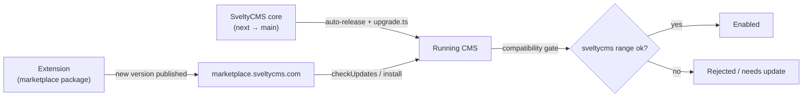

# Extension Lifecycle, Updates & Compatibility

SveltyCMS extensions are moving out of the core repository and onto
**marketplace.sveltycms.com**. This page answers the operational questions that
come with that change:

1. Where does an extension live, and how does it get updated?
2. As the CMS core grows, how does a developer keep an extension working?
3. What stops a bad or outdated extension from crashing the CMS?
4. How does an existing extension get updated and pushed to the marketplace?
5. How do WordPress, Drupal, and Strapi solve the same problem?

Read this before you publish an extension. The detailed, per-kind mechanics live
in the marketplace guides linked at the bottom.

---

## The distribution model is changing

Today, plugins, widgets, dashboard widgets, and themes ship in the SveltyCMS
GitHub monorepo. In future only a **bare-minimum core** stays in Git; everything
else becomes a marketplace download.

| Phase | Scope                                                                                | Status         |
| :---- | :----------------------------------------------------------------------------------- | :------------- |
| **1** | Core widgets stay in the repo (checkbox, input, rich-text, etc.)                     | ✅ Complete    |
| **2** | In-app catalog + custom widgets move toward the marketplace, leaving doc stubs       | 🏗️ In progress |
| **3** | Plugins move to the marketplace; doc stubs remain                                    | 🚀 Planned     |
| **4** | Themes, dashboards, and other extensions become marketplace-only with federated docs | 🏗️ In progress |

The full migration plan, including the doc-stub and federation pattern that keeps
`llms-full.txt` complete during the move, is documented in
[Marketplace System](../reference/architecture/marketplace.mdx).

> [!NOTE]
> "Core" here means the engine, database adapters, admin shell, and the
> foundational field widgets. A capability that is a _product feature of the CMS_
> stays in core; a capability that is a _choice you bolt on_ becomes an extension.

### What stays in Git vs. what moves

| Layer                 | In core Git (long term)                          | Marketplace (long term)                     |
| :-------------------- | :----------------------------------------------- | :------------------------------------------ |
| **Engine**            | `LocalCMS`, `IDBAdapter`, core types             | —                                           |
| **Admin shell**       | Routes, UI kit, Collection Builder               | —                                           |
| **Core widgets**      | `checkbox`, `input`, `rich-text`, `select`, etc. | Custom + premium field widgets              |
| **Plugins**           | Bare plugins required to boot                    | Stripe, PageSpeed, Commerce, importer, etc. |
| **Dashboard widgets** | A minimal first-screen set                       | Analytics, commerce, security cards         |
| **Themes**            | Default admin theme                              | Community + premium themes                  |

This is the same shape as WordPress (tiny core, large directory) and Strapi
(small core, npm plugins): the project keeps release velocity on the engine, and
extensions version independently.

---

## How updates work

There are **two independent update tracks**. Updating one never requires
updating the other, as long as the compatibility ranges below still hold.



### Core updates

Core follows a two-branch model (`next` for development, `main` for production
releases) with an automated release pipeline. Operators update with:

```bash
bun run scripts/upgrade.ts
```

The admin `VersionCheck` badge and `GET /api/system/version/check` surface newer
releases. This is fully covered in
[Version Checking](../guides/configuration/version-channels.mdx).

### Extension updates

An extension update is a **new version of the same package slug** on the
marketplace, published by its author. The CMS checks for newer versions and
installs the update into the same install path it originally used:

```typescript
import { marketplace } from "@src/services/intelligence/marketplace-client";

const updates = await marketplace.checkUpdates([{ id: "redirect-manager", version: "1.0.0" }]);
// → [{ id: "redirect-manager", version: "1.1.0", ... }]
```

Installed extensions are discovered on the next boot and stay **inert until
enabled**, so applying an update never mutates a running plugin mid-request. See
[Marketplace System](../reference/architecture/marketplace.mdx) for install
paths and the install → enable → activate lifecycle.

---

## How developers keep extensions compatible as core grows

The contract between an extension and the CMS is a **declared CMS version range**.
Core guarantees it will check that range before loading the extension; the
extension author guarantees the range is honest.

### Declare a CMS version range

Every portable package must declare `sveltycms` (or `requiresSveltyCMS`):

```typescript
// widget (src/widgets/marketplace/<slug>/index.ts)
export default createWidget({
  Name: "PhoneNumber",
  version: "1.2.0",
  sveltycms: ">=0.0.8", // CMS range this widget supports
  author: "Vendor Name",
  // ...
});
```

```json
{
  "id": "pagespeed",
  "version": "1.2.0",
  "sveltycms": ">=0.0.8",
  "type": "plugin",
  "license": "freemium",
  "price": 19.99
}
```

The range parser supports `*`, exact `x.y.z`, `>=`, `>`, `<=`, `<`, `^`, and `~`
(`src/widgets/widget-compatibility.ts`). On a mismatch, the package is **not
registered** — the CMS refuses the import rather than loading something known to
be incompatible.

### The rules to stay compatible

1. **Version the package with SemVer** — `version: "1.0.0"`. Portable packages
   without it fail validation.
2. **Keep the range honest** — if you only use stable public APIs, keep a broad
   lower bound (`>=0.0.8`). If you adopt a new core API, bump the lower bound to
   the version that introduced it.
3. **Code against the public surface** — `createWidget` (3-pillar: definition,
   input, display) and `definePlugin` (the `PluginPart` union). Do not import
   private `src/` internals that core may move.
4. **Watch the release notes** — core follows Conventional Commits + SemVer. On
   `0.x`, breaking changes land in **minor** releases (SemVer §4); after `1.0` they
   land in **major** releases. A `feat` should never break your extension.
5. **Test against `next`** — the development branch carries upcoming core changes
   before they reach `main`.
6. **Bump on breaking changes** — if core removes an API you used, publish a new
   major of your extension with an updated range. Older extension versions remain
   installable on older cores.

The compatibility gate and the naming invariant (`widgetNameToFolder(Name) ===
folderName`) are shared by `createWidget`, the widget store, and marketplace
install, and they **fail closed** — see [Widget Marketplace](./widgets/marketplace.mdx).

---

## Safeguards: why a broken extension does not crash the CMS

Defense is layered. An extension can fail in several ways, and each failure mode
has a boundary around it.

### 1. Import-time compatibility gate

Before an extension is registered, `validateWidgetImport()` checks identity
(`Name`, `version`) and `satisfiesCmsRange()`. An incompatible or malformed
package is **rejected at import** and logged, never loaded. Invalid marketplace
packages are skipped rather than mounted.

### 2. Plugin sandbox

Plugins run against a **scoped database adapter**, not the raw adapter
(`src/plugins/sandbox.ts`):

- Protected system collections (`users`, `sessions`, `tokens`, `roles`,
  `system_settings`, `private_settings`, `audit_logs`) are always blocked.
- Writes are restricted to `plugin_<pluginId>_`-prefixed collections.
- A per-hook query cap (`MAX_QUERIES_PER_HOOK = 100`) stops runaway queries.

### 3. Hook timeout + error boundary

Plugin lifecycle hooks are wrapped with a timeout and an error boundary:

- `HOOK_TIMEOUT_MS = 5000` — a hung hook is aborted.
- If a hook throws, the error is logged and the CMS continues; `beforeSave`
  returns the original payload instead of crashing the write.

So a plugin that times out or throws degrades to "that plugin did nothing" —
not "the admin is down".

### 4. Inert install + lazy activation

A freshly installed plugin ships with `enabled: false`. It contributes **no
routes, capabilities, or migrations** until an admin enables it. Activation is
lazy and does not require a reboot.

### 5. Widget runtime validation

- `validateSchemaWidgets()` / `validateCollectionForRendering()` detect fields
  whose widget is missing or inactive and report them instead of rendering a
  blank or crashing page.
- `validateLayoutWidgets()` drops invalid dashboard widgets from a saved layout.
- `canSafelyDeactivateWidget()` refuses to deactivate a widget still referenced
  by a collection or layout.

### 6. License gates fail safely

- **Configured key + marketplace unreachable** → **fail-open** (a paying customer
  is not blocked by a network blip).
- **No key + marketplace unreachable** → **fail-closed** once the trial expires
  (an outage cannot be exploited to gain premium access).

See [License Gate Inventory](../reference/security/license-endpoint-inventory.mdx).

### 7. Capability and WASM boundaries

- `definePlugin` requires `requiredCapabilities` on every `route` part — omitted
  capability declarations are a compile-time error.
- The WASM micro-sandbox bounds memory, execution time, and granted capabilities
  for third-party plugin code. See
  [Policy-as-Code & WASM](../reference/security/policy-as-code-and-wasm.mdx).

> [!NOTE]
> A stronger **plugin capability sandbox** (`fs`, `net`, `env`, `collections`
> declared in the manifest and enforced at load) is on the
> [roadmap](../project/roadmap-2026.mdx). The runtime sandbox above already
> enforces collection scoping and query/timeout limits.

---

## Publishing and updating an existing extension

The same workflow covers a first release and an update. An update is just a new
`version` (and, if needed, a new `sveltycms` range) for an existing slug.

### 1. Extract a portable package

```bash
bun run extension:extract plugin pagespeed
bun run extension:extract widget phone-number
```

This exports the extension into a self-contained marketplace package folder with
its runtime code, manifest, and docs.

### 2. Validate against the marketplace spec

```bash
bun run lint:marketplace
```

This verifies every local extension matches the catalog contract (identity,
version, CMS range, naming, required files).

### 3. Bump the version and range

- Increment `version` per SemVer.
- If the new release adopts core APIs, raise the `sveltycms` lower bound.
- Run the package tests (`bun run test:unit`) and `bun run check`.

### 4. Submit to the marketplace

Publish through the developer dashboard or the API:

- `POST /api/packages` — create/update the package metadata.
- `POST /api/upload` — upload the package archive (50 MB max).

The marketplace assigns a license tier and price, hosts the package, and serves
it to installations. An update reuses the existing slug; installations then see
the newer version in `marketplace.checkUpdates()` and the in-app catalog.

### 5. Leave a doc stub if you removed docs from core

When an extension's co-located `.mdx` leaves the repo, leave a redirect stub so
`docs.sveltycms.com` keeps resolving it:

```markdown
---
title: "Remote Video Widget"
redirect: "https://marketplace.sveltycms.com/packages/remote-video"
---

# Remote Video Widget

This widget has moved to the [SveltyCMS Marketplace](https://marketplace.sveltycms.com/packages/remote-video).
```

See the federation pattern in
[Marketplace System](../reference/architecture/marketplace.mdx).

---

## How others do it

This is a distribution-and-update comparison, not a feature ranking. It is based
on publicly available documentation as of **November 2026**; verify current
specifics before relying on them. For the broader feature comparison, see
[Competitive Comparison](../project/competitive-comparison.mdx).

| Concern                       | WordPress                                                          | Drupal                                                                | Strapi                                               | SveltyCMS                                                            |
| :---------------------------- | :----------------------------------------------------------------- | :-------------------------------------------------------------------- | :--------------------------------------------------- | :------------------------------------------------------------------- |
| **Core vs. extensions**       | Tiny core; plugins/themes in the wordpress.org directory           | Core + contrib projects on drupal.org, installed via Composer         | Small core; plugins are npm packages / Strapi Market | Slim core; extensions on marketplace.sveltycms.com                   |
| **Versioning**                | Plugin header `Version`; core uses date-based releases             | Semantic Versioning (`core_version_requirement`)                      | npm SemVer, peer dependency on Strapi version        | SemVer `version` + `sveltycms` range                                 |
| **Compatibility declaration** | `Requires at least` / `Tested up to` headers                       | `core_version_requirement` in `.info.yml`                             | npm `peerDependencies`                               | `sveltycms` / `requiresSveltyCMS` range                              |
| **Install / update channel**  | Admin update check against wordpress.org API; auto-updates         | `composer require` / `drush`; Update module checks drupal.org         | npm install / Strapi Market + CLI                    | `marketplace.checkUpdates()` + in-app install                        |
| **Safety on failure**         | Fatal-error rollback of a failed plugin/theme update (recent core) | Composer lock + site `config`/`vendor` rollback; update status report | npm dependency resolution; plugin lifecycle hooks    | Import-time compatibility gate, sandbox, hook timeout/error boundary |

### WordPress

WordPress keeps a deliberately small core and a centralized plugin/theme
directory. Plugins declare `Requires at least` and `Tested up to` versions, the
admin polls the directory for updates, and recent core releases can
**automatically roll back** a plugin/theme update that triggers a fatal error.
Distribution and review are centralized through wordpress.org.

### Drupal

Drupal contrib modules are Composer packages hosted on drupal.org. A module
declares `core_version_requirement` in its `.info.yml`, and the Update module
compares the installed version against drupal.org. Upgrades flow through
`composer update`, which keeps the dependency graph and lock file consistent.
Core and contrib release on separate cycles.

### Strapi

Strapi plugins are npm packages (historically `strapi-plugin-*`, now distributed
through Strapi Market and the plugin SDK) with a peer dependency on the Strapi
version. Installation and updates use npm, and plugins hook the Strapi
lifecycle. Compatibility is expressed through npm's peer-dependency resolution.

### The SveltyCMS shape

SveltyCMS combines the WordPress idea (central marketplace directory, tiny core)
with the Drupal/npm idea (declared version ranges and lockable updates). The
extra layer is the **import-time compatibility gate and plugin sandbox**: a
declared mismatch is rejected before load, and a runtime failure is contained
rather than propagated to the admin.

---

## Related

- [Marketplace System](../reference/architecture/marketplace.mdx)
- [Version Checking](../guides/configuration/version-channels.mdx)
- [Plugin Marketplace & Monetization](./plugins/marketplace.mdx)
- [Widget Marketplace](./widgets/marketplace.mdx)
- [Dashboard Widget Marketplace](./dashboard/marketplace.mdx)
- [Hybrid Package Model](./package-model.mdx)
- [License Gate Inventory](../reference/security/license-endpoint-inventory.mdx)
- [Policy-as-Code & WASM](../reference/security/policy-as-code-and-wasm.mdx)
- [Competitive Comparison](../project/competitive-comparison.mdx)
- [Roadmap 2026](../project/roadmap-2026.mdx)
