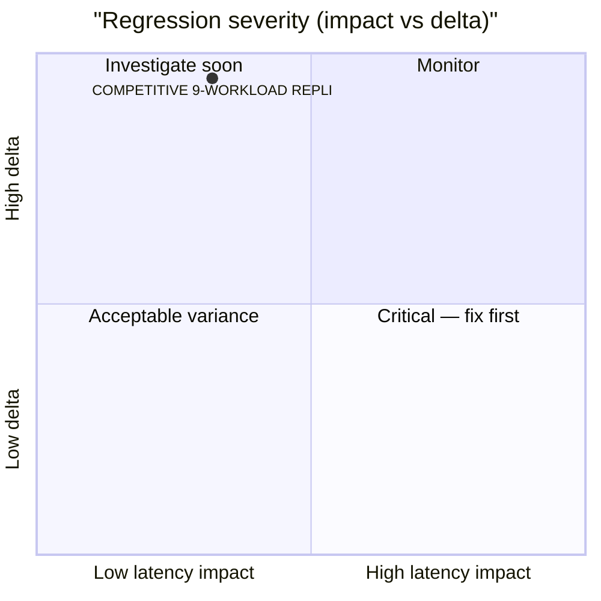

# 🚀 MariaDB Performance Ledger

> [!NOTE] Competitive comparisons based on publicly available documentation as of June 2026. All SveltyCMS metrics self-measured via `bun test tests/benchmarks/`.

> [!IMPORTANT]
> **Console-only by default.** Use `BENCHMARK_RECORD=1` to write results to this report.
>
> ```bash
> BENCHMARK_RECORD=1 bun test tests/benchmarks/auth-performance.test.ts
> ```
>
> The full matrix runner (`bun run scripts/benchmark-matrix/index.ts --sql`) always records.

<!-- BENCHMARK_START -->

<!-- EXECUTIVE_START -->
<!-- LATEST_AUDIT_HEADER -->

## 📊 Latest Performance Audit

<!-- EXECUTIVE_FIX_NOTES_START -->

### 📝 Fix Overlays

> [!NOTE]
> Phase notes and remediation entries appear here after matrix or surgical runs.

<!-- EXECUTIVE_FIX_NOTES_END -->

(21/11/2026, 23:34:47)

**✅ PASS** · 38/44 tests · 6 skipped · **MARIADB** · Bun 1.4.2

### Dimension health

| Dimension      | Tests | Status | Worst Δ | Issues |
| -------------- | ----: | ------ | ------- | ------ |
| **Core**       |    13 | 🟢     | -27%    | 0      |
| **API**        |     9 | 🟢     | —       | 0      |
| **Scale**      |    17 | 🟢     | —       | 0      |
| **Resilience** |     5 | 🟢     | —       | 0      |

### Issues (action required)

> ✅ **All clear** — no regressions or budget violations detected.

### Executive latency matrix

| Scenario               | Latency | Trend  | Budget   | Result |
| ---------------------- | ------- | ------ | -------- | ------ |
| **Cold Start**         | N/A     | ⚪ (—) | < 5000ms | ⚪ N/A |
| **REST (Collections)** | N/A     | ⚪ (—) | < 5ms    | ⚪ N/A |
| **Middleware Hooks**   | N/A     | ⚪     | < 2ms    | ⚪ N/A |
| **GraphQL (Avg)**      | N/A     | ⚪ (—) | < 5ms    | ⚪ N/A |
| **Million-Row Index**  | N/A     | ⚪     | < 250ms  | ⚪ N/A |
| **DB Raw (p95)**       | N/A     | ⚪     | < 50ms   | ⚪ N/A |

### Historical pulse

> **Scope:** Sparklines only — full run tables: [`tests/benchmarks/results/history.sqlite`](../../../tests/benchmarks/results/history.sqlite)

| Metric | Trend | Sparkline | Latest |
| ------ | ----- | --------- | ------ |

<details>
<summary>📈 Latency trend chart (last 10 runs)</summary>

```mermaid
xychart-beta
  title "MARIADB REST p95 (last 10 runs)"
  x-axis ["R1", "R2", "R3", "R4", "R5", "R6", "R7", "R8", "R9", "R10"]
  y-axis "Latency (ms)"
  line "p95" : [0.000, 0.000, 0.000, 0.000, 0.000, 0.000, 0.000, 0.000, 0.000, 0.000]
```

</details>
<details>
<summary>📊 Regression severity matrix (quadrant)</summary>



</details>

<!-- EXECUTIVE_PARTIAL_WATERMARK -->

> 📋 **Partial report** — run full matrix for complete cross-DB analysis.

<!-- EXECUTIVE_ALERTS_START -->

> 📋 **Partial report** — run full matrix for complete cross-DB analysis.

### 🔴 Top Regressions

> **🔴 truth-latency [Local SDK (Full)]** (mariadb): +100% | 0.01ms vs 0.01ms baseline
> **🔴 rest-api-performance [Collection Find (List Limit 20)]** (mariadb): +86% | 0.23ms vs 0.12ms baseline
> **🔴 rest-api-performance [Collection Search Query]** (mariadb): +79% | 0.23ms vs 0.13ms baseline
> **🔴 hooks-performance [REST with API Caching]** (mariadb): +44% | 0.15ms vs 0.10ms baseline
> **🔴 truth-latency [HTTP End-to-End]** (mariadb): +27% | 0.15ms vs 0.12ms baseline

### 🟢 Top Improvements

> **database-performance [UPDATE]** (mariadb): -19% | 0.66ms vs 0.82ms baseline
> **transaction-acid [TX Commit]** (mariadb): -18% | 0.57ms vs 0.70ms baseline
> **transaction-acid [TX Rollback Integrity]** (mariadb): -18% | 0.90ms vs 1.10ms baseline
> **virtual-query-federation [Virtual Read Passthrough (mock REST)]** (mariadb): -11% | 0.05ms vs 0.06ms baseline
> **hooks-performance [Static Asset (No Middleware)]** (mariadb): -11% | 0.94ms vs 1.05ms baseline

<!-- EXECUTIVE_ALERTS_END --><!-- EXECUTIVE_END -->

<!-- SUMMARY_START -->
<!-- SUMMARY_RUN_OVERLAY_START -->

### Current Run Summary (2026-11-21)

> **Scope:** Only tests that ran in THIS invocation.

**Run ID:** `569d253e-95f1-42f1-845c-2ed5f1f3e5e0` · **Tests invoked:** 7 · **Metrics:** 40 · **DB:** mariadb

| Test                     | Metric                                         | Avg (ms) | p95 (ms) | RPS    | Trend | Detail                            |
| ------------------------ | ---------------------------------------------- | -------- | -------- | ------ | ----- | --------------------------------- |
| Cache Performance        | Cache Miss (Bypass)                            | 0.643    | 0.798    | 1509   | 🟢    | ⚪ established at 0.643ms (1 run) |
| Cache Performance        | Cache Hit (L1 Warm)                            | 0.120    | 0.196    | 7736   | 🟢    | ⚪ established at 0.120ms (1 run) |
| Database Performance     | INSERT                                         | 0.485    | 0.731    | 1897   | 🟢    | ⚪ established at 0.485ms (1 run) |
| Database Performance     | FIND ONE                                       | 0.345    | 0.459    | 2781   | 🟢    | ⚪ established at 0.345ms (1 run) |
| Database Performance     | FIND MANY (limit 50)                           | 0.526    | 0.677    | 1831   | 🟢    | ⚪ established at 0.526ms (1 run) |
| Database Performance     | FILTER (blob field, 1 match)                   | 1.713    | 1.940    | 576    | 🟢    | ⚪ established at 1.71ms (1 run)  |
| Database Performance     | QUERY BUILDER LIST (50)                        | 0.518    | 0.666    | 1873   | 🟢    | ⚪ established at 0.518ms (1 run) |
| Database Performance     | FIND PAGE (50 hasMore)                         | 0.534    | 0.691    | 1775   | 🟢    | ⚪ established at 0.534ms (1 run) |
| Database Performance     | FIND PAGE keyset                               | 0.552    | 0.748    | 1733   | 🟢    | ⚪ established at 0.552ms (1 run) |
| Database Performance     | FIND MANY offset 50                            | 0.465    | 0.584    | 2077   | 🟢    | ⚪ established at 0.465ms (1 run) |
| Database Performance     | LIST+COUNT (legacy)                            | 0.635    | 0.798    | 1470   | 🟢    | ⚪ established at 0.635ms (1 run) |
| Database Performance     | UPDATE                                         | 0.664    | 0.848    | 1467   | 🟢    | ⚪ established at 0.664ms (1 run) |
| Database Performance     | UPDATE (no-returning)                          | 0.328    | 0.435    | 2952   | 🟢    | ⚪ established at 0.328ms (1 run) |
| Database Performance     | NATIVE UPSERT                                  | 0.360    | 0.478    | 2589   | 🟢    | ⚪ established at 0.360ms (1 run) |
| Database Performance     | COUNT                                          | 0.538    | 0.703    | 1763   | 🟢    | ⚪ established at 0.538ms (1 run) |
| Database Performance     | COUNT ESTIMATE                                 | 0.308    | 0.415    | 3117   | 🟢    | ⚪ established at 0.308ms (1 run) |
| Database Performance     | COUNT CACHED                                   | 0.001    | 0.002    | 692713 | 🟢    | ⚪ established at 0.001ms (1 run) |
| Database Performance     | DELETE (Active Rows)                           | 0.411    | 0.533    | 2253   | 🟢    | ⚪ established at 0.411ms (1 run) |
| Database Performance     | BULK INSERT (100)                              | 1.855    | 2.198    | 525    | 🟢    | ⚪ established at 1.85ms (1 run)  |
| Database Performance     | BULK UPDATE (100 heterogeneous)                | 2.846    | 3.648    | 333    | 🟢    | ⚪ established at 2.85ms (1 run)  |
| Database Performance     | BULK UPDATE (100 homogeneous)                  | 2.168    | 2.553    | 448    | 🟢    | ⚪ established at 2.17ms (1 run)  |
| Hooks Performance        | Static Asset (No Middleware)                   | 0.935    | 1.701    | 3847   | 🟢    | ⚪ established at 0.935ms (1 run) |
| Hooks Performance        | Turbo Pipeline (Light)                         | 0.529    | 0.910    | 6907   | 🟢    | ⚪ established at 0.529ms (1 run) |
| Hooks Performance        | Full Security + Auth Pipeline                  | 0.105    | 0.231    | 32675  | 🟢    | ⚪ established at 0.105ms (1 run) |
| Hooks Performance        | REST with API Caching                          | 0.151    | 0.271    | 23723  | 🟢    | ⚪ established at 0.151ms (1 run) |
| Hooks Performance        | Mutation (audit logging disabled)              | 0.940    | 1.101    | 1030   | 🟢    | ⚪ established at 0.940ms (1 run) |
| Rest Api Performance     | System Health Check                            | 0.500    | 0.739    | 7639   | 🟢    | ⚪ established at 0.500ms (1 run) |
| Rest Api Performance     | Collection Schema Metadata                     | 0.129    | 0.260    | 26569  | 🟢    | ⚪ established at 0.129ms (1 run) |
| Rest Api Performance     | Single Document Read                           | 0.145    | 0.292    | 25629  | 🟢    | ⚪ established at 0.145ms (1 run) |
| Rest Api Performance     | Collection Find (List Limit 20)                | 0.225    | 0.405    | 16633  | 🟢    | ⚪ established at 0.225ms (1 run) |
| Rest Api Performance     | Collection Search Query                        | 0.234    | 0.546    | 14709  | 🟢    | ⚪ established at 0.234ms (1 run) |
| Transaction Acid         | TX Commit                                      | 0.569    | 0.947    | 6296   | 🟢    | ⚪ established at 0.569ms (1 run) |
| Transaction Acid         | TX Rollback Integrity                          | 0.901    | 1.149    | 1106   | 🟢    | ⚪ established at 0.901ms (1 run) |
| Truth Latency            | Logic Baseline                                 | 0.000    | 0.000    | 632911 | 🟢    | ⚪ established at 0ms (1 run)     |
| Truth Latency            | Local SDK (Full)                               | 0.012    | 0.028    | 1860   | 🟢    | ⚪ established at 0.012ms (1 run) |
| Truth Latency            | HTTP End-to-End                                | 0.147    | 0.321    | 6730   | 🟢    | ⚪ established at 0.147ms (1 run) |
| Truth Latency            | HTTP Cold (Cache-Busted)                       | 0.725    | 0.948    | 1376   | 🟢    | ⚪ established at 0.725ms (1 run) |
| Virtual Query Federation | Virtual Read Passthrough (live Postgres)       | 3.149    | 3.829    | 317    | 🟢    | ⚪ established at 3.15ms (1 run)  |
| Virtual Query Federation | Virtual Read Passthrough (live WordPress REST) | 0.251    | 0.398    | 3945   | 🟢    | ⚪ established at 0.251ms (1 run) |
| Virtual Query Federation | Virtual Read Passthrough (mock REST)           | 0.054    | 0.079    | 18218  | 🟢    | ⚪ established at 0.054ms (1 run) |

<!-- SUMMARY_RUN_OVERLAY_END -->

<!-- SUMMARY_HISTORY_START -->

### Historical Trends (2026-11-21)

> **Mode:** production-parity matrix runs only (`run_mode='matrix'` + `server_mode='production'` — `NODE_ENV=production`, no `TEST_MODE`). Standalone/mode-variant samples are recorded but never trended here.

> **Scope:** Sparklines only — full run tables live in `history.sqlite` (link below). Runs = sparkline bar count.

**Detail:** [`tests/benchmarks/results/history.sqlite`](../../../tests/benchmarks/results/history.sqlite) · `SELECT test_id, phase, server_mode, avg_ms, p95_ms, rps, timestamp FROM runs WHERE db_type='mariadb' AND redis=0 ORDER BY timestamp DESC`

**Series:** 8 · **DB:** mariadb

| Metric                              | Trend | Sparkline (last 7) | Latest  |
| ----------------------------------- | ----- | ------------------ | ------- |
| CACHE PERFORMANCE (warm)            | 🟢    | `▁█`               | 0.120ms |
| COMPETITIVE WORKLOAD REPLICA (warm) | 🟢    | `█▄▁`              | 0.320ms |
| DATABASE PERFORMANCE (warm)         | 🟢    | `▁█`               | 0.345ms |
| HOOKS PERFORMANCE (warm)            | 🟢    | `▁█`               | 0.105ms |
| REST API PERFORMANCE (warm)         | 🟢    | `▁█`               | 0.145ms |
| TRANSACTION ACID (warm)             | 🟢    | `█▁`               | 0.569ms |
| TRUTH LATENCY (warm)                | 🟢    | `█▁`               | 0.725ms |
| VIRTUAL QUERY FEDERATION (warm)     | 🟢    | `█▁`               | 3.149ms |

<!-- SUMMARY_HISTORY_END --><!-- SUMMARY_END -->

<details>
<summary>📊 Infrastructure drill-down (expand for adapter, hooks, memory trends)</summary>

## 📊 Infrastructure drill-down

### 🏷️ Mixed Workload Performance {#mixedAvg}

**Mixed p95:** — (not measured in this run) | **Trend:** ⚪ (—)

> Production request mix: 60% Reads, 20% Writes, 15% GraphQL, 5% Media.

### 🏷️ Database Adapter Performance {#dbRaw}

**Raw Adapter p95:** — (not measured in this run) | **Target:** < 50ms | **Trend:** ⚪ (—)

> Direct database access latency (bypass CMS logic).

### 🏷️ Middleware & Hooks Audit {#hooks}

**Middleware p95:** — (not measured in this run) | **Target:** < 2ms | **Trend:** ⚪ (—)

> Total overhead of security, logging, and auth hooks.

### 🏷️ Memory Stability Audit {#memGrowth}

**Memory RSS Δ:** — (not measured in this run) | **Target:** < 60MB | **Trend:** ⚪ (—)

> Peak memory growth during stress workload.

### Enterprise scale audit

### 🏷️ Multi-Tenancy Performance {#tenancyAvg}

**Tenancy p95:** — (not measured in this run) | **Trend:** ⚪ (—)

> Measures latency across tenant isolation boundaries.

### 🏷️ Relational Resolver Latency {#relationalAvg}

**Relational p95:** — (not measured in this run) | **Trend:** ⚪ (—)

> Tests performance of complex JOINs and nested relationship population.

### 🏷️ Telemetry & Update Performance {#telemetryAvg}

**Telemetry p95:** — (not measured in this run) | **Trend:** ⚪ (—)

> Measures overhead of telemetry collection and cryptographic signing.

</details>

<!-- LEDGER_START -->

## 🔬 Full benchmark ledger (41 modules)

Expand dimension groups, then any row, for ASCII truth tables. Executive summary above shows pass/fail and issues only.

<!-- LEDGER_DIMENSION:CORE:START -->

<details id="ledger-dimension-core">
<summary><strong>Core</strong> · 28 tests</summary>

<!-- SECTION:API_LATENCY:START -->
<details id="section-api_latency">
<summary><strong>🏷️ API LAYER LATENCY</strong> · ⚪ ⏳ pending · ➡️ — · <a href="../../../tests/benchmarks/api-latency.test.ts">source</a></summary>
<!-- LEDGER_TRUTH_START -->
```text
╔═══════════════════════════════════════════════════════════════════════════════════════════════════════╗
║                                     SVELTYCMS — API LAYER LATENCY                                     ║
║                              File: tests/benchmarks/api-latency.test.ts                               ║
║                                       Ran: 2026-10-06 10:46:41                                        ║
║              Cold full-pipeline findById + warm TURBO-HIT path after responseCache fill.              ║
╠═══════════════════════════════════════════════════════════════════════════════════════════════════════╣
║ HTTP: findById @ 8c (Cold)   │ Cold:     2.53 ms │ Warm:     2.601 ms │ p95:     3.252 ms │   2,997 RPS ║
║ HTTP: findById TURBO-HIT @ 8c (Warm) │ Cold:     0.45 ms │ Warm:     0.896 ms │ p95:     1.318 ms │   8,538 RPS ║
║ HTTP: zstd large GET (>64KiB, drained) │ Cold:     2.43 ms │ Warm:     3.604 ms │ p95:     5.131 ms │     503 RPS ║
║ HTTP: findById TURBO-HIT idle (Warm) │        0.203 ms │ p95:        0.269 ms │ RPS:      4,880 ║
║ HTTP: findById TURBO-HIT during zstd (Warm) │        0.277 ms │ p95:        0.478 ms │ RPS:      3,321 ║
╚═══════════════════════════════════════════════════════════════════════════════════════════════════════╝
```
<!-- LEDGER_TRUTH_END -->

</details>
<!-- SECTION:API_LATENCY:END -->

<!-- SECTION:COLD_START:START -->
<details id="section-cold_start">
<summary><strong>🏷️ PHASED COLD START</strong> · ⚪ ⏳ pending · ➡️ — · <a href="../../../tests/benchmarks/cold-start-phased.test.ts">source</a></summary>
<!-- LEDGER_TRUTH_START -->
```text
╔═══════════════════════════════════════════════════════════════════════════════════════════════════════╗
║                                  SVELTYCMS — PHASED COLD START AUDIT                                  ║
║                           File: tests/benchmarks/cold-start-phased.test.ts                            ║
║                                       Ran: 2026-09-18 18:18:21                                        ║
║            Measures process spawn, dependency hydration, and first-request TTFB readiness.            ║
╠═══════════════════════════════════════════════════════════════════════════════════════════════════════╣
║ Initial Cold Boot (Fresh Process) │     2328.690 ms │ p95:     2328.690 ms │ RPS:          0 ║
║ Steady-State Respawn (Average) │     1573.369 ms │ p95:     2328.690 ms │ RPS:          0 ║
╚═══════════════════════════════════════════════════════════════════════════════════════════════════════╝
```
<!-- LEDGER_TRUTH_END -->

</details>
<!-- SECTION:COLD_START:END -->

<!-- SECTION:TRUTH_AUDIT:START -->
<details id="section-truth_audit">
<summary><strong>🏷️ SRE TRUTH AUDIT</strong> · ⚪ 0.725ms · ➡️ — · <a href="../../../tests/benchmarks/truth-latency.test.ts">source</a></summary>
<!-- LEDGER_TRUTH_START -->
```text
╔═══════════════════════════════════════════════════════════════════════════════════════════════════════╗
║                                      SVELTYCMS — SRE TRUTH AUDIT                                      ║
║                             File: tests/benchmarks/truth-latency.test.ts                              ║
║                                       Ran: 2026-11-21 22:33:40                                        ║
║            Validates performance claims by comparing SDK, Middleware, and Real HTTP Stack             ║
╠═══════════════════════════════════════════════════════════════════════════════════════════════════════╣
║ Logic Baseline               │ Cold:     0.01 ms │ Warm:     0.000 ms │ p95:     0.000 ms │ 632,911 RPS ║
║ Local SDK (Full)             │ Cold:   121.57 ms │ Warm:     0.012 ms │ p95:     0.028 ms │   1,860 RPS ║
║ HTTP End-to-End              │ Cold:     5.63 ms │ Warm:     0.147 ms │ p95:     0.321 ms │   6,730 RPS ║
║ HTTP Cold (Cache-Busted)     │ Cold:     4.03 ms │ Warm:     0.725 ms │ p95:     0.948 ms │   1,376 RPS ║
╚═══════════════════════════════════════════════════════════════════════════════════════════════════════╝
```
<!-- LEDGER_TRUTH_END -->

</details>
<!-- SECTION:TRUTH_AUDIT:END -->

<!-- SECTION:INCREMENTAL:START -->
<details id="section-incremental">
<summary><strong>🏷️ Incremental Content Reload</strong> · ⚪ ⏳ pending · ➡️ — · <a href="../../../tests/benchmarks/content-incremental-reload.test.ts">source</a></summary>
<!-- LEDGER_TRUTH_START -->
```text
╔═══════════════════════════════════════════════════════════════════════════════════════════════════════╗
║                             SVELTYCMS — INCREMENTAL CONTENT RELOAD AUDIT                              ║
║                       File: tests/benchmarks/content-incremental-reload.test.ts                       ║
║                                       Ran: 2026-10-06 09:30:32                                        ║
║      Measures surgical single-file fullReload vs full reconciliation path and batch processing.       ║
╠═══════════════════════════════════════════════════════════════════════════════════════════════════════╣
║ Incremental fullReload (1 file) │ Cold:     4.84 ms │ Warm:     0.066 ms │ p95:     0.121 ms │  13,745 RPS ║
║ Full Reconciliation Reload   │ Cold:     2.74 ms │ Warm:     0.191 ms │ p95:     0.256 ms │   5,195 RPS ║
║ Sequential 10-File Reload    │ Cold:     6.04 ms │ Warm:     0.801 ms │ p95:     1.193 ms │   1,244 RPS ║
║ Batched 10-File Reload       │ Cold:     1.50 ms │ Warm:     0.231 ms │ p95:     0.389 ms │   3,932 RPS ║
╚═══════════════════════════════════════════════════════════════════════════════════════════════════════╝
```
<!-- LEDGER_TRUTH_END -->

</details>
<!-- SECTION:INCREMENTAL:END -->

<!-- SECTION:HOOKS_TRACE:START -->
<details id="section-hooks_trace">
<summary><strong>🏷️ Middleware & Hooks Performance</strong> · ⚪ 0.105ms · ➡️ — · <a href="../../../tests/benchmarks/hooks-performance.test.ts">source</a></summary>
<!-- LEDGER_TRUTH_START -->
```text
╔═══════════════════════════════════════════════════════════════════════════════════════════════════════╗
║                                 SVELTYCMS — MIDDLEWARE & HOOKS AUDIT                                  ║
║                           File: tests/benchmarks/hooks-performance.test.ts                            ║
║                                       Ran: 2026-11-21 22:33:59                                        ║
║Measures the cost of the full middleware chain including Turbo, Security, Auth, and Audit via HTTP E2E.║
╠═══════════════════════════════════════════════════════════════════════════════════════════════════════╣
║ Static Asset (No Middleware) │ Cold:     2.68 ms │ Warm:     0.935 ms │ p95:     1.701 ms │   3,847 RPS ║
║ Turbo Pipeline (Light)       │ Cold:     0.47 ms │ Warm:     0.529 ms │ p95:     0.910 ms │   6,907 RPS ║
║ Full Security + Auth Pipeline │ Cold:     0.47 ms │ Warm:     0.105 ms │ p95:     0.231 ms │  32,675 RPS ║
║ REST with API Caching        │ Cold:     3.23 ms │ Warm:     0.151 ms │ p95:     0.271 ms │  23,723 RPS ║
║ Mutation (audit logging disabled) │ Cold:     3.41 ms │ Warm:     0.940 ms │ p95:     1.101 ms │   1,030 RPS ║
╚═══════════════════════════════════════════════════════════════════════════════════════════════════════╝
```
<!-- LEDGER_TRUTH_END -->

</details>
<!-- SECTION:HOOKS_TRACE:END -->

<!-- SECTION:STATE_MACHINE:START -->
<details id="section-state_machine">
<summary><strong>🏷️ State Machine Transitions</strong> · ⚪ ⏳ pending · ➡️ — · <a href="../../../tests/benchmarks/state-machine-transition.test.ts">source</a></summary>
<!-- LEDGER_TRUTH_START -->
```text
╔═══════════════════════════════════════════════════════════════════════════════════════════════════════╗
║                                  SVELTYCMS — STATE MACHINE INTEGRITY                                  ║
║                        File: tests/benchmarks/state-machine-transition.test.ts                        ║
║                                       Ran: 2026-10-06 09:30:40                                        ║
║Measures state machine self-healing transition latencies, convergence settling time, and health probe consistency under stress.║
╠═══════════════════════════════════════════════════════════════════════════════════════════════════════╣
║ State Transition (Transient) │ Cold:    78.95 ms │ Warm:    49.378 ms │ p95:    63.072 ms │      20 RPS ║
║ Self-Healing Full Convergence │ Cold:    51.69 ms │ Warm:    48.446 ms │ p95:    54.433 ms │      21 RPS ║
╚═══════════════════════════════════════════════════════════════════════════════════════════════════════╝
```
<!-- LEDGER_TRUTH_END -->

</details>
<!-- SECTION:STATE_MACHINE:END -->

<!-- SECTION:DB_RAW_P95:START -->
<details id="section-db_raw_p95">
<summary><strong>🏷️ Database Adapter Raw CRUD</strong> · ⚪ 0.345ms · ➡️ — · <a href="../../../tests/benchmarks/database-performance.test.ts">source</a></summary>
<!-- LEDGER_TRUTH_START -->
```text
╔═══════════════════════════════════════════════════════════════════════════════════════════════════════╗
║                          SVELTYCMS — DATABASE ADAPTER PERFORMANCE (MARIADB)                           ║
║                          File: tests/benchmarks/database-performance.test.ts                          ║
║                                       Ran: 2026-11-21 22:34:44                                        ║
║          Measures raw CRUD performance, indexing efficiency, and connection pool resilience.          ║
╠═══════════════════════════════════════════════════════════════════════════════════════════════════════╣
║ INSERT                       │ Cold:     1.70 ms │ Warm:     0.485 ms │ p95:     0.731 ms │   1,897 RPS ║
║ FIND ONE                     │ Cold:     1.66 ms │ Warm:     0.345 ms │ p95:     0.459 ms │   2,781 RPS ║
║ FIND MANY (limit 50)         │ Cold:    46.91 ms │ Warm:     0.526 ms │ p95:     0.677 ms │   1,831 RPS ║
║ FILTER (blob field, 1 match) │ Cold:     4.25 ms │ Warm:     1.713 ms │ p95:     1.940 ms │     576 RPS ║
║ QUERY BUILDER LIST (50)      │ Cold:     2.95 ms │ Warm:     0.518 ms │ p95:     0.666 ms │   1,873 RPS ║
║ FIND PAGE (50 hasMore)       │ Cold:     3.64 ms │ Warm:     0.534 ms │ p95:     0.691 ms │   1,775 RPS ║
║ FIND PAGE keyset             │ Cold:     4.16 ms │ Warm:     0.552 ms │ p95:     0.748 ms │   1,733 RPS ║
║ FIND MANY offset 50          │ Cold:     2.32 ms │ Warm:     0.465 ms │ p95:     0.584 ms │   2,077 RPS ║
║ LIST+COUNT (legacy)          │ Cold:     2.56 ms │ Warm:     0.635 ms │ p95:     0.798 ms │   1,470 RPS ║
║ UPDATE                       │ Cold:     3.83 ms │ Warm:     0.664 ms │ p95:     0.848 ms │   1,467 RPS ║
║ UPDATE (no-returning)        │ Cold:     1.73 ms │ Warm:     0.328 ms │ p95:     0.435 ms │   2,952 RPS ║
║ NATIVE UPSERT                │ Cold:     2.10 ms │ Warm:     0.360 ms │ p95:     0.478 ms │   2,589 RPS ║
║ COUNT                        │ Cold:     2.34 ms │ Warm:     0.538 ms │ p95:     0.703 ms │   1,763 RPS ║
║ COUNT ESTIMATE               │ Cold:     1.72 ms │ Warm:     0.308 ms │ p95:     0.415 ms │   3,117 RPS ║
║ COUNT CACHED                 │ Cold:     3.06 ms │ Warm:     0.001 ms │ p95:     0.002 ms │ 692,713 RPS ║
║ DELETE (Active Rows)         │ Cold:    19.05 ms │ Warm:     0.411 ms │ p95:     0.533 ms │   2,253 RPS ║
║ BULK INSERT (100)            │ Cold:     4.58 ms │ Warm:     1.855 ms │ p95:     2.198 ms │     525 RPS ║
║ BULK UPDATE (100 heterogeneous) │ Cold:    23.29 ms │ Warm:     2.846 ms │ p95:     3.648 ms │     333 RPS ║
║ BULK UPDATE (100 homogeneous) │ Cold:     7.92 ms │ Warm:     2.168 ms │ p95:     2.553 ms │     448 RPS ║
╚═══════════════════════════════════════════════════════════════════════════════════════════════════════╝
```
<!-- LEDGER_TRUTH_END -->

</details>
<!-- SECTION:DB_RAW_P95:END -->

<!-- SECTION:ACID:START -->
<details id="section-acid">
<summary><strong>🏷️ ACID Transaction Overhead</strong> · ⚪ 0.569ms · ➡️ — · <a href="../../../tests/benchmarks/transaction-acid.test.ts">source</a></summary>
<!-- LEDGER_TRUTH_START -->
```text
╔═══════════════════════════════════════════════════════════════════════════════════════════════════════╗
║                                   SVELTYCMS — ACID INTEGRITY AUDIT                                    ║
║                            File: tests/benchmarks/transaction-acid.test.ts                            ║
║                                       Ran: 2026-11-21 22:34:47                                        ║
║         Measures transaction commit latencies and rollback overhead across database adapters          ║
╠═══════════════════════════════════════════════════════════════════════════════════════════════════════╣
║ TX Commit                    │ Cold:     2.44 ms │ Warm:     0.569 ms │ p95:     0.947 ms │   6,296 RPS ║
║ TX Rollback Integrity        │ Cold:     3.58 ms │ Warm:     0.901 ms │ p95:     1.149 ms │   1,106 RPS ║
╚═══════════════════════════════════════════════════════════════════════════════════════════════════════╝
```
<!-- LEDGER_TRUTH_END -->

</details>
<!-- SECTION:ACID:END -->

<!-- SECTION:CACHE:START -->
<details id="section-cache">
<summary><strong>🏷️ System Cache Efficiency</strong> · ⚪ 0.120ms · ➡️ — · <a href="../../../tests/benchmarks/cache-performance.test.ts">source</a></summary>
<!-- LEDGER_TRUTH_START -->
```text
╔═══════════════════════════════════════════════════════════════════════════════════════════════════════╗
║                                  SVELTYCMS — CACHE EFFICIENCY AUDIT                                   ║
║                           File: tests/benchmarks/cache-performance.test.ts                            ║
║                                       Ran: 2026-11-21 22:33:54                                        ║
║         Measures cache hit vs miss latency and efficiency via real HTTP end-to-end requests.          ║
╠═══════════════════════════════════════════════════════════════════════════════════════════════════════╣
║ Cache Miss (Bypass)          │ Cold:     3.71 ms │ Warm:     0.643 ms │ p95:     0.798 ms │   1,509 RPS ║
║ Cache Hit (L1 Warm)          │ Cold:     1.24 ms │ Warm:     0.120 ms │ p95:     0.196 ms │   7,736 RPS ║
╚═══════════════════════════════════════════════════════════════════════════════════════════════════════╝
```
<!-- LEDGER_TRUTH_END -->

</details>
<!-- SECTION:CACHE:END -->

<!-- SECTION:CACHE_EFFICIENCY:START -->
<details id="section-cache_efficiency">
<summary><strong>🏷️ Cache Hit/Miss Ratio & Efficiency</strong> · ⚪ ⏳ pending · ➡️ — · <a href="../../../tests/benchmarks/cache-hit-ratio.test.ts">source</a></summary>
<!-- LEDGER_TRUTH_START -->
```text
╔═══════════════════════════════════════════════════════════════════════════════════════════════════════╗
║                                  SVELTYCMS — CACHE EFFICIENCY AUDIT                                   ║
║                           File: tests/benchmarks/cache-performance.test.ts                            ║
║                                       Ran: 2026-11-21 22:33:54                                        ║
║         Measures cache hit vs miss latency and efficiency via real HTTP end-to-end requests.          ║
╠═══════════════════════════════════════════════════════════════════════════════════════════════════════╣
║ Cache Miss (Bypass)          │ Cold:     3.71 ms │ Warm:     0.643 ms │ p95:     0.798 ms │   1,509 RPS ║
║ Cache Hit (L1 Warm)          │ Cold:     1.24 ms │ Warm:     0.120 ms │ p95:     0.196 ms │   7,736 RPS ║
╚═══════════════════════════════════════════════════════════════════════════════════════════════════════╝
```
<!-- LEDGER_TRUTH_END -->

</details>
<!-- SECTION:CACHE_EFFICIENCY:END -->

<!-- SECTION:UNKNOWN:START -->
<details id="section-unknown">
<summary><strong>🏷️ unknown</strong> · 🟢 0.002ms · ➡️ recorded (awaiting trend) · <a href="../../../tests/benchmarks/transaction-acid.test.ts">source</a></summary>
<!-- LEDGER_TRUTH_START -->
```text
╔═════════════════════════════════════════════════════════════════════════════════════════╗
║                      SVELTYCMS — CACHE EVICTION BOUNDARY HARDENING                      ║
║                                      File: unknown                                      ║
║                                Ran: 2026-08-23 22:39:30                                 ║
╠═════════════════════════════════════════════════════════════════════════════════════════╣
║ Cache Flooding & Eviction      │        0.002 ms │ p95:        0.002 ms │ RPS:    460,599 ║
╚═════════════════════════════════════════════════════════════════════════════════════════╝
```
<!-- LEDGER_TRUTH_END -->

</details>
<!-- SECTION:UNKNOWN:END -->

<!-- SECTION:LOGIC:START -->
<details id="section-logic">
<summary><strong>🏷️ Logic</strong> · 🟢 ⏳ pending · ➡️ ⚪ stable at 0ms (7 runs) (2026-09-18 18:18:35) · <a href="../../../tests/benchmarks/truth-latency.test.ts">source</a></summary>
<!-- LEDGER_TRUTH_START -->
> ⏳ Pending
<!-- LEDGER_TRUTH_END -->

</details>
<!-- SECTION:LOGIC:END -->

<!-- SECTION:SDK:START -->
<details id="section-sdk">
<summary><strong>🏷️ SDK</strong> · 🟢 0.445ms · ➡️ recorded (awaiting trend) · <a href="../../../tests/benchmarks/truth-latency.test.ts">source</a></summary>
<!-- LEDGER_TRUTH_START -->
```text
╔═══════════════════════════════════════════════════════════════════════════════════════════════════════╗
║                              SVELTYCMS — SDK VS DIRECT ADAPTER (MARIADB)                              ║
║                          File: tests/benchmarks/local-sdk-vs-direct.test.ts                           ║
║                                       Ran: 2026-10-06 10:53:47                                        ║
║Measures the exact SDK tax across Create, Find, and Update pathways with isolated GC sweeps and zero-allocation key pools.║
╠═══════════════════════════════════════════════════════════════════════════════════════════════════════╣
║ Direct insert                  │        0.445 ms │ p95:        0.445 ms │ RPS:      2,246 ║
║ SDK create (full)              │        0.539 ms │ p95:        0.539 ms │ RPS:      1,856 ║
║ Direct findOne                 │        0.383 ms │ p95:        0.383 ms │ RPS:      2,610 ║
║ SDK find (bypassCache)         │        0.888 ms │ p95:        0.888 ms │ RPS:      1,126 ║
║ Direct update                  │        0.836 ms │ p95:        0.836 ms │ RPS:      1,196 ║
║ SDK update (full)              │        1.308 ms │ p95:        1.308 ms │ RPS:          0 ║
║ SDK create (detached)          │        0.377 ms │ p95:        0.377 ms │ RPS:      2,652 ║
║ SDK update (detached)          │        1.270 ms │ p95:        1.270 ms │ RPS:          0 ║
╚═══════════════════════════════════════════════════════════════════════════════════════════════════════╝
```
<!-- LEDGER_TRUTH_END -->

</details>
<!-- SECTION:SDK:END -->

<!-- SECTION:HTTP:START -->
<details id="section-http">
<summary><strong>🏷️ HTTP</strong> · 🟢 0.431ms · ↘️ ⚪ stable at 0.465ms (±0.127ms) (7 runs) (2026-09-18 18:18:35) · <a href="../../../tests/benchmarks/truth-latency.test.ts">source</a></summary>
<!-- LEDGER_INSIGHT_START -->
> [!NOTE]
> **Specific to this test**: Performance improved — recent optimizations or cache warming likely effective.
<!-- LEDGER_INSIGHT_END -->

<!-- LEDGER_TRUTH_START -->

> ⏳ Pending

<!-- LEDGER_TRUTH_END -->

</details>
<!-- SECTION:HTTP:END -->

<!-- SECTION:MIDDLEWARE:START -->
<details id="section-middleware">
<summary><strong>🏷️ Middleware</strong> · 🟢 2.589ms · ➡️ ⚪ established at 2.59ms (1 run) (2026-09-30 15:24:57) · <a href="../../../tests/benchmarks/hooks-performance.test.ts">source</a></summary>
<!-- LEDGER_TRUTH_START -->
> ⏳ Pending
<!-- LEDGER_TRUTH_END -->

</details>
<!-- SECTION:MIDDLEWARE:END -->

<!-- SECTION:SYSTEM:START -->
<details id="section-system">
<summary><strong>🏷️ System</strong> · 🟢 0.421ms · ↘️ ⚪ stable at 0.483ms (±0.059ms) (2 runs) (2026-09-18 18:20:41) · <a href="../../../tests/benchmarks/rest-api-performance.test.ts">source</a></summary>
<!-- LEDGER_INSIGHT_START -->
> [!NOTE]
> **Specific to this test**: Performance improved — recent optimizations or cache warming likely effective.
<!-- LEDGER_INSIGHT_END -->

<!-- LEDGER_TRUTH_START -->

> ⏳ Pending

<!-- LEDGER_TRUTH_END -->

</details>
<!-- SECTION:SYSTEM:END -->

<!-- SECTION:METADATA:START -->
<details id="section-metadata">
<summary><strong>🏷️ Metadata</strong> · 🟢 0.765ms · ➡️ ⚪ stable at 0.774ms (±0.100ms) (2 runs) (2026-09-18 18:20:41) · <a href="../../../tests/benchmarks/rest-api-performance.test.ts">source</a></summary>
<!-- LEDGER_TRUTH_START -->
> ⏳ Pending
<!-- LEDGER_TRUTH_END -->

</details>
<!-- SECTION:METADATA:END -->

<!-- SECTION:CRUD:START -->
<details id="section-crud">
<summary><strong>🏷️ CRUD</strong> · 🟢 0.535ms · ➡️ ⚪ established at 0.535ms (1 run) (2026-08-25 11:31:30) · <a href="../../../tests/benchmarks/rest-api-performance.test.ts">source</a></summary>
<!-- LEDGER_TRUTH_START -->
> ⏳ Pending
<!-- LEDGER_TRUTH_END -->

</details>
<!-- SECTION:CRUD:END -->

<!-- SECTION:CONTENT:START -->
<details id="section-content">
<summary><strong>🏷️ Content</strong> · 🟢 146.190ms · ➡️ recorded (awaiting trend) · <a href="../../../tests/benchmarks/seo-performance.test.ts">source</a></summary>
<!-- LEDGER_TRUTH_START -->
```text
╔═══════════════════════════════════════════════════════════════════════════════════════════════════════╗
║                                    CONTENT PACKAGE AUDIT (MARIADB)                                    ║
║                            File: tests/benchmarks/content-package.test.ts                             ║
║                                       Ran: 2026-10-06 10:53:10                                        ║
║                 Measures export/import throughput via ContentPackageService directly,                 ║
╠═══════════════════════════════════════════════════════════════════════════════════════════════════════╣
║ Content Export (100 entries) │ Cold:   146.19 ms │ Warm:   101.018 ms │ p95:   116.549 ms │      10 RPS ║
║ Content Import Plan (100 entries) │ Cold:   350.37 ms │ Warm:   379.522 ms │ p95:   388.914 ms │       3 RPS ║
╚═══════════════════════════════════════════════════════════════════════════════════════════════════════╝
```
<!-- LEDGER_TRUTH_END -->

</details>
<!-- SECTION:CONTENT:END -->

<!-- SECTION:ANALYTICS:START -->
<details id="section-analytics">
<summary><strong>🏷️ Analytics</strong> · 🟢 3.823ms · ➡️ ⚪ established at 3.82ms (1 run) (2026-08-23 19:46:55) · <a href="../../../tests/benchmarks/seo-performance.test.ts">source</a></summary>
<!-- LEDGER_TRUTH_START -->
> ⏳ Pending
<!-- LEDGER_TRUTH_END -->

</details>
<!-- SECTION:ANALYTICS:END -->

<!-- SECTION:HTTP_COLD:START -->
<details id="section-http_cold">
<summary><strong>🏷️ HTTP-Cold</strong> · 🟢 0.562ms · ↗️ ⚪ stable at 0.528ms (±0.034ms) (2 runs) (2026-09-18 18:18:35) · <a href="../../../tests/benchmarks/truth-latency.test.ts">source</a></summary>
<!-- LEDGER_INSIGHT_START -->
> [!NOTE]
> **Specific to this test**: Both avg and p95 degraded — likely adapter or infrastructure bottleneck. Check DB connection pool, indexes, or recent commits.
<!-- LEDGER_INSIGHT_END -->

<!-- LEDGER_TRUTH_START -->

> ⏳ Pending

<!-- LEDGER_TRUTH_END -->

</details>
<!-- SECTION:HTTP_COLD:END -->

<!-- SECTION:CRUD__GET_:START -->
<details id="section-crud__get_">
<summary><strong>🏷️ CRUD (Get)</strong> · 🟢 0.758ms · ➡️ ⚪ stable at 0.757ms (±0.086ms) (2 runs) (2026-09-18 18:20:42) · <a href="../../../tests/benchmarks/rest-api-performance.test.ts">source</a></summary>
<!-- LEDGER_TRUTH_START -->
> ⏳ Pending
<!-- LEDGER_TRUTH_END -->

</details>
<!-- SECTION:CRUD__GET_:END -->

<!-- SECTION:CRUD__LIST_:START -->
<details id="section-crud__list_">
<summary><strong>🏷️ CRUD (List)</strong> · ⚪ 0.801ms · ↘️ 🟢 faster: 0.889ms → 0.801ms (-10%) (2 runs) (2026-09-18 18:20:42) · <a href="../../../tests/benchmarks/rest-api-performance.test.ts">source</a></summary>
<!-- LEDGER_INSIGHT_START -->
> [!NOTE]
> **Specific to this test**: Performance improved — recent optimizations or cache warming likely effective.
<!-- LEDGER_INSIGHT_END -->

<!-- LEDGER_TRUTH_START -->

> ⏳ Pending

<!-- LEDGER_TRUTH_END -->

</details>
<!-- SECTION:CRUD__LIST_:END -->

<!-- SECTION:CRUD__SEARCH_:START -->
<details id="section-crud__search_">
<summary><strong>🏷️ CRUD (Search)</strong> · 🟢 0.804ms · ➡️ ⚪ stable at 0.845ms (±0.269ms) (2 runs) (2026-09-18 18:20:43) · <a href="../../../tests/benchmarks/rest-api-performance.test.ts">source</a></summary>
<!-- LEDGER_TRUTH_START -->
> ⏳ Pending
<!-- LEDGER_TRUTH_END -->

</details>
<!-- SECTION:CRUD__SEARCH_:END -->

<!-- SECTION:COMPETITIVE:START -->
<details id="section-competitive">
<summary><strong>🏷️ COMPETITIVE 9-WORKLOAD REPLICA</strong> · ⚪ 0.320ms · ↘️ — · <a href="../../../tests/benchmarks/competitive-workload-replica.test.ts">source</a></summary>
<!-- LEDGER_INSIGHT_START -->
> [!NOTE]
> **Specific to this test**: Performance improved — recent optimizations or cache warming likely effective.
<!-- LEDGER_INSIGHT_END -->

<!-- LEDGER_TRUTH_START -->

```text
╔═══════════════════════════════════════════════════════════════════════════════════════════════════════╗
║                    COMPETITIVE HARNESS REPLICA (MARIADB — 500 Docs, COLD vs WARM)                     ║
║                      File: tests/benchmarks/competitive-workload-replica.test.ts                      ║
║                                       Ran: 2026-11-21 22:26:06                                        ║
║              Seq + concurrent (8 workers), harness iteration counts, median of N rounds.              ║
╠═══════════════════════════════════════════════════════════════════════════════════════════════════════╣
║ findById (Cold Sequential)   │ Cold:     0.34 ms │ Warm:     0.191 ms │ p95:     0.264 ms │   5,139 RPS ║
║ findById (Cold Concurrent 8c) │ Cold:     0.28 ms │ Warm:     0.599 ms │ p95:     1.753 ms │  12,970 RPS ║
║ findByIdRandom (Cold Sequential) │ Cold:     0.68 ms │ Warm:     0.719 ms │ p95:     0.891 ms │   1,385 RPS ║
║ findByIdRandom (Cold Concurrent 8c) │ Cold:     2.39 ms │ Warm:     1.460 ms │ p95:     3.302 ms │   5,346 RPS ║
║ listFilterSort (Cold Sequential) │ Cold:     0.18 ms │ Warm:     0.203 ms │ p95:     0.304 ms │   4,893 RPS ║
║ listFilterSort (Cold Concurrent 8c) │ Cold:     0.26 ms │ Warm:     0.746 ms │ p95:     1.340 ms │  10,364 RPS ║
║ listLarge (Cold Sequential)  │ Cold:     0.32 ms │ Warm:     0.293 ms │ p95:     0.388 ms │   3,392 RPS ║
║ listLarge (Cold Concurrent 8c) │ Cold:     0.35 ms │ Warm:     0.987 ms │ p95:     1.457 ms │   7,781 RPS ║
║ listPlain (Cold Sequential)  │ Cold:     0.17 ms │ Warm:     0.179 ms │ p95:     0.267 ms │   5,557 RPS ║
║ listPlain (Cold Concurrent 8c) │ Cold:     0.21 ms │ Warm:     0.301 ms │ p95:     0.495 ms │  25,575 RPS ║
║ listPopulated (Cold Sequential) │ Cold:     2.98 ms │ Warm:     0.279 ms │ p95:     0.357 ms │   3,561 RPS ║
║ listPopulated (Cold Concurrent 8c) │ Cold:     0.21 ms │ Warm:     0.342 ms │ p95:     0.480 ms │  22,723 RPS ║
║ listPopulatedLarge (Cold Sequential) │ Cold:     0.16 ms │ Warm:     0.218 ms │ p95:     0.395 ms │   4,577 RPS ║
║ listPopulatedLarge (Cold Concurrent 8c) │ Cold:     0.27 ms │ Warm:     0.453 ms │ p95:     0.877 ms │  17,100 RPS ║
║ findMissing (Cold Sequential) │ Cold:     0.07 ms │ Warm:     0.105 ms │ p95:     0.165 ms │   9,467 RPS ║
║ findMissing (Cold Concurrent 8c) │ Cold:     0.17 ms │ Warm:     0.338 ms │ p95:     0.507 ms │  22,876 RPS ║
║ create (Cold Sequential)     │ Cold:     1.08 ms │ Warm:     0.992 ms │ p95:     1.095 ms │   1,007 RPS ║
║ create (Cold Concurrent 8c)  │ Cold:     1.65 ms │ Warm:     2.135 ms │ p95:     2.829 ms │   3,650 RPS ║
║ update (Cold Sequential)     │ Cold:     0.76 ms │ Warm:     0.877 ms │ p95:     1.157 ms │   1,138 RPS ║
║ update (Cold Concurrent 8c)  │ Cold:     1.43 ms │ Warm:     1.917 ms │ p95:     2.211 ms │   4,082 RPS ║
║ graphql (Cold Sequential)    │ Cold:     0.22 ms │ Warm:     0.244 ms │ p95:     0.298 ms │   4,069 RPS ║
║ graphql (Cold Concurrent 8c) │ Cold:     0.26 ms │ Warm:     0.660 ms │ p95:     0.860 ms │  11,621 RPS ║
║ mixed (Cold Sequential)      │ Cold:     0.71 ms │ Warm:     1.184 ms │ p95:     3.445 ms │     843 RPS ║
║ mixed (Cold Concurrent 8c)   │ Cold:     1.66 ms │ Warm:     2.991 ms │ p95:     5.560 ms │   2,498 RPS ║
║ findById (Warm Sequential)   │ Cold:     0.06 ms │ Warm:     0.090 ms │ p95:     0.175 ms │  11,011 RPS ║
║ findById (Warm Concurrent 8c) │ Cold:     0.15 ms │ Warm:     0.207 ms │ p95:     0.324 ms │  38,259 RPS ║
║ findByIdRandom (Warm Sequential) │ Cold:     0.50 ms │ Warm:     0.094 ms │ p95:     0.267 ms │  10,525 RPS ║
║ findByIdRandom (Warm Concurrent 8c) │ Cold:     0.16 ms │ Warm:     0.211 ms │ p95:     0.364 ms │  37,381 RPS ║
║ listFilterSort (Warm Sequential) │ Cold:     0.19 ms │ Warm:     0.163 ms │ p95:     0.346 ms │   6,116 RPS ║
║ listFilterSort (Warm Concurrent 8c) │ Cold:     0.22 ms │ Warm:     0.340 ms │ p95:     0.422 ms │  23,115 RPS ║
║ listLarge (Warm Sequential)  │ Cold:     0.67 ms │ Warm:     0.270 ms │ p95:     0.457 ms │   3,689 RPS ║
║ listLarge (Warm Concurrent 8c) │ Cold:     0.37 ms │ Warm:     0.882 ms │ p95:     1.865 ms │   8,930 RPS ║
║ listPlain (Warm Sequential)  │ Cold:     0.11 ms │ Warm:     0.129 ms │ p95:     0.200 ms │   7,708 RPS ║
║ listPlain (Warm Concurrent 8c) │ Cold:     0.35 ms │ Warm:     0.296 ms │ p95:     0.537 ms │  26,560 RPS ║
║ listPopulated (Warm Sequential) │ Cold:     0.47 ms │ Warm:     0.151 ms │ p95:     0.230 ms │   6,595 RPS ║
║ listPopulated (Warm Concurrent 8c) │ Cold:     0.13 ms │ Warm:     0.323 ms │ p95:     0.601 ms │  24,213 RPS ║
║ listPopulatedLarge (Warm Sequential) │ Cold:     0.19 ms │ Warm:     0.194 ms │ p95:     0.301 ms │   5,126 RPS ║
║ listPopulatedLarge (Warm Concurrent 8c) │ Cold:     0.36 ms │ Warm:     0.443 ms │ p95:     0.687 ms │  17,507 RPS ║
║ findMissing (Warm Sequential) │ Cold:     0.10 ms │ Warm:     0.096 ms │ p95:     0.133 ms │  10,372 RPS ║
║ findMissing (Warm Concurrent 8c) │ Cold:     0.12 ms │ Warm:     0.281 ms │ p95:     0.358 ms │  27,721 RPS ║
║ create (Warm Sequential)     │ Cold:     2.16 ms │ Warm:     0.858 ms │ p95:     1.067 ms │   1,163 RPS ║
║ create (Warm Concurrent 8c)  │ Cold:     1.10 ms │ Warm:     1.374 ms │ p95:     2.322 ms │   5,760 RPS ║
║ update (Warm Sequential)     │ Cold:     2.20 ms │ Warm:     0.777 ms │ p95:     0.982 ms │   1,284 RPS ║
║ update (Warm Concurrent 8c)  │ Cold:     2.59 ms │ Warm:     1.817 ms │ p95:     2.450 ms │   4,378 RPS ║
║ graphql (Warm Sequential)    │ Cold:     0.22 ms │ Warm:     0.213 ms │ p95:     0.253 ms │   4,671 RPS ║
║ graphql (Warm Concurrent 8c) │ Cold:     0.18 ms │ Warm:     0.406 ms │ p95:     0.578 ms │  19,134 RPS ║
║ mixed (Warm Sequential)      │ Cold:     0.20 ms │ Warm:     1.032 ms │ p95:     3.380 ms │     968 RPS ║
║ mixed (Warm Concurrent 8c)   │ Cold:     0.16 ms │ Warm:     1.891 ms │ p95:     3.843 ms │   4,154 RPS ║
╚═══════════════════════════════════════════════════════════════════════════════════════════════════════╝
```

<!-- LEDGER_TRUTH_END -->

</details>
<!-- SECTION:COMPETITIVE:END -->

<!-- SECTION:FLAMEGRAPH:START -->
<details id="section-flamegraph">
<summary><strong>🏷️ MIDDLEWARE FLAMEGRAPH PROFILER</strong> · ⚪ ⏳ pending · ➡️ — · <a href="../../../tests/benchmarks/middleware-flamegraph.test.ts">source</a></summary>
<!-- LEDGER_TRUTH_START -->
```text
╔═══════════════════════════════════════════════════════════════════════════════════════════════════════╗
║                               MIDDLEWARE FLAMEGRAPH PROFILER (MARIADB)                                ║
║                         File: tests/benchmarks/middleware-flamegraph.test.ts                          ║
║                                       Ran: 2026-10-06 09:34:10                                        ║
║Measures isolated microsecond cost and incremental deltas of each middleware stage from edge to database.║
╠═══════════════════════════════════════════════════════════════════════════════════════════════════════╣
║ Stage 0: Raw Socket Baseline (Static Asset) │ Cold:     2.64 ms │ Warm:     0.967 ms │ p95:     1.551 ms │   3,867 RPS ║
║ Stage 1: System State + Turbo Pipeline │ Cold:     2.62 ms │ Warm:     0.752 ms │ p95:     0.907 ms │   5,290 RPS ║
║ Stage 2: WAF Security Inspection │ Cold:     1.20 ms │ Warm:     0.717 ms │ p95:     0.914 ms │   5,220 RPS ║
║ Stage 3: Token Auth Gating   │ Cold:     6.50 ms │ Warm:     1.945 ms │ p95:     2.523 ms │   1,955 RPS ║
║ Stage 4: Collection Schema Resolution │ Cold:     9.49 ms │ Warm:     0.584 ms │ p95:     0.952 ms │   6,426 RPS ║
║ Stage 5: Full REST Single Document │ Cold:     2.93 ms │ Warm:     0.518 ms │ p95:     0.905 ms │   7,210 RPS ║
║ Stage 6: GraphQL Single Query (JIT) │ Cold:     4.92 ms │ Warm:     1.690 ms │ p95:     3.403 ms │   2,137 RPS ║
╚═══════════════════════════════════════════════════════════════════════════════════════════════════════╝
```
<!-- LEDGER_TRUTH_END -->

</details>
<!-- SECTION:FLAMEGRAPH:END -->

<!-- SECTION:EVENTLOOP:START -->
<details id="section-eventloop">
<summary><strong>🏷️ EVENT LOOP LAG & SATURATION</strong> · ⚪ ⏳ pending · ➡️ — · <a href="../../../tests/benchmarks/event-loop-lag.test.ts">source</a></summary>
<!-- LEDGER_TRUTH_START -->
```text
╔═══════════════════════════════════════════════════════════════════════════════════════════════════════╗
║                                 EVENT LOOP LAG & SATURATION (MARIADB)                                 ║
║                             File: tests/benchmarks/event-loop-lag.test.ts                             ║
║                                       Ran: 2026-10-06 10:53:12                                        ║
║Measures event loop delay (p50, p95, p99, max) and microtask drain speed under concurrent write bursts.║
╠═══════════════════════════════════════════════════════════════════════════════════════════════════════╣
║ Idle Baseline Lag              │        0.000 ms │ p95:        0.000 ms │ RPS:      1,454 ║
║ Write Burst Lag (200 writes @ 16c) │        0.000 ms │ p95:        0.000 ms │ RPS:      1,218 ║
╚═══════════════════════════════════════════════════════════════════════════════════════════════════════╝
```
<!-- LEDGER_TRUTH_END -->

</details>
<!-- SECTION:EVENTLOOP:END -->

<!-- SECTION:INGESTION:START -->
<details id="section-ingestion">
<summary><strong>🏷️ Ingestion</strong> · 🟢 0.130ms · ↘️ ⚪ stable at 0.159ms (±0.062ms) (4 runs) (2026-10-04 18:01:00) · <a href="../../../tests/benchmarks/competitive-workload-replica.test.ts">source</a></summary>
<!-- LEDGER_INSIGHT_START -->
> [!NOTE]
> **Specific to this test**: Performance improved — recent optimizations or cache warming likely effective.
<!-- LEDGER_INSIGHT_END -->

<!-- LEDGER_TRUTH_START -->

> ⏳ Pending

<!-- LEDGER_TRUTH_END -->

</details>
<!-- SECTION:INGESTION:END -->

</details>

<!-- LEDGER_DIMENSION:CORE:END -->

<!-- LEDGER_DIMENSION:API:START -->

<details id="ledger-dimension-api">
<summary><strong>API</strong> · 9 tests</summary>

<!-- SECTION:TEMPORAL:START -->
<details id="section-temporal">
<summary><strong>🏷️ Temporal Integrity Audit</strong> · ⚪ ⏳ pending · ➡️ — · <a href="../../../tests/benchmarks/temporal-integrity.test.ts">source</a></summary>
<!-- LEDGER_TRUTH_START -->
```text
╔═════════════════════════════════════════════════════════════════════════════════════════╗
║                             SVELTYCMS — TEMPORAL INTEGRITY                              ║
║                    File: tests/benchmarks/temporal-integrity.test.ts                    ║
║                                Ran: 2026-08-23 22:37:06                                 ║
║Validates deterministic UTC normalization of ISO date strings across timezone offsets for consistent persistence.║
╠═════════════════════════════════════════════════════════════════════════════════════════╣
║ Timezone Ingestion             │        5.756 ms │ p95:        5.756 ms │ RPS:        174 ║
╚═════════════════════════════════════════════════════════════════════════════════════════╝
```
<!-- LEDGER_TRUTH_END -->

</details>
<!-- SECTION:TEMPORAL:END -->

<!-- SECTION:RELATIONAL:START -->
<details id="section-relational">
<summary><strong>🏷️ Relational & Nested Queries</strong> · ⚪ ⏳ pending · ➡️ — · <a href="../../../tests/benchmarks/relational-performance.test.ts">source</a></summary>
<!-- LEDGER_TRUTH_START -->
```text
╔═══════════════════════════════════════════════════════════════════════════════════════════════════════╗
║                                 SVELTYCMS — RELATIONAL RESOLVER AUDIT                                 ║
║                         File: tests/benchmarks/relational-performance.test.ts                         ║
║                                       Ran: 2026-08-29 20:51:37                                        ║
║Measures GraphQL resolver performance for shallow listings, deep relational joins, and nested author population across cold/hot execution paths.║
╠═══════════════════════════════════════════════════════════════════════════════════════════════════════╣
║ Shallow Query (Collections)  │ Cold:     2.77 ms │ Warm:     2.937 ms │ p95:     4.628 ms │   1,945 RPS ║
║ Deep Join (Cold DB)          │ Cold:     2.95 ms │ Warm:     2.350 ms │ p95:     3.543 ms │   1,568 RPS ║
║ Deep Join (Warm Cached)      │ Cold:     2.93 ms │ Warm:     1.870 ms │ p95:     3.362 ms │   1,946 RPS ║
╚═══════════════════════════════════════════════════════════════════════════════════════════════════════╝
```
<!-- LEDGER_TRUTH_END -->

</details>
<!-- SECTION:RELATIONAL:END -->

<!-- SECTION:AUTH_TRACE:START -->
<details id="section-auth_trace">
<summary><strong>🏷️ Auth & RBAC Performance</strong> · ⚪ ⏳ pending · ➡️ — · <a href="../../../tests/benchmarks/auth-performance.test.ts">source</a></summary>
<!-- LEDGER_TRUTH_START -->
```text
╔═══════════════════════════════════════════════════════════════════════════════════════════════════════╗
║                                 SVELTYCMS — AUTHENTICATION TELEMETRY                                  ║
║                            File: tests/benchmarks/auth-performance.test.ts                            ║
║                                       Ran: 2026-10-06 10:46:48                                        ║
║           Evaluates authenticated session resolution, RBAC evaluation, and rejection paths.           ║
╠═══════════════════════════════════════════════════════════════════════════════════════════════════════╣
║ Unauthenticated (401 reject) │ Cold:     2.00 ms │ Warm:     0.874 ms │ p95:     1.212 ms │   1,089 RPS ║
║ Reject: unknown session cookie │ Cold:     1.14 ms │ Warm:     0.889 ms │ p95:     1.264 ms │   1,069 RPS ║
║ Reject: unknown API key (Bearer sck_) │ Cold:     0.99 ms │ Warm:     0.829 ms │ p95:     1.197 ms │   1,146 RPS ║
║ Auth Validation @ 1c         │ Cold:     2.34 ms │ Warm:     0.831 ms │ p95:     1.236 ms │   1,117 RPS ║
║ HTTP Auth Pipeline @ 8c      │ Cold:     2.55 ms │ Warm:     1.862 ms │ p95:     2.797 ms │   4,118 RPS ║
║ Auth (full chain) @ 1c       │ Cold:     1.84 ms │ Warm:     0.359 ms │ p95:     0.468 ms │   2,627 RPS ║
╚═══════════════════════════════════════════════════════════════════════════════════════════════════════╝
```
<!-- LEDGER_TRUTH_END -->

</details>
<!-- SECTION:AUTH_TRACE:END -->

<!-- SECTION:REST:START -->
<details id="section-rest">
<summary><strong>🏷️ REST API Performance</strong> · ⚪ 0.145ms · ➡️ — · <a href="../../../tests/benchmarks/rest-api-performance.test.ts">source</a></summary>
<!-- LEDGER_TRUTH_START -->
```text
╔═══════════════════════════════════════════════════════════════════════════════════════════════════════╗
║                                 SVELTYCMS — ENTERPRISE REST API AUDIT                                 ║
║                          File: tests/benchmarks/rest-api-performance.test.ts                          ║
║                                       Ran: 2026-11-21 22:33:51                                        ║
║Measures latency, throughput, and correctness of core REST endpoints: health check, schema, single read, list, and search.║
╠═══════════════════════════════════════════════════════════════════════════════════════════════════════╣
║ System Health Check          │ Cold:     1.26 ms │ Warm:     0.500 ms │ p95:     0.739 ms │   7,639 RPS ║
║ Collection Schema Metadata   │ Cold:     3.31 ms │ Warm:     0.129 ms │ p95:     0.260 ms │  26,569 RPS ║
║ Single Document Read         │ Cold:     0.73 ms │ Warm:     0.145 ms │ p95:     0.292 ms │  25,629 RPS ║
║ Collection Find (List Limit 20) │ Cold:     5.83 ms │ Warm:     0.225 ms │ p95:     0.405 ms │  16,633 RPS ║
║ Collection Search Query      │ Cold:    22.80 ms │ Warm:     0.234 ms │ p95:     0.546 ms │  14,709 RPS ║
╚═══════════════════════════════════════════════════════════════════════════════════════════════════════╝
```
<!-- LEDGER_TRUTH_END -->

</details>
<!-- SECTION:REST:END -->

<!-- SECTION:GRAPHQL:START -->
<details id="section-graphql">
<summary><strong>🏷️ GraphQL API Performance</strong> · ⚪ ⏳ pending · ➡️ — · <a href="../../../tests/benchmarks/graphql-api-performance.test.ts">source</a></summary>
<!-- LEDGER_TRUTH_START -->
```text
╔═══════════════════════════════════════════════════════════════════════════════════════════════════════╗
║                                  SVELTYCMS — GRAPHQL CACHE HIT AUDIT                                  ║
║                           File: tests/benchmarks/graphql-cache-hit.test.ts                            ║
║                                       Ran: 2026-10-06 09:33:22                                        ║
║        Validates sub-millisecond L1 response cache hits, cache key isolation, and hit headers.        ║
╠═══════════════════════════════════════════════════════════════════════════════════════════════════════╣
║ Q1: Health (Cold Miss)         │        5.263 ms │ p95:        5.263 ms │ RPS:        190 ║
║ Q1: Health (L1 Hit)            │        1.375 ms │ p95:        1.851 ms │ RPS:        727 ║
║ Q2: Collections (Cold Miss)    │        2.510 ms │ p95:        2.510 ms │ RPS:        398 ║
║ Q2: Collections (L1 Hit)       │        1.317 ms │ p95:        1.668 ms │ RPS:        759 ║
╚═══════════════════════════════════════════════════════════════════════════════════════════════════════╝
```
<!-- LEDGER_TRUTH_END -->

</details>
<!-- SECTION:GRAPHQL:END -->

<!-- SECTION:SEO:START -->
<details id="section-seo">
<summary><strong>🏷️ Enterprise SEO Suite Audit</strong> · ⚪ ⏳ pending · ➡️ — · <a href="../../../tests/benchmarks/seo-performance.test.ts">source</a></summary>
<!-- LEDGER_TRUTH_START -->
```text
╔═══════════════════════════════════════════════════════════════════════════════════════════════════════╗
║                                   SVELTYCMS — ENTERPRISE SEO AUDIT                                    ║
║                            File: tests/benchmarks/seo-performance.test.ts                             ║
║                                       Ran: 2026-10-06 09:28:06                                        ║
║Measures redirect lookup latency, dynamic sitemap.xml generation, robots.txt serving, and 404 logging performance.║
╠═══════════════════════════════════════════════════════════════════════════════════════════════════════╣
║ Redirect Lookup (301)        │ Cold:     1.87 ms │ Warm:     1.881 ms │ p95:     3.284 ms │   4,207 RPS ║
║ Dynamic Sitemap XML          │ Cold:  1416.60 ms │ Warm:     1.485 ms │ p95:     1.867 ms │   5,323 RPS ║
║ Robots.txt Generation        │ Cold:     2.12 ms │ Warm:     1.823 ms │ p95:     3.138 ms │   4,350 RPS ║
║ Missing Path (404 Log)       │ Cold:   120.30 ms │ Warm:   154.694 ms │ p95:   187.916 ms │      52 RPS ║
╚═══════════════════════════════════════════════════════════════════════════════════════════════════════╝
```
<!-- LEDGER_TRUTH_END -->

</details>
<!-- SECTION:SEO:END -->

<!-- SECTION:BROADCAST:START -->
<details id="section-broadcast">
<summary><strong>🏷️ REAL-TIME BROADCAST AUDIT</strong> · ⚪ ⏳ pending · ➡️ — · <a href="../../../tests/benchmarks/websocket-broadcast.test.ts">source</a></summary>
<!-- LEDGER_TRUTH_START -->
```text
╔═══════════════════════════════════════════════════════════════════════════════════════════════════════╗
║                               SVELTYCMS — YJS COLLABORATION SYNC AUDIT                                ║
║                          File: tests/benchmarks/websocket-broadcast.test.ts                           ║
║                                       Ran: 2026-10-06 10:52:14                                        ║
║Measures WebSocket handshake latency, bidirectional Yjs CRDT update propagation, and synchronization throughput.║
╠═══════════════════════════════════════════════════════════════════════════════════════════════════════╣
║ WS Handshake + SyncStep        │        9.630 ms │ p95:        0.000 ms │ RPS:          0 ║
║ Yjs CRDT Propagation         │ Cold:     3.73 ms │ Warm:     0.108 ms │ p95:     0.195 ms │   8,576 RPS ║
╚═══════════════════════════════════════════════════════════════════════════════════════════════════════╝
```
<!-- LEDGER_TRUTH_END -->

</details>
<!-- SECTION:BROADCAST:END -->

<!-- SECTION:REAL_TIME:START -->
<details id="section-real_time">
<summary><strong>🏷️ WebSocket & Realtime Latency</strong> · ⚪ ⏳ pending · ➡️ — · <a href="../../../tests/benchmarks/realtime-performance.test.ts">source</a></summary>
<!-- LEDGER_TRUTH_START -->
> ⏳ **WebSocket & Realtime Latency**: Pending execution.
> 🎯 Benchmarks WebSocket connection/broadcast latency.
<!-- LEDGER_TRUTH_END -->

</details>
<!-- SECTION:REAL_TIME:END -->

<!-- SECTION:GQL_CACHE:START -->
<details id="section-gql_cache">
<summary><strong>🏷️ GraphQL Response Cache Hit</strong> · ⚪ ⏳ pending · ➡️ — · <a href="../../../tests/benchmarks/graphql-cache-hit.test.ts">source</a></summary>
<!-- LEDGER_TRUTH_START -->
```text
╔═══════════════════════════════════════════════════════════════════════════════════════════════════════╗
║                                  SVELTYCMS — GRAPHQL CACHE HIT AUDIT                                  ║
║                           File: tests/benchmarks/graphql-cache-hit.test.ts                            ║
║                                       Ran: 2026-10-06 10:53:14                                        ║
║        Validates sub-millisecond L1 response cache hits, cache key isolation, and hit headers.        ║
╠═══════════════════════════════════════════════════════════════════════════════════════════════════════╣
║ Q1: Health (Cold Miss)         │        3.140 ms │ p95:        3.140 ms │ RPS:        318 ║
║ Q1: Health (L1 Hit)            │        1.047 ms │ p95:        1.260 ms │ RPS:        955 ║
║ Q2: Collections (Cold Miss)    │        2.670 ms │ p95:        2.670 ms │ RPS:        375 ║
║ Q2: Collections (L1 Hit)       │        1.073 ms │ p95:        1.562 ms │ RPS:        932 ║
╚═══════════════════════════════════════════════════════════════════════════════════════════════════════╝
```
<!-- LEDGER_TRUTH_END -->

</details>
<!-- SECTION:GQL_CACHE:END -->

</details>

<!-- LEDGER_DIMENSION:API:END -->

<!-- LEDGER_DIMENSION:SCALE:START -->

<details id="ledger-dimension-scale">
<summary><strong>Scale</strong> · 17 tests</summary>

<!-- SECTION:NEGATIVE_CACHE:START -->
<details id="section-negative_cache">
<summary><strong>🏷️ Negative Cache Performance</strong> · ⚪ ⏳ pending · ➡️ — · <a href="../../../tests/benchmarks/negative-cache.test.ts">source</a></summary>
<!-- LEDGER_TRUTH_START -->
```text
╔═════════════════════════════════════════════════════════════════════════════════════════╗
║                            NEGATIVE CACHE PERFORMANCE AUDIT                             ║
║                      File: tests/benchmarks/negative-cache.test.ts                      ║
║                                Ran: 2026-08-23 22:35:48                                 ║
║        Measures Bloom-filter style missing-key cache speedup for repeated misses        ║
╠═════════════════════════════════════════════════════════════════════════════════════════╣
║ First Miss (DB)                │        1.621 ms │ p95:        3.249 ms │ RPS:        612 ║
║ Cached Miss (Negative Cache)   │        0.001 ms │ p95:        0.002 ms │ RPS:    792,591 ║
╚═════════════════════════════════════════════════════════════════════════════════════════╝
```
<!-- LEDGER_TRUTH_END -->

</details>
<!-- SECTION:NEGATIVE_CACHE:END -->

<!-- SECTION:REVISION_STRESS:START -->
<details id="section-revision_stress">
<summary><strong>🏷️ Revision & History Growth</strong> · ⚪ ⏳ pending · ➡️ — · <a href="../../../tests/benchmarks/revision-stress.test.ts">source</a></summary>
<!-- LEDGER_TRUTH_START -->
```text
╔═══════════════════════════════════════════════════════════════════════════════════════════════════════╗
║                                   SVELTYCMS — REVISION STRESS AUDIT                                   ║
║                            File: tests/benchmarks/revision-stress.test.ts                             ║
║                                       Ran: 2026-10-06 09:29:23                                        ║
║Measures latest read degradation, history retrieval speed, and storage footprint under heavy revision growth (100 revisions).║
╠═══════════════════════════════════════════════════════════════════════════════════════════════════════╣
║ Clean Document Read (Baseline) │ Cold:     3.87 ms │ Warm:     0.299 ms │ p95:     0.460 ms │  11,935 RPS ║
║ Latest Read (100 Revisions)  │ Cold:     2.31 ms │ Warm:     0.291 ms │ p95:     0.486 ms │  12,678 RPS ║
║ History List Retrieval       │ Cold:     8.90 ms │ Warm:     1.542 ms │ p95:     1.987 ms │   1,257 RPS ║
╚═══════════════════════════════════════════════════════════════════════════════════════════════════════╝
```
<!-- LEDGER_TRUTH_END -->

</details>
<!-- SECTION:REVISION_STRESS:END -->

<!-- SECTION:MEMORY:START -->
<details id="section-memory">
<summary><strong>🏷️ Memory Stability & GC Behavior</strong> · ⚪ ⏳ pending · ➡️ — · <a href="../../../tests/benchmarks/memory-stability.test.ts">source</a></summary>
<!-- LEDGER_TRUTH_START -->
> ⏳ **Memory Stability & GC Behavior**: Pending execution.
> 🎯 Long-running soak test to identify memory leaks and GC pressure.
<!-- LEDGER_TRUTH_END -->

</details>
<!-- SECTION:MEMORY:END -->

<!-- SECTION:TENANCY:START -->
<details id="section-tenancy">
<summary><strong>🏷️ Multi-Tenant Performance & Isolation</strong> · ⚪ ⏳ pending · ➡️ — · <a href="../../../tests/benchmarks/multi-tenant-performance.test.ts">source</a></summary>
<!-- LEDGER_TRUTH_START -->
```text
╔═══════════════════════════════════════════════════════════════════════════════════════════════════════╗
║                              SVELTYCMS — MULTI-TENANCY PERFORMANCE AUDIT                              ║
║                        File: tests/benchmarks/multi-tenant-performance.test.ts                        ║
║                                       Ran: 2026-10-06 09:27:36                                        ║
║Measures the overhead of tenant isolation, context switching, and data partitioning across many tenants.║
╠═══════════════════════════════════════════════════════════════════════════════════════════════════════╣
║ Single Tenant Baseline       │ Cold:     2.53 ms │ Warm:     0.639 ms │ p95:     0.885 ms │  12,061 RPS ║
║ Multi-Tenant Context Switching │ Cold:     0.78 ms │ Warm:     0.615 ms │ p95:     0.855 ms │  12,340 RPS ║
╚═══════════════════════════════════════════════════════════════════════════════════════════════════════╝
```
<!-- LEDGER_TRUTH_END -->

</details>
<!-- SECTION:TENANCY:END -->

<!-- SECTION:MIXED:START -->
<details id="section-mixed">
<summary><strong>🏷️ Realistic Mixed Workload</strong> · ⚪ ⏳ pending · ➡️ — · <a href="../../../tests/benchmarks/mixed-workload.test.ts">source</a></summary>
<!-- LEDGER_TRUTH_START -->
```text
╔═══════════════════════════════════════════════════════════════════════════════════════════════════════╗
║                                   SVELTYCMS — MIXED WORKLOAD AUDIT                                    ║
║                             File: tests/benchmarks/mixed-workload.test.ts                             ║
║                                       Ran: 2026-10-06 09:28:09                                        ║
║Simulates real-world traffic with a weighted mix of reads, searches, GraphQL queries, and metadata requests with per-operation telemetry.║
╠═══════════════════════════════════════════════════════════════════════════════════════════════════════╣
║ Mixed Workload               │ Cold:     6.44 ms │ Warm:     1.019 ms │ p95:     2.912 ms │   6,301 RPS ║
║ Mix: REST Read                 │        1.137 ms │ p95:        1.759 ms │ RPS:      1,476 ║
║ Mix: REST Search               │        1.185 ms │ p95:        1.941 ms │ RPS:        499 ║
║ Mix: GraphQL                   │        3.104 ms │ p95:        4.402 ms │ RPS:        327 ║
║ Mix: Metadata                  │        1.211 ms │ p95:        2.045 ms │ RPS:        106 ║
╚═══════════════════════════════════════════════════════════════════════════════════════════════════════╝
```
<!-- LEDGER_TRUTH_END -->

</details>
<!-- SECTION:MIXED:END -->

<!-- SECTION:GQL_STRESS:START -->
<details id="section-gql_stress">
<summary><strong>🏷️ GraphQL Load Stress</strong> · ⚪ ⏳ pending · ➡️ — · <a href="../../../tests/benchmarks/graphql-stress.test.ts">source</a></summary>
<!-- LEDGER_TRUTH_START -->
```text
╔═══════════════════════════════════════════════════════════════════════════════════════════════════════╗
║                                SVELTYCMS — GRAPHQL CAPACITY DISCOVERY                                 ║
║                             File: tests/benchmarks/graphql-stress.test.ts                             ║
║                                       Ran: 2026-10-06 10:47:00                                        ║
║                Discovers maximum sustainable GraphQL throughput by ramping concurrency                ║
╠═══════════════════════════════════════════════════════════════════════════════════════════════════════╣
║ GQL: 5c Warmup               │ Cold:     2.27 ms │ Warm:     1.340 ms │ p95:     1.805 ms │   3,691 RPS ║
║ GQL: 10c Light               │ Cold:     2.46 ms │ Warm:     1.767 ms │ p95:     2.701 ms │   5,169 RPS ║
║ GQL: 20c Moderate            │ Cold:     2.04 ms │ Warm:     4.658 ms │ p95:     7.774 ms │   4,053 RPS ║
║ GQL: 40c Heavy               │ Cold:     2.09 ms │ Warm:     7.249 ms │ p95:    16.856 ms │   4,713 RPS ║
║ GQL: 60c Stress              │ Cold:     2.38 ms │ Warm:    12.050 ms │ p95:    22.640 ms │   4,827 RPS ║
║ GQL: 80c Extreme             │ Cold:     2.05 ms │ Warm:    15.753 ms │ p95:    23.495 ms │   4,993 RPS ║
║ GQL: 100c Max                │ Cold:     2.08 ms │ Warm:    18.042 ms │ p95:    35.112 ms │   5,074 RPS ║
╚═══════════════════════════════════════════════════════════════════════════════════════════════════════╝
```
<!-- LEDGER_TRUTH_END -->

</details>
<!-- SECTION:GQL_STRESS:END -->

<!-- SECTION:MIGRATION:START -->
<details id="section-migration">
<summary><strong>🏷️ Bulk Migration & Scale</strong> · ⚪ ⏳ pending · ➡️ — · <a href="../../../tests/benchmarks/migration-scale.test.ts">source</a></summary>
<!-- LEDGER_TRUTH_START -->
```text
╔═══════════════════════════════════════════════════════════════════════════════════════════════════════╗
║                                  SVELTYCMS — MIGRATION & SCALE AUDIT                                  ║
║                            File: tests/benchmarks/migration-scale.test.ts                             ║
║                                       Ran: 2026-10-06 09:31:24                                        ║
║Measures bulk ingestion throughput for 10,000 entries, random point-lookups, and indexed range scans across large datasets.║
╠═══════════════════════════════════════════════════════════════════════════════════════════════════════╣
║ Bulk Migration (10k docs)    │ Cold:    51.29 ms │ Warm:    30.750 ms │ p95:    65.046 ms │  16,210 RPS ║
║ Random Point Lookup          │ Cold:     5.57 ms │ Warm:     2.526 ms │ p95:     4.326 ms │   2,192 RPS ║
║ Range Scan & Pagination      │ Cold:   102.95 ms │ Warm:     0.895 ms │ p95:     1.660 ms │   6,110 RPS ║
╚═══════════════════════════════════════════════════════════════════════════════════════════════════════╝
```
<!-- LEDGER_TRUTH_END -->

</details>
<!-- SECTION:MIGRATION:END -->

<!-- SECTION:INDEX_PRESSURE:START -->
<details id="section-index_pressure">
<summary><strong>🏷️ Million-Row Index Pressure</strong> · ⚪ ⏳ pending · ➡️ — · <a href="../../../tests/benchmarks/index-pressure.test.ts">source</a></summary>
<!-- LEDGER_TRUTH_START -->
```text
╔═══════════════════════════════════════════════════════════════════════════════════════════════════════╗
║                                  SVELTYCMS  —  INDEX PRESSURE AUDIT                                   ║
║                             File: tests/benchmarks/index-pressure.test.ts                             ║
║                                       Ran: 2026-10-06 09:29:14                                        ║
║           Measures read performance with sorting and filtering on a large entry collection.           ║
╠═══════════════════════════════════════════════════════════════════════════════════════════════════════╣
║ Sorted List (25k rows)       │ Cold:    22.82 ms │ Warm:     0.892 ms │ p95:     1.308 ms │   4,454 RPS ║
║ Filtered Query (25k rows)    │ Cold:     7.15 ms │ Warm:     0.575 ms │ p95:     0.951 ms │   6,887 RPS ║
╚═══════════════════════════════════════════════════════════════════════════════════════════════════════╝
```
<!-- LEDGER_TRUTH_END -->

</details>
<!-- SECTION:INDEX_PRESSURE:END -->

<!-- SECTION:CONTENT_STRESS:START -->
<details id="section-content_stress">
<summary><strong>🏷️ Content Scale Stress</strong> · ⚪ ⏳ pending · ➡️ — · <a href="../../../tests/benchmarks/content-scale-stress.test.ts">source</a></summary>
<!-- LEDGER_TRUTH_START -->
```text
╔═══════════════════════════════════════════════════════════════════════════════════════════════════════╗
║                                SVELTYCMS — CONTENT SCALE STRESS AUDIT                                 ║
║                          File: tests/benchmarks/content-scale-stress.test.ts                          ║
║                                       Ran: 2026-10-06 10:50:29                                        ║
║        Measures file-scanning and content discovery performance at scale (1,000+ collections).        ║
╠═══════════════════════════════════════════════════════════════════════════════════════════════════════╣
║ Cold Stress Scan (1000 files)  │        0.715 ms │ p95:        0.784 ms │ RPS:      1,399 ║
║ Warm Stress Scan (1000 files) │ Cold:     0.50 ms │ Warm:     0.135 ms │ p95:     0.166 ms │   7,188 RPS ║
╚═══════════════════════════════════════════════════════════════════════════════════════════════════════╝
```
<!-- LEDGER_TRUTH_END -->

</details>
<!-- SECTION:CONTENT_STRESS:END -->

<!-- SECTION:MEDIA_UPLOAD:START -->
<details id="section-media_upload">
<summary><strong>🏷️ Media Upload Stress & Throughput</strong> · ⚪ ⏳ pending · ➡️ — · <a href="../../../tests/benchmarks/media-upload-stress.test.ts">source</a></summary>
<!-- LEDGER_TRUTH_START -->
```text
╔═══════════════════════════════════════════════════════════════════════════════════════════════════════╗
║                                 SVELTYCMS — MEDIA UPLOAD STRESS AUDIT                                 ║
║                          File: tests/benchmarks/media-upload-stress.test.ts                           ║
║                                       Ran: 2026-10-06 09:31:11                                        ║
║Measures throughput for large file uploads, concurrent transfers, and streaming efficiency with valid media fixtures.║
╠═══════════════════════════════════════════════════════════════════════════════════════════════════════╣
║ Single Upload (0.01MB)       │ Cold:    23.16 ms │ Warm:     8.336 ms │ p95:    10.365 ms │     116 RPS ║
║ Small Upload (0MB @ 4c)      │ Cold:     8.79 ms │ Warm:     8.640 ms │ p95:    13.771 ms │     441 RPS ║
╚═══════════════════════════════════════════════════════════════════════════════════════════════════════╝
```
<!-- LEDGER_TRUTH_END -->

</details>
<!-- SECTION:MEDIA_UPLOAD:END -->

<!-- SECTION:JOURNEY:START -->
<details id="section-journey">
<summary><strong>🏷️ Full Client Journey Simulation</strong> · ⚪ ⏳ pending · ➡️ — · <a href="../../../tests/benchmarks/client-journey.test.ts">source</a></summary>
<!-- LEDGER_TRUTH_START -->
```text
╔═══════════════════════════════════════════════════════════════════════════════════════════════════════╗
║                                     SVELTYCMS  —  WORLD LIFE DATA                                     ║
║                             File: tests/benchmarks/client-journey.test.ts                             ║
║                                       Ran: 2026-10-06 10:48:54                                        ║
║ Measures cumulative latency of a realistic editorial user workflow: Auth → List → View → Edit → Save. ║
╠═══════════════════════════════════════════════════════════════════════════════════════════════════════╣
║ Full Journey @ 1c            │ Cold:    31.55 ms │ Warm:     5.861 ms │ p95:     8.397 ms │     170 RPS ║
╚═══════════════════════════════════════════════════════════════════════════════════════════════════════╝
```
<!-- LEDGER_TRUTH_END -->

</details>
<!-- SECTION:JOURNEY:END -->

<!-- SECTION:CONCURRENCY:START -->
<details id="section-concurrency">
<summary><strong>🏷️ Concurrency & Race Condition</strong> · ⚪ ⏳ pending · ➡️ — · <a href="../../../tests/benchmarks/concurrency-race.test.ts">source</a></summary>
<!-- LEDGER_TRUTH_START -->
```text
╔═══════════════════════════════════════════════════════════════════════════════════════════════════════╗
║                                     SVELTYCMS — CONCURRENCY AUDIT                                     ║
║                            File: tests/benchmarks/concurrency-race.test.ts                            ║
║                                       Ran: 2026-10-06 09:31:31                                        ║
║          Simulates high-concurrency writes to a single document to prove atomic consistency.          ║
╠═══════════════════════════════════════════════════════════════════════════════════════════════════════╣
║ Concurrent PATCH Bomb          │       28.452 ms │ p95:       51.989 ms │ RPS:        826 ║
╚═══════════════════════════════════════════════════════════════════════════════════════════════════════╝
```
<!-- LEDGER_TRUTH_END -->

</details>
<!-- SECTION:CONCURRENCY:END -->

<!-- SECTION:THROUGHPUT:START -->
<details id="section-throughput">
<summary><strong>🏷️ Multi-Doc Concurrency Throughput</strong> · ⚪ ⏳ pending · ➡️ — · <a href="../../../tests/benchmarks/concurrency-throughput.test.ts">source</a></summary>
<!-- LEDGER_TRUTH_START -->
```text
╔═══════════════════════════════════════════════════════════════════════════════════════════════════════╗
║                            SVELTYCMS — DIRECT ADAPTER THROUGHPUT (MARIADB)                            ║
║                          File: tests/benchmarks/local-api-throughput.test.ts                          ║
║                                       Ran: 2026-10-06 09:29:25                                        ║
║Measures direct adapter write throughput, read throughput, and percentile latencies with zero HTTP overhead.║
╠═══════════════════════════════════════════════════════════════════════════════════════════════════════╣
║ Writes (1000 atomic increments) │        1.099 ms │ p95:        1.849 ms │ RPS:      6,684 ║
║ Reads (1000 point lookups)     │        1.174 ms │ p95:        2.564 ms │ RPS:     10,794 ║
╚═══════════════════════════════════════════════════════════════════════════════════════════════════════╝
```
<!-- LEDGER_TRUTH_END -->

</details>
<!-- SECTION:THROUGHPUT:END -->

<!-- SECTION:MAXRPS:START -->
<details id="section-maxrps">
<summary><strong>🏷️ Max Throughput — No Throttle</strong> · ⚪ ⏳ pending · ➡️ — · <a href="../../../tests/benchmarks/concurrency-max.test.ts">source</a></summary>
<!-- LEDGER_TRUTH_START -->
> ⏳ **Max Throughput — No Throttle**: Pending execution.
> 🎯 1000 concurrent writes across 100 docs — no semaphore.
<!-- LEDGER_TRUTH_END -->

</details>
<!-- SECTION:MAXRPS:END -->

<!-- SECTION:FAST_FAIL:START -->
<details id="section-fast_fail">
<summary><strong>🏷️ Failure Propagation & Fast-Fail Audit</strong> · ⚪ ⏳ pending · ➡️ — · <a href="../../../tests/benchmarks/failure-propagation.test.ts">source</a></summary>
<!-- LEDGER_TRUTH_START -->
```text
╔═══════════════════════════════════════════════════════════════════════════════════════════════════════╗
║                                  SVELTYCMS — AI INFRASTRUCTURE AUDIT                                  ║
║                             File: tests/benchmarks/ai-performance.test.ts                             ║
║                                       Ran: 2026-10-06 10:48:29                                        ║
║        Measures the latency tax of internal CMS logic for AI enrichment and layout generation.        ║
╠═══════════════════════════════════════════════════════════════════════════════════════════════════════╣
║ AI Text Enrichment           │ Cold:     0.06 ms │ Warm:     0.000 ms │ p95:     0.001 ms │ 1,217,039 RPS ║
║ AI Layout Spec Generation    │ Cold:     0.04 ms │ Warm:     0.000 ms │ p95:     0.001 ms │ 1,116,071 RPS ║
╚═══════════════════════════════════════════════════════════════════════════════════════════════════════╝
```
<!-- LEDGER_TRUTH_END -->

</details>
<!-- SECTION:FAST_FAIL:END -->

<!-- SECTION:RESILIENCE:START -->
<details id="section-resilience">
<summary><strong>🏷️ Chaos & Infrastructure Resilience</strong> · ⚪ ⏳ pending · ➡️ — · <a href="../../../tests/benchmarks/chaos-resilience.test.ts">source</a></summary>
<!-- LEDGER_TRUTH_START -->
```text
╔═════════════════════════════════════════════════════════════════════════════════════════╗
║                           SVELTYCMS — CHAOS RESILIENCE AUDIT                            ║
║                     File: tests/benchmarks/chaos-resilience.test.ts                     ║
║                                Ran: 2026-07-26 10:34:44                                 ║
║Simulates infrastructure brownouts and measures system stability and graceful degradation under stress.║
╠═════════════════════════════════════════════════════════════════════════════════════════╣
║ Chaos Resilience (Brownout)    │      197.326 ms │ p95:      734.025 ms │ RPS:          5 ║
╚═════════════════════════════════════════════════════════════════════════════════════════╝
```
<!-- LEDGER_TRUTH_END -->

</details>
<!-- SECTION:RESILIENCE:END -->

<!-- SECTION:PROD_DAY:START -->
<details id="section-prod_day">
<summary><strong>🏷️ Production Day Simulation</strong> · ⚪ ⏳ pending · ➡️ — · <a href="../../../tests/benchmarks/production-day.test.ts">source</a></summary>
<!-- LEDGER_TRUTH_START -->
> ⏳ **Production Day Simulation**: Pending execution.
> 🎯 Full production day with mixed workload, 100% reliability.
<!-- LEDGER_TRUTH_END -->

</details>
<!-- SECTION:PROD_DAY:END -->

</details>

<!-- LEDGER_DIMENSION:SCALE:END -->

<!-- LEDGER_DIMENSION:RESILIENCE:START -->

<details id="ledger-dimension-resilience">
<summary><strong>Resilience</strong> · 5 tests</summary>

<!-- SECTION:CIRCUIT_BREAKER:START -->
<details id="section-circuit_breaker">
<summary><strong>🏷️ Circuit Breaker Failover</strong> · ⚪ ⏳ pending · ➡️ — · <a href="../../../tests/benchmarks/circuit-breaker-failover.test.ts">source</a></summary>
<!-- LEDGER_TRUTH_START -->
> ⏳ **Circuit Breaker Failover**: Pending execution.
> 🎯 Measures system graceful degradation when external services fail.
<!-- LEDGER_TRUTH_END -->

</details>
<!-- SECTION:CIRCUIT_BREAKER:END -->

<!-- SECTION:THROTTLING:START -->
<details id="section-throttling">
<summary><strong>🏷️ Throttling & Backoff Stress</strong> · ⚪ ⏳ pending · ➡️ — · <a href="../../../tests/benchmarks/throttling-backoff-stress.test.ts">source</a></summary>
<!-- LEDGER_TRUTH_START -->
```text
╔═════════════════════════════════════════════════════════════════════════════════════════╗
║                              SVELTYCMS — THROTTLING AUDIT                               ║
║                File: tests/benchmarks/throttling-backoff-stress.test.ts                 ║
║                                Ran: 2026-07-21 16:13:32                                 ║
║Simulates high-velocity traffic from a single client IP to verify rate-limiting enforcement and backoff consistency.║
╠═════════════════════════════════════════════════════════════════════════════════════════╣
║ Throttling Enforcement         │        2.555 ms │ p95:        5.292 ms │ RPS:        391 ║
╚═════════════════════════════════════════════════════════════════════════════════════════╝
```
<!-- LEDGER_TRUTH_END -->

</details>
<!-- SECTION:THROTTLING:END -->

<!-- SECTION:GDPR:START -->
<details id="section-gdpr">
<summary><strong>🏷️ GDPR Compliance Speed</strong> · ⚪ ⏳ pending · ➡️ — · <a href="../../../tests/benchmarks/right-to-be-forgotten-audit.test.ts">source</a></summary>
<!-- LEDGER_TRUTH_START -->
```text
╔═══════════════════════════════════════════════════════════════════════════════════════════════════════╗
║                                   SVELTYCMS — GDPR COMPLIANCE AUDIT                                   ║
║                      File: tests/benchmarks/right-to-be-forgotten-audit.test.ts                       ║
║                                       Ran: 2026-10-06 09:29:18                                        ║
║Measures the latency, cascading relational integrity, and throughput of deep user erasure across all linked repositories.║
╠═══════════════════════════════════════════════════════════════════════════════════════════════════════╣
║ Deep Deletion Speed          │ Cold:    23.25 ms │ Warm:     8.955 ms │ p95:    10.908 ms │     104 RPS ║
╚═══════════════════════════════════════════════════════════════════════════════════════════════════════╝
```
<!-- LEDGER_TRUTH_END -->

</details>
<!-- SECTION:GDPR:END -->

<!-- SECTION:SOVEREIGNTY:START -->
<details id="section-sovereignty">
<summary><strong>🏷️ Data Residency & Sovereignty</strong> · ⚪ ⏳ pending · ➡️ — · <a href="../../../tests/benchmarks/data-residency-failover.test.ts">source</a></summary>
<!-- LEDGER_TRUTH_START -->
> ⏳ **Data Residency & Sovereignty**: Pending execution.
> 🎯 PII blocking and data sovereignty enforcement with cross-region failover.
<!-- LEDGER_TRUTH_END -->

</details>
<!-- SECTION:SOVEREIGNTY:END -->

<!-- SECTION:FAILOVER:START -->
<details id="section-failover">
<summary><strong>🏷️ Database Failover & Reconnection</strong> · ⚪ ⏳ pending · ➡️ — · <a href="../../../tests/benchmarks/database-failover.test.ts">source</a></summary>
<!-- LEDGER_TRUTH_START -->
```text
╔═════════════════════════════════════════════════════════════════════════════════════════╗
║                            SVELTYCMS — DATA RESIDENCY AUDIT                             ║
║                 File: tests/benchmarks/data-residency-failover.test.ts                  ║
║                                Ran: 2026-07-26 10:36:42                                 ║
║Simulates geopolitical boundary crossing and verifies PII field blocking for residency law compliance.║
╠═════════════════════════════════════════════════════════════════════════════════════════╣
║ PII Field Blocking             │       18.143 ms │ p95:       22.896 ms │ RPS:         55 ║
╚═════════════════════════════════════════════════════════════════════════════════════════╝
```
<!-- LEDGER_TRUTH_END -->

</details>
<!-- SECTION:FAILOVER:END -->

</details>

<!-- LEDGER_DIMENSION:RESILIENCE:END -->
<!-- LEDGER_END -->

<!-- METADATA_START -->

## 🔬 Host environment

| Host     | Platform | Arch | Cores | RAM  | Runtime   |
| -------- | -------- | ---- | ----: | ---- | --------- |
| RKroells | win32    | x64  |    24 | 63GB | Bun 1.4.2 |

<!-- METADATA_END -->

<!-- BENCHMARK_END -->
