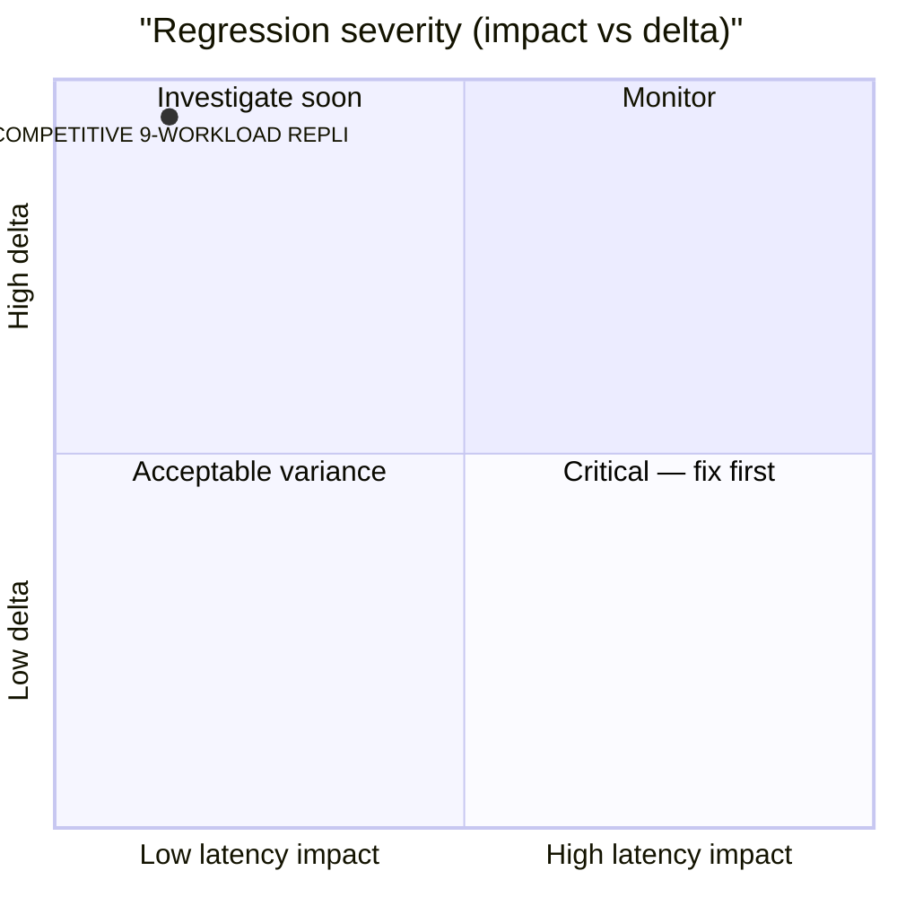

# 🚀 MongoDB Performance Ledger

> [!NOTE] Competitive comparisons based on publicly available documentation as of June 2026. All SveltyCMS metrics self-measured via `bun test tests/benchmarks/`.

> [!IMPORTANT]
> **Console-only by default.** Use `BENCHMARK_RECORD=1` to write results to this report.
>
> ```bash
> BENCHMARK_RECORD=1 bun test tests/benchmarks/auth-performance.test.ts
> ```
>
> The full matrix runner (`bun run scripts/benchmark-matrix/index.ts --sql`) always records.

<!-- BENCHMARK_START -->

<!-- EXECUTIVE_START -->
<!-- LATEST_AUDIT_HEADER -->

## 📊 Latest Performance Audit

<!-- EXECUTIVE_FIX_NOTES_START -->

### 📝 Fix Overlays

> [!NOTE]
> Phase notes and remediation entries appear here after matrix or surgical runs.

<!-- EXECUTIVE_FIX_NOTES_END -->

(21/11/2026, 23:37:41)

**✅ PASS** · 33/38 tests · 5 skipped · **MONGODB** · Bun 1.4.2

### Dimension health

| Dimension      | Tests | Status | Worst Δ | Issues |
| -------------- | ----: | ------ | ------- | ------ |
| **Core**       |    10 | 🟢     | -21%    | 0      |
| **API**        |     9 | 🟢     | —       | 0      |
| **Scale**      |    14 | 🟢     | —       | 0      |
| **Resilience** |     5 | 🟢     | —       | 0      |

### Issues (action required)

> ✅ **All clear** — no regressions or budget violations detected.

### Executive latency matrix

| Scenario               | Latency | Trend  | Budget   | Result |
| ---------------------- | ------- | ------ | -------- | ------ |
| **Cold Start**         | N/A     | ⚪ (—) | < 5000ms | ⚪ N/A |
| **REST (Collections)** | N/A     | ⚪ (—) | < 5ms    | ⚪ N/A |
| **Middleware Hooks**   | N/A     | ⚪     | < 2ms    | ⚪ N/A |
| **GraphQL (Avg)**      | N/A     | ⚪ (—) | < 5ms    | ⚪ N/A |
| **Million-Row Index**  | N/A     | ⚪     | < 250ms  | ⚪ N/A |
| **DB Raw (p95)**       | N/A     | ⚪     | < 50ms   | ⚪ N/A |

### Historical pulse

> **Scope:** Sparklines only — full run tables: [`tests/benchmarks/results/history.sqlite`](../../../tests/benchmarks/results/history.sqlite)

| Metric | Trend | Sparkline | Latest |
| ------ | ----- | --------- | ------ |

<details>
<summary>📈 Latency trend chart (last 10 runs)</summary>

```mermaid
xychart-beta
  title "MONGODB REST p95 (last 10 runs)"
  x-axis ["R1", "R2", "R3", "R4", "R5", "R6", "R7", "R8", "R9", "R10"]
  y-axis "Latency (ms)"
  line "p95" : [0.000, 0.000, 0.000, 0.000, 0.000, 0.000, 0.000, 0.000, 0.000, 0.000]
```

</details>
<details>
<summary>📊 Regression severity matrix (quadrant)</summary>



</details>

<!-- EXECUTIVE_PARTIAL_WATERMARK -->

> 📋 **Partial report** — run full matrix for complete cross-DB analysis.

<!-- EXECUTIVE_ALERTS_START -->

> 📋 **Partial report** — run full matrix for complete cross-DB analysis.

### 🔴 Top Regressions

> **🔴 database-performance [UPDATE]** (mongodb): +22% | 0.60ms vs 0.50ms baseline
> **🟠 database-performance [DELETE (Active Rows)]** (mongodb): +19% | 1.21ms vs 1.02ms baseline
> **🟠 hooks-performance [REST with API Caching]** (mongodb): +19% | 0.12ms vs 0.10ms baseline
> **🟠 database-performance [BULK INSERT (100)]** (mongodb): +19% | 3.32ms vs 2.80ms baseline
> **🟠 transaction-acid [TX Rollback Integrity]** (mongodb): +16% | 0.67ms vs 0.57ms baseline

### 🟢 Top Improvements

> **database-performance [QUERY BUILDER LIST (50)]** (mongodb): -80% | 0.76ms vs 3.74ms baseline
> **rest-api-performance [Collection Schema Metadata]** (mongodb): -73% | 0.12ms vs 0.45ms baseline
> **rest-api-performance [Single Document Read]** (mongodb): -69% | 0.11ms vs 0.36ms baseline
> **rest-api-performance [System Health Check]** (mongodb): -67% | 0.49ms vs 1.48ms baseline
> **rest-api-performance [Collection Find (List Limit 20)]** (mongodb): -58% | 0.18ms vs 0.43ms baseline

<!-- EXECUTIVE_ALERTS_END --><!-- EXECUTIVE_END -->

<!-- SUMMARY_START -->
<!-- SUMMARY_RUN_OVERLAY_START -->

### Current Run Summary (2026-11-21)

> **Scope:** Only tests that ran in THIS invocation.

**Run ID:** `4f89f5a7-a144-4d9e-bd9b-21a0068d7b99` · **Tests invoked:** 7 · **Metrics:** 40 · **DB:** mongodb

| Test                     | Metric                                         | Avg (ms) | p95 (ms) | RPS     | Trend | Detail                            |
| ------------------------ | ---------------------------------------------- | -------- | -------- | ------- | ----- | --------------------------------- |
| Cache Performance        | Cache Miss (Bypass)                            | 0.818    | 0.940    | 1205    | 🟢    | ⚪ established at 0.818ms (1 run) |
| Cache Performance        | Cache Hit (L1 Warm)                            | 0.117    | 0.217    | 8243    | 🟢    | ⚪ established at 0.117ms (1 run) |
| Database Performance     | INSERT                                         | 0.512    | 0.620    | 1911    | 🟢    | ⚪ established at 0.512ms (1 run) |
| Database Performance     | FIND ONE                                       | 0.522    | 0.621    | 1861    | 🟢    | ⚪ established at 0.522ms (1 run) |
| Database Performance     | FIND MANY (limit 50)                           | 0.762    | 0.969    | 1216    | 🟢    | ⚪ established at 0.762ms (1 run) |
| Database Performance     | FILTER (blob field, 1 match)                   | 1.759    | 1.930    | 563     | 🟢    | ⚪ established at 1.76ms (1 run)  |
| Database Performance     | QUERY BUILDER LIST (50)                        | 0.759    | 1.033    | 1228    | 🟢    | ⚪ established at 0.759ms (1 run) |
| Database Performance     | FIND PAGE (50 hasMore)                         | 0.778    | 0.985    | 1209    | 🟢    | ⚪ established at 0.778ms (1 run) |
| Database Performance     | FIND PAGE keyset                               | 0.743    | 0.942    | 1306    | 🟢    | ⚪ established at 0.743ms (1 run) |
| Database Performance     | FIND MANY offset 50                            | 0.674    | 0.859    | 1404    | 🟢    | ⚪ established at 0.674ms (1 run) |
| Database Performance     | LIST+COUNT (legacy)                            | 1.577    | 1.906    | 607     | 🟢    | ⚪ established at 1.58ms (1 run)  |
| Database Performance     | UPDATE                                         | 0.604    | 0.743    | 1609    | 🟢    | ⚪ established at 0.604ms (1 run) |
| Database Performance     | UPDATE (no-returning)                          | 0.594    | 0.725    | 1619    | 🟢    | ⚪ established at 0.594ms (1 run) |
| Database Performance     | NATIVE UPSERT                                  | 0.592    | 0.748    | 1636    | 🟢    | ⚪ established at 0.592ms (1 run) |
| Database Performance     | COUNT                                          | 1.417    | 1.570    | 698     | 🟢    | ⚪ established at 1.42ms (1 run)  |
| Database Performance     | COUNT ESTIMATE                                 | 0.413    | 0.523    | 2354    | 🟢    | ⚪ established at 0.413ms (1 run) |
| Database Performance     | COUNT CACHED                                   | 0.001    | 0.002    | 687144  | 🟢    | ⚪ established at 0.001ms (1 run) |
| Database Performance     | DELETE (Active Rows)                           | 1.214    | 1.429    | 776     | 🟢    | ⚪ established at 1.21ms (1 run)  |
| Database Performance     | BULK INSERT (100)                              | 3.324    | 6.241    | 264     | 🟢    | ⚪ established at 3.32ms (1 run)  |
| Database Performance     | BULK UPDATE (100 heterogeneous)                | 4.570    | 5.321    | 205     | 🟢    | ⚪ established at 4.57ms (1 run)  |
| Database Performance     | BULK UPDATE (100 homogeneous)                  | 3.506    | 4.070    | 263     | 🟢    | ⚪ established at 3.51ms (1 run)  |
| Hooks Performance        | Static Asset (No Middleware)                   | 0.851    | 1.552    | 4250    | 🟢    | ⚪ established at 0.851ms (1 run) |
| Hooks Performance        | Turbo Pipeline (Light)                         | 0.425    | 0.710    | 8764    | 🟢    | ⚪ established at 0.425ms (1 run) |
| Hooks Performance        | Full Security + Auth Pipeline                  | 0.093    | 0.136    | 39959   | 🟢    | ⚪ established at 0.093ms (1 run) |
| Hooks Performance        | REST with API Caching                          | 0.119    | 0.237    | 30294   | 🟢    | ⚪ established at 0.119ms (1 run) |
| Hooks Performance        | Mutation (audit logging disabled)              | 0.894    | 1.059    | 1090    | 🟢    | ⚪ established at 0.894ms (1 run) |
| Rest Api Performance     | System Health Check                            | 0.493    | 0.834    | 7554    | 🟢    | ⚪ established at 0.493ms (1 run) |
| Rest Api Performance     | Collection Schema Metadata                     | 0.121    | 0.256    | 28289   | 🟢    | ⚪ established at 0.121ms (1 run) |
| Rest Api Performance     | Single Document Read                           | 0.110    | 0.207    | 32381   | 🟢    | ⚪ established at 0.110ms (1 run) |
| Rest Api Performance     | Collection Find (List Limit 20)                | 0.179    | 0.345    | 18913   | 🟢    | ⚪ established at 0.179ms (1 run) |
| Rest Api Performance     | Collection Search Query                        | 0.169    | 0.368    | 18932   | 🟢    | ⚪ established at 0.169ms (1 run) |
| Transaction Acid         | TX Commit                                      | 0.000    | 0.001    | 1367677 | 🟢    | ⚪ established at 0ms (1 run)     |
| Transaction Acid         | TX Rollback Integrity                          | 0.666    | 0.806    | 1497    | 🟢    | ⚪ established at 0.666ms (1 run) |
| Truth Latency            | Logic Baseline                                 | 0.000    | 0.000    | 641711  | 🟢    | ⚪ established at 0ms (1 run)     |
| Truth Latency            | Local SDK (Full)                               | 0.007    | 0.011    | 1950    | 🟢    | ⚪ established at 0.007ms (1 run) |
| Truth Latency            | HTTP End-to-End                                | 0.149    | 0.199    | 6653    | 🟢    | ⚪ established at 0.149ms (1 run) |
| Truth Latency            | HTTP Cold (Cache-Busted)                       | 1.096    | 1.698    | 911     | 🟢    | ⚪ established at 1.10ms (1 run)  |
| Virtual Query Federation | Virtual Read Passthrough (live Postgres)       | 3.813    | 4.804    | 262     | 🟢    | ⚪ established at 3.81ms (1 run)  |
| Virtual Query Federation | Virtual Read Passthrough (live WordPress REST) | 0.239    | 0.301    | 4148    | 🟢    | ⚪ established at 0.239ms (1 run) |
| Virtual Query Federation | Virtual Read Passthrough (mock REST)           | 0.036    | 0.051    | 27502   | 🟢    | ⚪ established at 0.036ms (1 run) |

<!-- SUMMARY_RUN_OVERLAY_END -->

<!-- SUMMARY_HISTORY_START -->

### Historical Trends (2026-11-21)

> **Mode:** production-parity matrix runs only (`run_mode='matrix'` + `server_mode='production'` — `NODE_ENV=production`, no `TEST_MODE`). Standalone/mode-variant samples are recorded but never trended here.

> **Scope:** Sparklines only — full run tables live in `history.sqlite` (link below). Runs = sparkline bar count.

**Detail:** [`tests/benchmarks/results/history.sqlite`](../../../tests/benchmarks/results/history.sqlite) · `SELECT test_id, phase, server_mode, avg_ms, p95_ms, rps, timestamp FROM runs WHERE db_type='mongodb' AND redis=0 ORDER BY timestamp DESC`

**Series:** 8 · **DB:** mongodb

| Metric                              | Trend | Sparkline (last 7) | Latest  |
| ----------------------------------- | ----- | ------------------ | ------- |
| CACHE PERFORMANCE (warm)            | 🟢    | `█▁`               | 0.117ms |
| COMPETITIVE WORKLOAD REPLICA (warm) | 🟢    | `█▂▁`              | 0.145ms |
| DATABASE PERFORMANCE (warm)         | 🟢    | `▁█`               | 0.522ms |
| HOOKS PERFORMANCE (warm)            | 🟢    | `█▁`               | 0.093ms |
| REST API PERFORMANCE (warm)         | 🟢    | `█▁`               | 0.110ms |
| TRANSACTION ACID (warm)             | 🟢    | `▁▁`               | 0.000ms |
| TRUTH LATENCY (warm)                | 🟢    | `▁█`               | 1.096ms |
| VIRTUAL QUERY FEDERATION (warm)     | 🟢    | `▁█`               | 3.813ms |

<!-- SUMMARY_HISTORY_END --><!-- SUMMARY_END -->

<details>
<summary>📊 Infrastructure drill-down (expand for adapter, hooks, memory trends)</summary>

## 📊 Infrastructure drill-down

### 🏷️ Mixed Workload Performance {#mixedAvg}

**Mixed p95:** — (not measured in this run) | **Trend:** ⚪ (—)

> Production request mix: 60% Reads, 20% Writes, 15% GraphQL, 5% Media.

### 🏷️ Database Adapter Performance {#dbRaw}

**Raw Adapter p95:** — (not measured in this run) | **Target:** < 50ms | **Trend:** ⚪ (—)

> Direct database access latency (bypass CMS logic).

### 🏷️ Middleware & Hooks Audit {#hooks}

**Middleware p95:** — (not measured in this run) | **Target:** < 2ms | **Trend:** ⚪ (—)

> Total overhead of security, logging, and auth hooks.

### 🏷️ Memory Stability Audit {#memGrowth}

**Memory RSS Δ:** — (not measured in this run) | **Target:** < 60MB | **Trend:** ⚪ (—)

> Peak memory growth during stress workload.

### Enterprise scale audit

### 🏷️ Multi-Tenancy Performance {#tenancyAvg}

**Tenancy p95:** — (not measured in this run) | **Trend:** ⚪ (—)

> Measures latency across tenant isolation boundaries.

### 🏷️ Relational Resolver Latency {#relationalAvg}

**Relational p95:** — (not measured in this run) | **Trend:** ⚪ (—)

> Tests performance of complex JOINs and nested relationship population.

### 🏷️ Telemetry & Update Performance {#telemetryAvg}

**Telemetry p95:** — (not measured in this run) | **Trend:** ⚪ (—)

> Measures overhead of telemetry collection and cryptographic signing.

</details>

<!-- LEDGER_START -->

## 🔬 Full benchmark ledger (35 modules)

Expand dimension groups, then any row, for ASCII truth tables. Executive summary above shows pass/fail and issues only.

<!-- LEDGER_DIMENSION:CORE:START -->

<details id="ledger-dimension-core">
<summary><strong>Core</strong> · 27 tests</summary>

<!-- SECTION:API_LATENCY:START -->
<details id="section-api_latency">
<summary><strong>🏷️ API LAYER LATENCY</strong> · ⚪ ⏳ pending · ➡️ — · <a href="../../../tests/benchmarks/api-latency.test.ts">source</a></summary>
<!-- LEDGER_TRUTH_START -->
```text
╔═══════════════════════════════════════════════════════════════════════════════════════════════════════╗
║                                     SVELTYCMS — API LAYER LATENCY                                     ║
║                              File: tests/benchmarks/api-latency.test.ts                               ║
║                                       Ran: 2026-10-06 12:40:21                                        ║
║              Cold full-pipeline findById + warm TURBO-HIT path after responseCache fill.              ║
╠═══════════════════════════════════════════════════════════════════════════════════════════════════════╣
║ HTTP: findById @ 8c (Cold)   │ Cold:     2.81 ms │ Warm:     2.604 ms │ p95:     3.382 ms │   2,984 RPS ║
║ HTTP: findById TURBO-HIT @ 8c (Warm) │ Cold:     0.27 ms │ Warm:     0.468 ms │ p95:     0.640 ms │  15,938 RPS ║
║ HTTP: zstd large GET (>64KiB, drained) │ Cold:     1.66 ms │ Warm:     1.816 ms │ p95:     2.389 ms │   1,056 RPS ║
║ HTTP: findById TURBO-HIT idle (Warm) │        0.215 ms │ p95:        0.284 ms │ RPS:      4,317 ║
║ HTTP: findById TURBO-HIT during zstd (Warm) │        0.274 ms │ p95:        0.326 ms │ RPS:      3,583 ║
╚═══════════════════════════════════════════════════════════════════════════════════════════════════════╝
```
<!-- LEDGER_TRUTH_END -->

</details>
<!-- SECTION:API_LATENCY:END -->

<!-- SECTION:COLD_START:START -->
<details id="section-cold_start">
<summary><strong>🏷️ PHASED COLD START</strong> · ⚪ ⏳ pending · ➡️ — · <a href="../../../tests/benchmarks/cold-start-phased.test.ts">source</a></summary>
<!-- LEDGER_TRUTH_START -->
```text
╔═══════════════════════════════════════════════════════════════════════════════════════════════════════╗
║                                  SVELTYCMS — PHASED COLD START AUDIT                                  ║
║                           File: tests/benchmarks/cold-start-phased.test.ts                            ║
║                                       Ran: 2026-09-18 18:14:41                                        ║
║            Measures process spawn, dependency hydration, and first-request TTFB readiness.            ║
╠═══════════════════════════════════════════════════════════════════════════════════════════════════════╣
║ Initial Cold Boot (Fresh Process) │     2366.569 ms │ p95:     2366.569 ms │ RPS:          0 ║
║ Steady-State Respawn (Average) │     1567.161 ms │ p95:     2366.569 ms │ RPS:          0 ║
╚═══════════════════════════════════════════════════════════════════════════════════════════════════════╝
```
<!-- LEDGER_TRUTH_END -->

</details>
<!-- SECTION:COLD_START:END -->

<!-- SECTION:TRUTH_AUDIT:START -->
<details id="section-truth_audit">
<summary><strong>🏷️ SRE TRUTH AUDIT</strong> · ⚪ 1.096ms · ➡️ — · <a href="../../../tests/benchmarks/truth-latency.test.ts">source</a></summary>
<!-- LEDGER_TRUTH_START -->
```text
╔═══════════════════════════════════════════════════════════════════════════════════════════════════════╗
║                                      SVELTYCMS — SRE TRUTH AUDIT                                      ║
║                             File: tests/benchmarks/truth-latency.test.ts                              ║
║                                       Ran: 2026-11-21 22:36:12                                        ║
║            Validates performance claims by comparing SDK, Middleware, and Real HTTP Stack             ║
╠═══════════════════════════════════════════════════════════════════════════════════════════════════════╣
║ Logic Baseline               │ Cold:     0.01 ms │ Warm:     0.000 ms │ p95:     0.000 ms │ 641,711 RPS ║
║ Local SDK (Full)             │ Cold:   118.61 ms │ Warm:     0.007 ms │ p95:     0.011 ms │   1,950 RPS ║
║ HTTP End-to-End              │ Cold:     5.25 ms │ Warm:     0.149 ms │ p95:     0.199 ms │   6,653 RPS ║
║ HTTP Cold (Cache-Busted)     │ Cold:     2.85 ms │ Warm:     1.096 ms │ p95:     1.698 ms │     911 RPS ║
╚═══════════════════════════════════════════════════════════════════════════════════════════════════════╝
```
<!-- LEDGER_TRUTH_END -->

</details>
<!-- SECTION:TRUTH_AUDIT:END -->

<!-- SECTION:INCREMENTAL:START -->
<details id="section-incremental">
<summary><strong>🏷️ Incremental Content Reload</strong> · ⚪ ⏳ pending · ➡️ — · <a href="../../../tests/benchmarks/content-incremental-reload.test.ts">source</a></summary>
<!-- LEDGER_TRUTH_START -->
```text
╔═══════════════════════════════════════════════════════════════════════════════════════════════════════╗
║                             SVELTYCMS — INCREMENTAL CONTENT RELOAD AUDIT                              ║
║                       File: tests/benchmarks/content-incremental-reload.test.ts                       ║
║                                       Ran: 2026-10-06 09:48:17                                        ║
║      Measures surgical single-file fullReload vs full reconciliation path and batch processing.       ║
╠═══════════════════════════════════════════════════════════════════════════════════════════════════════╣
║ Incremental fullReload (1 file) │ Cold:     4.38 ms │ Warm:     0.061 ms │ p95:     0.111 ms │  14,581 RPS ║
║ Full Reconciliation Reload   │ Cold:     2.68 ms │ Warm:     0.197 ms │ p95:     0.307 ms │   4,891 RPS ║
║ Sequential 10-File Reload    │ Cold:     4.54 ms │ Warm:     0.642 ms │ p95:     0.870 ms │   1,548 RPS ║
║ Batched 10-File Reload       │ Cold:     1.15 ms │ Warm:     0.230 ms │ p95:     0.257 ms │   4,169 RPS ║
╚═══════════════════════════════════════════════════════════════════════════════════════════════════════╝
```
<!-- LEDGER_TRUTH_END -->

</details>
<!-- SECTION:INCREMENTAL:END -->

<!-- SECTION:STATE_MACHINE:START -->
<details id="section-state_machine">
<summary><strong>🏷️ State Machine Transitions</strong> · ⚪ ⏳ pending · ➡️ — · <a href="../../../tests/benchmarks/state-machine-transition.test.ts">source</a></summary>
<!-- LEDGER_TRUTH_START -->
```text
╔═══════════════════════════════════════════════════════════════════════════════════════════════════════╗
║                                  SVELTYCMS — STATE MACHINE INTEGRITY                                  ║
║                        File: tests/benchmarks/state-machine-transition.test.ts                        ║
║                                       Ran: 2026-10-06 09:48:24                                        ║
║Measures state machine self-healing transition latencies, convergence settling time, and health probe consistency under stress.║
╠═══════════════════════════════════════════════════════════════════════════════════════════════════════╣
║ State Transition (Transient) │ Cold:    47.36 ms │ Warm:    29.671 ms │ p95:    34.388 ms │      34 RPS ║
║ Self-Healing Full Convergence │ Cold:    25.75 ms │ Warm:    27.079 ms │ p95:    34.053 ms │      37 RPS ║
╚═══════════════════════════════════════════════════════════════════════════════════════════════════════╝
```
<!-- LEDGER_TRUTH_END -->

</details>
<!-- SECTION:STATE_MACHINE:END -->

<!-- SECTION:DB_RAW_P95:START -->
<details id="section-db_raw_p95">
<summary><strong>🏷️ Database Adapter Raw CRUD</strong> · ⚪ 0.522ms · ➡️ — · <a href="../../../tests/benchmarks/database-performance.test.ts">source</a></summary>
<!-- LEDGER_TRUTH_START -->
```text
╔═══════════════════════════════════════════════════════════════════════════════════════════════════════╗
║                          SVELTYCMS — DATABASE ADAPTER PERFORMANCE (MONGODB)                           ║
║                          File: tests/benchmarks/database-performance.test.ts                          ║
║                                       Ran: 2026-11-21 22:37:38                                        ║
║          Measures raw CRUD performance, indexing efficiency, and connection pool resilience.          ║
╠═══════════════════════════════════════════════════════════════════════════════════════════════════════╣
║ INSERT                       │ Cold:     2.26 ms │ Warm:     0.512 ms │ p95:     0.620 ms │   1,911 RPS ║
║ FIND ONE                     │ Cold:     2.20 ms │ Warm:     0.522 ms │ p95:     0.621 ms │   1,861 RPS ║
║ FIND MANY (limit 50)         │ Cold:     6.63 ms │ Warm:     0.762 ms │ p95:     0.969 ms │   1,216 RPS ║
║ FILTER (blob field, 1 match) │ Cold:    22.74 ms │ Warm:     1.759 ms │ p95:     1.930 ms │     563 RPS ║
║ QUERY BUILDER LIST (50)      │ Cold:    18.30 ms │ Warm:     0.759 ms │ p95:     1.033 ms │   1,228 RPS ║
║ FIND PAGE (50 hasMore)       │ Cold:     4.38 ms │ Warm:     0.778 ms │ p95:     0.985 ms │   1,209 RPS ║
║ FIND PAGE keyset             │ Cold:     6.91 ms │ Warm:     0.743 ms │ p95:     0.942 ms │   1,306 RPS ║
║ FIND MANY offset 50          │ Cold:     2.41 ms │ Warm:     0.674 ms │ p95:     0.859 ms │   1,404 RPS ║
║ LIST+COUNT (legacy)          │ Cold:     4.64 ms │ Warm:     1.577 ms │ p95:     1.906 ms │     607 RPS ║
║ UPDATE                       │ Cold:     2.81 ms │ Warm:     0.604 ms │ p95:     0.743 ms │   1,609 RPS ║
║ UPDATE (no-returning)        │ Cold:     2.50 ms │ Warm:     0.594 ms │ p95:     0.725 ms │   1,619 RPS ║
║ NATIVE UPSERT                │ Cold:     2.36 ms │ Warm:     0.592 ms │ p95:     0.748 ms │   1,636 RPS ║
║ COUNT                        │ Cold:     8.72 ms │ Warm:     1.417 ms │ p95:     1.570 ms │     698 RPS ║
║ COUNT ESTIMATE               │ Cold:     3.23 ms │ Warm:     0.413 ms │ p95:     0.523 ms │   2,354 RPS ║
║ COUNT CACHED                 │ Cold:     4.28 ms │ Warm:     0.001 ms │ p95:     0.002 ms │ 687,144 RPS ║
║ DELETE (Active Rows)         │ Cold:    17.51 ms │ Warm:     1.214 ms │ p95:     1.429 ms │     776 RPS ║
║ BULK INSERT (100)            │ Cold:     5.57 ms │ Warm:     3.324 ms │ p95:     6.241 ms │     264 RPS ║
║ BULK UPDATE (100 heterogeneous) │ Cold:    14.95 ms │ Warm:     4.570 ms │ p95:     5.321 ms │     205 RPS ║
║ BULK UPDATE (100 homogeneous) │ Cold:    13.23 ms │ Warm:     3.506 ms │ p95:     4.070 ms │     263 RPS ║
╚═══════════════════════════════════════════════════════════════════════════════════════════════════════╝
```
<!-- LEDGER_TRUTH_END -->

</details>
<!-- SECTION:DB_RAW_P95:END -->

<!-- SECTION:ACID:START -->
<details id="section-acid">
<summary><strong>🏷️ ACID Transaction Overhead</strong> · ⚪ ⏳ pending · ➡️ — · <a href="../../../tests/benchmarks/transaction-acid.test.ts">source</a></summary>
<!-- LEDGER_TRUTH_START -->
```text
╔═══════════════════════════════════════════════════════════════════════════════════════════════════════╗
║                                   SVELTYCMS — ACID INTEGRITY AUDIT                                    ║
║                            File: tests/benchmarks/transaction-acid.test.ts                            ║
║                                       Ran: 2026-11-21 22:37:41                                        ║
║         Measures transaction commit latencies and rollback overhead across database adapters          ║
╠═══════════════════════════════════════════════════════════════════════════════════════════════════════╣
║ TX Commit                    │ Cold:     0.07 ms │ Warm:     0.000 ms │ p95:     0.001 ms │ 1,367,677 RPS ║
║ TX Rollback Integrity        │ Cold:     1.50 ms │ Warm:     0.666 ms │ p95:     0.806 ms │   1,497 RPS ║
╚═══════════════════════════════════════════════════════════════════════════════════════════════════════╝
```
<!-- LEDGER_TRUTH_END -->

</details>
<!-- SECTION:ACID:END -->

<!-- SECTION:LOGIC:START -->
<details id="section-logic">
<summary><strong>🏷️ Logic</strong> · 🟢 ⏳ pending · ➡️ ⚪ stable at 0ms (7 runs) (2026-09-18 18:14:56) · <a href="../../../tests/benchmarks/truth-latency.test.ts">source</a></summary>
<!-- LEDGER_TRUTH_START -->
> ⏳ Pending
<!-- LEDGER_TRUTH_END -->

</details>
<!-- SECTION:LOGIC:END -->

<!-- SECTION:SDK:START -->
<details id="section-sdk">
<summary><strong>🏷️ SDK</strong> · 🟢 0.541ms · ➡️ recorded (awaiting trend) · <a href="../../../tests/benchmarks/truth-latency.test.ts">source</a></summary>
<!-- LEDGER_TRUTH_START -->
```text
╔═══════════════════════════════════════════════════════════════════════════════════════════════════════╗
║                              SVELTYCMS — SDK VS DIRECT ADAPTER (MONGODB)                              ║
║                          File: tests/benchmarks/local-sdk-vs-direct.test.ts                           ║
║                                       Ran: 2026-10-06 12:47:27                                        ║
║Measures the exact SDK tax across Create, Find, and Update pathways with isolated GC sweeps and zero-allocation key pools.║
╠═══════════════════════════════════════════════════════════════════════════════════════════════════════╣
║ Direct insert                  │        0.541 ms │ p95:        0.541 ms │ RPS:      1,847 ║
║ SDK create (full)              │        0.676 ms │ p95:        0.676 ms │ RPS:      1,479 ║
║ Direct findOne                 │        0.569 ms │ p95:        0.569 ms │ RPS:      1,759 ║
║ SDK find (bypassCache)         │        0.577 ms │ p95:        0.577 ms │ RPS:      1,735 ║
║ Direct update                  │        0.717 ms │ p95:        0.717 ms │ RPS:      1,395 ║
║ SDK update (full)              │        0.771 ms │ p95:        0.771 ms │ RPS:      1,297 ║
║ SDK create (detached)          │        0.526 ms │ p95:        0.526 ms │ RPS:      1,900 ║
║ SDK update (detached)          │        0.726 ms │ p95:        0.726 ms │ RPS:      1,378 ║
╚═══════════════════════════════════════════════════════════════════════════════════════════════════════╝
```
<!-- LEDGER_TRUTH_END -->

</details>
<!-- SECTION:SDK:END -->

<!-- SECTION:HTTP:START -->
<details id="section-http">
<summary><strong>🏷️ HTTP</strong> · 🟢 0.482ms · ➡️ ⚪ stable at 0.499ms (±0.017ms) (7 runs) (2026-09-18 18:14:56) · <a href="../../../tests/benchmarks/truth-latency.test.ts">source</a></summary>
<!-- LEDGER_TRUTH_START -->
> ⏳ Pending
<!-- LEDGER_TRUTH_END -->

</details>
<!-- SECTION:HTTP:END -->

<!-- SECTION:UNKNOWN:START -->
<details id="section-unknown">
<summary><strong>🏷️ unknown</strong> · 🟢 0.002ms · ➡️ recorded (awaiting trend) · <a href="../../../tests/benchmarks/transaction-acid.test.ts">source</a></summary>
<!-- LEDGER_TRUTH_START -->
```text
╔═════════════════════════════════════════════════════════════════════════════════════════╗
║                      SVELTYCMS — CACHE EVICTION BOUNDARY HARDENING                      ║
║                                      File: unknown                                      ║
║                                Ran: 2026-08-23 22:17:47                                 ║
╠═════════════════════════════════════════════════════════════════════════════════════════╣
║ Cache Flooding & Eviction      │        0.002 ms │ p95:        0.002 ms │ RPS:    473,175 ║
╚═════════════════════════════════════════════════════════════════════════════════════════╝
```
<!-- LEDGER_TRUTH_END -->

</details>
<!-- SECTION:UNKNOWN:END -->

<!-- SECTION:CACHE:START -->
<details id="section-cache">
<summary><strong>🏷️ Cache</strong> · 🟢 2.690ms · ➡️ recorded (awaiting trend) · <a href="../../../tests/benchmarks/cache-performance.test.ts">source</a></summary>
<!-- LEDGER_TRUTH_START -->
```text
╔═══════════════════════════════════════════════════════════════════════════════════════════════════════╗
║                                  SVELTYCMS — CACHE EFFICIENCY AUDIT                                   ║
║                           File: tests/benchmarks/cache-performance.test.ts                            ║
║                                       Ran: 2026-11-21 22:36:25                                        ║
║         Measures cache hit vs miss latency and efficiency via real HTTP end-to-end requests.          ║
╠═══════════════════════════════════════════════════════════════════════════════════════════════════════╣
║ Cache Miss (Bypass)          │ Cold:     2.69 ms │ Warm:     0.818 ms │ p95:     0.940 ms │   1,205 RPS ║
║ Cache Hit (L1 Warm)          │ Cold:     0.61 ms │ Warm:     0.117 ms │ p95:     0.217 ms │   8,243 RPS ║
╚═══════════════════════════════════════════════════════════════════════════════════════════════════════╝
```
<!-- LEDGER_TRUTH_END -->

</details>
<!-- SECTION:CACHE:END -->

<!-- SECTION:MIDDLEWARE:START -->
<details id="section-middleware">
<summary><strong>🏷️ Middleware</strong> · 🟢 1.315ms · ➡️ ⚪ established at 1.31ms (1 run) (2026-09-30 15:25:06) · <a href="../../../tests/benchmarks/hooks-performance.test.ts">source</a></summary>
<!-- LEDGER_TRUTH_START -->
> ⏳ Pending
<!-- LEDGER_TRUTH_END -->

</details>
<!-- SECTION:MIDDLEWARE:END -->

<!-- SECTION:SYSTEM:START -->
<details id="section-system">
<summary><strong>🏷️ System</strong> · ⚪ 1.152ms · ↘️ 🟢 faster: 1.69ms → 1.15ms (-32%) (2 runs) (2026-09-18 18:17:56) · <a href="../../../tests/benchmarks/rest-api-performance.test.ts">source</a></summary>
<!-- LEDGER_INSIGHT_START -->
> [!NOTE]
> **Specific to this test**: Performance improved — recent optimizations or cache warming likely effective.
<!-- LEDGER_INSIGHT_END -->

<!-- LEDGER_TRUTH_START -->

> ⏳ Pending

<!-- LEDGER_TRUTH_END -->

</details>
<!-- SECTION:SYSTEM:END -->

<!-- SECTION:METADATA:START -->
<details id="section-metadata">
<summary><strong>🏷️ Metadata</strong> · 🟢 2.094ms · ↘️ ⚪ stable at 2.53ms (±0.696ms) (2 runs) (2026-09-18 18:17:57) · <a href="../../../tests/benchmarks/rest-api-performance.test.ts">source</a></summary>
<!-- LEDGER_INSIGHT_START -->
> [!NOTE]
> **Specific to this test**: Performance improved — recent optimizations or cache warming likely effective.
<!-- LEDGER_INSIGHT_END -->

<!-- LEDGER_TRUTH_START -->

> ⏳ Pending

<!-- LEDGER_TRUTH_END -->

</details>
<!-- SECTION:METADATA:END -->

<!-- SECTION:CRUD:START -->
<details id="section-crud">
<summary><strong>🏷️ CRUD</strong> · 🟢 1.273ms · ➡️ ⚪ established at 1.27ms (1 run) (2026-08-25 11:29:52) · <a href="../../../tests/benchmarks/rest-api-performance.test.ts">source</a></summary>
<!-- LEDGER_TRUTH_START -->
> ⏳ Pending
<!-- LEDGER_TRUTH_END -->

</details>
<!-- SECTION:CRUD:END -->

<!-- SECTION:BASELINE:START -->
<details id="section-baseline">
<summary><strong>🏷️ Baseline</strong> · 🟢 0.953ms · ➡️ ⚪ established at 0.953ms (1 run) (2026-08-29 17:15:48) · <a href="../../../tests/benchmarks/revision-stress.test.ts">source</a></summary>
<!-- LEDGER_TRUTH_START -->
> ⏳ Pending
<!-- LEDGER_TRUTH_END -->

</details>
<!-- SECTION:BASELINE:END -->

<!-- SECTION:READ_PATH:START -->
<details id="section-read_path">
<summary><strong>🏷️ Read Path</strong> · 🟢 0.717ms · ➡️ ⚪ established at 0.717ms (1 run) (2026-08-29 17:15:48) · <a href="../../../tests/benchmarks/revision-stress.test.ts">source</a></summary>
<!-- LEDGER_TRUTH_START -->
> ⏳ Pending
<!-- LEDGER_TRUTH_END -->

</details>
<!-- SECTION:READ_PATH:END -->

<!-- SECTION:HISTORY:START -->
<details id="section-history">
<summary><strong>🏷️ History</strong> · 🟢 0.435ms · ➡️ ⚪ established at 0.435ms (1 run) (2026-08-29 17:15:48) · <a href="../../../tests/benchmarks/revision-stress.test.ts">source</a></summary>
<!-- LEDGER_TRUTH_START -->
> ⏳ Pending
<!-- LEDGER_TRUTH_END -->

</details>
<!-- SECTION:HISTORY:END -->

<!-- SECTION:HTTP_COLD:START -->
<details id="section-http_cold">
<summary><strong>🏷️ HTTP-Cold</strong> · 🟢 1.571ms · ➡️ ⚪ stable at 1.60ms (±0.161ms) (2 runs) (2026-09-18 18:14:56) · <a href="../../../tests/benchmarks/truth-latency.test.ts">source</a></summary>
<!-- LEDGER_TRUTH_START -->
> ⏳ Pending
<!-- LEDGER_TRUTH_END -->

</details>
<!-- SECTION:HTTP_COLD:END -->

<!-- SECTION:CRUD__GET_:START -->
<details id="section-crud__get_">
<summary><strong>🏷️ CRUD (Get)</strong> · 🟢 2.130ms · ➡️ ⚪ stable at 2.19ms (±0.177ms) (2 runs) (2026-09-18 18:17:57) · <a href="../../../tests/benchmarks/rest-api-performance.test.ts">source</a></summary>
<!-- LEDGER_TRUTH_START -->
> ⏳ Pending
<!-- LEDGER_TRUTH_END -->

</details>
<!-- SECTION:CRUD__GET_:END -->

<!-- SECTION:CRUD__LIST_:START -->
<details id="section-crud__list_">
<summary><strong>🏷️ CRUD (List)</strong> · 🟢 2.190ms · ↘️ ⚪ stable at 2.47ms (±0.416ms) (2 runs) (2026-09-18 18:17:58) · <a href="../../../tests/benchmarks/rest-api-performance.test.ts">source</a></summary>
<!-- LEDGER_INSIGHT_START -->
> [!NOTE]
> **Specific to this test**: Performance improved — recent optimizations or cache warming likely effective.
<!-- LEDGER_INSIGHT_END -->

<!-- LEDGER_TRUTH_START -->

> ⏳ Pending

<!-- LEDGER_TRUTH_END -->

</details>
<!-- SECTION:CRUD__LIST_:END -->

<!-- SECTION:CRUD__SEARCH_:START -->
<details id="section-crud__search_">
<summary><strong>🏷️ CRUD (Search)</strong> · 🟢 2.290ms · ➡️ ⚪ stable at 2.32ms (±0.089ms) (2 runs) (2026-09-18 18:17:58) · <a href="../../../tests/benchmarks/rest-api-performance.test.ts">source</a></summary>
<!-- LEDGER_TRUTH_START -->
> ⏳ Pending
<!-- LEDGER_TRUTH_END -->

</details>
<!-- SECTION:CRUD__SEARCH_:END -->

<!-- SECTION:COMPETITIVE:START -->
<details id="section-competitive">
<summary><strong>🏷️ COMPETITIVE 9-WORKLOAD REPLICA</strong> · ⚪ 0.145ms · ↘️ — · <a href="../../../tests/benchmarks/competitive-workload-replica.test.ts">source</a></summary>
<!-- LEDGER_INSIGHT_START -->
> [!NOTE]
> **Specific to this test**: Performance improved — recent optimizations or cache warming likely effective.
<!-- LEDGER_INSIGHT_END -->

<!-- LEDGER_TRUTH_START -->

```text
╔═══════════════════════════════════════════════════════════════════════════════════════════════════════╗
║                    COMPETITIVE HARNESS REPLICA (MONGODB — 500 Docs, COLD vs WARM)                     ║
║                      File: tests/benchmarks/competitive-workload-replica.test.ts                      ║
║                                       Ran: 2026-11-21 22:27:39                                        ║
║              Seq + concurrent (8 workers), harness iteration counts, median of N rounds.              ║
╠═══════════════════════════════════════════════════════════════════════════════════════════════════════╣
║ findById (Cold Sequential)   │ Cold:     0.16 ms │ Warm:     0.159 ms │ p95:     0.225 ms │   6,174 RPS ║
║ findById (Cold Concurrent 8c) │ Cold:     0.96 ms │ Warm:     0.583 ms │ p95:     1.194 ms │  13,242 RPS ║
║ findByIdRandom (Cold Sequential) │ Cold:     1.02 ms │ Warm:     1.014 ms │ p95:     1.133 ms │     984 RPS ║
║ findByIdRandom (Cold Concurrent 8c) │ Cold:     0.20 ms │ Warm:     2.291 ms │ p95:     2.920 ms │   3,424 RPS ║
║ listFilterSort (Cold Sequential) │ Cold:     0.24 ms │ Warm:     0.200 ms │ p95:     0.283 ms │   4,972 RPS ║
║ listFilterSort (Cold Concurrent 8c) │ Cold:     0.28 ms │ Warm:     0.486 ms │ p95:     0.688 ms │  15,798 RPS ║
║ listLarge (Cold Sequential)  │ Cold:     0.31 ms │ Warm:     0.292 ms │ p95:     0.476 ms │   3,411 RPS ║
║ listLarge (Cold Concurrent 8c) │ Cold:     0.42 ms │ Warm:     1.068 ms │ p95:     2.075 ms │   7,265 RPS ║
║ listPlain (Cold Sequential)  │ Cold:     0.17 ms │ Warm:     0.155 ms │ p95:     0.424 ms │   6,394 RPS ║
║ listPlain (Cold Concurrent 8c) │ Cold:     0.21 ms │ Warm:     0.269 ms │ p95:     0.419 ms │  28,632 RPS ║
║ listPopulated (Cold Sequential) │ Cold:     0.11 ms │ Warm:     0.125 ms │ p95:     0.263 ms │   7,946 RPS ║
║ listPopulated (Cold Concurrent 8c) │ Cold:     0.18 ms │ Warm:     0.311 ms │ p95:     0.467 ms │  24,786 RPS ║
║ listPopulatedLarge (Cold Sequential) │ Cold:     0.25 ms │ Warm:     0.243 ms │ p95:     0.446 ms │   4,094 RPS ║
║ listPopulatedLarge (Cold Concurrent 8c) │ Cold:     0.24 ms │ Warm:     0.539 ms │ p95:     1.594 ms │  14,302 RPS ║
║ findMissing (Cold Sequential) │ Cold:     0.12 ms │ Warm:     0.092 ms │ p95:     0.157 ms │  10,708 RPS ║
║ findMissing (Cold Concurrent 8c) │ Cold:     0.12 ms │ Warm:     0.334 ms │ p95:     0.461 ms │  22,914 RPS ║
║ create (Cold Sequential)     │ Cold:     0.99 ms │ Warm:     0.939 ms │ p95:     1.063 ms │   1,063 RPS ║
║ create (Cold Concurrent 8c)  │ Cold:     2.15 ms │ Warm:     2.915 ms │ p95:     4.087 ms │   2,665 RPS ║
║ update (Cold Sequential)     │ Cold:     0.98 ms │ Warm:     0.974 ms │ p95:     1.160 ms │   1,025 RPS ║
║ update (Cold Concurrent 8c)  │ Cold:     1.96 ms │ Warm:     2.527 ms │ p95:     3.540 ms │   3,098 RPS ║
║ graphql (Cold Sequential)    │ Cold:     0.31 ms │ Warm:     0.258 ms │ p95:     0.311 ms │   3,846 RPS ║
║ graphql (Cold Concurrent 8c) │ Cold:     0.22 ms │ Warm:     0.690 ms │ p95:     0.899 ms │  11,196 RPS ║
║ mixed (Cold Sequential)      │ Cold:     0.78 ms │ Warm:     0.770 ms │ p95:     1.357 ms │   1,295 RPS ║
║ mixed (Cold Concurrent 8c)   │ Cold:     0.42 ms │ Warm:     2.060 ms │ p95:     2.882 ms │   3,766 RPS ║
║ findById (Warm Sequential)   │ Cold:     0.64 ms │ Warm:     0.100 ms │ p95:     0.269 ms │   9,949 RPS ║
║ findById (Warm Concurrent 8c) │ Cold:     0.11 ms │ Warm:     0.231 ms │ p95:     0.346 ms │  34,105 RPS ║
║ findByIdRandom (Warm Sequential) │ Cold:     0.09 ms │ Warm:     0.106 ms │ p95:     0.176 ms │   9,366 RPS ║
║ findByIdRandom (Warm Concurrent 8c) │ Cold:     0.17 ms │ Warm:     0.212 ms │ p95:     0.405 ms │  37,247 RPS ║
║ listFilterSort (Warm Sequential) │ Cold:     0.18 ms │ Warm:     0.153 ms │ p95:     0.286 ms │   6,504 RPS ║
║ listFilterSort (Warm Concurrent 8c) │ Cold:     0.26 ms │ Warm:     0.385 ms │ p95:     0.977 ms │  20,490 RPS ║
║ listLarge (Warm Sequential)  │ Cold:     0.21 ms │ Warm:     0.312 ms │ p95:     0.548 ms │   3,199 RPS ║
║ listLarge (Warm Concurrent 8c) │ Cold:     0.38 ms │ Warm:     1.082 ms │ p95:     1.904 ms │   7,280 RPS ║
║ listPlain (Warm Sequential)  │ Cold:     0.10 ms │ Warm:     0.154 ms │ p95:     0.254 ms │   6,439 RPS ║
║ listPlain (Warm Concurrent 8c) │ Cold:     0.27 ms │ Warm:     0.277 ms │ p95:     0.499 ms │  28,333 RPS ║
║ listPopulated (Warm Sequential) │ Cold:     0.06 ms │ Warm:     0.098 ms │ p95:     0.290 ms │  10,095 RPS ║
║ listPopulated (Warm Concurrent 8c) │ Cold:     0.20 ms │ Warm:     0.290 ms │ p95:     0.518 ms │  26,712 RPS ║
║ listPopulatedLarge (Warm Sequential) │ Cold:     0.09 ms │ Warm:     0.113 ms │ p95:     0.181 ms │   8,784 RPS ║
║ listPopulatedLarge (Warm Concurrent 8c) │ Cold:     0.17 ms │ Warm:     0.260 ms │ p95:     0.396 ms │  27,344 RPS ║
║ findMissing (Warm Sequential) │ Cold:     0.38 ms │ Warm:     0.074 ms │ p95:     0.136 ms │  13,419 RPS ║
║ findMissing (Warm Concurrent 8c) │ Cold:     0.21 ms │ Warm:     0.185 ms │ p95:     0.295 ms │  42,196 RPS ║
║ create (Warm Sequential)     │ Cold:     0.70 ms │ Warm:     0.868 ms │ p95:     1.009 ms │   1,150 RPS ║
║ create (Warm Concurrent 8c)  │ Cold:     1.13 ms │ Warm:     2.088 ms │ p95:     2.842 ms │   3,803 RPS ║
║ update (Warm Sequential)     │ Cold:     2.75 ms │ Warm:     1.154 ms │ p95:     1.828 ms │     866 RPS ║
║ update (Warm Concurrent 8c)  │ Cold:     1.65 ms │ Warm:     2.036 ms │ p95:     2.583 ms │   3,888 RPS ║
║ graphql (Warm Sequential)    │ Cold:     0.24 ms │ Warm:     0.212 ms │ p95:     0.252 ms │   4,689 RPS ║
║ graphql (Warm Concurrent 8c) │ Cold:     0.28 ms │ Warm:     0.466 ms │ p95:     0.804 ms │  16,836 RPS ║
║ mixed (Warm Sequential)      │ Cold:     0.20 ms │ Warm:     0.497 ms │ p95:     1.400 ms │   2,008 RPS ║
║ mixed (Warm Concurrent 8c)   │ Cold:     0.14 ms │ Warm:     1.120 ms │ p95:     2.281 ms │   6,951 RPS ║
╚═══════════════════════════════════════════════════════════════════════════════════════════════════════╝
```

<!-- LEDGER_TRUTH_END -->

</details>
<!-- SECTION:COMPETITIVE:END -->

<!-- SECTION:FLAMEGRAPH:START -->
<details id="section-flamegraph">
<summary><strong>🏷️ MIDDLEWARE FLAMEGRAPH PROFILER</strong> · ⚪ ⏳ pending · ➡️ — · <a href="../../../tests/benchmarks/middleware-flamegraph.test.ts">source</a></summary>
<!-- LEDGER_TRUTH_START -->
```text
╔═══════════════════════════════════════════════════════════════════════════════════════════════════════╗
║                               MIDDLEWARE FLAMEGRAPH PROFILER (MONGODB)                                ║
║                         File: tests/benchmarks/middleware-flamegraph.test.ts                          ║
║                                       Ran: 2026-10-06 09:51:11                                        ║
║Measures isolated microsecond cost and incremental deltas of each middleware stage from edge to database.║
╠═══════════════════════════════════════════════════════════════════════════════════════════════════════╣
║ Stage 0: Raw Socket Baseline (Static Asset) │ Cold:     2.32 ms │ Warm:     1.011 ms │ p95:     2.313 ms │   3,371 RPS ║
║ Stage 1: System State + Turbo Pipeline │ Cold:     1.09 ms │ Warm:     0.792 ms │ p95:     0.970 ms │   4,882 RPS ║
║ Stage 2: WAF Security Inspection │ Cold:     0.92 ms │ Warm:     0.641 ms │ p95:     0.901 ms │   6,043 RPS ║
║ Stage 3: Token Auth Gating   │ Cold:     8.51 ms │ Warm:     1.501 ms │ p95:     2.130 ms │   2,572 RPS ║
║ Stage 4: Collection Schema Resolution │ Cold:     2.84 ms │ Warm:     0.423 ms │ p95:     0.850 ms │   8,098 RPS ║
║ Stage 5: Full REST Single Document │ Cold:     2.57 ms │ Warm:     0.419 ms │ p95:     0.813 ms │   8,763 RPS ║
║ Stage 6: GraphQL Single Query (JIT) │ Cold:     4.18 ms │ Warm:     1.425 ms │ p95:     2.172 ms │   2,692 RPS ║
╚═══════════════════════════════════════════════════════════════════════════════════════════════════════╝
```
<!-- LEDGER_TRUTH_END -->

</details>
<!-- SECTION:FLAMEGRAPH:END -->

<!-- SECTION:EVENTLOOP:START -->
<details id="section-eventloop">
<summary><strong>🏷️ EVENT LOOP LAG & SATURATION</strong> · ⚪ ⏳ pending · ➡️ — · <a href="../../../tests/benchmarks/event-loop-lag.test.ts">source</a></summary>
<!-- LEDGER_TRUTH_START -->
```text
╔═══════════════════════════════════════════════════════════════════════════════════════════════════════╗
║                                 EVENT LOOP LAG & SATURATION (MONGODB)                                 ║
║                             File: tests/benchmarks/event-loop-lag.test.ts                             ║
║                                       Ran: 2026-10-06 12:47:01                                        ║
║Measures event loop delay (p50, p95, p99, max) and microtask drain speed under concurrent write bursts.║
╠═══════════════════════════════════════════════════════════════════════════════════════════════════════╣
║ Idle Baseline Lag              │        0.000 ms │ p95:        0.000 ms │ RPS:      1,428 ║
║ Write Burst Lag (200 writes @ 16c) │        0.000 ms │ p95:        0.000 ms │ RPS:        963 ║
╚═══════════════════════════════════════════════════════════════════════════════════════════════════════╝
```
<!-- LEDGER_TRUTH_END -->

</details>
<!-- SECTION:EVENTLOOP:END -->

<!-- SECTION:INGESTION:START -->
<details id="section-ingestion">
<summary><strong>🏷️ Ingestion</strong> · 🟢 0.054ms · ➡️ ⚪ established at 0.054ms (1 run) (2026-09-30 14:27:11) · <a href="../../../tests/benchmarks/competitive-workload-replica.test.ts">source</a></summary>
<!-- LEDGER_TRUTH_START -->
> ⏳ Pending
<!-- LEDGER_TRUTH_END -->

</details>
<!-- SECTION:INGESTION:END -->

</details>

<!-- LEDGER_DIMENSION:CORE:END -->

<!-- LEDGER_DIMENSION:API:START -->

<details id="ledger-dimension-api">
<summary><strong>API</strong> · 9 tests</summary>

<!-- SECTION:TEMPORAL:START -->
<details id="section-temporal">
<summary><strong>🏷️ Temporal Integrity Audit</strong> · ⚪ ⏳ pending · ➡️ — · <a href="../../../tests/benchmarks/temporal-integrity.test.ts">source</a></summary>
<!-- LEDGER_TRUTH_START -->
```text
╔═════════════════════════════════════════════════════════════════════════════════════════╗
║                             SVELTYCMS — TEMPORAL INTEGRITY                              ║
║                    File: tests/benchmarks/temporal-integrity.test.ts                    ║
║                                Ran: 2026-08-23 22:14:58                                 ║
║Validates deterministic UTC normalization of ISO date strings across timezone offsets for consistent persistence.║
╠═════════════════════════════════════════════════════════════════════════════════════════╣
║ Timezone Ingestion             │        4.618 ms │ p95:        4.618 ms │ RPS:        217 ║
╚═════════════════════════════════════════════════════════════════════════════════════════╝
```
<!-- LEDGER_TRUTH_END -->

</details>
<!-- SECTION:TEMPORAL:END -->

<!-- SECTION:RELATIONAL:START -->
<details id="section-relational">
<summary><strong>🏷️ Relational & Nested Queries</strong> · ⚪ ⏳ pending · ➡️ — · <a href="../../../tests/benchmarks/relational-performance.test.ts">source</a></summary>
<!-- LEDGER_TRUTH_START -->
```text
╔═══════════════════════════════════════════════════════════════════════════════════════════════════════╗
║                                 SVELTYCMS — RELATIONAL RESOLVER AUDIT                                 ║
║                         File: tests/benchmarks/relational-performance.test.ts                         ║
║                                       Ran: 2026-08-29 16:55:08                                        ║
║Measures GraphQL resolver performance for shallow listings, deep relational joins, and nested author population across cold/hot execution paths.║
╠═══════════════════════════════════════════════════════════════════════════════════════════════════════╣
║ Shallow Query (Collections)  │ Cold:     2.75 ms │ Warm:     3.095 ms │ p95:     5.591 ms │   1,817 RPS ║
║ Deep Join (Cold DB)          │ Cold:     2.61 ms │ Warm:     2.327 ms │ p95:     3.415 ms │   1,632 RPS ║
║ Deep Join (Warm Cached)      │ Cold:     1.90 ms │ Warm:     1.797 ms │ p95:     2.571 ms │   2,078 RPS ║
╚═══════════════════════════════════════════════════════════════════════════════════════════════════════╝
```
<!-- LEDGER_TRUTH_END -->

</details>
<!-- SECTION:RELATIONAL:END -->

<!-- SECTION:AUTH_TRACE:START -->
<details id="section-auth_trace">
<summary><strong>🏷️ Auth & RBAC Performance</strong> · ⚪ ⏳ pending · ➡️ — · <a href="../../../tests/benchmarks/auth-performance.test.ts">source</a></summary>
<!-- LEDGER_TRUTH_START -->
```text
╔═══════════════════════════════════════════════════════════════════════════════════════════════════════╗
║                                 SVELTYCMS — AUTHENTICATION TELEMETRY                                  ║
║                            File: tests/benchmarks/auth-performance.test.ts                            ║
║                                       Ran: 2026-10-06 12:40:28                                        ║
║           Evaluates authenticated session resolution, RBAC evaluation, and rejection paths.           ║
╠═══════════════════════════════════════════════════════════════════════════════════════════════════════╣
║ Unauthenticated (401 reject) │ Cold:     1.65 ms │ Warm:     0.810 ms │ p95:     0.928 ms │   1,204 RPS ║
║ Reject: unknown session cookie │ Cold:     0.99 ms │ Warm:     0.797 ms │ p95:     0.911 ms │   1,244 RPS ║
║ Reject: unknown API key (Bearer sck_) │ Cold:     0.90 ms │ Warm:     0.767 ms │ p95:     0.905 ms │   1,241 RPS ║
║ Auth Validation @ 1c         │ Cold:     2.12 ms │ Warm:     0.755 ms │ p95:     0.886 ms │   1,302 RPS ║
║ HTTP Auth Pipeline @ 8c      │ Cold:     2.43 ms │ Warm:     1.513 ms │ p95:     1.889 ms │   5,060 RPS ║
║ Auth (full chain) @ 1c       │ Cold:     1.52 ms │ Warm:     0.317 ms │ p95:     0.407 ms │   3,018 RPS ║
╚═══════════════════════════════════════════════════════════════════════════════════════════════════════╝
```
<!-- LEDGER_TRUTH_END -->

</details>
<!-- SECTION:AUTH_TRACE:END -->

<!-- SECTION:REST:START -->
<details id="section-rest">
<summary><strong>🏷️ REST API Performance</strong> · ⚪ 0.110ms · ➡️ — · <a href="../../../tests/benchmarks/rest-api-performance.test.ts">source</a></summary>
<!-- LEDGER_TRUTH_START -->
```text
╔═══════════════════════════════════════════════════════════════════════════════════════════════════════╗
║                                 SVELTYCMS — ENTERPRISE REST API AUDIT                                 ║
║                          File: tests/benchmarks/rest-api-performance.test.ts                          ║
║                                       Ran: 2026-11-21 22:36:22                                        ║
║Measures latency, throughput, and correctness of core REST endpoints: health check, schema, single read, list, and search.║
╠═══════════════════════════════════════════════════════════════════════════════════════════════════════╣
║ System Health Check          │ Cold:     1.04 ms │ Warm:     0.493 ms │ p95:     0.834 ms │   7,554 RPS ║
║ Collection Schema Metadata   │ Cold:     2.81 ms │ Warm:     0.121 ms │ p95:     0.256 ms │  28,289 RPS ║
║ Single Document Read         │ Cold:     0.46 ms │ Warm:     0.110 ms │ p95:     0.207 ms │  32,381 RPS ║
║ Collection Find (List Limit 20) │ Cold:    21.35 ms │ Warm:     0.179 ms │ p95:     0.345 ms │  18,913 RPS ║
║ Collection Search Query      │ Cold:     7.60 ms │ Warm:     0.169 ms │ p95:     0.368 ms │  18,932 RPS ║
╚═══════════════════════════════════════════════════════════════════════════════════════════════════════╝
```
<!-- LEDGER_TRUTH_END -->

</details>
<!-- SECTION:REST:END -->

<!-- SECTION:GRAPHQL:START -->
<details id="section-graphql">
<summary><strong>🏷️ GraphQL API Performance</strong> · ⚪ ⏳ pending · ➡️ — · <a href="../../../tests/benchmarks/graphql-api-performance.test.ts">source</a></summary>
<!-- LEDGER_TRUTH_START -->
```text
╔═══════════════════════════════════════════════════════════════════════════════════════════════════════╗
║                                  SVELTYCMS — GRAPHQL CACHE HIT AUDIT                                  ║
║                           File: tests/benchmarks/graphql-cache-hit.test.ts                            ║
║                                       Ran: 2026-10-06 09:50:39                                        ║
║        Validates sub-millisecond L1 response cache hits, cache key isolation, and hit headers.        ║
╠═══════════════════════════════════════════════════════════════════════════════════════════════════════╣
║ Q1: Health (Cold Miss)         │        6.628 ms │ p95:        6.628 ms │ RPS:        151 ║
║ Q1: Health (L1 Hit)            │        2.243 ms │ p95:        3.850 ms │ RPS:        446 ║
║ Q2: Collections (Cold Miss)    │        3.114 ms │ p95:        3.114 ms │ RPS:        321 ║
║ Q2: Collections (L1 Hit)       │        2.103 ms │ p95:        3.339 ms │ RPS:        476 ║
╚═══════════════════════════════════════════════════════════════════════════════════════════════════════╝
```
<!-- LEDGER_TRUTH_END -->

</details>
<!-- SECTION:GRAPHQL:END -->

<!-- SECTION:SEO:START -->
<details id="section-seo">
<summary><strong>🏷️ Enterprise SEO Suite Audit</strong> · ⚪ ⏳ pending · ➡️ — · <a href="../../../tests/benchmarks/seo-performance.test.ts">source</a></summary>
<!-- LEDGER_TRUTH_START -->
```text
╔═══════════════════════════════════════════════════════════════════════════════════════════════════════╗
║                                   SVELTYCMS — ENTERPRISE SEO AUDIT                                    ║
║                            File: tests/benchmarks/seo-performance.test.ts                             ║
║                                       Ran: 2026-10-06 09:44:44                                        ║
║Measures redirect lookup latency, dynamic sitemap.xml generation, robots.txt serving, and 404 logging performance.║
╠═══════════════════════════════════════════════════════════════════════════════════════════════════════╣
║ Redirect Lookup (301)        │ Cold:     1.66 ms │ Warm:     1.504 ms │ p95:     2.447 ms │   5,269 RPS ║
║ Dynamic Sitemap XML          │ Cold:     6.24 ms │ Warm:     0.960 ms │ p95:     2.150 ms │   8,265 RPS ║
║ Robots.txt Generation        │ Cold:     1.63 ms │ Warm:     1.744 ms │ p95:     3.156 ms │   4,548 RPS ║
║ Missing Path (404 Log)       │ Cold:    71.88 ms │ Warm:    17.139 ms │ p95:    22.589 ms │     463 RPS ║
╚═══════════════════════════════════════════════════════════════════════════════════════════════════════╝
```
<!-- LEDGER_TRUTH_END -->

</details>
<!-- SECTION:SEO:END -->

<!-- SECTION:BROADCAST:START -->
<details id="section-broadcast">
<summary><strong>🏷️ REAL-TIME BROADCAST AUDIT</strong> · ⚪ ⏳ pending · ➡️ — · <a href="../../../tests/benchmarks/websocket-broadcast.test.ts">source</a></summary>
<!-- LEDGER_TRUTH_START -->
```text
╔═══════════════════════════════════════════════════════════════════════════════════════════════════════╗
║                               SVELTYCMS — YJS COLLABORATION SYNC AUDIT                                ║
║                          File: tests/benchmarks/websocket-broadcast.test.ts                           ║
║                                       Ran: 2026-10-06 12:46:09                                        ║
║Measures WebSocket handshake latency, bidirectional Yjs CRDT update propagation, and synchronization throughput.║
╠═══════════════════════════════════════════════════════════════════════════════════════════════════════╣
║ WS Handshake + SyncStep        │        5.950 ms │ p95:        0.000 ms │ RPS:          0 ║
║ Yjs CRDT Propagation         │ Cold:     2.50 ms │ Warm:     0.138 ms │ p95:     0.224 ms │   6,947 RPS ║
╚═══════════════════════════════════════════════════════════════════════════════════════════════════════╝
```
<!-- LEDGER_TRUTH_END -->

</details>
<!-- SECTION:BROADCAST:END -->

<!-- SECTION:REAL_TIME:START -->
<details id="section-real_time">
<summary><strong>🏷️ WebSocket & Realtime Latency</strong> · ⚪ ⏳ pending · ➡️ — · <a href="../../../tests/benchmarks/realtime-performance.test.ts">source</a></summary>
<!-- LEDGER_TRUTH_START -->
> ⏳ **WebSocket & Realtime Latency**: Pending execution.
> 🎯 Benchmarks WebSocket connection/broadcast latency.
<!-- LEDGER_TRUTH_END -->

</details>
<!-- SECTION:REAL_TIME:END -->

<!-- SECTION:GQL_CACHE:START -->
<details id="section-gql_cache">
<summary><strong>🏷️ GraphQL Response Cache Hit</strong> · ⚪ ⏳ pending · ➡️ — · <a href="../../../tests/benchmarks/graphql-cache-hit.test.ts">source</a></summary>
<!-- LEDGER_TRUTH_START -->
```text
╔═══════════════════════════════════════════════════════════════════════════════════════════════════════╗
║                                  SVELTYCMS — GRAPHQL CACHE HIT AUDIT                                  ║
║                           File: tests/benchmarks/graphql-cache-hit.test.ts                            ║
║                                       Ran: 2026-10-06 12:47:03                                        ║
║        Validates sub-millisecond L1 response cache hits, cache key isolation, and hit headers.        ║
╠═══════════════════════════════════════════════════════════════════════════════════════════════════════╣
║ Q1: Health (Cold Miss)         │        4.149 ms │ p95:        4.149 ms │ RPS:        241 ║
║ Q1: Health (L1 Hit)            │        1.101 ms │ p95:        1.966 ms │ RPS:        908 ║
║ Q2: Collections (Cold Miss)    │        2.190 ms │ p95:        2.190 ms │ RPS:        457 ║
║ Q2: Collections (L1 Hit)       │        1.082 ms │ p95:        1.257 ms │ RPS:        924 ║
╚═══════════════════════════════════════════════════════════════════════════════════════════════════════╝
```
<!-- LEDGER_TRUTH_END -->

</details>
<!-- SECTION:GQL_CACHE:END -->

</details>

<!-- LEDGER_DIMENSION:API:END -->

<!-- LEDGER_DIMENSION:SCALE:START -->

<details id="ledger-dimension-scale">
<summary><strong>Scale</strong> · 14 tests</summary>

<!-- SECTION:NEGATIVE_CACHE:START -->
<details id="section-negative_cache">
<summary><strong>🏷️ Negative Cache Performance</strong> · ⚪ ⏳ pending · ➡️ — · <a href="../../../tests/benchmarks/negative-cache.test.ts">source</a></summary>
<!-- LEDGER_TRUTH_START -->
```text
╔═════════════════════════════════════════════════════════════════════════════════════════╗
║                            NEGATIVE CACHE PERFORMANCE AUDIT                             ║
║                      File: tests/benchmarks/negative-cache.test.ts                      ║
║                                Ran: 2026-08-23 22:13:41                                 ║
║        Measures Bloom-filter style missing-key cache speedup for repeated misses        ║
╠═════════════════════════════════════════════════════════════════════════════════════════╣
║ First Miss (DB)                │        1.487 ms │ p95:        3.850 ms │ RPS:        667 ║
║ Cached Miss (Negative Cache)   │        0.001 ms │ p95:        0.002 ms │ RPS:    777,871 ║
╚═════════════════════════════════════════════════════════════════════════════════════════╝
```
<!-- LEDGER_TRUTH_END -->

</details>
<!-- SECTION:NEGATIVE_CACHE:END -->

<!-- SECTION:MEMORY:START -->
<details id="section-memory">
<summary><strong>🏷️ Memory Stability & GC Behavior</strong> · ⚪ ⏳ pending · ➡️ — · <a href="../../../tests/benchmarks/memory-stability.test.ts">source</a></summary>
<!-- LEDGER_TRUTH_START -->
> ⏳ **Memory Stability & GC Behavior**: Pending execution.
> 🎯 Long-running soak test to identify memory leaks and GC pressure.
<!-- LEDGER_TRUTH_END -->

</details>
<!-- SECTION:MEMORY:END -->

<!-- SECTION:TENANCY:START -->
<details id="section-tenancy">
<summary><strong>🏷️ Multi-Tenant Performance & Isolation</strong> · ⚪ ⏳ pending · ➡️ — · <a href="../../../tests/benchmarks/multi-tenant-performance.test.ts">source</a></summary>
<!-- LEDGER_TRUTH_START -->
```text
╔═══════════════════════════════════════════════════════════════════════════════════════════════════════╗
║                              SVELTYCMS — MULTI-TENANCY PERFORMANCE AUDIT                              ║
║                        File: tests/benchmarks/multi-tenant-performance.test.ts                        ║
║                                       Ran: 2026-10-06 09:44:30                                        ║
║Measures the overhead of tenant isolation, context switching, and data partitioning across many tenants.║
╠═══════════════════════════════════════════════════════════════════════════════════════════════════════╣
║ Single Tenant Baseline       │ Cold:     4.77 ms │ Warm:     0.703 ms │ p95:     1.113 ms │  10,505 RPS ║
║ Multi-Tenant Context Switching │ Cold:     0.72 ms │ Warm:     0.550 ms │ p95:     0.953 ms │  13,232 RPS ║
╚═══════════════════════════════════════════════════════════════════════════════════════════════════════╝
```
<!-- LEDGER_TRUTH_END -->

</details>
<!-- SECTION:TENANCY:END -->

<!-- SECTION:MIXED:START -->
<details id="section-mixed">
<summary><strong>🏷️ Realistic Mixed Workload</strong> · ⚪ ⏳ pending · ➡️ — · <a href="../../../tests/benchmarks/mixed-workload.test.ts">source</a></summary>
<!-- LEDGER_TRUTH_START -->
```text
╔═══════════════════════════════════════════════════════════════════════════════════════════════════════╗
║                                   SVELTYCMS — MIXED WORKLOAD AUDIT                                    ║
║                             File: tests/benchmarks/mixed-workload.test.ts                             ║
║                                       Ran: 2026-10-06 09:44:46                                        ║
║Simulates real-world traffic with a weighted mix of reads, searches, GraphQL queries, and metadata requests with per-operation telemetry.║
╠═══════════════════════════════════════════════════════════════════════════════════════════════════════╣
║ Mixed Workload               │ Cold:     4.08 ms │ Warm:     0.949 ms │ p95:     2.853 ms │   6,529 RPS ║
║ Mix: REST Read                 │        0.961 ms │ p95:        1.697 ms │ RPS:      1,596 ║
║ Mix: REST Search               │        0.961 ms │ p95:        1.626 ms │ RPS:        550 ║
║ Mix: GraphQL                   │        2.681 ms │ p95:        4.648 ms │ RPS:        399 ║
║ Mix: Metadata                  │        1.063 ms │ p95:        1.847 ms │ RPS:        120 ║
╚═══════════════════════════════════════════════════════════════════════════════════════════════════════╝
```
<!-- LEDGER_TRUTH_END -->

</details>
<!-- SECTION:MIXED:END -->

<!-- SECTION:GQL_STRESS:START -->
<details id="section-gql_stress">
<summary><strong>🏷️ GraphQL Load Stress</strong> · ⚪ ⏳ pending · ➡️ — · <a href="../../../tests/benchmarks/graphql-stress.test.ts">source</a></summary>
<!-- LEDGER_TRUTH_START -->
```text
╔═══════════════════════════════════════════════════════════════════════════════════════════════════════╗
║                                SVELTYCMS — GRAPHQL CAPACITY DISCOVERY                                 ║
║                             File: tests/benchmarks/graphql-stress.test.ts                             ║
║                                       Ran: 2026-10-06 12:40:39                                        ║
║                Discovers maximum sustainable GraphQL throughput by ramping concurrency                ║
╠═══════════════════════════════════════════════════════════════════════════════════════════════════════╣
║ GQL: 5c Warmup               │ Cold:     2.56 ms │ Warm:     1.084 ms │ p95:     1.701 ms │   4,337 RPS ║
║ GQL: 10c Light               │ Cold:     2.39 ms │ Warm:     1.642 ms │ p95:     3.080 ms │   4,440 RPS ║
║ GQL: 20c Moderate            │ Cold:     2.29 ms │ Warm:     2.692 ms │ p95:     3.252 ms │   7,143 RPS ║
║ GQL: 40c Heavy               │ Cold:     1.93 ms │ Warm:     4.367 ms │ p95:     9.339 ms │   8,308 RPS ║
║ GQL: 60c Stress              │ Cold:     1.92 ms │ Warm:     6.208 ms │ p95:    10.521 ms │   8,821 RPS ║
║ GQL: 80c Extreme             │ Cold:     2.14 ms │ Warm:     9.302 ms │ p95:    12.457 ms │   8,508 RPS ║
║ GQL: 100c Max                │ Cold:     2.23 ms │ Warm:    10.391 ms │ p95:    13.339 ms │   9,373 RPS ║
╚═══════════════════════════════════════════════════════════════════════════════════════════════════════╝
```
<!-- LEDGER_TRUTH_END -->

</details>
<!-- SECTION:GQL_STRESS:END -->

<!-- SECTION:MIGRATION:START -->
<details id="section-migration">
<summary><strong>🏷️ Bulk Migration & Scale</strong> · ⚪ ⏳ pending · ➡️ — · <a href="../../../tests/benchmarks/migration-scale.test.ts">source</a></summary>
<!-- LEDGER_TRUTH_START -->
```text
╔═══════════════════════════════════════════════════════════════════════════════════════════════════════╗
║                                  SVELTYCMS — MIGRATION & SCALE AUDIT                                  ║
║                            File: tests/benchmarks/migration-scale.test.ts                             ║
║                                       Ran: 2026-10-06 09:49:04                                        ║
║Measures bulk ingestion throughput for 10,000 entries, random point-lookups, and indexed range scans across large datasets.║
╠═══════════════════════════════════════════════════════════════════════════════════════════════════════╣
║ Bulk Migration (10k docs)    │ Cold:    40.07 ms │ Warm:    20.772 ms │ p95:    25.952 ms │  22,916 RPS ║
║ Random Point Lookup          │ Cold:     4.48 ms │ Warm:     1.877 ms │ p95:     2.585 ms │   3,072 RPS ║
║ Range Scan & Pagination      │ Cold:    78.35 ms │ Warm:     0.474 ms │ p95:     0.674 ms │  12,067 RPS ║
╚═══════════════════════════════════════════════════════════════════════════════════════════════════════╝
```
<!-- LEDGER_TRUTH_END -->

</details>
<!-- SECTION:MIGRATION:END -->

<!-- SECTION:INDEX_PRESSURE:START -->
<details id="section-index_pressure">
<summary><strong>🏷️ Million-Row Index Pressure</strong> · ⚪ ⏳ pending · ➡️ — · <a href="../../../tests/benchmarks/index-pressure.test.ts">source</a></summary>
<!-- LEDGER_TRUTH_START -->
```text
╔═══════════════════════════════════════════════════════════════════════════════════════════════════════╗
║                                  SVELTYCMS  —  INDEX PRESSURE AUDIT                                   ║
║                             File: tests/benchmarks/index-pressure.test.ts                             ║
║                                       Ran: 2026-10-06 09:45:49                                        ║
║           Measures read performance with sorting and filtering on a large entry collection.           ║
╠═══════════════════════════════════════════════════════════════════════════════════════════════════════╣
║ Sorted List (25k rows)       │ Cold:     4.10 ms │ Warm:     0.486 ms │ p95:     0.616 ms │   8,166 RPS ║
║ Filtered Query (25k rows)    │ Cold:     3.47 ms │ Warm:     0.433 ms │ p95:     0.528 ms │   9,158 RPS ║
╚═══════════════════════════════════════════════════════════════════════════════════════════════════════╝
```
<!-- LEDGER_TRUTH_END -->

</details>
<!-- SECTION:INDEX_PRESSURE:END -->

<!-- SECTION:CONTENT_STRESS:START -->
<details id="section-content_stress">
<summary><strong>🏷️ Content Scale Stress</strong> · ⚪ ⏳ pending · ➡️ — · <a href="../../../tests/benchmarks/content-scale-stress.test.ts">source</a></summary>
<!-- LEDGER_TRUTH_START -->
```text
╔═══════════════════════════════════════════════════════════════════════════════════════════════════════╗
║                                SVELTYCMS — CONTENT SCALE STRESS AUDIT                                 ║
║                          File: tests/benchmarks/content-scale-stress.test.ts                          ║
║                                       Ran: 2026-10-06 12:44:33                                        ║
║        Measures file-scanning and content discovery performance at scale (1,000+ collections).        ║
╠═══════════════════════════════════════════════════════════════════════════════════════════════════════╣
║ Cold Stress Scan (1000 files)  │        0.706 ms │ p95:        0.757 ms │ RPS:      1,417 ║
║ Warm Stress Scan (1000 files) │ Cold:     0.63 ms │ Warm:     0.146 ms │ p95:     0.218 ms │   6,441 RPS ║
╚═══════════════════════════════════════════════════════════════════════════════════════════════════════╝
```
<!-- LEDGER_TRUTH_END -->

</details>
<!-- SECTION:CONTENT_STRESS:END -->

<!-- SECTION:MEDIA_UPLOAD:START -->
<details id="section-media_upload">
<summary><strong>🏷️ Media Upload Stress & Throughput</strong> · ⚪ ⏳ pending · ➡️ — · <a href="../../../tests/benchmarks/media-upload-stress.test.ts">source</a></summary>
<!-- LEDGER_TRUTH_START -->
```text
╔═══════════════════════════════════════════════════════════════════════════════════════════════════════╗
║                                 SVELTYCMS — MEDIA UPLOAD STRESS AUDIT                                 ║
║                          File: tests/benchmarks/media-upload-stress.test.ts                           ║
║                                       Ran: 2026-10-06 09:48:51                                        ║
║Measures throughput for large file uploads, concurrent transfers, and streaming efficiency with valid media fixtures.║
╠═══════════════════════════════════════════════════════════════════════════════════════════════════════╣
║ Single Upload (0.01MB)       │ Cold:     9.30 ms │ Warm:     6.718 ms │ p95:     8.058 ms │     144 RPS ║
║ Small Upload (0MB @ 4c)      │ Cold:     9.14 ms │ Warm:     7.250 ms │ p95:    10.536 ms │     521 RPS ║
╚═══════════════════════════════════════════════════════════════════════════════════════════════════════╝
```
<!-- LEDGER_TRUTH_END -->

</details>
<!-- SECTION:MEDIA_UPLOAD:END -->

<!-- SECTION:JOURNEY:START -->
<details id="section-journey">
<summary><strong>🏷️ Full Client Journey Simulation</strong> · ⚪ ⏳ pending · ➡️ — · <a href="../../../tests/benchmarks/client-journey.test.ts">source</a></summary>
<!-- LEDGER_TRUTH_START -->
```text
╔═══════════════════════════════════════════════════════════════════════════════════════════════════════╗
║                                     SVELTYCMS  —  WORLD LIFE DATA                                     ║
║                             File: tests/benchmarks/client-journey.test.ts                             ║
║                                       Ran: 2026-10-06 12:42:07                                        ║
║ Measures cumulative latency of a realistic editorial user workflow: Auth → List → View → Edit → Save. ║
╠═══════════════════════════════════════════════════════════════════════════════════════════════════════╣
║ Full Journey @ 1c            │ Cold:    10.79 ms │ Warm:     3.470 ms │ p95:     4.132 ms │     287 RPS ║
╚═══════════════════════════════════════════════════════════════════════════════════════════════════════╝
```
<!-- LEDGER_TRUTH_END -->

</details>
<!-- SECTION:JOURNEY:END -->

<!-- SECTION:CONCURRENCY:START -->
<details id="section-concurrency">
<summary><strong>🏷️ Concurrency & Race Condition</strong> · ⚪ ⏳ pending · ➡️ — · <a href="../../../tests/benchmarks/concurrency-race.test.ts">source</a></summary>
<!-- LEDGER_TRUTH_START -->
```text
╔═══════════════════════════════════════════════════════════════════════════════════════════════════════╗
║                                     SVELTYCMS — CONCURRENCY AUDIT                                     ║
║                            File: tests/benchmarks/concurrency-race.test.ts                            ║
║                                       Ran: 2026-10-06 09:49:09                                        ║
║          Simulates high-concurrency writes to a single document to prove atomic consistency.          ║
╠═══════════════════════════════════════════════════════════════════════════════════════════════════════╣
║ Concurrent PATCH Bomb          │       49.778 ms │ p95:       62.538 ms │ RPS:      1,556 ║
╚═══════════════════════════════════════════════════════════════════════════════════════════════════════╝
```
<!-- LEDGER_TRUTH_END -->

</details>
<!-- SECTION:CONCURRENCY:END -->

<!-- SECTION:THROUGHPUT:START -->
<details id="section-throughput">
<summary><strong>🏷️ Multi-Doc Concurrency Throughput</strong> · ⚪ ⏳ pending · ➡️ — · <a href="../../../tests/benchmarks/concurrency-throughput.test.ts">source</a></summary>
<!-- LEDGER_TRUTH_START -->
```text
╔═══════════════════════════════════════════════════════════════════════════════════════════════════════╗
║                            SVELTYCMS — DIRECT ADAPTER THROUGHPUT (MONGODB)                            ║
║                          File: tests/benchmarks/local-api-throughput.test.ts                          ║
║                                       Ran: 2026-10-06 09:46:05                                        ║
║Measures direct adapter write throughput, read throughput, and percentile latencies with zero HTTP overhead.║
╠═══════════════════════════════════════════════════════════════════════════════════════════════════════╣
║ Writes (1000 atomic increments) │        2.621 ms │ p95:        5.210 ms │ RPS:      2,153 ║
║ Reads (1000 point lookups)     │        4.503 ms │ p95:        7.981 ms │ RPS:      8,108 ║
╚═══════════════════════════════════════════════════════════════════════════════════════════════════════╝
```
<!-- LEDGER_TRUTH_END -->

</details>
<!-- SECTION:THROUGHPUT:END -->

<!-- SECTION:MAXRPS:START -->
<details id="section-maxrps">
<summary><strong>🏷️ Max Throughput — No Throttle</strong> · ⚪ ⏳ pending · ➡️ — · <a href="../../../tests/benchmarks/concurrency-max.test.ts">source</a></summary>
<!-- LEDGER_TRUTH_START -->
> ⏳ **Max Throughput — No Throttle**: Pending execution.
> 🎯 1000 concurrent writes across 100 docs — no semaphore.
<!-- LEDGER_TRUTH_END -->

</details>
<!-- SECTION:MAXRPS:END -->

<!-- SECTION:PROD_DAY:START -->
<details id="section-prod_day">
<summary><strong>🏷️ Production Day Simulation</strong> · ⚪ ⏳ pending · ➡️ — · <a href="../../../tests/benchmarks/production-day.test.ts">source</a></summary>
<!-- LEDGER_TRUTH_START -->
> ⏳ **Production Day Simulation**: Pending execution.
> 🎯 Full production day with mixed workload, 100% reliability.
<!-- LEDGER_TRUTH_END -->

</details>
<!-- SECTION:PROD_DAY:END -->

</details>

<!-- LEDGER_DIMENSION:SCALE:END -->

<!-- LEDGER_DIMENSION:RESILIENCE:START -->

<details id="ledger-dimension-resilience">
<summary><strong>Resilience</strong> · 5 tests</summary>

<!-- SECTION:CIRCUIT_BREAKER:START -->
<details id="section-circuit_breaker">
<summary><strong>🏷️ Circuit Breaker Failover</strong> · ⚪ ⏳ pending · ➡️ — · <a href="../../../tests/benchmarks/circuit-breaker-failover.test.ts">source</a></summary>
<!-- LEDGER_TRUTH_START -->
```text
╔═════════════════════════════════════════════════════════════════════════════════════════╗
║                            SVELTYCMS — CIRCUIT BREAKER AUDIT                            ║
║                 File: tests/benchmarks/circuit-breaker-failover.test.ts                 ║
║                                Ran: 2026-07-26 10:44:03                                 ║
║Simulates external service failures and measures system graceful degradation via circuit breaker patterns.║
╠═════════════════════════════════════════════════════════════════════════════════════════╣
║ Circuit Breaker Fallback       │        1.395 ms │ p95:        5.716 ms │ RPS:        717 ║
╚═════════════════════════════════════════════════════════════════════════════════════════╝
```
<!-- LEDGER_TRUTH_END -->

</details>
<!-- SECTION:CIRCUIT_BREAKER:END -->

<!-- SECTION:THROTTLING:START -->
<details id="section-throttling">
<summary><strong>🏷️ Throttling & Backoff Stress</strong> · ⚪ ⏳ pending · ➡️ — · <a href="../../../tests/benchmarks/throttling-backoff-stress.test.ts">source</a></summary>
<!-- LEDGER_TRUTH_START -->
```text
╔═════════════════════════════════════════════════════════════════════════════════════════╗
║                              SVELTYCMS — THROTTLING AUDIT                               ║
║                File: tests/benchmarks/throttling-backoff-stress.test.ts                 ║
║                                Ran: 2026-07-26 10:51:08                                 ║
║Simulates high-velocity traffic from a single client IP to verify rate-limiting enforcement and backoff consistency.║
╠═════════════════════════════════════════════════════════════════════════════════════════╣
║ Throttling Enforcement         │        6.395 ms │ p95:       11.274 ms │ RPS:        156 ║
╚═════════════════════════════════════════════════════════════════════════════════════════╝
```
<!-- LEDGER_TRUTH_END -->

</details>
<!-- SECTION:THROTTLING:END -->

<!-- SECTION:GDPR:START -->
<details id="section-gdpr">
<summary><strong>🏷️ GDPR Compliance Speed</strong> · ⚪ ⏳ pending · ➡️ — · <a href="../../../tests/benchmarks/right-to-be-forgotten-audit.test.ts">source</a></summary>
<!-- LEDGER_TRUTH_START -->
```text
╔═══════════════════════════════════════════════════════════════════════════════════════════════════════╗
║                                   SVELTYCMS — GDPR COMPLIANCE AUDIT                                   ║
║                      File: tests/benchmarks/right-to-be-forgotten-audit.test.ts                       ║
║                                       Ran: 2026-10-06 09:45:53                                        ║
║Measures the latency, cascading relational integrity, and throughput of deep user erasure across all linked repositories.║
╠═══════════════════════════════════════════════════════════════════════════════════════════════════════╣
║ Deep Deletion Speed          │ Cold:    13.37 ms │ Warm:     6.540 ms │ p95:     7.416 ms │     151 RPS ║
╚═══════════════════════════════════════════════════════════════════════════════════════════════════════╝
```
<!-- LEDGER_TRUTH_END -->

</details>
<!-- SECTION:GDPR:END -->

<!-- SECTION:SOVEREIGNTY:START -->
<details id="section-sovereignty">
<summary><strong>🏷️ Data Residency & Sovereignty</strong> · ⚪ ⏳ pending · ➡️ — · <a href="../../../tests/benchmarks/data-residency-failover.test.ts">source</a></summary>
<!-- LEDGER_TRUTH_START -->
> ⏳ **Data Residency & Sovereignty**: Pending execution.
> 🎯 PII blocking and data sovereignty enforcement with cross-region failover.
<!-- LEDGER_TRUTH_END -->

</details>
<!-- SECTION:SOVEREIGNTY:END -->

<!-- SECTION:FAILOVER:START -->
<details id="section-failover">
<summary><strong>🏷️ Database Failover & Reconnection</strong> · ⚪ ⏳ pending · ➡️ — · <a href="../../../tests/benchmarks/database-failover.test.ts">source</a></summary>
<!-- LEDGER_TRUTH_START -->
```text
╔═══════════════════════════════════════════════════════════════════════════════════════════════════════╗
║                                  SVELTYCMS — AI INFRASTRUCTURE AUDIT                                  ║
║                             File: tests/benchmarks/ai-performance.test.ts                             ║
║                                       Ran: 2026-10-06 12:41:44                                        ║
║        Measures the latency tax of internal CMS logic for AI enrichment and layout generation.        ║
╠═══════════════════════════════════════════════════════════════════════════════════════════════════════╣
║ AI Text Enrichment           │ Cold:     0.05 ms │ Warm:     0.000 ms │ p95:     0.001 ms │ 1,330,377 RPS ║
║ AI Layout Spec Generation    │ Cold:     0.04 ms │ Warm:     0.000 ms │ p95:     0.001 ms │ 1,304,348 RPS ║
╚═══════════════════════════════════════════════════════════════════════════════════════════════════════╝
```
<!-- LEDGER_TRUTH_END -->

</details>
<!-- SECTION:FAILOVER:END -->

</details>

<!-- LEDGER_DIMENSION:RESILIENCE:END -->
<!-- LEDGER_END -->

<!-- METADATA_START -->

## 🔬 Host environment

| Host     | Platform | Arch | Cores | RAM  | Runtime   |
| -------- | -------- | ---- | ----: | ---- | --------- |
| RKroells | win32    | x64  |    24 | 63GB | Bun 1.4.2 |

<!-- METADATA_END -->

<!-- BENCHMARK_END -->
