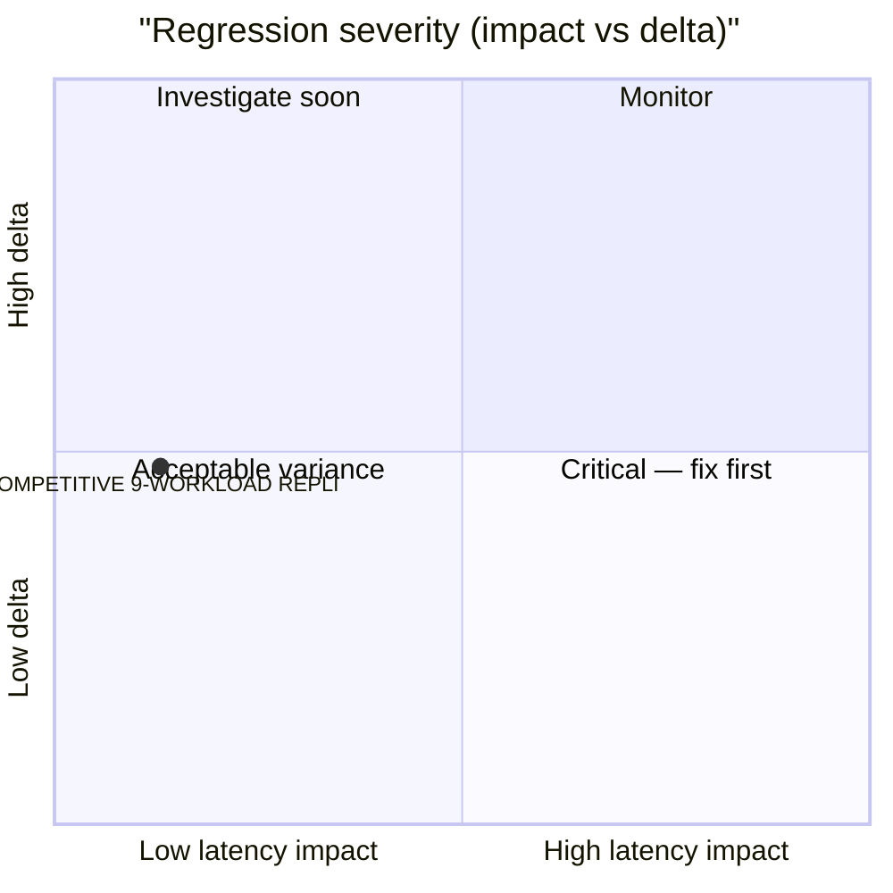

# 🚀 PostgreSQL Performance Ledger

> [!NOTE] Competitive comparisons based on publicly available documentation as of June 2026. All SveltyCMS metrics self-measured via `bun test tests/benchmarks/`.

> [!IMPORTANT]
> **Console-only by default.** Use `BENCHMARK_RECORD=1` to write results to this report.
>
> ```bash
> BENCHMARK_RECORD=1 bun test tests/benchmarks/auth-performance.test.ts
> ```
>
> The full matrix runner (`bun run scripts/benchmark-matrix/index.ts --sql`) always records.

<!-- BENCHMARK_START -->

<!-- EXECUTIVE_START -->
<!-- LATEST_AUDIT_HEADER -->

## 📊 Latest Performance Audit

<!-- EXECUTIVE_FIX_NOTES_START -->

### 📝 Fix Overlays

> [!NOTE]
> Phase notes and remediation entries appear here after matrix or surgical runs.

<!-- EXECUTIVE_FIX_NOTES_END -->

(21/11/2026, 23:36:05)

**✅ PASS** · 38/44 tests · 6 skipped · **POSTGRESQL** · Bun 1.4.2

### Dimension health

| Dimension      | Tests | Status | Worst Δ | Issues |
| -------------- | ----: | ------ | ------- | ------ |
| **Core**       |    13 | 🟢     | -10%    | 0      |
| **API**        |     9 | 🟢     | —       | 0      |
| **Scale**      |    17 | 🟢     | —       | 0      |
| **Resilience** |     5 | 🟢     | —       | 0      |

### Issues (action required)

> ✅ **All clear** — no regressions or budget violations detected.

### Executive latency matrix

| Scenario               | Latency | Trend  | Budget   | Result |
| ---------------------- | ------- | ------ | -------- | ------ |
| **Cold Start**         | N/A     | ⚪ (—) | < 5000ms | ⚪ N/A |
| **REST (Collections)** | N/A     | ⚪ (—) | < 5ms    | ⚪ N/A |
| **Middleware Hooks**   | N/A     | ⚪     | < 2ms    | ⚪ N/A |
| **GraphQL (Avg)**      | N/A     | ⚪ (—) | < 5ms    | ⚪ N/A |
| **Million-Row Index**  | N/A     | ⚪     | < 250ms  | ⚪ N/A |
| **DB Raw (p95)**       | N/A     | ⚪     | < 50ms   | ⚪ N/A |

### Historical pulse

> **Scope:** Sparklines only — full run tables: [`tests/benchmarks/results/history.sqlite`](../../../tests/benchmarks/results/history.sqlite)

| Metric | Trend | Sparkline | Latest |
| ------ | ----- | --------- | ------ |

<details>
<summary>📈 Latency trend chart (last 10 runs)</summary>

```mermaid
xychart-beta
  title "POSTGRESQL REST p95 (last 10 runs)"
  x-axis ["R1", "R2", "R3", "R4", "R5", "R6", "R7", "R8", "R9", "R10"]
  y-axis "Latency (ms)"
  line "p95" : [0.000, 0.000, 0.000, 0.000, 0.000, 0.000, 0.000, 0.000, 0.000, 0.000]
```

</details>
<details>
<summary>📊 Regression severity matrix (quadrant)</summary>



</details>

<!-- EXECUTIVE_PARTIAL_WATERMARK -->

> 📋 **Partial report** — run full matrix for complete cross-DB analysis.

<!-- EXECUTIVE_ALERTS_START -->

> 📋 **Partial report** — run full matrix for complete cross-DB analysis.

### 🔴 Top Regressions

> **🔴 database-performance [LIST+COUNT (legacy)]** (postgresql): +142% | 1.26ms vs 0.52ms baseline
> **🔴 transaction-acid [TX Rollback Integrity]** (postgresql): +46% | 1.32ms vs 0.90ms baseline
> **🔴 rest-api-performance [Collection Search Query]** (postgresql): +45% | 0.23ms vs 0.16ms baseline
> **🔴 cache-performance [Cache Hit (L1 Warm)]** (postgresql): +33% | 0.13ms vs 0.09ms baseline
> **🔴 rest-api-performance [Collection Find (List Limit 20)]** (postgresql): +33% | 0.21ms vs 0.16ms baseline

### 🟢 Top Improvements

> **truth-latency [Local SDK (Full)]** (postgresql): -36% | 0.01ms vs 0.01ms baseline
> **rest-api-performance [Single Document Read]** (postgresql): -35% | 0.12ms vs 0.18ms baseline
> **hooks-performance [REST with API Caching]** (postgresql): -34% | 0.13ms vs 0.19ms baseline
> **rest-api-performance [System Health Check]** (postgresql): -24% | 0.54ms vs 0.71ms baseline
> **rest-api-performance [Collection Schema Metadata]** (postgresql): -16% | 0.19ms vs 0.23ms baseline

<!-- EXECUTIVE_ALERTS_END --><!-- EXECUTIVE_END -->

<!-- SUMMARY_START -->
<!-- SUMMARY_RUN_OVERLAY_START -->

### Current Run Summary (2026-11-21)

> **Scope:** Only tests that ran in THIS invocation.

**Run ID:** `8bb70c7b-6635-40ca-86d1-0b16416ccdf8` · **Tests invoked:** 7 · **Metrics:** 39 · **DB:** postgresql

| Test                     | Metric                                         | Avg (ms) | p95 (ms) | RPS    | Trend | Detail                            |
| ------------------------ | ---------------------------------------------- | -------- | -------- | ------ | ----- | --------------------------------- |
| Cache Performance        | Cache Miss (Bypass)                            | 0.637    | 0.903    | 1501   | 🟢    | ⚪ established at 0.637ms (1 run) |
| Cache Performance        | Cache Hit (L1 Warm)                            | 0.125    | 0.187    | 7781   | 🟢    | ⚪ established at 0.125ms (1 run) |
| Database Performance     | INSERT                                         | 0.399    | 0.495    | 2427   | 🟢    | ⚪ established at 0.399ms (1 run) |
| Database Performance     | FIND ONE                                       | 0.352    | 0.434    | 2750   | 🟢    | ⚪ established at 0.352ms (1 run) |
| Database Performance     | FIND MANY (limit 50)                           | 0.540    | 0.668    | 1791   | 🟢    | ⚪ established at 0.540ms (1 run) |
| Database Performance     | FILTER (blob field, 1 match)                   | 0.823    | 0.998    | 1182   | 🟢    | ⚪ established at 0.823ms (1 run) |
| Database Performance     | QUERY BUILDER LIST (50)                        | 0.511    | 0.813    | 1770   | 🟢    | ⚪ established at 0.511ms (1 run) |
| Database Performance     | FIND PAGE (50 hasMore)                         | 0.559    | 0.709    | 1722   | 🟢    | ⚪ established at 0.559ms (1 run) |
| Database Performance     | FIND PAGE keyset                               | 1.007    | 1.236    | 950    | 🟢    | ⚪ established at 1.01ms (1 run)  |
| Database Performance     | FIND MANY offset 50                            | 0.466    | 0.564    | 2080   | 🟢    | ⚪ established at 0.466ms (1 run) |
| Database Performance     | LIST+COUNT (legacy)                            | 1.265    | 1.518    | 768    | 🟢    | ⚪ established at 1.26ms (1 run)  |
| Database Performance     | UPDATE                                         | 0.403    | 0.506    | 2406   | 🟢    | ⚪ established at 0.403ms (1 run) |
| Database Performance     | UPDATE (no-returning)                          | 0.376    | 0.479    | 2568   | 🟢    | ⚪ established at 0.376ms (1 run) |
| Database Performance     | NATIVE UPSERT                                  | 0.769    | 0.982    | 1242   | 🟢    | ⚪ established at 0.769ms (1 run) |
| Database Performance     | COUNT                                          | 0.584    | 0.711    | 1663   | 🟢    | ⚪ established at 0.584ms (1 run) |
| Database Performance     | COUNT ESTIMATE                                 | 0.672    | 0.860    | 1436   | 🟢    | ⚪ established at 0.672ms (1 run) |
| Database Performance     | COUNT CACHED                                   | 0.001    | 0.003    | 592101 | 🟢    | ⚪ established at 0.001ms (1 run) |
| Database Performance     | DELETE (Active Rows)                           | 0.788    | 0.956    | 1198   | 🟢    | ⚪ established at 0.788ms (1 run) |
| Database Performance     | BULK INSERT (100)                              | 2.535    | 3.006    | 385    | 🟢    | ⚪ established at 2.54ms (1 run)  |
| Database Performance     | BULK UPDATE (100 heterogeneous)                | 4.243    | 5.158    | 226    | 🟢    | ⚪ established at 4.24ms (1 run)  |
| Database Performance     | BULK UPDATE (100 homogeneous)                  | 3.402    | 3.881    | 290    | 🟢    | ⚪ established at 3.40ms (1 run)  |
| Hooks Performance        | Static Asset (No Middleware)                   | 0.870    | 1.563    | 4072   | 🟢    | ⚪ established at 0.870ms (1 run) |
| Hooks Performance        | Turbo Pipeline (Light)                         | 0.574    | 0.945    | 6368   | 🟢    | ⚪ established at 0.574ms (1 run) |
| Hooks Performance        | Full Security + Auth Pipeline                  | 0.103    | 0.266    | 31545  | 🟢    | ⚪ established at 0.103ms (1 run) |
| Hooks Performance        | REST with API Caching                          | 0.125    | 0.297    | 26642  | 🟢    | ⚪ established at 0.125ms (1 run) |
| Hooks Performance        | Mutation (audit logging disabled)              | 0.821    | 1.337    | 1135   | 🟢    | ⚪ established at 0.821ms (1 run) |
| Rest Api Performance     | System Health Check                            | 0.540    | 0.944    | 6716   | 🟢    | ⚪ established at 0.540ms (1 run) |
| Rest Api Performance     | Collection Schema Metadata                     | 0.190    | 0.327    | 20612  | 🟢    | ⚪ established at 0.190ms (1 run) |
| Rest Api Performance     | Single Document Read                           | 0.116    | 0.232    | 30700  | 🟢    | ⚪ established at 0.116ms (1 run) |
| Rest Api Performance     | Collection Find (List Limit 20)                | 0.210    | 0.432    | 17211  | 🟢    | ⚪ established at 0.210ms (1 run) |
| Rest Api Performance     | Collection Search Query                        | 0.235    | 0.652    | 13332  | 🟢    | ⚪ established at 0.235ms (1 run) |
| Transaction Acid         | TX Commit                                      | 0.671    | 1.132    | 5495   | 🟢    | ⚪ established at 0.671ms (1 run) |
| Transaction Acid         | TX Rollback Integrity                          | 1.317    | 2.286    | 757    | 🟢    | ⚪ established at 1.32ms (1 run)  |
| Truth Latency            | Logic Baseline                                 | 0.000    | 0.000    | 479080 | 🟢    | ⚪ established at 0ms (1 run)     |
| Truth Latency            | Local SDK (Full)                               | 0.007    | 0.017    | 1665   | 🟢    | ⚪ established at 0.007ms (1 run) |
| Truth Latency            | HTTP End-to-End                                | 0.176    | 0.251    | 5619   | 🟢    | ⚪ established at 0.176ms (1 run) |
| Truth Latency            | HTTP Cold (Cache-Busted)                       | 0.876    | 1.427    | 1139   | 🟢    | ⚪ established at 0.876ms (1 run) |
| Virtual Query Federation | Virtual Read Passthrough (live WordPress REST) | 0.315    | 0.503    | 3081   | 🟢    | ⚪ established at 0.315ms (1 run) |
| Virtual Query Federation | Virtual Read Passthrough (mock REST)           | 0.048    | 0.063    | 20366  | 🟢    | ⚪ established at 0.048ms (1 run) |

<!-- SUMMARY_RUN_OVERLAY_END -->

<!-- SUMMARY_HISTORY_START -->

### Historical Trends (2026-11-21)

> **Mode:** production-parity matrix runs only (`run_mode='matrix'` + `server_mode='production'` — `NODE_ENV=production`, no `TEST_MODE`). Standalone/mode-variant samples are recorded but never trended here.

> **Scope:** Sparklines only — full run tables live in `history.sqlite` (link below). Runs = sparkline bar count.

**Detail:** [`tests/benchmarks/results/history.sqlite`](../../../tests/benchmarks/results/history.sqlite) · `SELECT test_id, phase, server_mode, avg_ms, p95_ms, rps, timestamp FROM runs WHERE db_type='postgresql' AND redis=0 ORDER BY timestamp DESC`

**Series:** 8 · **DB:** postgresql

| Metric                              | Trend | Sparkline (last 7) | Latest  |
| ----------------------------------- | ----- | ------------------ | ------- |
| CACHE PERFORMANCE (warm)            | 🟢    | `▁█`               | 0.125ms |
| COMPETITIVE WORKLOAD REPLICA (warm) | 🟢    | `█▇▁▄`             | 0.130ms |
| DATABASE PERFORMANCE (warm)         | 🟢    | `▁█`               | 0.352ms |
| HOOKS PERFORMANCE (warm)            | 🟢    | `█▁`               | 0.103ms |
| REST API PERFORMANCE (warm)         | 🟢    | `█▁`               | 0.116ms |
| TRANSACTION ACID (warm)             | 🟢    | `▁█`               | 0.671ms |
| TRUTH LATENCY (warm)                | 🟢    | `▁█`               | 0.876ms |
| VIRTUAL QUERY FEDERATION (warm)     | 🟢    | `▁█`               | 0.315ms |

<!-- SUMMARY_HISTORY_END --><!-- SUMMARY_END -->

<details>
<summary>📊 Infrastructure drill-down (expand for adapter, hooks, memory trends)</summary>

## 📊 Infrastructure drill-down

### 🏷️ Mixed Workload Performance {#mixedAvg}

**Mixed p95:** — (not measured in this run) | **Trend:** ⚪ (—)

> Production request mix: 60% Reads, 20% Writes, 15% GraphQL, 5% Media.

### 🏷️ Database Adapter Performance {#dbRaw}

**Raw Adapter p95:** — (not measured in this run) | **Target:** < 50ms | **Trend:** ⚪ (—)

> Direct database access latency (bypass CMS logic).

### 🏷️ Middleware & Hooks Audit {#hooks}

**Middleware p95:** — (not measured in this run) | **Target:** < 2ms | **Trend:** ⚪ (—)

> Total overhead of security, logging, and auth hooks.

### 🏷️ Memory Stability Audit {#memGrowth}

**Memory RSS Δ:** — (not measured in this run) | **Target:** < 60MB | **Trend:** ⚪ (—)

> Peak memory growth during stress workload.

### Enterprise scale audit

### 🏷️ Multi-Tenancy Performance {#tenancyAvg}

**Tenancy p95:** — (not measured in this run) | **Trend:** ⚪ (—)

> Measures latency across tenant isolation boundaries.

### 🏷️ Relational Resolver Latency {#relationalAvg}

**Relational p95:** — (not measured in this run) | **Trend:** ⚪ (—)

> Tests performance of complex JOINs and nested relationship population.

### 🏷️ Telemetry & Update Performance {#telemetryAvg}

**Telemetry p95:** — (not measured in this run) | **Trend:** ⚪ (—)

> Measures overhead of telemetry collection and cryptographic signing.

</details>

<!-- LEDGER_START -->

## 🔬 Full benchmark ledger (41 modules)

Expand dimension groups, then any row, for ASCII truth tables. Executive summary above shows pass/fail and issues only.

<!-- LEDGER_DIMENSION:CORE:START -->

<details id="ledger-dimension-core">
<summary><strong>Core</strong> · 27 tests</summary>

<!-- SECTION:API_LATENCY:START -->
<details id="section-api_latency">
<summary><strong>🏷️ API LAYER LATENCY</strong> · ⚪ ⏳ pending · ➡️ — · <a href="../../../tests/benchmarks/api-latency.test.ts">source</a></summary>
<!-- LEDGER_TRUTH_START -->
```text
╔═══════════════════════════════════════════════════════════════════════════════════════════════════════╗
║                                     SVELTYCMS — API LAYER LATENCY                                     ║
║                              File: tests/benchmarks/api-latency.test.ts                               ║
║                                       Ran: 2026-10-06 10:55:22                                        ║
║              Cold full-pipeline findById + warm TURBO-HIT path after responseCache fill.              ║
╠═══════════════════════════════════════════════════════════════════════════════════════════════════════╣
║ HTTP: findById @ 8c (Cold)   │ Cold:     2.36 ms │ Warm:     2.080 ms │ p95:     4.527 ms │   3,371 RPS ║
║ HTTP: findById TURBO-HIT @ 8c (Warm) │ Cold:     0.29 ms │ Warm:     0.753 ms │ p95:     0.881 ms │  10,973 RPS ║
║ HTTP: zstd large GET (>64KiB, drained) │ Cold:     2.84 ms │ Warm:     3.818 ms │ p95:     4.551 ms │     510 RPS ║
║ HTTP: findById TURBO-HIT idle (Warm) │        0.198 ms │ p95:        0.277 ms │ RPS:      4,946 ║
║ HTTP: findById TURBO-HIT during zstd (Warm) │        0.291 ms │ p95:        0.610 ms │ RPS:      2,463 ║
╚═══════════════════════════════════════════════════════════════════════════════════════════════════════╝
```
<!-- LEDGER_TRUTH_END -->

</details>
<!-- SECTION:API_LATENCY:END -->

<!-- SECTION:COLD_START:START -->
<details id="section-cold_start">
<summary><strong>🏷️ PHASED COLD START</strong> · ⚪ ⏳ pending · ➡️ — · <a href="../../../tests/benchmarks/cold-start-phased.test.ts">source</a></summary>
<!-- LEDGER_TRUTH_START -->
```text
╔═══════════════════════════════════════════════════════════════════════════════════════════════════════╗
║                                  SVELTYCMS — PHASED COLD START AUDIT                                  ║
║                           File: tests/benchmarks/cold-start-phased.test.ts                            ║
║                                       Ran: 2026-10-17 12:06:20                                        ║
║            Measures process spawn, dependency hydration, and first-request TTFB readiness.            ║
╠═══════════════════════════════════════════════════════════════════════════════════════════════════════╣
║ Initial Cold Boot (Fresh Process) │     4139.707 ms │ p95:     4139.707 ms │ RPS:          0 ║
║ Steady-State Respawn (Average) │     2621.272 ms │ p95:     4139.707 ms │ RPS:          0 ║
╚═══════════════════════════════════════════════════════════════════════════════════════════════════════╝
```
<!-- LEDGER_TRUTH_END -->

</details>
<!-- SECTION:COLD_START:END -->

<!-- SECTION:TRUTH_AUDIT:START -->
<details id="section-truth_audit">
<summary><strong>🏷️ SRE TRUTH AUDIT</strong> · ⚪ 0.876ms · ➡️ — · <a href="../../../tests/benchmarks/truth-latency.test.ts">source</a></summary>
<!-- LEDGER_TRUTH_START -->
```text
╔═══════════════════════════════════════════════════════════════════════════════════════════════════════╗
║                                      SVELTYCMS — SRE TRUTH AUDIT                                      ║
║                             File: tests/benchmarks/truth-latency.test.ts                              ║
║                                       Ran: 2026-11-21 22:34:54                                        ║
║            Validates performance claims by comparing SDK, Middleware, and Real HTTP Stack             ║
╠═══════════════════════════════════════════════════════════════════════════════════════════════════════╣
║ Logic Baseline               │ Cold:     0.01 ms │ Warm:     0.000 ms │ p95:     0.000 ms │ 479,080 RPS ║
║ Local SDK (Full)             │ Cold:   134.32 ms │ Warm:     0.007 ms │ p95:     0.017 ms │   1,665 RPS ║
║ HTTP End-to-End              │ Cold:     5.63 ms │ Warm:     0.176 ms │ p95:     0.251 ms │   5,619 RPS ║
║ HTTP Cold (Cache-Busted)     │ Cold:     4.40 ms │ Warm:     0.876 ms │ p95:     1.427 ms │   1,139 RPS ║
╚═══════════════════════════════════════════════════════════════════════════════════════════════════════╝
```
<!-- LEDGER_TRUTH_END -->

</details>
<!-- SECTION:TRUTH_AUDIT:END -->

<!-- SECTION:INCREMENTAL:START -->
<details id="section-incremental">
<summary><strong>🏷️ Incremental Content Reload</strong> · ⚪ ⏳ pending · ➡️ — · <a href="../../../tests/benchmarks/content-incremental-reload.test.ts">source</a></summary>
<!-- LEDGER_TRUTH_START -->
```text
╔═══════════════════════════════════════════════════════════════════════════════════════════════════════╗
║                             SVELTYCMS — INCREMENTAL CONTENT RELOAD AUDIT                              ║
║                       File: tests/benchmarks/content-incremental-reload.test.ts                       ║
║                                       Ran: 2026-10-06 09:39:27                                        ║
║      Measures surgical single-file fullReload vs full reconciliation path and batch processing.       ║
╠═══════════════════════════════════════════════════════════════════════════════════════════════════════╣
║ Incremental fullReload (1 file) │ Cold:     4.56 ms │ Warm:     0.060 ms │ p95:     0.129 ms │  14,319 RPS ║
║ Full Reconciliation Reload   │ Cold:     3.12 ms │ Warm:     0.178 ms │ p95:     0.212 ms │   5,543 RPS ║
║ Sequential 10-File Reload    │ Cold:     4.15 ms │ Warm:     0.514 ms │ p95:     0.653 ms │   1,905 RPS ║
║ Batched 10-File Reload       │ Cold:     0.98 ms │ Warm:     0.234 ms │ p95:     0.339 ms │   3,953 RPS ║
╚═══════════════════════════════════════════════════════════════════════════════════════════════════════╝
```
<!-- LEDGER_TRUTH_END -->

</details>
<!-- SECTION:INCREMENTAL:END -->

<!-- SECTION:HOOKS_TRACE:START -->
<details id="section-hooks_trace">
<summary><strong>🏷️ Middleware & Hooks Performance</strong> · ⚪ 0.103ms · ➡️ — · <a href="../../../tests/benchmarks/hooks-performance.test.ts">source</a></summary>
<!-- LEDGER_TRUTH_START -->
```text
╔═══════════════════════════════════════════════════════════════════════════════════════════════════════╗
║                                 SVELTYCMS — MIDDLEWARE & HOOKS AUDIT                                  ║
║                           File: tests/benchmarks/hooks-performance.test.ts                            ║
║                                       Ran: 2026-11-21 22:35:12                                        ║
║Measures the cost of the full middleware chain including Turbo, Security, Auth, and Audit via HTTP E2E.║
╠═══════════════════════════════════════════════════════════════════════════════════════════════════════╣
║ Static Asset (No Middleware) │ Cold:     2.50 ms │ Warm:     0.870 ms │ p95:     1.563 ms │   4,072 RPS ║
║ Turbo Pipeline (Light)       │ Cold:     0.48 ms │ Warm:     0.574 ms │ p95:     0.945 ms │   6,368 RPS ║
║ Full Security + Auth Pipeline │ Cold:     0.42 ms │ Warm:     0.103 ms │ p95:     0.266 ms │  31,545 RPS ║
║ REST with API Caching        │ Cold:     2.27 ms │ Warm:     0.125 ms │ p95:     0.297 ms │  26,642 RPS ║
║ Mutation (audit logging disabled) │ Cold:     3.88 ms │ Warm:     0.821 ms │ p95:     1.337 ms │   1,135 RPS ║
╚═══════════════════════════════════════════════════════════════════════════════════════════════════════╝
```
<!-- LEDGER_TRUTH_END -->

</details>
<!-- SECTION:HOOKS_TRACE:END -->

<!-- SECTION:STATE_MACHINE:START -->
<details id="section-state_machine">
<summary><strong>🏷️ State Machine Transitions</strong> · ⚪ ⏳ pending · ➡️ — · <a href="../../../tests/benchmarks/state-machine-transition.test.ts">source</a></summary>
<!-- LEDGER_TRUTH_START -->
```text
╔═══════════════════════════════════════════════════════════════════════════════════════════════════════╗
║                                  SVELTYCMS — STATE MACHINE INTEGRITY                                  ║
║                        File: tests/benchmarks/state-machine-transition.test.ts                        ║
║                                       Ran: 2026-10-06 09:39:41                                        ║
║Measures state machine self-healing transition latencies, convergence settling time, and health probe consistency under stress.║
╠═══════════════════════════════════════════════════════════════════════════════════════════════════════╣
║ State Transition (Transient) │ Cold:   157.07 ms │ Warm:   111.017 ms │ p95:   126.051 ms │       9 RPS ║
║ Self-Healing Full Convergence │ Cold:   116.23 ms │ Warm:   108.114 ms │ p95:   118.538 ms │       9 RPS ║
╚═══════════════════════════════════════════════════════════════════════════════════════════════════════╝
```
<!-- LEDGER_TRUTH_END -->

</details>
<!-- SECTION:STATE_MACHINE:END -->

<!-- SECTION:DB_RAW_P95:START -->
<details id="section-db_raw_p95">
<summary><strong>🏷️ Database Adapter Raw CRUD</strong> · ⚪ 0.352ms · ➡️ — · <a href="../../../tests/benchmarks/database-performance.test.ts">source</a></summary>
<!-- LEDGER_TRUTH_START -->
```text
╔═══════════════════════════════════════════════════════════════════════════════════════════════════════╗
║                         SVELTYCMS — DATABASE ADAPTER PERFORMANCE (POSTGRESQL)                         ║
║                          File: tests/benchmarks/database-performance.test.ts                          ║
║                                       Ran: 2026-11-21 22:36:01                                        ║
║          Measures raw CRUD performance, indexing efficiency, and connection pool resilience.          ║
╠═══════════════════════════════════════════════════════════════════════════════════════════════════════╣
║ INSERT                       │ Cold:     1.99 ms │ Warm:     0.399 ms │ p95:     0.495 ms │   2,427 RPS ║
║ FIND ONE                     │ Cold:     1.51 ms │ Warm:     0.352 ms │ p95:     0.434 ms │   2,750 RPS ║
║ FIND MANY (limit 50)         │ Cold:     3.12 ms │ Warm:     0.540 ms │ p95:     0.668 ms │   1,791 RPS ║
║ FILTER (blob field, 1 match) │ Cold:     2.78 ms │ Warm:     0.823 ms │ p95:     0.998 ms │   1,182 RPS ║
║ QUERY BUILDER LIST (50)      │ Cold:     4.51 ms │ Warm:     0.511 ms │ p95:     0.813 ms │   1,770 RPS ║
║ FIND PAGE (50 hasMore)       │ Cold:     4.40 ms │ Warm:     0.559 ms │ p95:     0.709 ms │   1,722 RPS ║
║ FIND PAGE keyset             │ Cold:    18.55 ms │ Warm:     1.007 ms │ p95:     1.236 ms │     950 RPS ║
║ FIND MANY offset 50          │ Cold:     3.32 ms │ Warm:     0.466 ms │ p95:     0.564 ms │   2,080 RPS ║
║ LIST+COUNT (legacy)          │ Cold:     4.28 ms │ Warm:     1.265 ms │ p95:     1.518 ms │     768 RPS ║
║ UPDATE                       │ Cold:     3.98 ms │ Warm:     0.403 ms │ p95:     0.506 ms │   2,406 RPS ║
║ UPDATE (no-returning)        │ Cold:     3.19 ms │ Warm:     0.376 ms │ p95:     0.479 ms │   2,568 RPS ║
║ NATIVE UPSERT                │ Cold:     2.71 ms │ Warm:     0.769 ms │ p95:     0.982 ms │   1,242 RPS ║
║ COUNT                        │ Cold:     4.74 ms │ Warm:     0.584 ms │ p95:     0.711 ms │   1,663 RPS ║
║ COUNT ESTIMATE               │ Cold:     3.08 ms │ Warm:     0.672 ms │ p95:     0.860 ms │   1,436 RPS ║
║ COUNT CACHED                 │ Cold:     2.85 ms │ Warm:     0.001 ms │ p95:     0.003 ms │ 592,101 RPS ║
║ DELETE (Active Rows)         │ Cold:    11.02 ms │ Warm:     0.788 ms │ p95:     0.956 ms │   1,198 RPS ║
║ BULK INSERT (100)            │ Cold:     7.48 ms │ Warm:     2.535 ms │ p95:     3.006 ms │     385 RPS ║
║ BULK UPDATE (100 heterogeneous) │ Cold:    13.11 ms │ Warm:     4.243 ms │ p95:     5.158 ms │     226 RPS ║
║ BULK UPDATE (100 homogeneous) │ Cold:     9.28 ms │ Warm:     3.402 ms │ p95:     3.881 ms │     290 RPS ║
╚═══════════════════════════════════════════════════════════════════════════════════════════════════════╝
```
<!-- LEDGER_TRUTH_END -->

</details>
<!-- SECTION:DB_RAW_P95:END -->

<!-- SECTION:ACID:START -->
<details id="section-acid">
<summary><strong>🏷️ ACID Transaction Overhead</strong> · ⚪ 0.671ms · ➡️ — · <a href="../../../tests/benchmarks/transaction-acid.test.ts">source</a></summary>
<!-- LEDGER_TRUTH_START -->
```text
╔═══════════════════════════════════════════════════════════════════════════════════════════════════════╗
║                                   SVELTYCMS — ACID INTEGRITY AUDIT                                    ║
║                            File: tests/benchmarks/transaction-acid.test.ts                            ║
║                                       Ran: 2026-11-21 22:36:04                                        ║
║         Measures transaction commit latencies and rollback overhead across database adapters          ║
╠═══════════════════════════════════════════════════════════════════════════════════════════════════════╣
║ TX Commit                    │ Cold:     3.15 ms │ Warm:     0.671 ms │ p95:     1.132 ms │   5,495 RPS ║
║ TX Rollback Integrity        │ Cold:     3.62 ms │ Warm:     1.317 ms │ p95:     2.286 ms │     757 RPS ║
╚═══════════════════════════════════════════════════════════════════════════════════════════════════════╝
```
<!-- LEDGER_TRUTH_END -->

</details>
<!-- SECTION:ACID:END -->

<!-- SECTION:CACHE:START -->
<details id="section-cache">
<summary><strong>🏷️ System Cache Efficiency</strong> · ⚪ 0.125ms · ➡️ — · <a href="../../../tests/benchmarks/cache-performance.test.ts">source</a></summary>
<!-- LEDGER_TRUTH_START -->
```text
╔═══════════════════════════════════════════════════════════════════════════════════════════════════════╗
║                                  SVELTYCMS — CACHE EFFICIENCY AUDIT                                   ║
║                           File: tests/benchmarks/cache-performance.test.ts                            ║
║                                       Ran: 2026-11-21 22:35:08                                        ║
║         Measures cache hit vs miss latency and efficiency via real HTTP end-to-end requests.          ║
╠═══════════════════════════════════════════════════════════════════════════════════════════════════════╣
║ Cache Miss (Bypass)          │ Cold:     2.26 ms │ Warm:     0.637 ms │ p95:     0.903 ms │   1,501 RPS ║
║ Cache Hit (L1 Warm)          │ Cold:     0.81 ms │ Warm:     0.125 ms │ p95:     0.187 ms │   7,781 RPS ║
╚═══════════════════════════════════════════════════════════════════════════════════════════════════════╝
```
<!-- LEDGER_TRUTH_END -->

</details>
<!-- SECTION:CACHE:END -->

<!-- SECTION:CACHE_EFFICIENCY:START -->
<details id="section-cache_efficiency">
<summary><strong>🏷️ Cache Hit/Miss Ratio & Efficiency</strong> · ⚪ ⏳ pending · ➡️ — · <a href="../../../tests/benchmarks/cache-hit-ratio.test.ts">source</a></summary>
<!-- LEDGER_TRUTH_START -->
```text
╔═══════════════════════════════════════════════════════════════════════════════════════════════════════╗
║                                  SVELTYCMS — CACHE EFFICIENCY AUDIT                                   ║
║                           File: tests/benchmarks/cache-performance.test.ts                            ║
║                                       Ran: 2026-11-21 22:35:08                                        ║
║         Measures cache hit vs miss latency and efficiency via real HTTP end-to-end requests.          ║
╠═══════════════════════════════════════════════════════════════════════════════════════════════════════╣
║ Cache Miss (Bypass)          │ Cold:     2.26 ms │ Warm:     0.637 ms │ p95:     0.903 ms │   1,501 RPS ║
║ Cache Hit (L1 Warm)          │ Cold:     0.81 ms │ Warm:     0.125 ms │ p95:     0.187 ms │   7,781 RPS ║
╚═══════════════════════════════════════════════════════════════════════════════════════════════════════╝
```
<!-- LEDGER_TRUTH_END -->

</details>
<!-- SECTION:CACHE_EFFICIENCY:END -->

<!-- SECTION:UNKNOWN:START -->
<details id="section-unknown">
<summary><strong>🏷️ unknown</strong> · 🟢 0.002ms · ➡️ recorded (awaiting trend) · <a href="../../../tests/benchmarks/transaction-acid.test.ts">source</a></summary>
<!-- LEDGER_TRUTH_START -->
```text
╔═════════════════════════════════════════════════════════════════════════════════════════╗
║                      SVELTYCMS — CACHE EVICTION BOUNDARY HARDENING                      ║
║                                      File: unknown                                      ║
║                                Ran: 2026-08-23 22:11:25                                 ║
╠═════════════════════════════════════════════════════════════════════════════════════════╣
║ Cache Flooding & Eviction      │        0.002 ms │ p95:        0.002 ms │ RPS:    491,074 ║
╚═════════════════════════════════════════════════════════════════════════════════════════╝
```
<!-- LEDGER_TRUTH_END -->

</details>
<!-- SECTION:UNKNOWN:END -->

<!-- SECTION:MIDDLEWARE:START -->
<details id="section-middleware">
<summary><strong>🏷️ Middleware</strong> · 🟢 3.063ms · ➡️ ⚪ established at 3.06ms (1 run) (2026-09-30 15:24:48) · <a href="../../../tests/benchmarks/hooks-performance.test.ts">source</a></summary>
<!-- LEDGER_TRUTH_START -->
> ⏳ Pending
<!-- LEDGER_TRUTH_END -->

</details>
<!-- SECTION:MIDDLEWARE:END -->

<!-- SECTION:SYSTEM:START -->
<details id="section-system">
<summary><strong>🏷️ System</strong> · 🟢 0.388ms · ↘️ ⚪ stable at 0.494ms (±0.265ms) (3 runs) (2026-09-18 18:23:47) · <a href="../../../tests/benchmarks/rest-api-performance.test.ts">source</a></summary>
<!-- LEDGER_INSIGHT_START -->
> [!NOTE]
> **Specific to this test**: Performance improved — recent optimizations or cache warming likely effective.
<!-- LEDGER_INSIGHT_END -->

<!-- LEDGER_TRUTH_START -->

> ⏳ Pending

<!-- LEDGER_TRUTH_END -->

</details>
<!-- SECTION:SYSTEM:END -->

<!-- SECTION:METADATA:START -->
<details id="section-metadata">
<summary><strong>🏷️ Metadata</strong> · 🟢 0.707ms · ➡️ ⚪ stable at 0.738ms (±0.092ms) (3 runs) (2026-09-18 18:23:48) · <a href="../../../tests/benchmarks/rest-api-performance.test.ts">source</a></summary>
<!-- LEDGER_TRUTH_START -->
> ⏳ Pending
<!-- LEDGER_TRUTH_END -->

</details>
<!-- SECTION:METADATA:END -->

<!-- SECTION:CRUD:START -->
<details id="section-crud">
<summary><strong>🏷️ CRUD</strong> · 🟢 4.330ms · ➡️ recorded (awaiting trend) · <a href="../../../tests/benchmarks/rest-api-performance.test.ts">source</a></summary>
<!-- LEDGER_TRUTH_START -->
```text
╔═══════════════════════════════════════════════════════════════════════════════════════════════════════╗
║                              SVELTYCMS — LOCALCMS CRUD TAX (POSTGRESQL)                               ║
║                             File: tests/benchmarks/local-cms-crud.test.ts                             ║
║                                       Ran: 2026-10-06 11:02:17                                        ║
║Measures full CollectionsNamespace tax vs direct adapter baseline with isolated garbage collection and deterministic ID generation.║
╠═══════════════════════════════════════════════════════════════════════════════════════════════════════╣
║ Adapter FIND ONE             │ Cold:     4.33 ms │ Warm:     0.495 ms │ p95:     0.751 ms │   1,877 RPS ║
║ Direct-to-Wire Point Stream  │ Cold:     3.01 ms │ Warm:     0.448 ms │ p95:     0.578 ms │   2,173 RPS ║
║ LocalCMS findById (Warm)     │ Cold:     0.21 ms │ Warm:     0.001 ms │ p95:     0.003 ms │ 540,760 RPS ║
║ LocalCMS findById (Cold)     │ Cold:     1.74 ms │ Warm:     0.416 ms │ p95:     0.678 ms │   2,248 RPS ║
║ LocalCMS create              │ Cold:     3.33 ms │ Warm:     0.516 ms │ p95:     0.672 ms │   1,914 RPS ║
║ LocalCMS update              │ Cold:     6.94 ms │ Warm:     0.560 ms │ p95:     0.716 ms │   1,743 RPS ║
║ LocalCMS mixed C/U/R         │ Cold:     4.61 ms │ Warm:     1.491 ms │ p95:     1.958 ms │     646 RPS ║
╚═══════════════════════════════════════════════════════════════════════════════════════════════════════╝
```
<!-- LEDGER_TRUTH_END -->

</details>
<!-- SECTION:CRUD:END -->

<!-- SECTION:LOGIC:START -->
<details id="section-logic">
<summary><strong>🏷️ Logic</strong> · 🟢 ⏳ pending · ➡️ ⚪ established at 0ms (1 run) (2026-10-17 12:06:48) · <a href="../../../tests/benchmarks/truth-latency.test.ts">source</a></summary>
<!-- LEDGER_TRUTH_START -->
> ⏳ Pending
<!-- LEDGER_TRUTH_END -->

</details>
<!-- SECTION:LOGIC:END -->

<!-- SECTION:SDK:START -->
<details id="section-sdk">
<summary><strong>🏷️ SDK</strong> · 🟢 0.008ms · ➡️ ⚪ established at 0.008ms (1 run) (2026-10-17 12:06:48) · <a href="../../../tests/benchmarks/truth-latency.test.ts">source</a></summary>
<!-- LEDGER_TRUTH_START -->
```text
╔═══════════════════════════════════════════════════════════════════════════════════════════════════════╗
║                            SVELTYCMS — SDK VS DIRECT ADAPTER (POSTGRESQL)                             ║
║                          File: tests/benchmarks/local-sdk-vs-direct.test.ts                           ║
║                                       Ran: 2026-10-06 11:02:38                                        ║
║Measures the exact SDK tax across Create, Find, and Update pathways with isolated GC sweeps and zero-allocation key pools.║
╠═══════════════════════════════════════════════════════════════════════════════════════════════════════╣
║ Direct insert                  │        0.483 ms │ p95:        0.483 ms │ RPS:      2,072 ║
║ SDK create (full)              │        1.496 ms │ p95:        1.496 ms │ RPS:          0 ║
║ Direct findOne                 │        0.474 ms │ p95:        0.474 ms │ RPS:      2,111 ║
║ SDK find (bypassCache)         │        1.476 ms │ p95:        1.476 ms │ RPS:        677 ║
║ Direct update                  │        0.485 ms │ p95:        0.485 ms │ RPS:      2,061 ║
║ SDK update (full)              │        1.457 ms │ p95:        1.457 ms │ RPS:          0 ║
║ SDK create (detached)          │        1.572 ms │ p95:        1.572 ms │ RPS:          0 ║
║ SDK update (detached)          │        1.572 ms │ p95:        1.572 ms │ RPS:          0 ║
╚═══════════════════════════════════════════════════════════════════════════════════════════════════════╝
```
<!-- LEDGER_TRUTH_END -->

</details>
<!-- SECTION:SDK:END -->

<!-- SECTION:HTTP:START -->
<details id="section-http">
<summary><strong>🏷️ HTTP</strong> · 🟢 5.056ms · ↗️ ⚪ stable at 3.77ms (±1.53ms) (7 runs) (2026-11-15 11:35:14) · <a href="../../../tests/benchmarks/competitive-workload-replica.test.ts">source</a></summary>
<!-- LEDGER_INSIGHT_START -->
> [!NOTE]
> **Specific to this test**: Both avg and p95 degraded — likely adapter or infrastructure bottleneck. Check DB connection pool, indexes, or recent commits.  
Throughput dropped 28% — check connection pool saturation or lock contention.  
**Severe degradation** (+34%) — review recent commits immediately.
<!-- LEDGER_INSIGHT_END -->

<!-- LEDGER_TRUTH_START -->

> ⏳ Pending

<!-- LEDGER_TRUTH_END -->

</details>
<!-- SECTION:HTTP:END -->

<!-- SECTION:CRUD__GET_:START -->
<details id="section-crud__get_">
<summary><strong>🏷️ CRUD (Get)</strong> · 🟢 0.713ms · ➡️ ⚪ stable at 0.731ms (±0.122ms) (3 runs) (2026-09-18 18:23:48) · <a href="../../../tests/benchmarks/rest-api-performance.test.ts">source</a></summary>
<!-- LEDGER_TRUTH_START -->
> ⏳ Pending
<!-- LEDGER_TRUTH_END -->

</details>
<!-- SECTION:CRUD__GET_:END -->

<!-- SECTION:CRUD__LIST_:START -->
<details id="section-crud__list_">
<summary><strong>🏷️ CRUD (List)</strong> · 🟢 0.768ms · ➡️ ⚪ stable at 0.779ms (±0.186ms) (3 runs) (2026-09-18 18:23:49) · <a href="../../../tests/benchmarks/rest-api-performance.test.ts">source</a></summary>
<!-- LEDGER_TRUTH_START -->
> ⏳ Pending
<!-- LEDGER_TRUTH_END -->

</details>
<!-- SECTION:CRUD__LIST_:END -->

<!-- SECTION:CRUD__SEARCH_:START -->
<details id="section-crud__search_">
<summary><strong>🏷️ CRUD (Search)</strong> · 🟢 0.745ms · ➡️ ⚪ stable at 0.764ms (±0.137ms) (3 runs) (2026-09-18 18:23:49) · <a href="../../../tests/benchmarks/rest-api-performance.test.ts">source</a></summary>
<!-- LEDGER_TRUTH_START -->
> ⏳ Pending
<!-- LEDGER_TRUTH_END -->

</details>
<!-- SECTION:CRUD__SEARCH_:END -->

<!-- SECTION:HTTP_COLD:START -->
<details id="section-http_cold">
<summary><strong>🏷️ HTTP-Cold</strong> · 🟢 2.014ms · ➡️ ⚪ established at 2.01ms (1 run) (2026-10-17 12:06:48) · <a href="../../../tests/benchmarks/truth-latency.test.ts">source</a></summary>
<!-- LEDGER_TRUTH_START -->
> ⏳ Pending
<!-- LEDGER_TRUTH_END -->

</details>
<!-- SECTION:HTTP_COLD:END -->

<!-- SECTION:COMPETITIVE:START -->
<details id="section-competitive">
<summary><strong>🏷️ COMPETITIVE 9-WORKLOAD REPLICA</strong> · ⚪ 0.130ms · ↘️ — · <a href="../../../tests/benchmarks/competitive-workload-replica.test.ts">source</a></summary>
<!-- LEDGER_INSIGHT_START -->
> [!NOTE]
> **Specific to this test**: Performance improved — recent optimizations or cache warming likely effective.
<!-- LEDGER_INSIGHT_END -->

<!-- LEDGER_TRUTH_START -->

```text
╔═══════════════════════════════════════════════════════════════════════════════════════════════════════╗
║                 COMPETITIVE HARNESS REPLICA (POSTGRESQL — 100000 Docs, COLD vs WARM)                  ║
║                      File: tests/benchmarks/competitive-workload-replica.test.ts                      ║
║                                       Ran: 2026-11-09 17:43:02                                        ║
║              Seq + concurrent (8 workers), harness iteration counts, median of N rounds.              ║
╠═══════════════════════════════════════════════════════════════════════════════════════════════════════╣
║ findById (Cold Sequential)   │ Cold:     0.24 ms │ Warm:     0.230 ms │ p95:     0.314 ms │   4,299 RPS ║
║ findById (Cold Concurrent 8c) │ Cold:     0.93 ms │ Warm:     0.639 ms │ p95:     2.286 ms │  12,128 RPS ║
║ findByIdRandom (Cold Sequential) │ Cold:     0.52 ms │ Warm:     0.919 ms │ p95:     1.245 ms │   1,085 RPS ║
║ findByIdRandom (Cold Concurrent 8c) │ Cold:     1.06 ms │ Warm:     1.225 ms │ p95:     1.528 ms │   6,285 RPS ║
║ listFilterSort (Cold Sequential) │ Cold:     0.29 ms │ Warm:     0.273 ms │ p95:     0.318 ms │   3,639 RPS ║
║ listFilterSort (Cold Concurrent 8c) │ Cold:     0.27 ms │ Warm:     0.528 ms │ p95:     0.676 ms │  14,659 RPS ║
║ listLarge (Cold Sequential)  │ Cold:     0.92 ms │ Warm:     0.395 ms │ p95:     0.514 ms │   2,522 RPS ║
║ listLarge (Cold Concurrent 8c) │ Cold:     0.42 ms │ Warm:     1.081 ms │ p95:     1.715 ms │   7,109 RPS ║
║ listPlain (Cold Sequential)  │ Cold:     3.38 ms │ Warm:     0.206 ms │ p95:     0.243 ms │   4,818 RPS ║
║ listPlain (Cold Concurrent 8c) │ Cold:     0.23 ms │ Warm:     0.302 ms │ p95:     0.422 ms │  25,587 RPS ║
║ listPopulated (Cold Sequential) │ Cold:     0.19 ms │ Warm:     0.183 ms │ p95:     0.252 ms │   5,433 RPS ║
║ listPopulated (Cold Concurrent 8c) │ Cold:     0.18 ms │ Warm:     0.348 ms │ p95:     0.499 ms │  22,063 RPS ║
║ findMissing (Cold Sequential) │ Cold:     0.24 ms │ Warm:     0.136 ms │ p95:     0.179 ms │   7,294 RPS ║
║ findMissing (Cold Concurrent 8c) │ Cold:     0.18 ms │ Warm:     0.284 ms │ p95:     0.618 ms │  27,164 RPS ║
║ create (Cold Sequential)     │ Cold:     4.73 ms │ Warm:     1.156 ms │ p95:     1.331 ms │     863 RPS ║
║ create (Cold Concurrent 8c)  │ Cold:     1.51 ms │ Warm:     2.181 ms │ p95:     2.933 ms │   3,562 RPS ║
║ update (Cold Sequential)     │ Cold:     1.05 ms │ Warm:     1.073 ms │ p95:     1.497 ms │     930 RPS ║
║ update (Cold Concurrent 8c)  │ Cold:     1.46 ms │ Warm:     2.619 ms │ p95:     4.181 ms │   2,989 RPS ║
║ graphql (Cold Sequential)    │ Cold:     0.52 ms │ Warm:     0.558 ms │ p95:     0.741 ms │   1,786 RPS ║
║ graphql (Cold Concurrent 8c) │ Cold:     0.52 ms │ Warm:     2.805 ms │ p95:     6.548 ms │   2,755 RPS ║
║ mixed (Cold Sequential)      │ Cold:     1.21 ms │ Warm:     1.378 ms │ p95:     3.228 ms │     725 RPS ║
║ mixed (Cold Concurrent 8c)   │ Cold:     1.69 ms │ Warm:     3.458 ms │ p95:     5.492 ms │   2,267 RPS ║
║ findById (Warm Sequential)   │ Cold:     0.16 ms │ Warm:     0.125 ms │ p95:     0.180 ms │   7,898 RPS ║
║ findById (Warm Concurrent 8c) │ Cold:     0.19 ms │ Warm:     0.244 ms │ p95:     0.370 ms │  32,440 RPS ║
║ findByIdRandom (Warm Sequential) │ Cold:    15.83 ms │ Warm:     0.724 ms │ p95:     0.912 ms │   1,379 RPS ║
║ findByIdRandom (Warm Concurrent 8c) │ Cold:     0.85 ms │ Warm:     0.985 ms │ p95:     1.321 ms │   8,063 RPS ║
║ listFilterSort (Warm Sequential) │ Cold:     0.14 ms │ Warm:     0.253 ms │ p95:     0.281 ms │   3,930 RPS ║
║ listFilterSort (Warm Concurrent 8c) │ Cold:     0.28 ms │ Warm:     0.362 ms │ p95:     0.475 ms │  21,666 RPS ║
║ listLarge (Warm Sequential)  │ Cold:     0.32 ms │ Warm:     0.323 ms │ p95:     0.426 ms │   3,083 RPS ║
║ listLarge (Warm Concurrent 8c) │ Cold:     0.35 ms │ Warm:     1.066 ms │ p95:     1.953 ms │   7,399 RPS ║
║ listPlain (Warm Sequential)  │ Cold:     4.89 ms │ Warm:     0.136 ms │ p95:     0.223 ms │   7,298 RPS ║
║ listPlain (Warm Concurrent 8c) │ Cold:     0.34 ms │ Warm:     0.321 ms │ p95:     0.523 ms │  24,459 RPS ║
║ listPopulated (Warm Sequential) │ Cold:     0.12 ms │ Warm:     0.129 ms │ p95:     0.207 ms │   7,695 RPS ║
║ listPopulated (Warm Concurrent 8c) │ Cold:     0.23 ms │ Warm:     0.268 ms │ p95:     0.401 ms │  28,768 RPS ║
║ findMissing (Warm Sequential) │ Cold:     7.62 ms │ Warm:     0.100 ms │ p95:     0.168 ms │   9,950 RPS ║
║ findMissing (Warm Concurrent 8c) │ Cold:     0.23 ms │ Warm:     0.329 ms │ p95:     0.542 ms │  23,858 RPS ║
║ create (Warm Sequential)     │ Cold:     1.03 ms │ Warm:     0.916 ms │ p95:     1.341 ms │   1,090 RPS ║
║ create (Warm Concurrent 8c)  │ Cold:     1.17 ms │ Warm:     1.780 ms │ p95:     2.545 ms │   4,441 RPS ║
║ update (Warm Sequential)     │ Cold:     1.07 ms │ Warm:     0.921 ms │ p95:     1.329 ms │   1,085 RPS ║
║ update (Warm Concurrent 8c)  │ Cold:     1.56 ms │ Warm:     2.090 ms │ p95:     3.031 ms │   3,794 RPS ║
║ graphql (Warm Sequential)    │ Cold:     3.00 ms │ Warm:     0.404 ms │ p95:     0.534 ms │   2,469 RPS ║
║ graphql (Warm Concurrent 8c) │ Cold:     0.40 ms │ Warm:     1.560 ms │ p95:     1.824 ms │   5,037 RPS ║
║ mixed (Warm Sequential)      │ Cold:     1.62 ms │ Warm:     1.307 ms │ p95:     2.852 ms │     764 RPS ║
║ mixed (Warm Concurrent 8c)   │ Cold:     1.75 ms │ Warm:     2.684 ms │ p95:     4.300 ms │   2,942 RPS ║
╚═══════════════════════════════════════════════════════════════════════════════════════════════════════╝
```

<!-- LEDGER_TRUTH_END -->

</details>
<!-- SECTION:COMPETITIVE:END -->

<!-- SECTION:FLAMEGRAPH:START -->
<details id="section-flamegraph">
<summary><strong>🏷️ MIDDLEWARE FLAMEGRAPH PROFILER</strong> · ⚪ ⏳ pending · ➡️ — · <a href="../../../tests/benchmarks/middleware-flamegraph.test.ts">source</a></summary>
<!-- LEDGER_TRUTH_START -->
```text
╔═══════════════════════════════════════════════════════════════════════════════════════════════════════╗
║                              MIDDLEWARE FLAMEGRAPH PROFILER (POSTGRESQL)                              ║
║                         File: tests/benchmarks/middleware-flamegraph.test.ts                          ║
║                                       Ran: 2026-10-06 09:42:35                                        ║
║Measures isolated microsecond cost and incremental deltas of each middleware stage from edge to database.║
╠═══════════════════════════════════════════════════════════════════════════════════════════════════════╣
║ Stage 0: Raw Socket Baseline (Static Asset) │ Cold:     2.65 ms │ Warm:     0.794 ms │ p95:     1.320 ms │   4,757 RPS ║
║ Stage 1: System State + Turbo Pipeline │ Cold:     1.16 ms │ Warm:     0.681 ms │ p95:     1.044 ms │   5,566 RPS ║
║ Stage 2: WAF Security Inspection │ Cold:     0.90 ms │ Warm:     0.592 ms │ p95:     1.040 ms │   5,768 RPS ║
║ Stage 3: Token Auth Gating   │ Cold:     6.92 ms │ Warm:     1.501 ms │ p95:     2.048 ms │   2,616 RPS ║
║ Stage 4: Collection Schema Resolution │ Cold:     6.59 ms │ Warm:     0.341 ms │ p95:     0.669 ms │  10,702 RPS ║
║ Stage 5: Full REST Single Document │ Cold:     4.23 ms │ Warm:     0.293 ms │ p95:     0.528 ms │  12,425 RPS ║
║ Stage 6: GraphQL Single Query (JIT) │ Cold:     3.15 ms │ Warm:     1.432 ms │ p95:     1.871 ms │   2,706 RPS ║
╚═══════════════════════════════════════════════════════════════════════════════════════════════════════╝
```
<!-- LEDGER_TRUTH_END -->

</details>
<!-- SECTION:FLAMEGRAPH:END -->

<!-- SECTION:EVENTLOOP:START -->
<details id="section-eventloop">
<summary><strong>🏷️ EVENT LOOP LAG & SATURATION</strong> · ⚪ ⏳ pending · ➡️ — · <a href="../../../tests/benchmarks/event-loop-lag.test.ts">source</a></summary>
<!-- LEDGER_TRUTH_START -->
```text
╔═══════════════════════════════════════════════════════════════════════════════════════════════════════╗
║                               EVENT LOOP LAG & SATURATION (POSTGRESQL)                                ║
║                             File: tests/benchmarks/event-loop-lag.test.ts                             ║
║                                       Ran: 2026-10-06 11:01:59                                        ║
║Measures event loop delay (p50, p95, p99, max) and microtask drain speed under concurrent write bursts.║
╠═══════════════════════════════════════════════════════════════════════════════════════════════════════╣
║ Idle Baseline Lag              │        0.000 ms │ p95:        0.000 ms │ RPS:      1,182 ║
║ Write Burst Lag (200 writes @ 16c) │        0.000 ms │ p95:        0.000 ms │ RPS:        962 ║
╚═══════════════════════════════════════════════════════════════════════════════════════════════════════╝
```
<!-- LEDGER_TRUTH_END -->

</details>
<!-- SECTION:EVENTLOOP:END -->

<!-- SECTION:INGESTION:START -->
<details id="section-ingestion">
<summary><strong>🏷️ Ingestion</strong> · 🟢 0.190ms · ➡️ ⚪ established at 0.190ms (1 run) (2026-11-15 11:35:14) · <a href="../../../tests/benchmarks/competitive-workload-replica.test.ts">source</a></summary>
<!-- LEDGER_TRUTH_START -->
> ⏳ Pending
<!-- LEDGER_TRUTH_END -->

</details>
<!-- SECTION:INGESTION:END -->

<!-- SECTION:DB:START -->
<details id="section-db">
<summary><strong>🏷️ DB</strong> · 🟢 0.543ms · ➡️ ⚪ established at 0.543ms (1 run) (2026-09-26 23:02:36) · <a href="../../../tests/benchmarks/local-cms-crud.test.ts">source</a></summary>
<!-- LEDGER_TRUTH_START -->
> ⏳ Pending
<!-- LEDGER_TRUTH_END -->

</details>
<!-- SECTION:DB:END -->

</details>

<!-- LEDGER_DIMENSION:CORE:END -->

<!-- LEDGER_DIMENSION:API:START -->

<details id="ledger-dimension-api">
<summary><strong>API</strong> · 9 tests</summary>

<!-- SECTION:TEMPORAL:START -->
<details id="section-temporal">
<summary><strong>🏷️ Temporal Integrity Audit</strong> · ⚪ ⏳ pending · ➡️ — · <a href="../../../tests/benchmarks/temporal-integrity.test.ts">source</a></summary>
<!-- LEDGER_TRUTH_START -->
```text
╔═════════════════════════════════════════════════════════════════════════════════════════╗
║                             SVELTYCMS — TEMPORAL INTEGRITY                              ║
║                    File: tests/benchmarks/temporal-integrity.test.ts                    ║
║                                Ran: 2026-08-23 22:08:48                                 ║
║Validates deterministic UTC normalization of ISO date strings across timezone offsets for consistent persistence.║
╠═════════════════════════════════════════════════════════════════════════════════════════╣
║ Timezone Ingestion             │        4.762 ms │ p95:        4.762 ms │ RPS:        210 ║
╚═════════════════════════════════════════════════════════════════════════════════════════╝
```
<!-- LEDGER_TRUTH_END -->

</details>
<!-- SECTION:TEMPORAL:END -->

<!-- SECTION:RELATIONAL:START -->
<details id="section-relational">
<summary><strong>🏷️ Relational & Nested Queries</strong> · ⚪ ⏳ pending · ➡️ — · <a href="../../../tests/benchmarks/relational-performance.test.ts">source</a></summary>
<!-- LEDGER_TRUTH_START -->
```text
╔═══════════════════════════════════════════════════════════════════════════════════════════════════════╗
║                                 SVELTYCMS — RELATIONAL RESOLVER AUDIT                                 ║
║                         File: tests/benchmarks/relational-performance.test.ts                         ║
║                                       Ran: 2026-08-29 20:57:20                                        ║
║Measures GraphQL resolver performance for shallow listings, deep relational joins, and nested author population across cold/hot execution paths.║
╠═══════════════════════════════════════════════════════════════════════════════════════════════════════╣
║ Shallow Query (Collections)  │ Cold:     2.87 ms │ Warm:     2.707 ms │ p95:     4.494 ms │   2,064 RPS ║
║ Deep Join (Cold DB)          │ Cold:     3.14 ms │ Warm:     2.225 ms │ p95:     3.868 ms │   1,645 RPS ║
║ Deep Join (Warm Cached)      │ Cold:     1.63 ms │ Warm:     1.765 ms │ p95:     2.902 ms │   2,049 RPS ║
╚═══════════════════════════════════════════════════════════════════════════════════════════════════════╝
```
<!-- LEDGER_TRUTH_END -->

</details>
<!-- SECTION:RELATIONAL:END -->

<!-- SECTION:AUTH_TRACE:START -->
<details id="section-auth_trace">
<summary><strong>🏷️ Auth & RBAC Performance</strong> · ⚪ ⏳ pending · ➡️ — · <a href="../../../tests/benchmarks/auth-performance.test.ts">source</a></summary>
<!-- LEDGER_TRUTH_START -->
```text
╔═══════════════════════════════════════════════════════════════════════════════════════════════════════╗
║                                 SVELTYCMS — AUTHENTICATION TELEMETRY                                  ║
║                            File: tests/benchmarks/auth-performance.test.ts                            ║
║                                       Ran: 2026-10-06 10:55:29                                        ║
║           Evaluates authenticated session resolution, RBAC evaluation, and rejection paths.           ║
╠═══════════════════════════════════════════════════════════════════════════════════════════════════════╣
║ Unauthenticated (401 reject) │ Cold:     2.49 ms │ Warm:     0.810 ms │ p95:     0.989 ms │   1,213 RPS ║
║ Reject: unknown session cookie │ Cold:     0.99 ms │ Warm:     0.893 ms │ p95:     1.067 ms │   1,095 RPS ║
║ Reject: unknown API key (Bearer sck_) │ Cold:     1.13 ms │ Warm:     0.832 ms │ p95:     1.032 ms │   1,176 RPS ║
║ Auth Validation @ 1c         │ Cold:     2.26 ms │ Warm:     0.734 ms │ p95:     1.066 ms │   1,286 RPS ║
║ HTTP Auth Pipeline @ 8c      │ Cold:     2.93 ms │ Warm:     1.929 ms │ p95:     2.379 ms │   4,034 RPS ║
║ Auth (full chain) @ 1c       │ Cold:     2.07 ms │ Warm:     0.358 ms │ p95:     0.553 ms │   2,596 RPS ║
╚═══════════════════════════════════════════════════════════════════════════════════════════════════════╝
```
<!-- LEDGER_TRUTH_END -->

</details>
<!-- SECTION:AUTH_TRACE:END -->

<!-- SECTION:REST:START -->
<details id="section-rest">
<summary><strong>🏷️ REST API Performance</strong> · ⚪ 0.116ms · ➡️ — · <a href="../../../tests/benchmarks/rest-api-performance.test.ts">source</a></summary>
<!-- LEDGER_TRUTH_START -->
```text
╔═══════════════════════════════════════════════════════════════════════════════════════════════════════╗
║                                 SVELTYCMS — ENTERPRISE REST API AUDIT                                 ║
║                          File: tests/benchmarks/rest-api-performance.test.ts                          ║
║                                       Ran: 2026-11-21 22:35:05                                        ║
║Measures latency, throughput, and correctness of core REST endpoints: health check, schema, single read, list, and search.║
╠═══════════════════════════════════════════════════════════════════════════════════════════════════════╣
║ System Health Check          │ Cold:     1.20 ms │ Warm:     0.540 ms │ p95:     0.944 ms │   6,716 RPS ║
║ Collection Schema Metadata   │ Cold:     3.28 ms │ Warm:     0.190 ms │ p95:     0.327 ms │  20,612 RPS ║
║ Single Document Read         │ Cold:     0.68 ms │ Warm:     0.116 ms │ p95:     0.232 ms │  30,700 RPS ║
║ Collection Find (List Limit 20) │ Cold:     5.37 ms │ Warm:     0.210 ms │ p95:     0.432 ms │  17,211 RPS ║
║ Collection Search Query      │ Cold:    18.18 ms │ Warm:     0.235 ms │ p95:     0.652 ms │  13,332 RPS ║
╚═══════════════════════════════════════════════════════════════════════════════════════════════════════╝
```
<!-- LEDGER_TRUTH_END -->

</details>
<!-- SECTION:REST:END -->

<!-- SECTION:GRAPHQL:START -->
<details id="section-graphql">
<summary><strong>🏷️ GraphQL API Performance</strong> · ⚪ ⏳ pending · ➡️ — · <a href="../../../tests/benchmarks/graphql-api-performance.test.ts">source</a></summary>
<!-- LEDGER_TRUTH_START -->
```text
╔═══════════════════════════════════════════════════════════════════════════════════════════════════════╗
║                                  SVELTYCMS — GRAPHQL CACHE HIT AUDIT                                  ║
║                           File: tests/benchmarks/graphql-cache-hit.test.ts                            ║
║                                       Ran: 2026-10-06 09:41:56                                        ║
║        Validates sub-millisecond L1 response cache hits, cache key isolation, and hit headers.        ║
╠═══════════════════════════════════════════════════════════════════════════════════════════════════════╣
║ Q1: Health (Cold Miss)         │        4.110 ms │ p95:        4.110 ms │ RPS:        243 ║
║ Q1: Health (L1 Hit)            │        0.995 ms │ p95:        1.225 ms │ RPS:      1,005 ║
║ Q2: Collections (Cold Miss)    │        1.729 ms │ p95:        1.729 ms │ RPS:        578 ║
║ Q2: Collections (L1 Hit)       │        1.002 ms │ p95:        1.518 ms │ RPS:        998 ║
╚═══════════════════════════════════════════════════════════════════════════════════════════════════════╝
```
<!-- LEDGER_TRUTH_END -->

</details>
<!-- SECTION:GRAPHQL:END -->

<!-- SECTION:SEO:START -->
<details id="section-seo">
<summary><strong>🏷️ Enterprise SEO Suite Audit</strong> · ⚪ ⏳ pending · ➡️ — · <a href="../../../tests/benchmarks/seo-performance.test.ts">source</a></summary>
<!-- LEDGER_TRUTH_START -->
```text
╔═══════════════════════════════════════════════════════════════════════════════════════════════════════╗
║                                   SVELTYCMS — ENTERPRISE SEO AUDIT                                    ║
║                            File: tests/benchmarks/seo-performance.test.ts                             ║
║                                       Ran: 2026-08-29 20:57:26                                        ║
║Measures redirect lookup latency, dynamic sitemap.xml generation, robots.txt serving, and 404 logging performance.║
╠═══════════════════════════════════════════════════════════════════════════════════════════════════════╣
║ Redirect Lookup (301)        │ Cold:     1.17 ms │ Warm:     1.525 ms │ p95:     2.626 ms │   5,187 RPS ║
║ Dynamic Sitemap XML          │ Cold:    18.70 ms │ Warm:     0.924 ms │ p95:     1.533 ms │   8,591 RPS ║
║ Robots.txt Generation        │ Cold:     2.15 ms │ Warm:     1.733 ms │ p95:     2.857 ms │   4,586 RPS ║
║ Missing Path (404 Log)       │ Cold:    59.89 ms │ Warm:    17.365 ms │ p95:    24.798 ms │     457 RPS ║
╚═══════════════════════════════════════════════════════════════════════════════════════════════════════╝
```
<!-- LEDGER_TRUTH_END -->

</details>
<!-- SECTION:SEO:END -->

<!-- SECTION:BROADCAST:START -->
<details id="section-broadcast">
<summary><strong>🏷️ REAL-TIME BROADCAST AUDIT</strong> · ⚪ ⏳ pending · ➡️ — · <a href="../../../tests/benchmarks/websocket-broadcast.test.ts">source</a></summary>
<!-- LEDGER_TRUTH_START -->
```text
╔═══════════════════════════════════════════════════════════════════════════════════════════════════════╗
║                               SVELTYCMS — YJS COLLABORATION SYNC AUDIT                                ║
║                          File: tests/benchmarks/websocket-broadcast.test.ts                           ║
║                                       Ran: 2026-10-06 11:01:02                                        ║
║Measures WebSocket handshake latency, bidirectional Yjs CRDT update propagation, and synchronization throughput.║
╠═══════════════════════════════════════════════════════════════════════════════════════════════════════╣
║ WS Handshake + SyncStep        │        6.870 ms │ p95:        0.000 ms │ RPS:          0 ║
║ Yjs CRDT Propagation         │ Cold:     2.27 ms │ Warm:     0.213 ms │ p95:     0.517 ms │   3,899 RPS ║
╚═══════════════════════════════════════════════════════════════════════════════════════════════════════╝
```
<!-- LEDGER_TRUTH_END -->

</details>
<!-- SECTION:BROADCAST:END -->

<!-- SECTION:REAL_TIME:START -->
<details id="section-real_time">
<summary><strong>🏷️ WebSocket & Realtime Latency</strong> · ⚪ ⏳ pending · ➡️ — · <a href="../../../tests/benchmarks/realtime-performance.test.ts">source</a></summary>
<!-- LEDGER_TRUTH_START -->
> ⏳ **WebSocket & Realtime Latency**: Pending execution.
> 🎯 Benchmarks WebSocket connection/broadcast latency.
<!-- LEDGER_TRUTH_END -->

</details>
<!-- SECTION:REAL_TIME:END -->

<!-- SECTION:GQL_CACHE:START -->
<details id="section-gql_cache">
<summary><strong>🏷️ GraphQL Response Cache Hit</strong> · ⚪ ⏳ pending · ➡️ — · <a href="../../../tests/benchmarks/graphql-cache-hit.test.ts">source</a></summary>
<!-- LEDGER_TRUTH_START -->
```text
╔═══════════════════════════════════════════════════════════════════════════════════════════════════════╗
║                                  SVELTYCMS — GRAPHQL CACHE HIT AUDIT                                  ║
║                           File: tests/benchmarks/graphql-cache-hit.test.ts                            ║
║                                       Ran: 2026-10-06 11:02:01                                        ║
║        Validates sub-millisecond L1 response cache hits, cache key isolation, and hit headers.        ║
╠═══════════════════════════════════════════════════════════════════════════════════════════════════════╣
║ Q1: Health (Cold Miss)         │        5.163 ms │ p95:        5.163 ms │ RPS:        194 ║
║ Q1: Health (L1 Hit)            │        1.080 ms │ p95:        1.590 ms │ RPS:        926 ║
║ Q2: Collections (Cold Miss)    │        2.062 ms │ p95:        2.062 ms │ RPS:        485 ║
║ Q2: Collections (L1 Hit)       │        0.985 ms │ p95:        1.288 ms │ RPS:      1,015 ║
╚═══════════════════════════════════════════════════════════════════════════════════════════════════════╝
```
<!-- LEDGER_TRUTH_END -->

</details>
<!-- SECTION:GQL_CACHE:END -->

</details>

<!-- LEDGER_DIMENSION:API:END -->

<!-- LEDGER_DIMENSION:SCALE:START -->

<details id="ledger-dimension-scale">
<summary><strong>Scale</strong> · 17 tests</summary>

<!-- SECTION:NEGATIVE_CACHE:START -->
<details id="section-negative_cache">
<summary><strong>🏷️ Negative Cache Performance</strong> · ⚪ ⏳ pending · ➡️ — · <a href="../../../tests/benchmarks/negative-cache.test.ts">source</a></summary>
<!-- LEDGER_TRUTH_START -->
```text
╔═════════════════════════════════════════════════════════════════════════════════════════╗
║                            NEGATIVE CACHE PERFORMANCE AUDIT                             ║
║                      File: tests/benchmarks/negative-cache.test.ts                      ║
║                                Ran: 2026-08-23 22:41:20                                 ║
║        Measures Bloom-filter style missing-key cache speedup for repeated misses        ║
╠═════════════════════════════════════════════════════════════════════════════════════════╣
║ First Miss (DB)                │        2.487 ms │ p95:        4.448 ms │ RPS:        400 ║
║ Cached Miss (Negative Cache)   │        0.001 ms │ p95:        0.002 ms │ RPS:    828,497 ║
╚═════════════════════════════════════════════════════════════════════════════════════════╝
```
<!-- LEDGER_TRUTH_END -->

</details>
<!-- SECTION:NEGATIVE_CACHE:END -->

<!-- SECTION:REVISION_STRESS:START -->
<details id="section-revision_stress">
<summary><strong>🏷️ Revision & History Growth</strong> · ⚪ ⏳ pending · ➡️ — · <a href="../../../tests/benchmarks/revision-stress.test.ts">source</a></summary>
<!-- LEDGER_TRUTH_START -->
```text
╔═══════════════════════════════════════════════════════════════════════════════════════════════════════╗
║                                   SVELTYCMS — REVISION STRESS AUDIT                                   ║
║                            File: tests/benchmarks/revision-stress.test.ts                             ║
║                                       Ran: 2026-10-06 09:37:59                                        ║
║Measures latest read degradation, history retrieval speed, and storage footprint under heavy revision growth (100 revisions).║
╠═══════════════════════════════════════════════════════════════════════════════════════════════════════╣
║ Clean Document Read (Baseline) │ Cold:     3.26 ms │ Warm:     0.525 ms │ p95:     0.772 ms │   7,275 RPS ║
║ Latest Read (100 Revisions)  │ Cold:     3.37 ms │ Warm:     0.446 ms │ p95:     0.768 ms │   8,386 RPS ║
║ History List Retrieval       │ Cold:     6.29 ms │ Warm:     1.498 ms │ p95:     1.953 ms │   1,280 RPS ║
╚═══════════════════════════════════════════════════════════════════════════════════════════════════════╝
```
<!-- LEDGER_TRUTH_END -->

</details>
<!-- SECTION:REVISION_STRESS:END -->

<!-- SECTION:MEMORY:START -->
<details id="section-memory">
<summary><strong>🏷️ Memory Stability & GC Behavior</strong> · ⚪ ⏳ pending · ➡️ — · <a href="../../../tests/benchmarks/memory-stability.test.ts">source</a></summary>
<!-- LEDGER_TRUTH_START -->
> ⏳ **Memory Stability & GC Behavior**: Pending execution.
> 🎯 Long-running soak test to identify memory leaks and GC pressure.
<!-- LEDGER_TRUTH_END -->

</details>
<!-- SECTION:MEMORY:END -->

<!-- SECTION:TENANCY:START -->
<details id="section-tenancy">
<summary><strong>🏷️ Multi-Tenant Performance & Isolation</strong> · ⚪ ⏳ pending · ➡️ — · <a href="../../../tests/benchmarks/multi-tenant-performance.test.ts">source</a></summary>
<!-- LEDGER_TRUTH_START -->
```text
╔═══════════════════════════════════════════════════════════════════════════════════════════════════════╗
║                              SVELTYCMS — MULTI-TENANCY PERFORMANCE AUDIT                              ║
║                        File: tests/benchmarks/multi-tenant-performance.test.ts                        ║
║                                       Ran: 2026-10-06 09:36:27                                        ║
║Measures the overhead of tenant isolation, context switching, and data partitioning across many tenants.║
╠═══════════════════════════════════════════════════════════════════════════════════════════════════════╣
║ Single Tenant Baseline       │ Cold:     4.88 ms │ Warm:     0.918 ms │ p95:     1.259 ms │   8,376 RPS ║
║ Multi-Tenant Context Switching │ Cold:     0.87 ms │ Warm:     0.826 ms │ p95:     1.211 ms │   8,957 RPS ║
╚═══════════════════════════════════════════════════════════════════════════════════════════════════════╝
```
<!-- LEDGER_TRUTH_END -->

</details>
<!-- SECTION:TENANCY:END -->

<!-- SECTION:MIXED:START -->
<details id="section-mixed">
<summary><strong>🏷️ Realistic Mixed Workload</strong> · ⚪ ⏳ pending · ➡️ — · <a href="../../../tests/benchmarks/mixed-workload.test.ts">source</a></summary>
<!-- LEDGER_TRUTH_START -->
```text
╔═══════════════════════════════════════════════════════════════════════════════════════════════════════╗
║                                   SVELTYCMS — MIXED WORKLOAD AUDIT                                    ║
║                             File: tests/benchmarks/mixed-workload.test.ts                             ║
║                                       Ran: 2026-10-06 09:36:45                                        ║
║Simulates real-world traffic with a weighted mix of reads, searches, GraphQL queries, and metadata requests with per-operation telemetry.║
╠═══════════════════════════════════════════════════════════════════════════════════════════════════════╣
║ Mixed Workload               │ Cold:     8.29 ms │ Warm:     0.798 ms │ p95:     2.513 ms │   7,418 RPS ║
║ Mix: REST Read                 │        0.955 ms │ p95:        1.810 ms │ RPS:      1,942 ║
║ Mix: REST Search               │        1.001 ms │ p95:        1.830 ms │ RPS:        636 ║
║ Mix: GraphQL                   │        2.695 ms │ p95:        4.807 ms │ RPS:        493 ║
║ Mix: Metadata                  │        0.992 ms │ p95:        1.740 ms │ RPS:        172 ║
╚═══════════════════════════════════════════════════════════════════════════════════════════════════════╝
```
<!-- LEDGER_TRUTH_END -->

</details>
<!-- SECTION:MIXED:END -->

<!-- SECTION:GQL_STRESS:START -->
<details id="section-gql_stress">
<summary><strong>🏷️ GraphQL Load Stress</strong> · ⚪ ⏳ pending · ➡️ — · <a href="../../../tests/benchmarks/graphql-stress.test.ts">source</a></summary>
<!-- LEDGER_TRUTH_START -->
```text
╔═══════════════════════════════════════════════════════════════════════════════════════════════════════╗
║                                SVELTYCMS — GRAPHQL CAPACITY DISCOVERY                                 ║
║                             File: tests/benchmarks/graphql-stress.test.ts                             ║
║                                       Ran: 2026-10-06 10:55:40                                        ║
║                Discovers maximum sustainable GraphQL throughput by ramping concurrency                ║
╠═══════════════════════════════════════════════════════════════════════════════════════════════════════╣
║ GQL: 5c Warmup               │ Cold:     2.53 ms │ Warm:     1.334 ms │ p95:     2.161 ms │   3,531 RPS ║
║ GQL: 10c Light               │ Cold:     2.24 ms │ Warm:     2.056 ms │ p95:     2.595 ms │   4,740 RPS ║
║ GQL: 20c Moderate            │ Cold:     2.91 ms │ Warm:     4.099 ms │ p95:     7.955 ms │   4,126 RPS ║
║ GQL: 40c Heavy               │ Cold:     2.43 ms │ Warm:     5.660 ms │ p95:     9.026 ms │   6,711 RPS ║
║ GQL: 60c Stress              │ Cold:     1.71 ms │ Warm:     6.906 ms │ p95:    10.754 ms │   8,111 RPS ║
║ GQL: 80c Extreme             │ Cold:     2.15 ms │ Warm:    12.039 ms │ p95:    24.008 ms │   6,059 RPS ║
║ GQL: 100c Max                │ Cold:     1.82 ms │ Warm:    15.209 ms │ p95:    22.688 ms │   6,434 RPS ║
╚═══════════════════════════════════════════════════════════════════════════════════════════════════════╝
```
<!-- LEDGER_TRUTH_END -->

</details>
<!-- SECTION:GQL_STRESS:END -->

<!-- SECTION:MIGRATION:START -->
<details id="section-migration">
<summary><strong>🏷️ Bulk Migration & Scale</strong> · ⚪ ⏳ pending · ➡️ — · <a href="../../../tests/benchmarks/migration-scale.test.ts">source</a></summary>
<!-- LEDGER_TRUTH_START -->
```text
╔═══════════════════════════════════════════════════════════════════════════════════════════════════════╗
║                                  SVELTYCMS — MIGRATION & SCALE AUDIT                                  ║
║                            File: tests/benchmarks/migration-scale.test.ts                             ║
║                                       Ran: 2026-08-29 21:01:33                                        ║
║Measures bulk ingestion throughput for 10,000 entries, random point-lookups, and indexed range scans across large datasets.║
╠═══════════════════════════════════════════════════════════════════════════════════════════════════════╣
║ Bulk Migration (10k docs)    │ Cold:   123.65 ms │ Warm:    25.910 ms │ p95:    57.352 ms │  14,636 RPS ║
║ Random Point Lookup          │ Cold:     9.01 ms │ Warm:     4.645 ms │ p95:     8.035 ms │   1,226 RPS ║
║ Range Scan & Pagination      │ Cold:    26.17 ms │ Warm:     1.210 ms │ p95:     1.879 ms │   4,642 RPS ║
╚═══════════════════════════════════════════════════════════════════════════════════════════════════════╝
```
<!-- LEDGER_TRUTH_END -->

</details>
<!-- SECTION:MIGRATION:END -->

<!-- SECTION:INDEX_PRESSURE:START -->
<details id="section-index_pressure">
<summary><strong>🏷️ Million-Row Index Pressure</strong> · ⚪ ⏳ pending · ➡️ — · <a href="../../../tests/benchmarks/index-pressure.test.ts">source</a></summary>
<!-- LEDGER_TRUTH_START -->
```text
╔═══════════════════════════════════════════════════════════════════════════════════════════════════════╗
║                                  SVELTYCMS  —  INDEX PRESSURE AUDIT                                   ║
║                             File: tests/benchmarks/index-pressure.test.ts                             ║
║                                       Ran: 2026-10-06 09:37:49                                        ║
║           Measures read performance with sorting and filtering on a large entry collection.           ║
╠═══════════════════════════════════════════════════════════════════════════════════════════════════════╣
║ Sorted List (25k rows)       │ Cold:     6.28 ms │ Warm:     0.837 ms │ p95:     1.382 ms │   4,722 RPS ║
║ Filtered Query (25k rows)    │ Cold:     4.26 ms │ Warm:     0.796 ms │ p95:     1.513 ms │   4,988 RPS ║
╚═══════════════════════════════════════════════════════════════════════════════════════════════════════╝
```
<!-- LEDGER_TRUTH_END -->

</details>
<!-- SECTION:INDEX_PRESSURE:END -->

<!-- SECTION:CONTENT_STRESS:START -->
<details id="section-content_stress">
<summary><strong>🏷️ Content Scale Stress</strong> · ⚪ ⏳ pending · ➡️ — · <a href="../../../tests/benchmarks/content-scale-stress.test.ts">source</a></summary>
<!-- LEDGER_TRUTH_START -->
```text
╔═══════════════════════════════════════════════════════════════════════════════════════════════════════╗
║                                SVELTYCMS — CONTENT SCALE STRESS AUDIT                                 ║
║                          File: tests/benchmarks/content-scale-stress.test.ts                          ║
║                                       Ran: 2026-10-06 10:59:15                                        ║
║        Measures file-scanning and content discovery performance at scale (1,000+ collections).        ║
╠═══════════════════════════════════════════════════════════════════════════════════════════════════════╣
║ Cold Stress Scan (1000 files)  │        0.752 ms │ p95:        0.856 ms │ RPS:      1,329 ║
║ Warm Stress Scan (1000 files) │ Cold:     0.46 ms │ Warm:     0.151 ms │ p95:     0.208 ms │   6,229 RPS ║
╚═══════════════════════════════════════════════════════════════════════════════════════════════════════╝
```
<!-- LEDGER_TRUTH_END -->

</details>
<!-- SECTION:CONTENT_STRESS:END -->

<!-- SECTION:MEDIA_UPLOAD:START -->
<details id="section-media_upload">
<summary><strong>🏷️ Media Upload Stress & Throughput</strong> · ⚪ ⏳ pending · ➡️ — · <a href="../../../tests/benchmarks/media-upload-stress.test.ts">source</a></summary>
<!-- LEDGER_TRUTH_START -->
```text
╔═══════════════════════════════════════════════════════════════════════════════════════════════════════╗
║                                 SVELTYCMS — MEDIA UPLOAD STRESS AUDIT                                 ║
║                          File: tests/benchmarks/media-upload-stress.test.ts                           ║
║                                       Ran: 2026-10-06 09:40:09                                        ║
║Measures throughput for large file uploads, concurrent transfers, and streaming efficiency with valid media fixtures.║
╠═══════════════════════════════════════════════════════════════════════════════════════════════════════╣
║ Single Upload (0.01MB)       │ Cold:     8.75 ms │ Warm:     5.079 ms │ p95:     5.436 ms │     197 RPS ║
║ Small Upload (0MB @ 4c)      │ Cold:     8.76 ms │ Warm:     5.908 ms │ p95:     8.632 ms │     650 RPS ║
╚═══════════════════════════════════════════════════════════════════════════════════════════════════════╝
```
<!-- LEDGER_TRUTH_END -->

</details>
<!-- SECTION:MEDIA_UPLOAD:END -->

<!-- SECTION:JOURNEY:START -->
<details id="section-journey">
<summary><strong>🏷️ Full Client Journey Simulation</strong> · ⚪ ⏳ pending · ➡️ — · <a href="../../../tests/benchmarks/client-journey.test.ts">source</a></summary>
<!-- LEDGER_TRUTH_START -->
```text
╔═══════════════════════════════════════════════════════════════════════════════════════════════════════╗
║                                     SVELTYCMS  —  WORLD LIFE DATA                                     ║
║                             File: tests/benchmarks/client-journey.test.ts                             ║
║                                       Ran: 2026-10-06 10:57:12                                        ║
║ Measures cumulative latency of a realistic editorial user workflow: Auth → List → View → Edit → Save. ║
╠═══════════════════════════════════════════════════════════════════════════════════════════════════════╣
║ Full Journey @ 1c            │ Cold:    19.89 ms │ Warm:     5.366 ms │ p95:     6.212 ms │     186 RPS ║
╚═══════════════════════════════════════════════════════════════════════════════════════════════════════╝
```
<!-- LEDGER_TRUTH_END -->

</details>
<!-- SECTION:JOURNEY:END -->

<!-- SECTION:CONCURRENCY:START -->
<details id="section-concurrency">
<summary><strong>🏷️ Concurrency & Race Condition</strong> · ⚪ ⏳ pending · ➡️ — · <a href="../../../tests/benchmarks/concurrency-race.test.ts">source</a></summary>
<!-- LEDGER_TRUTH_START -->
```text
╔═══════════════════════════════════════════════════════════════════════════════════════════════════════╗
║                                     SVELTYCMS — CONCURRENCY AUDIT                                     ║
║                            File: tests/benchmarks/concurrency-race.test.ts                            ║
║                                       Ran: 2026-10-06 09:40:27                                        ║
║          Simulates high-concurrency writes to a single document to prove atomic consistency.          ║
╠═══════════════════════════════════════════════════════════════════════════════════════════════════════╣
║ Concurrent PATCH Bomb          │       13.318 ms │ p95:       19.669 ms │ RPS:      1,807 ║
╚═══════════════════════════════════════════════════════════════════════════════════════════════════════╝
```
<!-- LEDGER_TRUTH_END -->

</details>
<!-- SECTION:CONCURRENCY:END -->

<!-- SECTION:THROUGHPUT:START -->
<details id="section-throughput">
<summary><strong>🏷️ Multi-Doc Concurrency Throughput</strong> · ⚪ ⏳ pending · ➡️ — · <a href="../../../tests/benchmarks/concurrency-throughput.test.ts">source</a></summary>
<!-- LEDGER_TRUTH_START -->
```text
╔═══════════════════════════════════════════════════════════════════════════════════════════════════════╗
║                          SVELTYCMS — DIRECT ADAPTER THROUGHPUT (POSTGRESQL)                           ║
║                          File: tests/benchmarks/local-api-throughput.test.ts                          ║
║                                       Ran: 2026-10-06 09:38:00                                        ║
║Measures direct adapter write throughput, read throughput, and percentile latencies with zero HTTP overhead.║
╠═══════════════════════════════════════════════════════════════════════════════════════════════════════╣
║ Writes (1000 atomic increments) │        1.620 ms │ p95:        2.280 ms │ RPS:      4,952 ║
║ Reads (1000 point lookups)     │        1.375 ms │ p95:        2.590 ms │ RPS:      9,273 ║
╚═══════════════════════════════════════════════════════════════════════════════════════════════════════╝
```
<!-- LEDGER_TRUTH_END -->

</details>
<!-- SECTION:THROUGHPUT:END -->

<!-- SECTION:MAXRPS:START -->
<details id="section-maxrps">
<summary><strong>🏷️ Max Throughput — No Throttle</strong> · ⚪ ⏳ pending · ➡️ — · <a href="../../../tests/benchmarks/concurrency-max.test.ts">source</a></summary>
<!-- LEDGER_TRUTH_START -->
> ⏳ **Max Throughput — No Throttle**: Pending execution.
> 🎯 1000 concurrent writes across 100 docs — no semaphore.
<!-- LEDGER_TRUTH_END -->

</details>
<!-- SECTION:MAXRPS:END -->

<!-- SECTION:FAST_FAIL:START -->
<details id="section-fast_fail">
<summary><strong>🏷️ Failure Propagation & Fast-Fail Audit</strong> · ⚪ ⏳ pending · ➡️ — · <a href="../../../tests/benchmarks/failure-propagation.test.ts">source</a></summary>
<!-- LEDGER_TRUTH_START -->
```text
╔═══════════════════════════════════════════════════════════════════════════════════════════════════════╗
║                                  SVELTYCMS — AI INFRASTRUCTURE AUDIT                                  ║
║                             File: tests/benchmarks/ai-performance.test.ts                             ║
║                                       Ran: 2026-10-06 10:56:49                                        ║
║        Measures the latency tax of internal CMS logic for AI enrichment and layout generation.        ║
╠═══════════════════════════════════════════════════════════════════════════════════════════════════════╣
║ AI Text Enrichment           │ Cold:     0.05 ms │ Warm:     0.000 ms │ p95:     0.001 ms │ 1,372,998 RPS ║
║ AI Layout Spec Generation    │ Cold:     0.03 ms │ Warm:     0.000 ms │ p95:     0.001 ms │ 1,312,336 RPS ║
╚═══════════════════════════════════════════════════════════════════════════════════════════════════════╝
```
<!-- LEDGER_TRUTH_END -->

</details>
<!-- SECTION:FAST_FAIL:END -->

<!-- SECTION:RESILIENCE:START -->
<details id="section-resilience">
<summary><strong>🏷️ Chaos & Infrastructure Resilience</strong> · ⚪ ⏳ pending · ➡️ — · <a href="../../../tests/benchmarks/chaos-resilience.test.ts">source</a></summary>
<!-- LEDGER_TRUTH_START -->
```text
╔═════════════════════════════════════════════════════════════════════════════════════════╗
║                           SVELTYCMS — CHAOS RESILIENCE AUDIT                            ║
║                     File: tests/benchmarks/chaos-resilience.test.ts                     ║
║                                Ran: 2026-07-21 16:16:17                                 ║
║Simulates infrastructure brownouts and measures system stability and graceful degradation under stress.║
╠═════════════════════════════════════════════════════════════════════════════════════════╣
║ Chaos Resilience (Brownout)    │      170.556 ms │ p95:      686.820 ms │ RPS:          6 ║
╚═════════════════════════════════════════════════════════════════════════════════════════╝
```
<!-- LEDGER_TRUTH_END -->

</details>
<!-- SECTION:RESILIENCE:END -->

<!-- SECTION:PROD_DAY:START -->
<details id="section-prod_day">
<summary><strong>🏷️ Production Day Simulation</strong> · ⚪ ⏳ pending · ➡️ — · <a href="../../../tests/benchmarks/production-day.test.ts">source</a></summary>
<!-- LEDGER_TRUTH_START -->
> ⏳ **Production Day Simulation**: Pending execution.
> 🎯 Full production day with mixed workload, 100% reliability.
<!-- LEDGER_TRUTH_END -->

</details>
<!-- SECTION:PROD_DAY:END -->

</details>

<!-- LEDGER_DIMENSION:SCALE:END -->

<!-- LEDGER_DIMENSION:RESILIENCE:START -->

<details id="ledger-dimension-resilience">
<summary><strong>Resilience</strong> · 5 tests</summary>

<!-- SECTION:CIRCUIT_BREAKER:START -->
<details id="section-circuit_breaker">
<summary><strong>🏷️ Circuit Breaker Failover</strong> · ⚪ ⏳ pending · ➡️ — · <a href="../../../tests/benchmarks/circuit-breaker-failover.test.ts">source</a></summary>
<!-- LEDGER_TRUTH_START -->
> ⏳ **Circuit Breaker Failover**: Pending execution.
> 🎯 Measures system graceful degradation when external services fail.
<!-- LEDGER_TRUTH_END -->

</details>
<!-- SECTION:CIRCUIT_BREAKER:END -->

<!-- SECTION:THROTTLING:START -->
<details id="section-throttling">
<summary><strong>🏷️ Throttling & Backoff Stress</strong> · ⚪ ⏳ pending · ➡️ — · <a href="../../../tests/benchmarks/throttling-backoff-stress.test.ts">source</a></summary>
<!-- LEDGER_TRUTH_START -->
```text
╔═════════════════════════════════════════════════════════════════════════════════════════╗
║                              SVELTYCMS — THROTTLING AUDIT                               ║
║                File: tests/benchmarks/throttling-backoff-stress.test.ts                 ║
║                                Ran: 2026-07-21 16:20:21                                 ║
║Simulates high-velocity traffic from a single client IP to verify rate-limiting enforcement and backoff consistency.║
╠═════════════════════════════════════════════════════════════════════════════════════════╣
║ Throttling Enforcement         │        2.568 ms │ p95:        5.015 ms │ RPS:        389 ║
╚═════════════════════════════════════════════════════════════════════════════════════════╝
```
<!-- LEDGER_TRUTH_END -->

</details>
<!-- SECTION:THROTTLING:END -->

<!-- SECTION:GDPR:START -->
<details id="section-gdpr">
<summary><strong>🏷️ GDPR Compliance Speed</strong> · ⚪ ⏳ pending · ➡️ — · <a href="../../../tests/benchmarks/right-to-be-forgotten-audit.test.ts">source</a></summary>
<!-- LEDGER_TRUTH_START -->
```text
╔═══════════════════════════════════════════════════════════════════════════════════════════════════════╗
║                                   SVELTYCMS — GDPR COMPLIANCE AUDIT                                   ║
║                      File: tests/benchmarks/right-to-be-forgotten-audit.test.ts                       ║
║                                       Ran: 2026-10-06 09:37:53                                        ║
║Measures the latency, cascading relational integrity, and throughput of deep user erasure across all linked repositories.║
╠═══════════════════════════════════════════════════════════════════════════════════════════════════════╣
║ Deep Deletion Speed          │ Cold:    33.06 ms │ Warm:    12.657 ms │ p95:    15.106 ms │      77 RPS ║
╚═══════════════════════════════════════════════════════════════════════════════════════════════════════╝
```
<!-- LEDGER_TRUTH_END -->

</details>
<!-- SECTION:GDPR:END -->

<!-- SECTION:SOVEREIGNTY:START -->
<details id="section-sovereignty">
<summary><strong>🏷️ Data Residency & Sovereignty</strong> · ⚪ ⏳ pending · ➡️ — · <a href="../../../tests/benchmarks/data-residency-failover.test.ts">source</a></summary>
<!-- LEDGER_TRUTH_START -->
> ⏳ **Data Residency & Sovereignty**: Pending execution.
> 🎯 PII blocking and data sovereignty enforcement with cross-region failover.
<!-- LEDGER_TRUTH_END -->

</details>
<!-- SECTION:SOVEREIGNTY:END -->

<!-- SECTION:FAILOVER:START -->
<details id="section-failover">
<summary><strong>🏷️ Database Failover & Reconnection</strong> · ⚪ ⏳ pending · ➡️ — · <a href="../../../tests/benchmarks/database-failover.test.ts">source</a></summary>
<!-- LEDGER_TRUTH_START -->
```text
╔═════════════════════════════════════════════════════════════════════════════════════════╗
║                           SVELTYCMS — DATABASE FAILOVER AUDIT                           ║
║                    File: tests/benchmarks/database-failover.test.ts                     ║
║                                Ran: 2026-07-21 16:20:14                                 ║
║ Simulates database connection loss mid-request and measures circuit breaker activation, ║
╠═════════════════════════════════════════════════════════════════════════════════════════╣
║ Baseline Health Check          │        0.247 ms │ p95:        0.342 ms │ RPS:      4,054 ║
║ Degraded Dependency            │        0.595 ms │ p95:        0.951 ms │ RPS:      1,680 ║
║ Post-Recovery Health           │        2.168 ms │ p95:        3.147 ms │ RPS:        461 ║
║ Reconnect Time                 │        0.424 ms │ p95:        0.424 ms │ RPS:          0 ║
╚═════════════════════════════════════════════════════════════════════════════════════════╝
```
<!-- LEDGER_TRUTH_END -->

</details>
<!-- SECTION:FAILOVER:END -->

</details>

<!-- LEDGER_DIMENSION:RESILIENCE:END -->
<!-- LEDGER_END -->

<!-- METADATA_START -->

## 🔬 Host environment

| Host     | Platform | Arch | Cores | RAM  | Runtime   |
| -------- | -------- | ---- | ----: | ---- | --------- |
| RKroells | win32    | x64  |    24 | 63GB | Bun 1.4.2 |

<!-- METADATA_END -->

<!-- BENCHMARK_END -->
