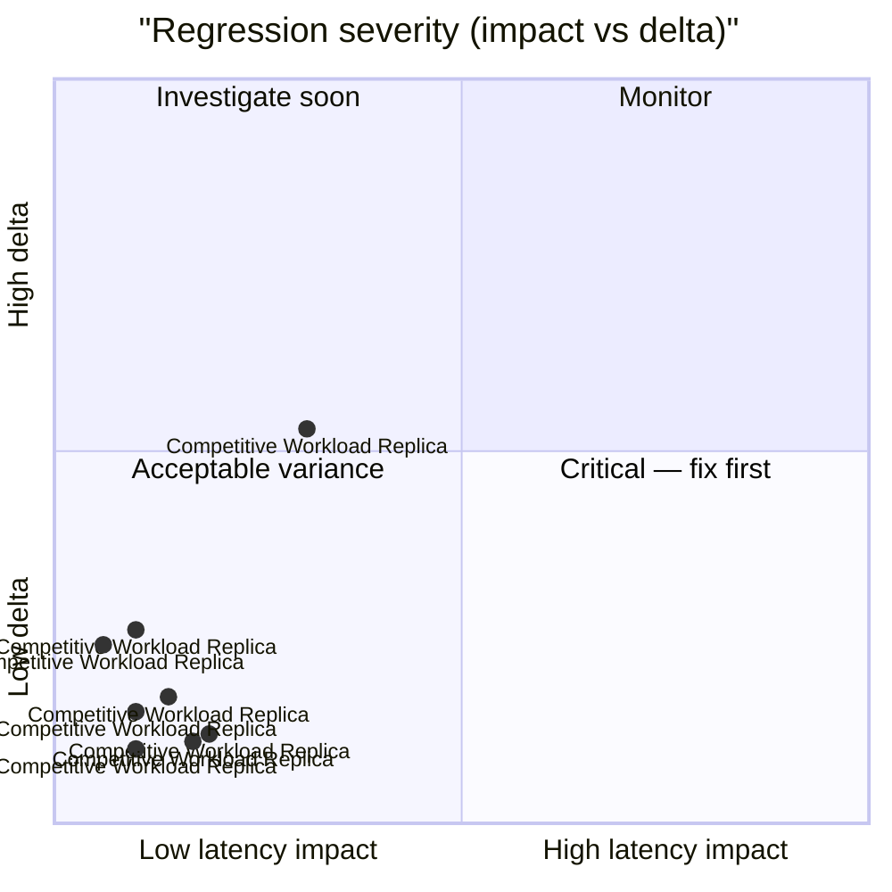

# 🚀 SQLite Performance Ledger

> [!NOTE] Competitive comparisons based on publicly available documentation as of June 2026. All SveltyCMS metrics self-measured via `bun test tests/benchmarks/`.

> [!IMPORTANT]
> **Console-only by default.** Use `BENCHMARK_RECORD=1` to write results to this report.
>
> ```bash
> BENCHMARK_RECORD=1 bun test tests/benchmarks/auth-performance.test.ts
> ```
>
> The full matrix runner (`bun run scripts/benchmark-matrix/index.ts --db=sqlite`) always records.

<!-- BENCHMARK_START -->

<!-- EXECUTIVE_START -->
<!-- LATEST_AUDIT_HEADER -->
## 📊 Latest Performance Audit
<!-- EXECUTIVE_FIX_NOTES_START -->
### 📝 Fix Overlays

> [!NOTE]
> Phase notes and remediation entries appear here after matrix or surgical runs.
<!-- EXECUTIVE_FIX_NOTES_END -->

> [!NOTE]
> **Partial update** — dimension rollups and issues reflect only tests invoked in this run.

**✅ PASS** *(partial invocation)* · 1/61 tests · 60 skipped · **sqlite** · standalone run

### Dimension health

| Dimension | Tests | Status | Worst Δ | Issues |
|-----------|------:|--------|----------|--------|
| **Core** | 25 | 🟢 | +98% | 0 |
| **API** | 0 | ⚪ | — | 0 |
| **Scale** | 0 | ⚪ | — | 0 |
| **Resilience** | 0 | ⚪ | — | 0 |

### Issues (action required)

> ✅ **All clear** — no regressions or budget violations detected.

### Executive latency matrix

| Scenario | Latency | Trend | Budget | Result |
|----------|---------|-------|--------|--------|
| **Competitive Workload Replica** | 0.086ms | ⚪ stable at 0.112ms (±0.049ms) (7 runs) | < 5ms | 🟢 |
| **Competitive Workload Replica** | 0.207ms | ⚪ stable at 0.248ms (±0.132ms) (7 runs) | < 5ms | 🟢 |
| **Competitive Workload Replica** | 0.142ms | ⚪ stable at 0.167ms (±0.029ms) (7 runs) | < 5ms | 🟢 |
| **Competitive Workload Replica** | 0.441ms | ⚪ stable at 0.291ms (±0.270ms) (7 runs) | < 5ms | 🟢 |
| **Competitive Workload Replica** | 0.141ms | ⚪ stable at 0.152ms (±0.031ms) (7 runs) | < 5ms | 🟢 |
| **Competitive Workload Replica** | 0.302ms | ⚪ stable at 0.327ms (±0.141ms) (7 runs) | < 5ms | 🟢 |
| **Competitive Workload Replica** | 0.237ms | ⚪ stable at 0.267ms (±0.019ms) (7 runs) | < 5ms | 🟢 |
| **Competitive Workload Replica** | 1.006ms | ⚪ stable at 1.03ms (±0.109ms) (7 runs) | < 5ms | 🟢 |
| **Competitive Workload Replica** | 0.149ms | ⚪ stable at 0.119ms (±0.023ms) (7 runs) | < 5ms | 🟢 |
| **Competitive Workload Replica** | 0.242ms | ⚪ stable at 0.251ms (±0.030ms) (7 runs) | < 5ms | 🟢 |
| **Competitive Workload Replica** | 0.144ms | ⚪ stable at 0.131ms (±0.068ms) (7 runs) | < 5ms | 🟢 |
| **Competitive Workload Replica** | 0.272ms | ⚪ stable at 0.309ms (±0.020ms) (7 runs) | < 5ms | 🟢 |
| **Competitive Workload Replica** | 0.148ms | ⚪ stable at 0.160ms (±0.040ms) (7 runs) | < 5ms | 🟢 |
| **Competitive Workload Replica** | 0.268ms | ⚪ stable at 0.329ms (±0.097ms) (7 runs) | < 5ms | 🟢 |
| **Competitive Workload Replica** | 0.076ms | ⚪ stable at 0.095ms (±0.039ms) (7 runs) | < 5ms | 🟢 |
| **Competitive Workload Replica** | 0.204ms | ⚪ stable at 0.229ms (±0.045ms) (7 runs) | < 5ms | 🟢 |
| **Competitive Workload Replica** | 0.480ms | ⚪ stable at 0.525ms (±0.089ms) (7 runs) | < 5ms | 🟢 |
| **Competitive Workload Replica** | 1.640ms | ⚪ stable at 1.77ms (±0.254ms) (7 runs) | < 5ms | 🟢 |
| **Competitive Workload Replica** | 0.473ms | ⚪ stable at 0.488ms (±0.112ms) (7 runs) | < 5ms | 🟢 |
| **Competitive Workload Replica** | 1.537ms | ⚪ stable at 1.52ms (±0.510ms) (7 runs) | < 5ms | 🟢 |
| **Competitive Workload Replica** | 0.881ms | ⚪ stable at 0.445ms (±0.730ms) (7 runs) | < 5ms | 🟢 |
| **Competitive Workload Replica** | 1.637ms | ⚪ stable at 1.70ms (±0.361ms) (7 runs) | < 5ms | 🟢 |
| **Competitive Workload Replica** | 0.458ms | ⚪ stable at 0.382ms (±0.196ms) (7 runs) | < 5ms | 🟢 |
| **Competitive Workload Replica** | 1.433ms | ⚪ stable at 1.57ms (±0.337ms) (7 runs) | < 5ms | 🟢 |
| **Ingestion** | 0.063ms | ⚪ stable at 0.043ms (±0.043ms) (3 runs) | < 5ms | 🟢 |

### Historical pulse

> **Scope:** Sparklines only — full run tables: [`tests/benchmarks/results/history.sqlite`](../../../tests/benchmarks/results/history.sqlite)

| Metric | Trend | Sparkline | Latest |
|--------|-------|-----------|--------|
| cold start phased (Cold Start (IDLE → HTTP READY)) (cold) | 🟢 | `▁█` | 1517.153ms |
| database performance (BULK INSERT (100)) (warm) | 🟢 | `▁█` | 1.049ms |

<details>
<summary>📈 Latency trend chart (last 10 runs)</summary>

```mermaid
xychart-beta
  title "sqlite REST p95 (last 10 runs)"
  x-axis ["R1", "R2", "R3", "R4", "R5", "R6", "R7", "R8", "R9", "R10"]
  y-axis "Latency (ms)"
  line "p95" : [0.000, 0.000, 0.000, 0.000, 0.000, 0.000, 0.000, 0.000, 0.000, 0.000]
```

</details>
<details>
<summary>📊 Regression severity matrix (quadrant)</summary>



</details>

<!-- EXECUTIVE_PARTIAL_WATERMARK -->

<!-- EXECUTIVE_ALERTS_START -->
<!-- EXECUTIVE_ALERTS_END -->

<!-- EXECUTIVE_END -->

<!-- SUMMARY_START -->
<!-- SUMMARY_RUN_OVERLAY_START -->
### Current Run Summary (2026-10-26)

> **Scope:** Only tests that ran in THIS invocation.

> ⚠️ Executive PASS/FAIL reflects the last full matrix run.

**Run ID:** `01a179c7-1e5f-76ac-9e6f-77640c3c6dc3` · **Tests invoked:** 1 · **Metrics:** 25 · **DB:** sqlite

| Test | Metric | Avg (ms) | p95 (ms) | RPS | Trend | Detail |
|------|--------|----------|----------|-----|-------|--------|
| Competitive Workload Replica | findById (Warm Sequential) | 0.086 | 0.143 | 11597 | 🟢 | ⚪ stable at 0.113ms (±0.049ms) (3 runs) |
| Competitive Workload Replica | findById (Warm Concurrent 8c) | 0.207 | 0.236 | 38179 | 🟢 | ⚪ stable at 0.239ms (±0.030ms) (3 runs) |
| Competitive Workload Replica | findByIdRandom (Warm Sequential) | 0.142 | 0.203 | 7010 | 🟢 | ⚪ stable at 0.167ms (±0.019ms) (3 runs) |
| Competitive Workload Replica | findByIdRandom (Warm Concurrent 8c) | 0.441 | 0.635 | 17967 | 🟢 | ⚪ stable at 0.524ms (±0.067ms) (3 runs) |
| Competitive Workload Replica | listFilterSort (Warm Sequential) | 0.141 | 0.212 | 7038 | 🟢 | ⚪ stable at 0.152ms (±0.010ms) (3 runs) |
| Competitive Workload Replica | listFilterSort (Warm Concurrent 8c) | 0.302 | 0.513 | 26060 | 🟢 | ⚪ stable at 0.310ms (±0.020ms) (3 runs) |
| Competitive Workload Replica | listLarge (Warm Sequential) | 0.237 | 0.326 | 4206 | 🟢 | ⚪ stable at 0.264ms (±0.028ms) (3 runs) |
| Competitive Workload Replica | listLarge (Warm Concurrent 8c) | 1.006 | 1.911 | 7833 | 🟢 | ⚪ stable at 0.949ms (±0.239ms) (3 runs) |
| Competitive Workload Replica | listPlain (Warm Sequential) | 0.149 | 0.216 | 6652 | 🟢 | ⚪ stable at 0.130ms (±0.019ms) (3 runs) |
| Competitive Workload Replica | listPlain (Warm Concurrent 8c) | 0.242 | 0.433 | 32438 | 🟢 | ⚪ stable at 0.248ms (±0.010ms) (3 runs) |
| Competitive Workload Replica | listProjected (Warm Sequential) | 0.144 | 0.239 | 6924 | 🟢 | ⚪ stable at 0.176ms (±0.071ms) (3 runs) |
| Competitive Workload Replica | listProjected (Warm Concurrent 8c) | 0.272 | 0.504 | 28858 | 🟢 | ⚪ stable at 0.322ms (±0.038ms) (3 runs) |
| Competitive Workload Replica | listPopulated (Warm Sequential) | 0.148 | 0.201 | 6704 | 🟢 | ⚪ stable at 0.172ms (±0.039ms) (3 runs) |
| Competitive Workload Replica | listPopulated (Warm Concurrent 8c) | 0.268 | 0.349 | 29354 | 🟢 | ⚪ stable at 0.329ms (±0.057ms) (3 runs) |
| Competitive Workload Replica | findMissing (Warm Sequential) | 0.076 | 0.128 | 12971 | 🟢 | ⚪ stable at 0.089ms (±0.013ms) (3 runs) |
| Competitive Workload Replica | findMissing (Warm Concurrent 8c) | 0.204 | 0.238 | 38026 | 🟢 | ⚪ stable at 0.205ms (±0.029ms) (3 runs) |
| Competitive Workload Replica | update (Warm Sequential) | 0.473 | 0.569 | 2107 | 🟢 | ⚪ stable at 0.528ms (±0.065ms) (3 runs) |
| Competitive Workload Replica | update (Warm Concurrent 8c) | 1.537 | 1.888 | 5158 | 🟢 | ⚪ stable at 1.83ms (±0.328ms) (3 runs) |
| Competitive Workload Replica | graphql (Warm Concurrent 8c) | 1.637 | 2.401 | 4823 | 🟢 | ⚪ stable at 1.76ms (±0.189ms) (3 runs) |
| Competitive Workload Replica | mixed (Warm Sequential) | 0.458 | 1.166 | 2178 | 🟢 | ⚪ stable at 0.535ms (±0.172ms) (3 runs) |
| Competitive Workload Replica | mixed (Warm Concurrent 8c) | 1.433 | 3.335 | 5493 | 🟢 | ⚪ stable at 1.63ms (±0.156ms) (3 runs) |
| Competitive Workload Replica | Seed Burst (10000 docs, HTTP) | 0.063 | 0.063 | 15875 | 🟢 | ⚪ stable at 0.043ms (±0.043ms) (3 runs) |
| Competitive Workload Replica | create (Warm Sequential) | 0.480 | 0.549 | 2080 | ⚪ | 🟢 faster: 0.595ms → 0.480ms (-19%) (3 runs) |
| Competitive Workload Replica | create (Warm Concurrent 8c) | 1.640 | 2.621 | 4823 | ⚪ | 🟢 faster: 1.82ms → 1.64ms (-10%) (3 runs) |
| Competitive Workload Replica | graphql (Warm Sequential) | 0.881 | 1.299 | 1134 | ⚪ | 🟢 faster: 1.07ms → 0.881ms (-18%) (3 runs) |

<!-- SUMMARY_RUN_OVERLAY_END -->

<!-- SUMMARY_HISTORY_START -->
### Historical Trends (2026-10-26)

> ⏳ No production-parity history recorded yet (`server_mode='production'`).
<!-- SUMMARY_HISTORY_END --><!-- SUMMARY_END -->

<details>
<summary>📊 Infrastructure drill-down (expand for adapter, hooks, memory trends)</summary>

## 📊 Infrastructure drill-down

### 🏷️ Mixed Workload Performance {#mixedAvg}

**Mixed p95:** — (not measured in this run) | **Trend:** ⚪ (—)

> Production request mix: 60% Reads, 20% Writes, 15% GraphQL, 5% Media.

### 🏷️ Database Adapter Performance {#dbRaw}

**Raw Adapter p95:** — (not measured in this run) | **Target:** < 50ms | **Trend:** ⚪ (—)

> Direct database access latency (bypass CMS logic).

### 🏷️ Middleware & Hooks Audit {#hooks}

**Middleware p95:** — (not measured in this run) | **Target:** < 2ms | **Trend:** ⚪ (—)

> Total overhead of security, logging, and auth hooks.

### 🏷️ Memory Stability Audit {#memGrowth}

**Memory RSS Δ:** — (not measured in this run) | **Target:** < 60MB | **Trend:** ⚪ (—)

> Peak memory growth during stress workload.

### Enterprise scale audit

### 🏷️ Multi-Tenancy Performance {#tenancyAvg}

**Tenancy p95:** — (not measured in this run) | **Trend:** ⚪ (—)

> Measures latency across tenant isolation boundaries.

### 🏷️ Relational Resolver Latency {#relationalAvg}

**Relational p95:** — (not measured in this run) | **Trend:** ⚪ (—)

> Tests performance of complex JOINs and nested relationship population.

### 🏷️ Telemetry & Update Performance {#telemetryAvg}

**Telemetry p95:** — (not measured in this run) | **Trend:** ⚪ (—)

> Measures overhead of telemetry collection and cryptographic signing.

</details>

<!-- LEDGER_START -->

## 🔬 Full benchmark ledger (58 modules)

Expand dimension groups, then any row, for ASCII truth tables. Executive summary above shows pass/fail and issues only.

<!-- LEDGER_DIMENSION:CORE:START -->

<details id="ledger-dimension-core">
<summary><strong>Core</strong> · 92 tests</summary>

<!-- SECTION:API_LATENCY:START -->
<details id="section-api_latency">
<summary><strong>🏷️ API LAYER LATENCY</strong> · ⚪ 3.577ms · ↗️ — · <a href="../../../tests/benchmarks/api-latency.test.ts">source</a></summary>
<!-- LEDGER_INSIGHT_START -->
> [!NOTE]
> **Specific to this test**: Both avg and p95 degraded — likely adapter or infrastructure bottleneck. Check DB connection pool, indexes, or recent commits.  
Throughput dropped 89% — check connection pool saturation or lock contention.  
**Severe degradation** (+1164%) — review recent commits immediately.
> **Check**: `src/routes/api/[...path]/+server.ts` · `src/hooks.server.ts`
<!-- LEDGER_INSIGHT_END -->

<!-- LEDGER_TRUTH_START -->

```text
╔═══════════════════════════════════════════════════════════════════════════════════════════════════════╗
║                                     SVELTYCMS — API LAYER LATENCY                                     ║
║                              File: tests/benchmarks/api-latency.test.ts                               ║
║                                       Ran: 2026-10-21 16:58:17                                        ║
║              Cold full-pipeline findById + warm TURBO-HIT path after responseCache fill.              ║
╠═══════════════════════════════════════════════════════════════════════════════════════════════════════╣
║ HTTP: findById @ 8c (Cold)   │ Cold:     0.97 ms │ Warm:     0.599 ms │ p95:     0.809 ms │  12,680 RPS ║
║ HTTP: findById TURBO-HIT @ 8c (Warm) │ Cold:     0.24 ms │ Warm:     0.245 ms │ p95:     0.297 ms │  31,342 RPS ║
║ HTTP: zstd large GET (>64KiB, drained) │ Cold:     2.98 ms │ Warm:     3.177 ms │ p95:     5.046 ms │     570 RPS ║
║ HTTP: findById TURBO-HIT idle (Warm) │        0.100 ms │ p95:        0.159 ms │ RPS:      9,720 ║
║ HTTP: findById TURBO-HIT during zstd (Warm) │        0.203 ms │ p95:        0.307 ms │ RPS:      4,303 ║
╚═══════════════════════════════════════════════════════════════════════════════════════════════════════╝
```

<!-- LEDGER_TRUTH_END -->

</details>
<!-- SECTION:API_LATENCY:END -->

<!-- SECTION:COLD_START:START -->
<details id="section-cold_start">
<summary><strong>🏷️ cold start phased</strong> · 🟢 1873.409ms · ➡️ ⚪ stable at 1863.89ms (±339.07ms) (2 runs) (2026-10-22 11:24:06) · <a href="../../../tests/benchmarks/cold-start-phased.test.ts">source</a></summary>
<!-- LEDGER_TRUTH_START -->
```text
╔═══════════════════════════════════════════════════════════════════════════════════════════════════════╗
║                                  SVELTYCMS — PHASED COLD START AUDIT                                  ║
║                           File: tests/benchmarks/cold-start-phased.test.ts                            ║
║                                       Ran: 2026-10-22 11:24:06                                        ║
║            Measures process spawn, dependency hydration, and first-request TTFB readiness.            ║
╠═══════════════════════════════════════════════════════════════════════════════════════════════════════╣
║ Initial Cold Boot (Fresh Process) │     4990.016 ms │ p95:     4990.016 ms │ RPS:          0 ║
║ Steady-State Respawn (Average) │     1873.409 ms │ p95:     4990.016 ms │ RPS:          0 ║
╚═══════════════════════════════════════════════════════════════════════════════════════════════════════╝
```
<!-- LEDGER_TRUTH_END -->

</details>
<!-- SECTION:COLD_START:END -->

<!-- SECTION:TRUTH_AUDIT:START -->
<details id="section-truth_audit">
<summary><strong>🏷️ SRE TRUTH AUDIT</strong> · 🟢 0.010ms · ➡️ recorded (awaiting trend) · <a href="../../../tests/benchmarks/truth-latency.test.ts">source</a></summary>
<!-- LEDGER_INSIGHT_START -->
> [!NOTE]
> **Specific to this test**: Both avg and p95 degraded — likely adapter or infrastructure bottleneck. Check DB connection pool, indexes, or recent commits.  
Throughput dropped 99% — check connection pool saturation or lock contention.  
**Severe degradation** (+5683%) — review recent commits immediately.
<!-- LEDGER_INSIGHT_END -->

<!-- LEDGER_TRUTH_START -->

```text
╔═══════════════════════════════════════════════════════════════════════════════════════════════════════╗
║                                      SVELTYCMS — SRE TRUTH AUDIT                                      ║
║                             File: tests/benchmarks/truth-latency.test.ts                              ║
║                                       Ran: 2026-10-22 11:24:17                                        ║
║            Validates performance claims by comparing SDK, Middleware, and Real HTTP Stack             ║
╠═══════════════════════════════════════════════════════════════════════════════════════════════════════╣
║ Logic Baseline               │ Cold:     0.01 ms │ Warm:     0.000 ms │ p95:     0.000 ms │ 641,437 RPS ║
║ Local SDK (Full)             │ Cold:     2.67 ms │ Warm:     0.006 ms │ p95:     0.012 ms │ 141,157 RPS ║
║ HTTP End-to-End              │ Cold:     2.03 ms │ Warm:     0.175 ms │ p95:     0.236 ms │   5,660 RPS ║
║ HTTP Cold (Cache-Busted)     │ Cold:     1.72 ms │ Warm:     0.207 ms │ p95:     0.307 ms │   4,791 RPS ║
╚═══════════════════════════════════════════════════════════════════════════════════════════════════════╝
```

<!-- LEDGER_TRUTH_END -->

</details>
<!-- SECTION:TRUTH_AUDIT:END -->

<!-- SECTION:SCAN:START -->
<details id="section-scan">
<summary><strong>🏷️ Self-Healing Content Scan</strong> · ⚪ 0.611ms · ↘️ — · <a href="../../../tests/benchmarks/content-scan.test.ts">source</a></summary>
<!-- LEDGER_INSIGHT_START -->
> [!NOTE]
> **Specific to this test**: Performance improved — recent optimizations or cache warming likely effective.
> **Check**: `src/content/engine.server.ts` · `src/content/loader.server.ts`
<!-- LEDGER_INSIGHT_END -->

<!-- LEDGER_TRUTH_START -->

```text
╔═══════════════════════════════════════════════════════════════════════════════════════════════════════╗
║                                    SVELTYCMS — CONTENT SCAN AUDIT                                     ║
║                              File: tests/benchmarks/content-scan.test.ts                              ║
║                                       Ran: 2026-10-06 17:52:06                                        ║
║          Measures filesystem + metadata processing and persistent Mtime dirty-bit discovery.          ║
╠═══════════════════════════════════════════════════════════════════════════════════════════════════════╣
║ Cold Discovery (Filesystem I/O) │        1.205 ms │ p95:        0.857 ms │ RPS:        830 ║
║ Warm Discovery (Mtime Tree Hit) │ Cold:     0.70 ms │ Warm:     0.611 ms │ p95:     0.784 ms │   1,597 RPS ║
╚═══════════════════════════════════════════════════════════════════════════════════════════════════════╝
```

<!-- LEDGER_TRUTH_END -->

</details>
<!-- SECTION:SCAN:END -->

<!-- SECTION:INCREMENTAL:START -->
<details id="section-incremental">
<summary><strong>🏷️ Incremental Content Reload</strong> · ⚪ 0.632ms · ↗️ — · <a href="../../../tests/benchmarks/content-incremental-reload.test.ts">source</a></summary>
<!-- LEDGER_INSIGHT_START -->
> [!NOTE]
> **Specific to this test**: Both avg and p95 degraded — likely adapter or infrastructure bottleneck. Check DB connection pool, indexes, or recent commits.  
Throughput dropped 74% — check connection pool saturation or lock contention.  
**Severe degradation** (+174%) — review recent commits immediately.
> **Check**: `src/content/engine.server.ts` · `src/routes/api/[...path]/handlers/content.ts`
<!-- LEDGER_INSIGHT_END -->

<!-- LEDGER_TRUTH_START -->

```text
╔═══════════════════════════════════════════════════════════════════════════════════════════════════════╗
║                             SVELTYCMS — INCREMENTAL CONTENT RELOAD AUDIT                              ║
║                       File: tests/benchmarks/content-incremental-reload.test.ts                       ║
║                                       Ran: 2026-10-15 14:25:55                                        ║
║      Measures surgical single-file fullReload vs full reconciliation path and batch processing,       ║
╠═══════════════════════════════════════════════════════════════════════════════════════════════════════╣
║ baseline (no-op async)       │ Cold:     0.01 ms │ Warm:     0.000 ms │ p95:     0.000 ms │ 1,702,128 RPS ║
║ Incremental fullReload (1 file) │ Cold:     4.34 ms │ Warm:     0.056 ms │ p95:     0.101 ms │  16,055 RPS ║
║ Full Reconciliation Reload   │ Cold:     3.20 ms │ Warm:     0.153 ms │ p95:     0.251 ms │   6,330 RPS ║
║ Sequential 10-File Reload    │ Cold:     4.05 ms │ Warm:     0.535 ms │ p95:     0.753 ms │   1,807 RPS ║
║ Batched 10-File Reload       │ Cold:     0.83 ms │ Warm:     0.280 ms │ p95:     0.478 ms │   3,403 RPS ║
╚═══════════════════════════════════════════════════════════════════════════════════════════════════════╝
```

<!-- LEDGER_TRUTH_END -->

</details>
<!-- SECTION:INCREMENTAL:END -->

<!-- SECTION:HOOKS_TRACE:START -->
<details id="section-hooks_trace">
<summary><strong>🏷️ Middleware & Hooks Performance</strong> · 🟢 1.920ms · ➡️ recorded (awaiting trend) · <a href="../../../tests/benchmarks/hooks-performance.test.ts">source</a></summary>
<!-- LEDGER_TRUTH_START -->
```text
╔═══════════════════════════════════════════════════════════════════════════════════════════════════════╗
║                                 SVELTYCMS — MIDDLEWARE & HOOKS AUDIT                                  ║
║                           File: tests/benchmarks/hooks-performance.test.ts                            ║
║                                       Ran: 2026-10-22 11:25:42                                        ║
║Measures the cost of the full middleware chain including Turbo, Security, Auth, and Audit via HTTP E2E.║
╠═══════════════════════════════════════════════════════════════════════════════════════════════════════╣
║ Static Asset (No Middleware) │ Cold:     1.92 ms │ Warm:     0.362 ms │ p95:     0.483 ms │   2,200 RPS ║
║ Turbo Pipeline (Light)       │ Cold:     1.55 ms │ Warm:     0.329 ms │ p95:     0.421 ms │   2,985 RPS ║
║ Full Security + Auth Pipeline │ Cold:     4.74 ms │ Warm:     0.126 ms │ p95:     0.219 ms │   7,499 RPS ║
║ REST with API Caching        │ Cold:     2.69 ms │ Warm:     0.155 ms │ p95:     0.234 ms │   6,182 RPS ║
║ Mutation (audit logging disabled) │ Cold:     3.36 ms │ Warm:     0.592 ms │ p95:     0.700 ms │   1,675 RPS ║
╚═══════════════════════════════════════════════════════════════════════════════════════════════════════╝
```
<!-- LEDGER_TRUTH_END -->

</details>
<!-- SECTION:HOOKS_TRACE:END -->

<!-- SECTION:EDGE_SYNC:START -->
<details id="section-edge_sync">
<summary><strong>🏷️ Edge Sync & Distributed Cache</strong> · ⚪ ⏳ pending · ➡️ — · <a href="../../../tests/benchmarks/edge-sync.test.ts">source</a></summary>
<!-- LEDGER_TRUTH_START -->
```text
╔═══════════════════════════════════════════════════════════════════════════════════════════════════════╗
║                                SVELTYCMS — EDGE SYNC PROPAGATION AUDIT                                ║
║                               File: tests/benchmarks/edge-sync.test.ts                                ║
║                                       Ran: 2026-08-29 20:50:29                                        ║
║    Measures cache invalidation propagation latency across real edge nodes via live Redis Pub/Sub.     ║
╠═══════════════════════════════════════════════════════════════════════════════════════════════════════╣
║ Edge Sync Propagation        │ Cold:    12.83 ms │ Warm:    15.477 ms │ p95:    16.083 ms │      67 RPS ║
╚═══════════════════════════════════════════════════════════════════════════════════════════════════════╝
```
<!-- LEDGER_TRUTH_END -->

</details>
<!-- SECTION:EDGE_SYNC:END -->

<!-- SECTION:TELEMETRY:START -->
<details id="section-telemetry">
<summary><strong>🏷️ Telemetry Collection & Signing</strong> · ⚪ ⏳ pending · ↘️ — · <a href="../../../tests/benchmarks/telemetry-performance.test.ts">source</a></summary>
<!-- LEDGER_INSIGHT_START -->
> [!NOTE]
> **Specific to this test**: Performance improved — recent optimizations or cache warming likely effective.
<!-- LEDGER_INSIGHT_END -->

<!-- LEDGER_TRUTH_START -->

```text
╔═══════════════════════════════════════════════════════════════════════════════════════════════════════╗
║                                 SVELTYCMS — AUTHENTICATION TELEMETRY                                  ║
║                            File: tests/benchmarks/auth-performance.test.ts                            ║
║                                       Ran: 2026-10-06 17:49:55                                        ║
║           Evaluates authenticated session resolution, RBAC evaluation, and rejection paths.           ║
╠═══════════════════════════════════════════════════════════════════════════════════════════════════════╣
║ Unauthenticated (401 reject) │ Cold:     2.57 ms │ Warm:     0.865 ms │ p95:     1.062 ms │   1,119 RPS ║
║ Reject: unknown session cookie │ Cold:     1.09 ms │ Warm:     0.811 ms │ p95:     0.971 ms │   1,196 RPS ║
║ Reject: unknown API key (Bearer sck_) │ Cold:     1.10 ms │ Warm:     0.795 ms │ p95:     0.929 ms │   1,231 RPS ║
║ Auth Validation @ 1c         │ Cold:     2.99 ms │ Warm:     0.773 ms │ p95:     0.931 ms │   1,260 RPS ║
║ HTTP Auth Pipeline @ 8c      │ Cold:     2.36 ms │ Warm:     1.591 ms │ p95:     2.225 ms │   4,783 RPS ║
║ Auth (full chain) @ 1c       │ Cold:     1.82 ms │ Warm:     0.309 ms │ p95:     0.392 ms │   3,078 RPS ║
╚═══════════════════════════════════════════════════════════════════════════════════════════════════════╝
```

<!-- LEDGER_TRUTH_END -->

</details>
<!-- SECTION:TELEMETRY:END -->

<!-- SECTION:STATE_MACHINE:START -->
<details id="section-state_machine">
<summary><strong>🏷️ State Machine Transitions</strong> · ⚪ 9.601ms · ↘️ — · <a href="../../../tests/benchmarks/state-machine-transition.test.ts">source</a></summary>
<!-- LEDGER_INSIGHT_START -->
> [!NOTE]
> **Specific to this test**: Performance improved — recent optimizations or cache warming likely effective.
<!-- LEDGER_INSIGHT_END -->

<!-- LEDGER_TRUTH_START -->

```text
╔═══════════════════════════════════════════════════════════════════════════════════════════════════════╗
║                                  SVELTYCMS — STATE MACHINE INTEGRITY                                  ║
║                        File: tests/benchmarks/state-machine-transition.test.ts                        ║
║                                       Ran: 2026-10-06 19:15:54                                        ║
║Measures state machine self-healing transition latencies, convergence settling time, and health probe consistency under stress.║
╠═══════════════════════════════════════════════════════════════════════════════════════════════════════╣
║ State Transition (Transient) │ Cold:    13.43 ms │ Warm:     9.601 ms │ p95:    11.273 ms │     102 RPS ║
║ Self-Healing Full Convergence │ Cold:    10.42 ms │ Warm:     9.599 ms │ p95:    12.461 ms │     103 RPS ║
╚═══════════════════════════════════════════════════════════════════════════════════════════════════════╝
```

<!-- LEDGER_TRUTH_END -->

</details>
<!-- SECTION:STATE_MACHINE:END -->

<!-- SECTION:DB_RAW_P95:START -->
<details id="section-db_raw_p95">
<summary><strong>🏷️ database performance</strong> · ⚪ 0.666ms · ↗️ 🔴 slower: 0.571ms → 0.666ms (+17%) (7 runs) (2026-10-22 11:24:56) · <a href="../../../tests/benchmarks/database-performance.test.ts">source</a></summary>
<!-- LEDGER_INSIGHT_START -->
> [!NOTE]
> **Specific to this test**: Avg degraded but p95 stable — possible cold-start effect, GC pause, or warmup variance.
<!-- LEDGER_INSIGHT_END -->

<!-- LEDGER_TRUTH_START -->

```text
╔═══════════════════════════════════════════════════════════════════════════════════════════════════════╗
║                           SVELTYCMS — DATABASE ADAPTER PERFORMANCE (SQLITE)                           ║
║                          File: tests/benchmarks/database-performance.test.ts                          ║
║                                       Ran: 2026-10-22 11:24:56                                        ║
║          Measures raw CRUD performance, indexing efficiency, and connection pool resilience.          ║
╠═══════════════════════════════════════════════════════════════════════════════════════════════════════╣
║ INSERT                       │ Cold:     0.84 ms │ Warm:     0.119 ms │ p95:     0.303 ms │   7,237 RPS ║
║ FIND ONE                     │ Cold:     0.38 ms │ Warm:     0.007 ms │ p95:     0.011 ms │ 125,050 RPS ║
║ FIND MANY (limit 50)         │ Cold:     0.61 ms │ Warm:     0.075 ms │ p95:     0.120 ms │  12,280 RPS ║
║ FILTER (blob field, 1 match) │ Cold:     1.87 ms │ Warm:     0.221 ms │ p95:     0.314 ms │   4,106 RPS ║
║ QUERY BUILDER LIST (50)      │ Cold:     3.41 ms │ Warm:     0.073 ms │ p95:     0.100 ms │  12,892 RPS ║
║ FIND PAGE (50 hasMore)       │ Cold:     1.78 ms │ Warm:     0.083 ms │ p95:     0.146 ms │  10,460 RPS ║
║ FIND PAGE keyset             │ Cold:     3.56 ms │ Warm:     0.061 ms │ p95:     0.082 ms │  15,402 RPS ║
║ FIND MANY offset 50          │ Cold:     0.65 ms │ Warm:     0.043 ms │ p95:     0.057 ms │  21,710 RPS ║
║ LIST+COUNT (legacy)          │ Cold:     0.75 ms │ Warm:     0.169 ms │ p95:     0.208 ms │   5,473 RPS ║
║ UPDATE                       │ Cold:     6.88 ms │ Warm:     0.035 ms │ p95:     0.054 ms │  25,421 RPS ║
║ UPDATE (no-returning)        │ Cold:     1.00 ms │ Warm:     0.029 ms │ p95:     0.044 ms │  31,283 RPS ║
║ NATIVE UPSERT                │ Cold:     1.04 ms │ Warm:     0.059 ms │ p95:     0.111 ms │  14,654 RPS ║
║ COUNT                        │ Cold:     1.20 ms │ Warm:     0.457 ms │ p95:     0.527 ms │   2,131 RPS ║
║ COUNT ESTIMATE               │ Cold:     1.34 ms │ Warm:     0.437 ms │ p95:     0.503 ms │   2,218 RPS ║
║ COUNT CACHED                 │ Cold:     3.54 ms │ Warm:     0.001 ms │ p95:     0.003 ms │ 509,814 RPS ║
║ DELETE (Active Rows)         │ Cold:     4.75 ms │ Warm:     0.055 ms │ p95:     0.153 ms │  13,137 RPS ║
║ BULK INSERT (100)            │ Cold:     2.35 ms │ Warm:     1.026 ms │ p95:     1.309 ms │     925 RPS ║
║ BULK UPDATE (100 heterogeneous) │ Cold:     5.99 ms │ Warm:     0.933 ms │ p95:     1.189 ms │   1,015 RPS ║
║ BULK UPDATE (100 homogeneous) │ Cold:     3.90 ms │ Warm:     0.666 ms │ p95:     0.876 ms │   1,412 RPS ║
╚═══════════════════════════════════════════════════════════════════════════════════════════════════════╝
```

<!-- LEDGER_TRUTH_END -->

</details>
<!-- SECTION:DB_RAW_P95:END -->

<!-- SECTION:ACID:START -->
<details id="section-acid">
<summary><strong>🏷️ transaction acid</strong> · 🟢 0.016ms · ↘️ ⚪ stable at 0.070ms (±0.046ms) (3 runs) (2026-10-22 11:25:12) · <a href="../../../tests/benchmarks/transaction-acid.test.ts">source</a></summary>
<!-- LEDGER_INSIGHT_START -->
> [!NOTE]
> **Specific to this test**: Performance improved — recent optimizations or cache warming likely effective.
<!-- LEDGER_INSIGHT_END -->

<!-- LEDGER_TRUTH_START -->

```text
╔═══════════════════════════════════════════════════════════════════════════════════════════════════════╗
║                                   SVELTYCMS — ACID INTEGRITY AUDIT                                    ║
║                            File: tests/benchmarks/transaction-acid.test.ts                            ║
║                                       Ran: 2026-10-22 11:25:12                                        ║
║         Measures transaction commit latencies and rollback overhead across database adapters          ║
╠═══════════════════════════════════════════════════════════════════════════════════════════════════════╣
║ TX Commit                    │ Cold:     0.59 ms │ Warm:     0.005 ms │ p95:     0.018 ms │ 180,159 RPS ║
║ TX Rollback Integrity        │ Cold:     0.85 ms │ Warm:     0.016 ms │ p95:     0.025 ms │  57,076 RPS ║
╚═══════════════════════════════════════════════════════════════════════════════════════════════════════╝
```

<!-- LEDGER_TRUTH_END -->

</details>
<!-- SECTION:ACID:END -->

<!-- SECTION:CACHE:START -->
<details id="section-cache">
<summary><strong>🏷️ Cache</strong> · 🟢 0.151ms · ↘️ ⚪ stable at 0.178ms (±0.099ms) (6 runs) (2026-10-22 11:25:26) · <a href="../../../tests/benchmarks/cache-performance.test.ts">source</a></summary>
<!-- LEDGER_INSIGHT_START -->
> [!NOTE]
> **Specific to this test**: Performance improved — recent optimizations or cache warming likely effective.
<!-- LEDGER_INSIGHT_END -->

<!-- LEDGER_TRUTH_START -->

```text
╔═══════════════════════════════════════════════════════════════════════════════════════════════════════╗
║                                  SVELTYCMS — CACHE EFFICIENCY AUDIT                                   ║
║                           File: tests/benchmarks/cache-performance.test.ts                            ║
║                                       Ran: 2026-10-22 11:25:26                                        ║
║         Measures cache hit vs miss latency and efficiency via real HTTP end-to-end requests.          ║
╠═══════════════════════════════════════════════════════════════════════════════════════════════════════╣
║ Cache Miss (Bypass)          │ Cold:     1.37 ms │ Warm:     0.202 ms │ p95:     0.285 ms │   4,862 RPS ║
║ Cache Hit (L1 Warm)          │ Cold:     0.73 ms │ Warm:     0.151 ms │ p95:     0.328 ms │   6,285 RPS ║
╚═══════════════════════════════════════════════════════════════════════════════════════════════════════╝
```

<!-- LEDGER_TRUTH_END -->

</details>
<!-- SECTION:CACHE:END -->

<!-- SECTION:CACHE_EFFICIENCY:START -->
<details id="section-cache_efficiency">
<summary><strong>🏷️ Cache Hit/Miss Ratio & Efficiency</strong> · ⚪ 0.666ms · ↗️ — · <a href="../../../tests/benchmarks/cache-hit-ratio.test.ts">source</a></summary>
<!-- LEDGER_INSIGHT_START -->
> [!NOTE]
> **Specific to this test**: Both avg and p95 degraded — likely adapter or infrastructure bottleneck. Check DB connection pool, indexes, or recent commits.  
Throughput dropped 64% — check connection pool saturation or lock contention.  
**Severe degradation** (+148%) — review recent commits immediately.
> **Check**: `src/databases/cache/redis-adapter.ts` · `src/databases/cache/cache-service.ts`
<!-- LEDGER_INSIGHT_END -->

<!-- LEDGER_TRUTH_START -->

```text
╔═══════════════════════════════════════════════════════════════════════════════════════════════════════╗
║                                  SVELTYCMS — CACHE EFFICIENCY AUDIT                                   ║
║                           File: tests/benchmarks/cache-performance.test.ts                            ║
║                                       Ran: 2026-10-18 08:11:23                                        ║
║         Measures cache hit vs miss latency and efficiency via real HTTP end-to-end requests.          ║
╠═══════════════════════════════════════════════════════════════════════════════════════════════════════╣
║ Cache Miss (Bypass)          │ Cold:     1.75 ms │ Warm:     0.278 ms │ p95:     0.402 ms │   3,416 RPS ║
║ Cache Hit (L1 Warm)          │ Cold:     1.03 ms │ Warm:     0.133 ms │ p95:     0.237 ms │   6,966 RPS ║
╚═══════════════════════════════════════════════════════════════════════════════════════════════════════╝
```

<!-- LEDGER_TRUTH_END -->

</details>
<!-- SECTION:CACHE_EFFICIENCY:END -->

<!-- SECTION:BUILD:START -->
<details id="section-build">
<summary><strong>🏷️ Production Build Analysis</strong> · ⚪ ⏳ pending · ➡️ — · <a href="../../../tests/benchmarks/build-analysis.test.ts">source</a></summary>
<!-- LEDGER_TRUTH_START -->
```text
╔═══════════════════════════════════════════════════════════════════════════════════════════════════════╗
║                                 SVELTYCMS — PRODUCTION BUILD ANALYSIS                                 ║
║                             File: tests/benchmarks/build-analysis.test.ts                             ║
║                                       Ran: 2026-10-06 17:53:24                                        ║
║              Measures compilation speed, bundle size trends, and tree-shaking efficiency              ║
╠═══════════════════════════════════════════════════════════════════════════════════════════════════════╣
║ Production Build               │        0.000 ms │ p95:        0.000 ms │ RPS:          0 ║
╚═══════════════════════════════════════════════════════════════════════════════════════════════════════╝
```
<!-- LEDGER_TRUTH_END -->

</details>
<!-- SECTION:BUILD:END -->

<!-- SECTION:DX_TOOLING:START -->
<details id="section-dx_tooling">
<summary><strong>🏷️ DX Toolchain Performance</strong> · ⚪ ⏳ pending · ➡️ — · <a href="../../../tests/benchmarks/dev-dependency-load.test.ts">source</a></summary>
<!-- LEDGER_TRUTH_START -->
```text
╔═══════════════════════════════════════════════════════════════════════════════════════════════════════╗
║                                        DX Tooling Performance                                         ║
║                          File: tests/benchmarks/dev-dependency-load.test.ts                           ║
║                                       Ran: 2026-10-21 17:28:21                                        ║
║         Measures type-check, format, and lint toolchain overhead for peak developer velocity.         ║
╠═══════════════════════════════════════════════════════════════════════════════════════════════════════╣
║ Fast Format (oxfmt)            │     3677.745 ms │ p95:     3677.745 ms │ RPS:          0 ║
║ Type Check (svelte-check)      │    71482.682 ms │ p95:    71482.682 ms │ RPS:          0 ║
║ Fast Lint (oxlint)             │      129.903 ms │ p95:      129.903 ms │ RPS:          0 ║
╚═══════════════════════════════════════════════════════════════════════════════════════════════════════╝
```
<!-- LEDGER_TRUTH_END -->

</details>
<!-- SECTION:DX_TOOLING:END -->

<!-- SECTION:CACHE_SVC:START -->
<details id="section-cache_svc">
<summary><strong>🏷️ CacheService Micro-Benchmark</strong> · ⚪ 0.682ms · ↗️ — · <a href="../../../tests/benchmarks/cache-service.test.ts">source</a></summary>
<!-- LEDGER_INSIGHT_START -->
> [!NOTE]
> **Specific to this test**: Avg degraded but p95 stable — possible cold-start effect, GC pause, or warmup variance.  
Throughput dropped 100% — check connection pool saturation or lock contention.  
**Severe degradation** (+35%) — review recent commits immediately.
<!-- LEDGER_INSIGHT_END -->

<!-- LEDGER_TRUTH_START -->

```text
╔═══════════════════════════════════════════════════════════════════════════════════════════════════════╗
║                                  SVELTYCMS — CACHE SERVICE TELEMETRY                                  ║
║                             File: tests/benchmarks/cache-service.test.ts                              ║
║                                       Ran: 2026-10-06 17:42:11                                        ║
║               Measures L1 cache hit latency and pattern invalidation overhead at scale.               ║
╠═══════════════════════════════════════════════════════════════════════════════════════════════════════╣
║ Cache L1 Hit                 │ Cold:     0.25 ms │ Warm:     0.000 ms │ p95:     0.000 ms │ 1,503,692 RPS ║
║ Pattern Invalidation (1k items @ 25k noise) │        0.542 ms │ p95:        1.163 ms │ RPS:      1,845 ║
║ Pattern Invalidation (Namespaced 1k @ 50k noise) │        0.668 ms │ p95:        1.128 ms │ RPS:      1,496 ║
╚═══════════════════════════════════════════════════════════════════════════════════════════════════════╝
```

<!-- LEDGER_TRUTH_END -->

</details>
<!-- SECTION:CACHE_SVC:END -->

<!-- SECTION:LOCAL_API:START -->
<details id="section-local_api">
<summary><strong>🏷️ LocalCMS SDK Overhead</strong> · ⚪ 0.008ms · ➡️ — · <a href="../../../tests/benchmarks/local-api-performance.test.ts">source</a></summary>
<!-- LEDGER_TRUTH_START -->
```text
╔═════════════════════════════════════════════════════════════════════════════════════════╗
║                     SVELTYCMS — DIRECT ADAPTER THROUGHPUT (SQLITE)                      ║
║                   File: tests/benchmarks/local-api-throughput.test.ts                   ║
║                                Ran: 2026-08-28 10:17:19                                 ║
║Measures direct adapter write throughput, read throughput, and percentile latencies with zero HTTP overhead.║
╠═════════════════════════════════════════════════════════════════════════════════════════╣
║ Writes (1000 atomic increments) │        0.598 ms │ p95:        0.588 ms │ RPS:      9,965 ║
║ Reads (1000 point lookups)     │        0.573 ms │ p95:        1.451 ms │ RPS:     76,610 ║
╚═════════════════════════════════════════════════════════════════════════════════════════╝
```
<!-- LEDGER_TRUTH_END -->

</details>
<!-- SECTION:LOCAL_API:END -->

<!-- SECTION:SETUP_PROXY:START -->
<details id="section-setup_proxy">
<summary><strong>🏷️ Setup Proxy & Bootstrap Isolation</strong> · ⚪ ⏳ pending · ➡️ — · <a href="../../../tests/benchmarks/setup-proxy.test.ts">source</a></summary>
<!-- LEDGER_TRUTH_START -->
```text
╔═══════════════════════════════════════════════════════════════════════════════════════════════════════╗
║                            SVELTYCMS — INFRASTRUCTURE BOOT & ROUTING AUDIT                            ║
║                              File: tests/benchmarks/setup-proxy.test.ts                               ║
║                                       Ran: 2026-09-26 10:02:19                                        ║
║Measures cold-start initialization latency and proxy header parsing overhead for enterprise deployments.║
╠═══════════════════════════════════════════════════════════════════════════════════════════════════════╣
║ Cold Start                     │     2832.998 ms │ p95:     2853.440 ms │ RPS:          0 ║
║ Proxy Header Parsing         │ Cold:     9.02 ms │ Warm:     2.932 ms │ p95:     4.297 ms │   1,817 RPS ║
╚═══════════════════════════════════════════════════════════════════════════════════════════════════════╝
```
<!-- LEDGER_TRUTH_END -->

</details>
<!-- SECTION:SETUP_PROXY:END -->

<!-- SECTION:HTTP:START -->
<details id="section-http">
<summary><strong>🏷️ HTTP</strong> · 🟢 0.175ms · ↘️ ⚪ stable at 0.339ms (±0.154ms) (2 runs) (2026-10-22 11:24:29) · <a href="../../../tests/benchmarks/truth-latency.test.ts">source</a></summary>
<!-- LEDGER_INSIGHT_START -->
> [!NOTE]
> **Specific to this test**: Performance improved — recent optimizations or cache warming likely effective.
<!-- LEDGER_INSIGHT_END -->

<!-- LEDGER_TRUTH_START -->

> ⏳ Pending

<!-- LEDGER_TRUTH_END -->

</details>
<!-- SECTION:HTTP:END -->

<!-- SECTION:LOGIC:START -->
<details id="section-logic">
<summary><strong>🏷️ Logic</strong> · 🟢 ⏳ pending · ➡️ ⚪ stable at 0ms (2 runs) (2026-10-22 11:24:29) · <a href="../../../tests/benchmarks/truth-latency.test.ts">source</a></summary>
<!-- LEDGER_TRUTH_START -->
> ⏳ Pending
<!-- LEDGER_TRUTH_END -->

</details>
<!-- SECTION:LOGIC:END -->

<!-- SECTION:SDK:START -->
<details id="section-sdk">
<summary><strong>🏷️ SDK</strong> · 🟢 0.006ms · ↘️ ⚪ stable at 0.013ms (±0.016ms) (2 runs) (2026-10-22 11:24:29) · <a href="../../../tests/benchmarks/truth-latency.test.ts">source</a></summary>
<!-- LEDGER_INSIGHT_START -->
> [!NOTE]
> **Specific to this test**: Performance improved — recent optimizations or cache warming likely effective.
<!-- LEDGER_INSIGHT_END -->

<!-- LEDGER_TRUTH_START -->

```text
╔═══════════════════════════════════════════════════════════════════════════════════════════════════════╗
║                              SVELTYCMS — SDK VS DIRECT ADAPTER (SQLITE)                               ║
║                          File: tests/benchmarks/local-sdk-vs-direct.test.ts                           ║
║                                       Ran: 2026-10-09 13:44:44                                        ║
║Measures the exact SDK tax across Create, Find, and Update pathways with isolated GC sweeps and zero-allocation key pools.║
╠═══════════════════════════════════════════════════════════════════════════════════════════════════════╣
║ Direct insert                  │        0.082 ms │ p95:        0.082 ms │ RPS:     12,190 ║
║ SDK create (full)              │        0.170 ms │ p95:        0.170 ms │ RPS:      5,879 ║
║ Direct findOne                 │        0.008 ms │ p95:        0.008 ms │ RPS:    127,074 ║
║ SDK find (bypassCache)         │        0.011 ms │ p95:        0.011 ms │ RPS:     89,807 ║
║ Direct update                  │        0.029 ms │ p95:        0.029 ms │ RPS:     34,765 ║
║ SDK update (full)              │        0.050 ms │ p95:        0.050 ms │ RPS:     19,898 ║
║ SDK create (detached)          │        0.092 ms │ p95:        0.092 ms │ RPS:     10,875 ║
║ SDK update (detached)          │        0.032 ms │ p95:        0.032 ms │ RPS:     31,138 ║
╚═══════════════════════════════════════════════════════════════════════════════════════════════════════╝
```

<!-- LEDGER_TRUTH_END -->

</details>
<!-- SECTION:SDK:END -->

<!-- SECTION:UNKNOWN:START -->
<details id="section-unknown">
<summary><strong>🏷️ unknown</strong> · 🟢 0.002ms · ➡️ recorded (awaiting trend) · <a href="../../../tests/benchmarks/database-performance.test.ts">source</a></summary>
<!-- LEDGER_INSIGHT_START -->
> [!NOTE]
> **Specific to this test**: Both avg and p95 degraded — likely adapter or infrastructure bottleneck. Check DB connection pool, indexes, or recent commits.  
Throughput dropped 95% — check connection pool saturation or lock contention.  
**Severe degradation** (+2182%) — review recent commits immediately.
<!-- LEDGER_INSIGHT_END -->

<!-- LEDGER_TRUTH_START -->

```text
╔═════════════════════════════════════════════════════════════════════════════════════════╗
║                      SVELTYCMS — CACHE EVICTION BOUNDARY HARDENING                      ║
║                                      File: unknown                                      ║
║                                Ran: 2026-08-23 22:49:42                                 ║
╠═════════════════════════════════════════════════════════════════════════════════════════╣
║ Cache Flooding & Eviction      │        0.002 ms │ p95:        0.002 ms │ RPS:    491,908 ║
╚═════════════════════════════════════════════════════════════════════════════════════════╝
```

<!-- LEDGER_TRUTH_END -->

</details>
<!-- SECTION:UNKNOWN:END -->

<!-- SECTION:MIDDLEWARE:START -->
<details id="section-middleware">
<summary><strong>🏷️ Middleware</strong> · 🟢 0.592ms · ➡️ ⚪ stable at 0.610ms (±0.269ms) (4 runs) (2026-10-22 11:25:42) · <a href="../../../tests/benchmarks/hooks-performance.test.ts">source</a></summary>
<!-- LEDGER_TRUTH_START -->
```text
╔═══════════════════════════════════════════════════════════════════════════════════════════════════════╗
║                                MIDDLEWARE FLAMEGRAPH PROFILER (SQLITE)                                ║
║                         File: tests/benchmarks/middleware-flamegraph.test.ts                          ║
║                                       Ran: 2026-09-04 14:47:59                                        ║
║Measures isolated microsecond cost and incremental deltas of each middleware stage from edge to database.║
╠═══════════════════════════════════════════════════════════════════════════════════════════════════════╣
║ Stage 0: Raw Socket Baseline (Static Asset) │ Cold:     2.47 ms │ Warm:     0.959 ms │ p95:     1.919 ms │   3,735 RPS ║
║ Stage 1: System State + Turbo Pipeline │ Cold:     1.28 ms │ Warm:     0.688 ms │ p95:     1.207 ms │   5,347 RPS ║
║ Stage 2: WAF Security Inspection │ Cold:     0.98 ms │ Warm:     0.419 ms │ p95:     1.193 ms │   8,073 RPS ║
║ Stage 3: Token Auth Gating   │ Cold:     3.60 ms │ Warm:     0.838 ms │ p95:     1.047 ms │   4,596 RPS ║
║ Stage 4: Collection Schema Resolution │ Cold:     2.68 ms │ Warm:     0.720 ms │ p95:     1.095 ms │   5,120 RPS ║
║ Stage 5: Full REST Single Document │ Cold:     1.58 ms │ Warm:     0.687 ms │ p95:     0.810 ms │   5,495 RPS ║
║ Stage 6: GraphQL Single Query (JIT) │ Cold:     2.45 ms │ Warm:     1.082 ms │ p95:     1.212 ms │   3,654 RPS ║
╚═══════════════════════════════════════════════════════════════════════════════════════════════════════╝
```
<!-- LEDGER_TRUTH_END -->

</details>
<!-- SECTION:MIDDLEWARE:END -->

<!-- SECTION:SYSTEM:START -->
<details id="section-system">
<summary><strong>🏷️ System</strong> · ⚪ 0.595ms · ↗️ 🔴 slower: 0.463ms → 0.595ms (+29%) (6 runs) (2026-10-22 11:25:57) · <a href="../../../tests/benchmarks/rest-api-performance.test.ts">source</a></summary>
<!-- LEDGER_INSIGHT_START -->
> [!NOTE]
> **Specific to this test**: Both avg and p95 degraded — likely adapter or infrastructure bottleneck. Check DB connection pool, indexes, or recent commits.  
Throughput dropped 17% — check connection pool saturation or lock contention.  
**Severe degradation** (+29%) — review recent commits immediately.
<!-- LEDGER_INSIGHT_END -->

<!-- LEDGER_TRUTH_START -->

> ⏳ Pending

<!-- LEDGER_TRUTH_END -->

</details>
<!-- SECTION:SYSTEM:END -->

<!-- SECTION:METADATA:START -->
<details id="section-metadata">
<summary><strong>🏷️ Metadata</strong> · 🟢 0.148ms · ➡️ ⚪ stable at 0.155ms (±0.114ms) (6 runs) (2026-10-22 11:25:57) · <a href="../../../tests/benchmarks/rest-api-performance.test.ts">source</a></summary>
<!-- LEDGER_TRUTH_START -->
> ⏳ Pending
<!-- LEDGER_TRUTH_END -->

</details>
<!-- SECTION:METADATA:END -->

<!-- SECTION:CRUD:START -->
<details id="section-crud">
<summary><strong>🏷️ CRUD</strong> · 🟢 0.515ms · ➡️ ⚪ established at 0.515ms (1 run) (2026-08-25 11:26:43) · <a href="../../../tests/benchmarks/rest-api-performance.test.ts">source</a></summary>
<!-- LEDGER_TRUTH_START -->
> ⏳ Pending
<!-- LEDGER_TRUTH_END -->

</details>
<!-- SECTION:CRUD:END -->

<!-- SECTION:CRYPTO:START -->
<details id="section-crypto">
<summary><strong>🏷️ Crypto</strong> · 🟢 0.553ms · ↘️ ⚪ stable at 0.863ms (±1.22ms) (7 runs) (2026-09-03 20:15:16) · <a href="../../../tests/benchmarks/security-audit.test.ts">source</a></summary>
<!-- LEDGER_INSIGHT_START -->
> [!NOTE]
> **Specific to this test**: Performance improved — recent optimizations or cache warming likely effective.
<!-- LEDGER_INSIGHT_END -->

<!-- LEDGER_TRUTH_START -->

> ⏳ Pending

<!-- LEDGER_TRUTH_END -->

</details>
<!-- SECTION:CRYPTO:END -->

<!-- SECTION:DEFENSE:START -->
<details id="section-defense">
<summary><strong>🏷️ Defense</strong> · 🟢 ⏳ pending · ➡️ ⚪ stable at 0ms (7 runs) (2026-08-23 16:33:40) · <a href="../../../tests/benchmarks/security-audit.test.ts">source</a></summary>
<!-- LEDGER_TRUTH_START -->
> ⏳ Pending
<!-- LEDGER_TRUTH_END -->

</details>
<!-- SECTION:DEFENSE:END -->

<!-- SECTION:L1:START -->
<details id="section-l1">
<summary><strong>🏷️ L1</strong> · 🟢 4.015ms · ➡️ ⚪ established at 4.01ms (1 run) (2026-08-11 23:02:18) · <a href="../../../tests/benchmarks/cache-service.test.ts">source</a></summary>
<!-- LEDGER_TRUTH_START -->
> ⏳ Pending
<!-- LEDGER_TRUTH_END -->

</details>
<!-- SECTION:L1:END -->

<!-- SECTION:DB:START -->
<details id="section-db">
<summary><strong>🏷️ DB</strong> · 🟢 0.029ms · ➡️ ⚪ established at 0.029ms (1 run) (2026-10-09 13:44:44) · <a href="../../../tests/benchmarks/local-sdk-vs-direct.test.ts">source</a></summary>
<!-- LEDGER_TRUTH_START -->
> ⏳ Pending
<!-- LEDGER_TRUTH_END -->

</details>
<!-- SECTION:DB:END -->

<!-- SECTION:TURBO:START -->
<details id="section-turbo">
<summary><strong>🏷️ TURBO</strong> · 🟢 0.828ms · ↘️ ⚪ stable at 0.878ms (±0.502ms) (3 runs) (2026-09-26 22:56:48) · <a href="../../../tests/benchmarks/api-latency.test.ts">source</a></summary>
<!-- LEDGER_INSIGHT_START -->
> [!NOTE]
> **Specific to this test**: Performance improved — recent optimizations or cache warming likely effective.
<!-- LEDGER_INSIGHT_END -->

<!-- LEDGER_TRUTH_START -->

> ⏳ Pending

<!-- LEDGER_TRUTH_END -->

</details>
<!-- SECTION:TURBO:END -->

<!-- SECTION:STRESS:START -->
<details id="section-stress">
<summary><strong>🏷️ Stress</strong> · 🟢 1.450ms · ➡️ recorded (awaiting trend) · <a href="../../../tests/benchmarks/graphql-stress.test.ts">source</a></summary>
<!-- LEDGER_INSIGHT_START -->
> [!NOTE]
> **Specific to this test**: Performance improved — recent optimizations or cache warming likely effective.
<!-- LEDGER_INSIGHT_END -->

<!-- LEDGER_TRUTH_START -->

```text
╔═══════════════════════════════════════════════════════════════════════════════════════════════════════╗
║                                   SVELTYCMS — REVISION STRESS AUDIT                                   ║
║                            File: tests/benchmarks/revision-stress.test.ts                             ║
║                                       Ran: 2026-10-06 17:51:35                                        ║
║Measures latest read degradation, history retrieval speed, and storage footprint under heavy revision growth (100 revisions).║
╠═══════════════════════════════════════════════════════════════════════════════════════════════════════╣
║ Clean Document Read (Baseline) │ Cold:     1.45 ms │ Warm:     0.403 ms │ p95:     0.521 ms │   9,560 RPS ║
║ Latest Read (100 Revisions)  │ Cold:     1.02 ms │ Warm:     0.370 ms │ p95:     0.457 ms │  10,567 RPS ║
║ History List Retrieval       │ Cold:     5.47 ms │ Warm:     1.627 ms │ p95:     2.511 ms │   1,119 RPS ║
╚═══════════════════════════════════════════════════════════════════════════════════════════════════════╝
```

<!-- LEDGER_TRUTH_END -->

</details>
<!-- SECTION:STRESS:END -->

<!-- SECTION:CLIENT:START -->
<details id="section-client">
<summary><strong>🏷️ Client</strong> · 🟢 ⏳ pending · ➡️ ⚪ established at 0ms (1 run) (2026-08-23 15:48:15) · <a href="../../../tests/benchmarks/entry-edit-hydration.test.ts">source</a></summary>
<!-- LEDGER_TRUTH_START -->
> ⏳ Pending
<!-- LEDGER_TRUTH_END -->

</details>
<!-- SECTION:CLIENT:END -->

<!-- SECTION:GRAPHQL__COLD_:START -->
<details id="section-graphql__cold_">
<summary><strong>🏷️ GraphQL (cold)</strong> · 🟢 5.374ms · ➡️ ⚪ established at 5.37ms (1 run) (2026-09-20 15:54:11) · <a href="../../../tests/benchmarks/graphql-api-performance.test.ts">source</a></summary>
<!-- LEDGER_TRUTH_START -->
> ⏳ Pending
<!-- LEDGER_TRUTH_END -->

</details>
<!-- SECTION:GRAPHQL__COLD_:END -->

<!-- SECTION:GRAPHQL__HOT_:START -->
<details id="section-graphql__hot_">
<summary><strong>🏷️ GraphQL (hot)</strong> · 🟢 2.751ms · ➡️ ⚪ established at 2.75ms (1 run) (2026-09-20 15:54:12) · <a href="../../../tests/benchmarks/graphql-api-performance.test.ts">source</a></summary>
<!-- LEDGER_TRUTH_START -->
> ⏳ Pending
<!-- LEDGER_TRUTH_END -->

</details>
<!-- SECTION:GRAPHQL__HOT_:END -->

<!-- SECTION:CONTENT:START -->
<details id="section-content">
<summary><strong>🏷️ Content</strong> · 🟢 78.390ms · ➡️ recorded (awaiting trend) · <a href="../../../tests/benchmarks/seo-performance.test.ts">source</a></summary>
<!-- LEDGER_INSIGHT_START -->
> [!NOTE]
> **Specific to this test**: Both avg and p95 degraded — likely adapter or infrastructure bottleneck. Check DB connection pool, indexes, or recent commits.  
Throughput dropped 53% — check connection pool saturation or lock contention.  
**Severe degradation** (+305%) — review recent commits immediately.
<!-- LEDGER_INSIGHT_END -->

<!-- LEDGER_TRUTH_START -->

```text
╔═══════════════════════════════════════════════════════════════════════════════════════════════════════╗
║                                    CONTENT PACKAGE AUDIT (SQLITE)                                     ║
║                            File: tests/benchmarks/content-package.test.ts                             ║
║                                       Ran: 2026-10-06 17:53:57                                        ║
║                 Measures export/import throughput via ContentPackageService directly,                 ║
╠═══════════════════════════════════════════════════════════════════════════════════════════════════════╣
║ Content Export (100 entries) │ Cold:    78.39 ms │ Warm:    71.237 ms │ p95:    75.765 ms │      14 RPS ║
║ Content Import Plan (100 entries) │ Cold:   793.13 ms │ Warm:   788.213 ms │ p95:   791.364 ms │       1 RPS ║
╚═══════════════════════════════════════════════════════════════════════════════════════════════════════╝
```

<!-- LEDGER_TRUTH_END -->

</details>
<!-- SECTION:CONTENT:END -->

<!-- SECTION:ANALYTICS:START -->
<details id="section-analytics">
<summary><strong>🏷️ Analytics</strong> · 🟢 55.434ms · ↗️ ⚪ stable at 15.13ms (±53.44ms) (3 runs) (2026-08-29 12:58:02) · <a href="../../../tests/benchmarks/seo-performance.test.ts">source</a></summary>
<!-- LEDGER_INSIGHT_START -->
> [!NOTE]
> **Specific to this test**: Both avg and p95 degraded — likely adapter or infrastructure bottleneck. Check DB connection pool, indexes, or recent commits.  
Throughput dropped 82% — check connection pool saturation or lock contention.  
**Severe degradation** (+266%) — review recent commits immediately.
<!-- LEDGER_INSIGHT_END -->

<!-- LEDGER_TRUTH_START -->

> ⏳ Pending

<!-- LEDGER_TRUTH_END -->

</details>
<!-- SECTION:ANALYTICS:END -->

<!-- SECTION:STATUS:START -->
<details id="section-status">
<summary><strong>🏷️ Status</strong> · 🟢 4.627ms · ➡️ ⚪ established at 4.63ms (1 run) (2026-08-28 09:35:03) · <a href="../../../tests/benchmarks/config-promotion.test.ts">source</a></summary>
<!-- LEDGER_TRUTH_START -->
> ⏳ Pending
<!-- LEDGER_TRUTH_END -->

</details>
<!-- SECTION:STATUS:END -->

<!-- SECTION:10_COLLECTIONS:START -->
<details id="section-10_collections">
<summary><strong>🏷️ 10 collections</strong> · 🟢 8.165ms · ➡️ ⚪ established at 8.16ms (1 run) (2026-08-28 09:35:03) · <a href="../../../tests/benchmarks/config-promotion.test.ts">source</a></summary>
<!-- LEDGER_TRUTH_START -->
> ⏳ Pending
<!-- LEDGER_TRUTH_END -->

</details>
<!-- SECTION:10_COLLECTIONS:END -->

<!-- SECTION:50_COLLECTIONS:START -->
<details id="section-50_collections">
<summary><strong>🏷️ 50 collections</strong> · 🟢 8.746ms · ➡️ ⚪ established at 8.75ms (1 run) (2026-08-28 09:35:03) · <a href="../../../tests/benchmarks/config-promotion.test.ts">source</a></summary>
<!-- LEDGER_TRUTH_START -->
> ⏳ Pending
<!-- LEDGER_TRUTH_END -->

</details>
<!-- SECTION:50_COLLECTIONS:END -->

<!-- SECTION:100_COLLECTIONS:START -->
<details id="section-100_collections">
<summary><strong>🏷️ 100 collections</strong> · 🟢 11.605ms · ➡️ ⚪ established at 11.61ms (1 run) (2026-08-28 09:35:03) · <a href="../../../tests/benchmarks/config-promotion.test.ts">source</a></summary>
<!-- LEDGER_TRUTH_START -->
> ⏳ Pending
<!-- LEDGER_TRUTH_END -->

</details>
<!-- SECTION:100_COLLECTIONS:END -->

<!-- SECTION:PLANNING:START -->
<details id="section-planning">
<summary><strong>🏷️ Planning</strong> · 🟢 6.756ms · ➡️ ⚪ established at 6.76ms (1 run) (2026-08-28 09:35:03) · <a href="../../../tests/benchmarks/config-promotion.test.ts">source</a></summary>
<!-- LEDGER_TRUTH_START -->
> ⏳ Pending
<!-- LEDGER_TRUTH_END -->

</details>
<!-- SECTION:PLANNING:END -->

<!-- SECTION:APPLY:START -->
<details id="section-apply">
<summary><strong>🏷️ Apply</strong> · 🟢 17.580ms · ➡️ ⚪ established at 17.58ms (1 run) (2026-08-28 09:35:03) · <a href="../../../tests/benchmarks/config-promotion.test.ts">source</a></summary>
<!-- LEDGER_TRUTH_START -->
> ⏳ Pending
<!-- LEDGER_TRUTH_END -->

</details>
<!-- SECTION:APPLY:END -->

<!-- SECTION:CACHE__MISS_:START -->
<details id="section-cache__miss_">
<summary><strong>🏷️ Cache (Miss)</strong> · 🟢 0.997ms · ↘️ ⚪ stable at 1.20ms (±1.53ms) (7 runs) (2026-09-18 23:31:06) · <a href="../../../tests/benchmarks/cache-hit-ratio.test.ts">source</a></summary>
<!-- LEDGER_INSIGHT_START -->
> [!NOTE]
> **Specific to this test**: Performance improved — recent optimizations or cache warming likely effective.
<!-- LEDGER_INSIGHT_END -->

<!-- LEDGER_TRUTH_START -->

> ⏳ Pending

<!-- LEDGER_TRUTH_END -->

</details>
<!-- SECTION:CACHE__MISS_:END -->

<!-- SECTION:CACHE__HIT_:START -->
<details id="section-cache__hit_">
<summary><strong>🏷️ Cache (Hit)</strong> · 🟢 0.301ms · ↘️ ⚪ stable at 0.337ms (±0.933ms) (7 runs) (2026-09-18 23:31:06) · <a href="../../../tests/benchmarks/cache-hit-ratio.test.ts">source</a></summary>
<!-- LEDGER_INSIGHT_START -->
> [!NOTE]
> **Specific to this test**: Performance improved — recent optimizations or cache warming likely effective.
<!-- LEDGER_INSIGHT_END -->

<!-- LEDGER_TRUTH_START -->

> ⏳ Pending

<!-- LEDGER_TRUTH_END -->

</details>
<!-- SECTION:CACHE__HIT_:END -->

<!-- SECTION:DATABASE:START -->
<details id="section-database">
<summary><strong>🏷️ Database</strong> · 🟢 0.298ms · ↘️ ⚪ stable at 0.354ms (±1.18ms) (7 runs) (2026-09-18 23:31:06) · <a href="../../../tests/benchmarks/cache-hit-ratio.test.ts">source</a></summary>
<!-- LEDGER_INSIGHT_START -->
> [!NOTE]
> **Specific to this test**: Performance improved — recent optimizations or cache warming likely effective.
<!-- LEDGER_INSIGHT_END -->

<!-- LEDGER_TRUTH_START -->

> ⏳ Pending

<!-- LEDGER_TRUTH_END -->

</details>
<!-- SECTION:DATABASE:END -->

<!-- SECTION:MUTATION:START -->
<details id="section-mutation">
<summary><strong>🏷️ Mutation</strong> · 🟢 0.562ms · ↘️ ⚪ stable at 1.10ms (±1.51ms) (7 runs) (2026-09-18 23:31:06) · <a href="../../../tests/benchmarks/cache-hit-ratio.test.ts">source</a></summary>
<!-- LEDGER_INSIGHT_START -->
> [!NOTE]
> **Specific to this test**: Performance improved — recent optimizations or cache warming likely effective.
<!-- LEDGER_INSIGHT_END -->

<!-- LEDGER_TRUTH_START -->

> ⏳ Pending

<!-- LEDGER_TRUTH_END -->

</details>
<!-- SECTION:MUTATION:END -->

<!-- SECTION:AUTH:START -->
<details id="section-auth">
<summary><strong>🏷️ Auth</strong> · 🟢 2.570ms · ➡️ recorded (awaiting trend) · <a href="../../../tests/benchmarks/auth-performance.test.ts">source</a></summary>
<!-- LEDGER_TRUTH_START -->
```text
╔═══════════════════════════════════════════════════════════════════════════════════════════════════════╗
║                                 SVELTYCMS — AUTHENTICATION TELEMETRY                                  ║
║                            File: tests/benchmarks/auth-performance.test.ts                            ║
║                                       Ran: 2026-10-06 17:49:55                                        ║
║           Evaluates authenticated session resolution, RBAC evaluation, and rejection paths.           ║
╠═══════════════════════════════════════════════════════════════════════════════════════════════════════╣
║ Unauthenticated (401 reject) │ Cold:     2.57 ms │ Warm:     0.865 ms │ p95:     1.062 ms │   1,119 RPS ║
║ Reject: unknown session cookie │ Cold:     1.09 ms │ Warm:     0.811 ms │ p95:     0.971 ms │   1,196 RPS ║
║ Reject: unknown API key (Bearer sck_) │ Cold:     1.10 ms │ Warm:     0.795 ms │ p95:     0.929 ms │   1,231 RPS ║
║ Auth Validation @ 1c         │ Cold:     2.99 ms │ Warm:     0.773 ms │ p95:     0.931 ms │   1,260 RPS ║
║ HTTP Auth Pipeline @ 8c      │ Cold:     2.36 ms │ Warm:     1.591 ms │ p95:     2.225 ms │   4,783 RPS ║
║ Auth (full chain) @ 1c       │ Cold:     1.82 ms │ Warm:     0.309 ms │ p95:     0.392 ms │   3,078 RPS ║
╚═══════════════════════════════════════════════════════════════════════════════════════════════════════╝
```
<!-- LEDGER_TRUTH_END -->

</details>
<!-- SECTION:AUTH:END -->

<!-- SECTION:BASELINE:START -->
<details id="section-baseline">
<summary><strong>🏷️ Baseline</strong> · 🟢 1.082ms · ↘️ ⚪ stable at 3.00ms (±2.71ms) (3 runs) (2026-08-29 16:18:26) · <a href="../../../tests/benchmarks/revision-stress.test.ts">source</a></summary>
<!-- LEDGER_INSIGHT_START -->
> [!NOTE]
> **Specific to this test**: Performance improved — recent optimizations or cache warming likely effective.
<!-- LEDGER_INSIGHT_END -->

<!-- LEDGER_TRUTH_START -->

> ⏳ Pending

<!-- LEDGER_TRUTH_END -->

</details>
<!-- SECTION:BASELINE:END -->

<!-- SECTION:FIREWALL:START -->
<details id="section-firewall">
<summary><strong>🏷️ Firewall</strong> · ⚪ 31.860ms · ↗️ 🔴 slower: 9.18ms → 31.86ms (+247%) (7 runs) (2026-08-29 13:06:50) · <a href="../../../tests/benchmarks/throttling-backoff-stress.test.ts">source</a></summary>
<!-- LEDGER_INSIGHT_START -->
> [!NOTE]
> **Specific to this test**: Both avg and p95 degraded — likely adapter or infrastructure bottleneck. Check DB connection pool, indexes, or recent commits.  
Throughput dropped 67% — check connection pool saturation or lock contention.  
**Severe degradation** (+247%) — review recent commits immediately.
<!-- LEDGER_INSIGHT_END -->

<!-- LEDGER_TRUTH_START -->

> ⏳ Pending

<!-- LEDGER_TRUTH_END -->

</details>
<!-- SECTION:FIREWALL:END -->

<!-- SECTION:GATEWAY:START -->
<details id="section-gateway">
<summary><strong>🏷️ Gateway</strong> · 🟢 4.649ms · ↗️ ⚪ stable at 3.03ms (±3.49ms) (2 runs) (2026-08-29 12:55:20) · <a href="../../../tests/benchmarks/failure-propagation.test.ts">source</a></summary>
<!-- LEDGER_INSIGHT_START -->
> [!NOTE]
> **Specific to this test**: Both avg and p95 degraded — likely adapter or infrastructure bottleneck. Check DB connection pool, indexes, or recent commits.  
Throughput dropped 55% — check connection pool saturation or lock contention.  
**Severe degradation** (+53%) — review recent commits immediately.
<!-- LEDGER_INSIGHT_END -->

<!-- LEDGER_TRUTH_START -->

> ⏳ Pending

<!-- LEDGER_TRUTH_END -->

</details>
<!-- SECTION:GATEWAY:END -->

<!-- SECTION:CORE:START -->
<details id="section-core">
<summary><strong>🏷️ Core</strong> · 🟢 4.288ms · ↗️ ⚪ stable at 2.88ms (±2.09ms) (2 runs) (2026-08-29 12:55:20) · <a href="../../../tests/benchmarks/failure-propagation.test.ts">source</a></summary>
<!-- LEDGER_INSIGHT_START -->
> [!NOTE]
> **Specific to this test**: Both avg and p95 degraded — likely adapter or infrastructure bottleneck. Check DB connection pool, indexes, or recent commits.  
Throughput dropped 41% — check connection pool saturation or lock contention.  
**Severe degradation** (+49%) — review recent commits immediately.
<!-- LEDGER_INSIGHT_END -->

<!-- LEDGER_TRUTH_START -->

> ⏳ Pending

<!-- LEDGER_TRUTH_END -->

</details>
<!-- SECTION:CORE:END -->

<!-- SECTION:COLD__DB_:START -->
<details id="section-cold__db_">
<summary><strong>🏷️ Cold (DB)</strong> · 🟢 1.705ms · ➡️ ⚪ stable at 1.78ms (±2.89ms) (3 runs) (2026-09-02 18:21:28) · <a href="../../../tests/benchmarks/graphql-cache-hit.test.ts">source</a></summary>
<!-- LEDGER_TRUTH_START -->
> ⏳ Pending
<!-- LEDGER_TRUTH_END -->

</details>
<!-- SECTION:COLD__DB_:END -->

<!-- SECTION:WARM__CACHE_:START -->
<details id="section-warm__cache_">
<summary><strong>🏷️ Warm (Cache)</strong> · 🟢 0.538ms · ↘️ ⚪ stable at 0.726ms (±1.03ms) (3 runs) (2026-09-02 18:21:28) · <a href="../../../tests/benchmarks/graphql-cache-hit.test.ts">source</a></summary>
<!-- LEDGER_INSIGHT_START -->
> [!NOTE]
> **Specific to this test**: Performance improved — recent optimizations or cache warming likely effective.
<!-- LEDGER_INSIGHT_END -->

<!-- LEDGER_TRUTH_START -->

> ⏳ Pending

<!-- LEDGER_TRUTH_END -->

</details>
<!-- SECTION:WARM__CACHE_:END -->

<!-- SECTION:UPLOAD:START -->
<details id="section-upload">
<summary><strong>🏷️ Upload</strong> · 🟢 16.614ms · ↗️ ⚪ stable at 13.09ms (±12.59ms) (2 runs) (2026-08-29 13:08:24) · <a href="../../../tests/benchmarks/large-payload-streaming.test.ts">source</a></summary>
<!-- LEDGER_INSIGHT_START -->
> [!NOTE]
> **Specific to this test**: Both avg and p95 degraded — likely adapter or infrastructure bottleneck. Check DB connection pool, indexes, or recent commits.  
Throughput dropped 35% — check connection pool saturation or lock contention.  
**Severe degradation** (+27%) — review recent commits immediately.
<!-- LEDGER_INSIGHT_END -->

<!-- LEDGER_TRUTH_START -->

> ⏳ Pending

<!-- LEDGER_TRUTH_END -->

</details>
<!-- SECTION:UPLOAD:END -->

<!-- SECTION:DOWNLOAD:START -->
<details id="section-download">
<summary><strong>🏷️ Download</strong> · 🟢 21.262ms · ↗️ ⚪ stable at 15.15ms (±14.60ms) (2 runs) (2026-08-29 13:08:24) · <a href="../../../tests/benchmarks/large-payload-streaming.test.ts">source</a></summary>
<!-- LEDGER_INSIGHT_START -->
> [!NOTE]
> **Specific to this test**: Both avg and p95 degraded — likely adapter or infrastructure bottleneck. Check DB connection pool, indexes, or recent commits.  
Throughput dropped 40% — check connection pool saturation or lock contention.  
**Severe degradation** (+40%) — review recent commits immediately.
<!-- LEDGER_INSIGHT_END -->

<!-- LEDGER_TRUTH_START -->

> ⏳ Pending

<!-- LEDGER_TRUTH_END -->

</details>
<!-- SECTION:DOWNLOAD:END -->

<!-- SECTION:ADAPTER:START -->
<details id="section-adapter">
<summary><strong>🏷️ Adapter</strong> · 🟢 0.327ms · ➡️ recorded (awaiting trend) · <a href="../../../tests/benchmarks/local-api-throughput.test.ts">source</a></summary>
<!-- LEDGER_INSIGHT_START -->
> [!NOTE]
> **Specific to this test**: Performance improved — recent optimizations or cache warming likely effective.
<!-- LEDGER_INSIGHT_END -->

<!-- LEDGER_TRUTH_START -->

```text
╔═══════════════════════════════════════════════════════════════════════════════════════════════════════╗
║                            SVELTYCMS — DIRECT ADAPTER THROUGHPUT (SQLITE)                             ║
║                          File: tests/benchmarks/local-api-throughput.test.ts                          ║
║                                       Ran: 2026-10-06 17:51:37                                        ║
║Measures direct adapter write throughput, read throughput, and percentile latencies with zero HTTP overhead.║
╠═══════════════════════════════════════════════════════════════════════════════════════════════════════╣
║ Writes (1000 atomic increments) │        0.327 ms │ p95:        0.480 ms │ RPS:     19,791 ║
║ Reads (1000 point lookups)     │        0.337 ms │ p95:        0.987 ms │ RPS:    123,966 ║
╚═══════════════════════════════════════════════════════════════════════════════════════════════════════╝
```

<!-- LEDGER_TRUTH_END -->

</details>
<!-- SECTION:ADAPTER:END -->

<!-- SECTION:DETACHED:START -->
<details id="section-detached">
<summary><strong>🏷️ DETACHED</strong> · 🟢 0.032ms · ➡️ ⚪ established at 0.032ms (1 run) (2026-10-09 13:44:44) · <a href="../../../tests/benchmarks/local-sdk-vs-direct.test.ts">source</a></summary>
<!-- LEDGER_TRUTH_START -->
> ⏳ Pending
<!-- LEDGER_TRUTH_END -->

</details>
<!-- SECTION:DETACHED:END -->

<!-- SECTION:STABILITY:START -->
<details id="section-stability">
<summary><strong>🏷️ Stability</strong> · 🟢 0.600ms · ➡️ ⚪ established at 0.600ms (1 run) (2026-09-27 06:54:25) · <a href="../../../tests/benchmarks/longevity-soak.test.ts">source</a></summary>
<!-- LEDGER_TRUTH_START -->
> ⏳ Pending
<!-- LEDGER_TRUTH_END -->

</details>
<!-- SECTION:STABILITY:END -->

<!-- SECTION:STORAGE:START -->
<details id="section-storage">
<summary><strong>🏷️ Storage</strong> · 🟢 1.988ms · ↘️ ⚪ stable at 2.26ms (±0.453ms) (3 runs) (2026-09-25 12:11:39) · <a href="../../../tests/benchmarks/media-performance.test.ts">source</a></summary>
<!-- LEDGER_INSIGHT_START -->
> [!NOTE]
> **Specific to this test**: Performance improved — recent optimizations or cache warming likely effective.
<!-- LEDGER_INSIGHT_END -->

<!-- LEDGER_TRUTH_START -->

> ⏳ Pending

<!-- LEDGER_TRUTH_END -->

</details>
<!-- SECTION:STORAGE:END -->

<!-- SECTION:LARGE_FILE:START -->
<details id="section-large_file">
<summary><strong>🏷️ Large File</strong> · 🟢 3.019ms · ↘️ ⚪ stable at 4.70ms (±2.38ms) (3 runs) (2026-09-25 12:11:25) · <a href="../../../tests/benchmarks/media-upload-stress.test.ts">source</a></summary>
<!-- LEDGER_INSIGHT_START -->
> [!NOTE]
> **Specific to this test**: Performance improved — recent optimizations or cache warming likely effective.
<!-- LEDGER_INSIGHT_END -->

<!-- LEDGER_TRUTH_START -->

> ⏳ Pending

<!-- LEDGER_TRUTH_END -->

</details>
<!-- SECTION:LARGE_FILE:END -->

<!-- SECTION:SMALL_FILE:START -->
<details id="section-small_file">
<summary><strong>🏷️ Small File</strong> · 🟢 4.776ms · ↘️ ⚪ stable at 6.46ms (±1.76ms) (3 runs) (2026-09-25 12:11:25) · <a href="../../../tests/benchmarks/media-upload-stress.test.ts">source</a></summary>
<!-- LEDGER_INSIGHT_START -->
> [!NOTE]
> **Specific to this test**: Performance improved — recent optimizations or cache warming likely effective.
<!-- LEDGER_INSIGHT_END -->

<!-- LEDGER_TRUTH_START -->

> ⏳ Pending

<!-- LEDGER_TRUTH_END -->

</details>
<!-- SECTION:SMALL_FILE:END -->

<!-- SECTION:INGESTION:START -->
<details id="section-ingestion">
<summary><strong>🏷️ Ingestion</strong> · 🟢 0.063ms · ↗️ ⚪ stable at 0.043ms (±0.043ms) (3 runs) (2026-10-26 19:54:43) · <a href="../../../tests/benchmarks/competitive-workload-replica.test.ts">source</a></summary>
<!-- LEDGER_INSIGHT_START -->
> [!NOTE]
> **Specific to this test**: Both avg and p95 degraded — likely adapter or infrastructure bottleneck. Check DB connection pool, indexes, or recent commits.  
Throughput dropped 26% — check connection pool saturation or lock contention.  
**Severe degradation** (+48%) — review recent commits immediately.
<!-- LEDGER_INSIGHT_END -->

<!-- LEDGER_TRUTH_START -->
> ⏳ Pending
<!-- LEDGER_TRUTH_END -->

</details>
<!-- SECTION:INGESTION:END -->

<!-- SECTION:READ__ID_:START -->
<details id="section-read__id_">
<summary><strong>🏷️ Read (ID)</strong> · 🟢 11.277ms · ↗️ ⚪ stable at 7.83ms (±6.45ms) (2 runs) (2026-08-29 13:08:43) · <a href="../../../tests/benchmarks/migration-scale.test.ts">source</a></summary>
<!-- LEDGER_INSIGHT_START -->
> [!NOTE]
> **Specific to this test**: Both avg and p95 degraded — likely adapter or infrastructure bottleneck. Check DB connection pool, indexes, or recent commits.  
Throughput dropped 42% — check connection pool saturation or lock contention.  
**Severe degradation** (+44%) — review recent commits immediately.
<!-- LEDGER_INSIGHT_END -->

<!-- LEDGER_TRUTH_START -->

> ⏳ Pending

<!-- LEDGER_TRUTH_END -->

</details>
<!-- SECTION:READ__ID_:END -->

<!-- SECTION:READ__SCAN_:START -->
<details id="section-read__scan_">
<summary><strong>🏷️ Read (Scan)</strong> · 🟢 4.044ms · ↗️ ⚪ stable at 2.98ms (±2.87ms) (2 runs) (2026-08-29 13:08:43) · <a href="../../../tests/benchmarks/migration-scale.test.ts">source</a></summary>
<!-- LEDGER_INSIGHT_START -->
> [!NOTE]
> **Specific to this test**: Both avg and p95 degraded — likely adapter or infrastructure bottleneck. Check DB connection pool, indexes, or recent commits.  
Throughput dropped 45% — check connection pool saturation or lock contention.  
**Severe degradation** (+36%) — review recent commits immediately.
<!-- LEDGER_INSIGHT_END -->

<!-- LEDGER_TRUTH_START -->

> ⏳ Pending

<!-- LEDGER_TRUTH_END -->

</details>
<!-- SECTION:READ__SCAN_:END -->

<!-- SECTION:CORE_ENGINE:START -->
<details id="section-core_engine">
<summary><strong>🏷️ Core Engine</strong> · 🟢 0.656ms · ↗️ ⚪ stable at 0.431ms (±0.564ms) (2 runs) (2026-08-29 12:57:27) · <a href="../../../tests/benchmarks/openapi-performance.test.ts">source</a></summary>
<!-- LEDGER_INSIGHT_START -->
> [!NOTE]
> **Specific to this test**: Both avg and p95 degraded — likely adapter or infrastructure bottleneck. Check DB connection pool, indexes, or recent commits.  
Throughput dropped 63% — check connection pool saturation or lock contention.  
**Severe degradation** (+52%) — review recent commits immediately.
<!-- LEDGER_INSIGHT_END -->

<!-- LEDGER_TRUTH_START -->

> ⏳ Pending

<!-- LEDGER_TRUTH_END -->

</details>
<!-- SECTION:CORE_ENGINE:END -->

<!-- SECTION:GENERATION:START -->
<details id="section-generation">
<summary><strong>🏷️ Generation</strong> · 🟢 3.337ms · ➡️ ⚪ established at 3.34ms (1 run) (2026-08-29 12:39:17) · <a href="../../../tests/benchmarks/openapi-performance.test.ts">source</a></summary>
<!-- LEDGER_TRUTH_START -->
> ⏳ Pending
<!-- LEDGER_TRUTH_END -->

</details>
<!-- SECTION:GENERATION:END -->

<!-- SECTION:CACHED:START -->
<details id="section-cached">
<summary><strong>🏷️ Cached</strong> · ⚪ 3.911ms · ↗️ 🔴 slower: 1.16ms → 3.91ms (+236%) (2 runs) (2026-08-29 12:39:17) · <a href="../../../tests/benchmarks/openapi-performance.test.ts">source</a></summary>
<!-- LEDGER_INSIGHT_START -->
> [!NOTE]
> **Specific to this test**: Both avg and p95 degraded — likely adapter or infrastructure bottleneck. Check DB connection pool, indexes, or recent commits.  
Throughput dropped 52% — check connection pool saturation or lock contention.  
**Severe degradation** (+236%) — review recent commits immediately.
<!-- LEDGER_INSIGHT_END -->

<!-- LEDGER_TRUTH_START -->

> ⏳ Pending

<!-- LEDGER_TRUTH_END -->

</details>
<!-- SECTION:CACHED:END -->

<!-- SECTION:COLLECTIONS:START -->
<details id="section-collections">
<summary><strong>🏷️ Collections</strong> · ⚪ 2.207ms · ↘️ 🟢 faster: 5.52ms → 2.21ms (-60%) (4 runs) (2026-08-29 21:12:47) · <a href="../../../tests/benchmarks/relational-performance.test.ts">source</a></summary>
<!-- LEDGER_INSIGHT_START -->
> [!NOTE]
> **Specific to this test**: Performance improved — recent optimizations or cache warming likely effective.
<!-- LEDGER_INSIGHT_END -->

<!-- LEDGER_TRUTH_START -->

> ⏳ Pending

<!-- LEDGER_TRUTH_END -->

</details>
<!-- SECTION:COLLECTIONS:END -->

<!-- SECTION:DB_JOIN:START -->
<details id="section-db_join">
<summary><strong>🏷️ DB Join</strong> · 🟢 2.302ms · ↘️ ⚪ stable at 5.55ms (±4.34ms) (4 runs) (2026-08-29 21:12:48) · <a href="../../../tests/benchmarks/relational-performance.test.ts">source</a></summary>
<!-- LEDGER_INSIGHT_START -->
> [!NOTE]
> **Specific to this test**: Performance improved — recent optimizations or cache warming likely effective.
<!-- LEDGER_INSIGHT_END -->

<!-- LEDGER_TRUTH_START -->

> ⏳ Pending

<!-- LEDGER_TRUTH_END -->

</details>
<!-- SECTION:DB_JOIN:END -->

<!-- SECTION:L1_CACHE:START -->
<details id="section-l1_cache">
<summary><strong>🏷️ L1 Cache</strong> · ⚪ 1.121ms · ↘️ 🟢 faster: 3.13ms → 1.12ms (-64%) (4 runs) (2026-08-29 21:12:48) · <a href="../../../tests/benchmarks/relational-performance.test.ts">source</a></summary>
<!-- LEDGER_INSIGHT_START -->
> [!NOTE]
> **Specific to this test**: Performance improved — recent optimizations or cache warming likely effective.
<!-- LEDGER_INSIGHT_END -->

<!-- LEDGER_TRUTH_START -->

> ⏳ Pending

<!-- LEDGER_TRUTH_END -->

</details>
<!-- SECTION:L1_CACHE:END -->

<!-- SECTION:CRUD__GET_:START -->
<details id="section-crud__get_">
<summary><strong>🏷️ CRUD (Get)</strong> · 🟢 0.137ms · ➡️ ⚪ stable at 0.134ms (±0.027ms) (6 runs) (2026-10-22 11:25:57) · <a href="../../../tests/benchmarks/rest-api-performance.test.ts">source</a></summary>
<!-- LEDGER_TRUTH_START -->
> ⏳ Pending
<!-- LEDGER_TRUTH_END -->

</details>
<!-- SECTION:CRUD__GET_:END -->

<!-- SECTION:CRUD__LIST_:START -->
<details id="section-crud__list_">
<summary><strong>🏷️ CRUD (List)</strong> · ⚪ 0.149ms · ↗️ ⚪ stable at 0.120ms (±0.015ms) (6 runs) (2026-10-22 11:25:58) · <a href="../../../tests/benchmarks/rest-api-performance.test.ts">source</a></summary>
<!-- LEDGER_INSIGHT_START -->
> [!NOTE]
> **Specific to this test**: Avg degraded but p95 stable — possible cold-start effect, GC pause, or warmup variance.  
**Severe degradation** (+24%) — review recent commits immediately.
<!-- LEDGER_INSIGHT_END -->

<!-- LEDGER_TRUTH_START -->

> ⏳ Pending

<!-- LEDGER_TRUTH_END -->

</details>
<!-- SECTION:CRUD__LIST_:END -->

<!-- SECTION:CRUD__SEARCH_:START -->
<details id="section-crud__search_">
<summary><strong>🏷️ CRUD (Search)</strong> · ⚪ 0.229ms · ↗️ 🔴 slower: 0.147ms → 0.229ms (+55%) (6 runs) (2026-10-22 11:25:58) · <a href="../../../tests/benchmarks/rest-api-performance.test.ts">source</a></summary>
<!-- LEDGER_INSIGHT_START -->
> [!NOTE]
> **Specific to this test**: Avg degraded but p95 stable — possible cold-start effect, GC pause, or warmup variance.  
Throughput dropped 30% — check connection pool saturation or lock contention.  
**Severe degradation** (+55%) — review recent commits immediately.
<!-- LEDGER_INSIGHT_END -->

<!-- LEDGER_TRUTH_START -->

> ⏳ Pending

<!-- LEDGER_TRUTH_END -->

</details>
<!-- SECTION:CRUD__SEARCH_:END -->

<!-- SECTION:READ_PATH:START -->
<details id="section-read_path">
<summary><strong>🏷️ Read Path</strong> · 🟢 0.740ms · ↘️ ⚪ stable at 2.45ms (±2.14ms) (3 runs) (2026-08-29 16:18:26) · <a href="../../../tests/benchmarks/revision-stress.test.ts">source</a></summary>
<!-- LEDGER_INSIGHT_START -->
> [!NOTE]
> **Specific to this test**: Performance improved — recent optimizations or cache warming likely effective.
<!-- LEDGER_INSIGHT_END -->

<!-- LEDGER_TRUTH_START -->

> ⏳ Pending

<!-- LEDGER_TRUTH_END -->

</details>
<!-- SECTION:READ_PATH:END -->

<!-- SECTION:HISTORY:START -->
<details id="section-history">
<summary><strong>🏷️ History</strong> · 🟢 0.373ms · ↘️ ⚪ stable at 0.831ms (±1.03ms) (4 runs) (2026-08-29 16:18:26) · <a href="../../../tests/benchmarks/revision-stress.test.ts">source</a></summary>
<!-- LEDGER_INSIGHT_START -->
> [!NOTE]
> **Specific to this test**: Performance improved — recent optimizations or cache warming likely effective.
<!-- LEDGER_INSIGHT_END -->

<!-- LEDGER_TRUTH_START -->

> ⏳ Pending

<!-- LEDGER_TRUTH_END -->

</details>
<!-- SECTION:HISTORY:END -->

<!-- SECTION:THREAT_SCAN:START -->
<details id="section-threat_scan">
<summary><strong>🏷️ Threat Scan</strong> · 🟢 0.001ms · ↘️ ⚪ stable at 0.002ms (±0.002ms) (3 runs) (2026-09-03 20:15:16) · <a href="../../../tests/benchmarks/security-audit.test.ts">source</a></summary>
<!-- LEDGER_INSIGHT_START -->
> [!NOTE]
> **Specific to this test**: Performance improved — recent optimizations or cache warming likely effective.
<!-- LEDGER_INSIGHT_END -->

<!-- LEDGER_TRUTH_START -->

> ⏳ Pending

<!-- LEDGER_TRUTH_END -->

</details>
<!-- SECTION:THREAT_SCAN:END -->

<!-- SECTION:AUDIT:START -->
<details id="section-audit">
<summary><strong>🏷️ right to be forgotten audit</strong> · 🟢 30.850ms · ➡️ recorded (awaiting trend) · <a href="../../../tests/benchmarks/right-to-be-forgotten-audit.test.ts">source</a></summary>
<!-- LEDGER_TRUTH_START -->
```text
╔═══════════════════════════════════════════════════════════════════════════════════════════════════════╗
║                                   SVELTYCMS — GDPR COMPLIANCE AUDIT                                   ║
║                      File: tests/benchmarks/right-to-be-forgotten-audit.test.ts                       ║
║                                       Ran: 2026-10-06 17:51:29                                        ║
║Measures the latency, cascading relational integrity, and throughput of deep user erasure across all linked repositories.║
╠═══════════════════════════════════════════════════════════════════════════════════════════════════════╣
║ Deep Deletion Speed          │ Cold:    30.85 ms │ Warm:     2.075 ms │ p95:     2.242 ms │     476 RPS ║
╚═══════════════════════════════════════════════════════════════════════════════════════════════════════╝
```
<!-- LEDGER_TRUTH_END -->

</details>
<!-- SECTION:AUDIT:END -->

<!-- SECTION:AUTH_GATE:START -->
<details id="section-auth_gate">
<summary><strong>🏷️ Auth Gate</strong> · 🟢 ⏳ pending · ➡️ ⚪ stable at 0ms (3 runs) (2026-09-03 20:15:16) · <a href="../../../tests/benchmarks/security-audit.test.ts">source</a></summary>
<!-- LEDGER_TRUTH_START -->
> ⏳ Pending
<!-- LEDGER_TRUTH_END -->

</details>
<!-- SECTION:AUTH_GATE:END -->

<!-- SECTION:STATE_LOGIC:START -->
<details id="section-state_logic">
<summary><strong>🏷️ State Logic</strong> · 🟢 30.898ms · ↘️ ⚪ stable at 34.45ms (±7.41ms) (5 runs) (2026-08-29 13:15:03) · <a href="../../../tests/benchmarks/state-machine-transition.test.ts">source</a></summary>
<!-- LEDGER_INSIGHT_START -->
> [!NOTE]
> **Specific to this test**: Performance improved — recent optimizations or cache warming likely effective.
<!-- LEDGER_INSIGHT_END -->

<!-- LEDGER_TRUTH_START -->

> ⏳ Pending

<!-- LEDGER_TRUTH_END -->

</details>
<!-- SECTION:STATE_LOGIC:END -->

<!-- SECTION:SELF_HEALING:START -->
<details id="section-self_healing">
<summary><strong>🏷️ Self-Healing</strong> · 🟢 29.325ms · ↘️ ⚪ stable at 33.05ms (±6.10ms) (5 runs) (2026-08-29 13:15:03) · <a href="../../../tests/benchmarks/state-machine-transition.test.ts">source</a></summary>
<!-- LEDGER_INSIGHT_START -->
> [!NOTE]
> **Specific to this test**: Performance improved — recent optimizations or cache warming likely effective.
<!-- LEDGER_INSIGHT_END -->

<!-- LEDGER_TRUTH_START -->

> ⏳ Pending

<!-- LEDGER_TRUTH_END -->

</details>
<!-- SECTION:SELF_HEALING:END -->

<!-- SECTION:RECOVERY:START -->
<details id="section-recovery">
<summary><strong>🏷️ Recovery</strong> · ⚪ 3.772ms · ↗️ 🔴 slower: 0.825ms → 3.77ms (+357%) (7 runs) (2026-08-29 13:06:50) · <a href="../../../tests/benchmarks/throttling-backoff-stress.test.ts">source</a></summary>
<!-- LEDGER_INSIGHT_START -->
> [!NOTE]
> **Specific to this test**: Both avg and p95 degraded — likely adapter or infrastructure bottleneck. Check DB connection pool, indexes, or recent commits.  
Throughput dropped 74% — check connection pool saturation or lock contention.  
**Severe degradation** (+357%) — review recent commits immediately.
<!-- LEDGER_INSIGHT_END -->

<!-- LEDGER_TRUTH_START -->

> ⏳ Pending

<!-- LEDGER_TRUTH_END -->

</details>
<!-- SECTION:RECOVERY:END -->

<!-- SECTION:AI:START -->
<details id="section-ai">
<summary><strong>🏷️ AI</strong> · 🟢 0.060ms · ➡️ recorded (awaiting trend) · <a href="../../../tests/benchmarks/ai-performance.test.ts">source</a></summary>
<!-- LEDGER_TRUTH_START -->
```text
╔═══════════════════════════════════════════════════════════════════════════════════════════════════════╗
║                                  SVELTYCMS — AI INFRASTRUCTURE AUDIT                                  ║
║                             File: tests/benchmarks/ai-performance.test.ts                             ║
║                                       Ran: 2026-10-06 17:50:55                                        ║
║        Measures the latency tax of internal CMS logic for AI enrichment and layout generation.        ║
╠═══════════════════════════════════════════════════════════════════════════════════════════════════════╣
║ AI Text Enrichment           │ Cold:     0.06 ms │ Warm:     0.000 ms │ p95:     0.001 ms │ 1,233,553 RPS ║
║ AI Layout Spec Generation    │ Cold:     0.03 ms │ Warm:     0.000 ms │ p95:     0.001 ms │ 1,320,423 RPS ║
╚═══════════════════════════════════════════════════════════════════════════════════════════════════════╝
```
<!-- LEDGER_TRUTH_END -->

</details>
<!-- SECTION:AI:END -->

<!-- SECTION:HTTP_COLD:START -->
<details id="section-http_cold">
<summary><strong>🏷️ HTTP-Cold</strong> · ⚪ 0.207ms · ↘️ 🟢 faster: 0.525ms → 0.207ms (-61%) (2 runs) (2026-10-22 11:24:29) · <a href="../../../tests/benchmarks/truth-latency.test.ts">source</a></summary>
<!-- LEDGER_INSIGHT_START -->
> [!NOTE]
> **Specific to this test**: Performance improved — recent optimizations or cache warming likely effective.
<!-- LEDGER_INSIGHT_END -->

<!-- LEDGER_TRUTH_START -->

> ⏳ Pending

<!-- LEDGER_TRUTH_END -->

</details>
<!-- SECTION:HTTP_COLD:END -->

<!-- SECTION:COMPETITIVE:START -->
<details id="section-competitive">
<summary><strong>🏷️ competitive workload replica</strong> · 🟢 1.433ms · ↘️ ⚪ stable at 1.63ms (±0.156ms) (3 runs) (2026-10-26 19:54:43) · <a href="../../../tests/benchmarks/competitive-workload-replica.test.ts">source</a></summary>
<!-- LEDGER_INSIGHT_START -->
> [!NOTE]
> **Specific to this test**: Performance improved — recent optimizations or cache warming likely effective.
<!-- LEDGER_INSIGHT_END -->

<!-- LEDGER_TRUTH_START -->
```text
╔═══════════════════════════════════════════════════════════════════════════════════════════════════════╗
║                                SVELTYCMS — SEED BURST (DATASET SETUP)                                 ║
║                      File: tests/benchmarks/competitive-workload-replica.test.ts                      ║
║                                       Ran: 2026-10-26 19:54:43                                        ║
║              Seq + concurrent (8 workers), harness iteration counts, median of N rounds.              ║
╠═══════════════════════════════════════════════════════════════════════════════════════════════════════╣
║ Seed Burst (10000 docs, HTTP)  │        0.063 ms │ p95:        0.063 ms │ RPS:     15,875 ║
╚═══════════════════════════════════════════════════════════════════════════════════════════════════════╝
```
<!-- LEDGER_TRUTH_END -->

</details>
<!-- SECTION:COMPETITIVE:END -->

<!-- SECTION:FLAMEGRAPH:START -->
<details id="section-flamegraph">
<summary><strong>🏷️ MIDDLEWARE FLAMEGRAPH PROFILER</strong> · ⚪ 1.214ms · ↗️ — · <a href="../../../tests/benchmarks/middleware-flamegraph.test.ts">source</a></summary>
<!-- LEDGER_INSIGHT_START -->
> [!NOTE]
> **Specific to this test**: Both avg and p95 degraded — likely adapter or infrastructure bottleneck. Check DB connection pool, indexes, or recent commits.  
Throughput dropped 53% — check connection pool saturation or lock contention.  
**Severe degradation** (+110%) — review recent commits immediately.
<!-- LEDGER_INSIGHT_END -->

<!-- LEDGER_TRUTH_START -->

```text
╔═══════════════════════════════════════════════════════════════════════════════════════════════════════╗
║                                MIDDLEWARE FLAMEGRAPH PROFILER (SQLITE)                                ║
║                         File: tests/benchmarks/middleware-flamegraph.test.ts                          ║
║                                       Ran: 2026-10-06 17:54:17                                        ║
║Measures isolated microsecond cost and incremental deltas of each middleware stage from edge to database.║
╠═══════════════════════════════════════════════════════════════════════════════════════════════════════╣
║ Stage 0: Raw Socket Baseline (Static Asset) │ Cold:     1.83 ms │ Warm:     0.385 ms │ p95:     0.946 ms │   9,009 RPS ║
║ Stage 1: System State + Turbo Pipeline │ Cold:     1.06 ms │ Warm:     0.666 ms │ p95:     1.006 ms │   5,660 RPS ║
║ Stage 2: WAF Security Inspection │ Cold:     1.05 ms │ Warm:     0.577 ms │ p95:     0.963 ms │   6,499 RPS ║
║ Stage 3: Token Auth Gating   │ Cold:     3.21 ms │ Warm:     1.296 ms │ p95:     1.703 ms │   3,028 RPS ║
║ Stage 4: Collection Schema Resolution │ Cold:     1.89 ms │ Warm:     0.331 ms │ p95:     0.383 ms │  11,821 RPS ║
║ Stage 5: Full REST Single Document │ Cold:     1.07 ms │ Warm:     0.342 ms │ p95:     0.609 ms │  10,358 RPS ║
║ Stage 6: GraphQL Single Query (JIT) │ Cold:     3.38 ms │ Warm:     1.214 ms │ p95:     1.440 ms │   3,335 RPS ║
╚═══════════════════════════════════════════════════════════════════════════════════════════════════════╝
```

<!-- LEDGER_TRUTH_END -->

</details>
<!-- SECTION:FLAMEGRAPH:END -->

<!-- SECTION:EVENTLOOP:START -->
<details id="section-eventloop">
<summary><strong>🏷️ EVENT LOOP LAG & SATURATION</strong> · ⚪ ⏳ pending · ➡️ — · <a href="../../../tests/benchmarks/event-loop-lag.test.ts">source</a></summary>
<!-- LEDGER_TRUTH_START -->
```text
╔═══════════════════════════════════════════════════════════════════════════════════════════════════════╗
║                                 EVENT LOOP LAG & SATURATION (SQLITE)                                  ║
║                             File: tests/benchmarks/event-loop-lag.test.ts                             ║
║                                       Ran: 2026-10-06 17:53:59                                        ║
║Measures event loop delay (p50, p95, p99, max) and microtask drain speed under concurrent write bursts.║
╠═══════════════════════════════════════════════════════════════════════════════════════════════════════╣
║ Idle Baseline Lag              │        0.000 ms │ p95:        0.000 ms │ RPS:      1,220 ║
║ Write Burst Lag (200 writes @ 16c) │        0.000 ms │ p95:        0.000 ms │ RPS:      1,667 ║
╚═══════════════════════════════════════════════════════════════════════════════════════════════════════╝
```
<!-- LEDGER_TRUTH_END -->

</details>
<!-- SECTION:EVENTLOOP:END -->

<!-- SECTION:COMPRESSION:START -->
<details id="section-compression">
<summary><strong>🏷️ Compression</strong> · 🟢 6.065ms · ➡️ ⚪ established at 6.07ms (1 run) (2026-09-19 00:14:34) · <a href="../../../tests/benchmarks/api-latency.test.ts">source</a></summary>
<!-- LEDGER_TRUTH_START -->
> ⏳ Pending
<!-- LEDGER_TRUTH_END -->

</details>
<!-- SECTION:COMPRESSION:END -->

<!-- SECTION:CO_TENANT:START -->
<details id="section-co_tenant">
<summary><strong>🏷️ Co-tenant</strong> · 🟢 0.532ms · ➡️ ⚪ established at 0.532ms (1 run) (2026-09-19 00:14:34) · <a href="../../../tests/benchmarks/api-latency.test.ts">source</a></summary>
<!-- LEDGER_TRUTH_START -->
> ⏳ Pending
<!-- LEDGER_TRUTH_END -->

</details>
<!-- SECTION:CO_TENANT:END -->

<!-- SECTION:DERIVATIVES:START -->
<details id="section-derivatives">
<summary><strong>🏷️ Derivatives</strong> · 🟢 12.788ms · ↘️ ⚪ stable at 13.50ms (±2.22ms) (3 runs) (2026-09-25 12:11:39) · <a href="../../../tests/benchmarks/media-performance.test.ts">source</a></summary>
<!-- LEDGER_INSIGHT_START -->
> [!NOTE]
> **Specific to this test**: Performance improved — recent optimizations or cache warming likely effective.
<!-- LEDGER_INSIGHT_END -->

<!-- LEDGER_TRUTH_START -->

> ⏳ Pending

<!-- LEDGER_TRUTH_END -->

</details>
<!-- SECTION:DERIVATIVES:END -->

<!-- SECTION:DEDUPE:START -->
<details id="section-dedupe">
<summary><strong>🏷️ Dedupe</strong> · 🟢 1.626ms · ↘️ ⚪ stable at 1.84ms (±0.287ms) (3 runs) (2026-09-25 12:11:39) · <a href="../../../tests/benchmarks/media-performance.test.ts">source</a></summary>
<!-- LEDGER_INSIGHT_START -->
> [!NOTE]
> **Specific to this test**: Performance improved — recent optimizations or cache warming likely effective.
<!-- LEDGER_INSIGHT_END -->

<!-- LEDGER_TRUTH_START -->

> ⏳ Pending

<!-- LEDGER_TRUTH_END -->

</details>
<!-- SECTION:DEDUPE:END -->

<!-- SECTION:WIRE:START -->
<details id="section-wire">
<summary><strong>🏷️ WIRE</strong> · 🟢 0.004ms · ➡️ ⚪ established at 0.004ms (1 run) (2026-10-05 07:36:43) · <a href="../../../tests/benchmarks/local-cms-crud.test.ts">source</a></summary>
<!-- LEDGER_TRUTH_START -->
> ⏳ Pending
<!-- LEDGER_TRUTH_END -->

</details>
<!-- SECTION:WIRE:END -->

</details>

<!-- LEDGER_DIMENSION:CORE:END -->

<!-- LEDGER_DIMENSION:API:START -->

<details id="ledger-dimension-api">
<summary><strong>API</strong> · 16 tests</summary>

<!-- SECTION:AI_OVERHEAD:START -->
<details id="section-ai_overhead">
<summary><strong>🏷️ AI Bus & Inference Overhead</strong> · ⚪ ⏳ pending · ➡️ — · <a href="../../../tests/benchmarks/ai-performance.test.ts">source</a></summary>
<!-- LEDGER_TRUTH_START -->
```text
╔═══════════════════════════════════════════════════════════════════════════════════════════════════════╗
║                                  SVELTYCMS — AI INFRASTRUCTURE AUDIT                                  ║
║                             File: tests/benchmarks/ai-performance.test.ts                             ║
║                                       Ran: 2026-08-29 12:41:00                                        ║
║        Measures the latency tax of internal CMS logic for AI enrichment and layout generation.        ║
╠═══════════════════════════════════════════════════════════════════════════════════════════════════════╣
║ AI Text Enrichment           │ Cold:     0.27 ms │ Warm:     0.001 ms │ p95:     0.004 ms │ 159,422 RPS ║
║ AI Layout Spec Generation    │ Cold:     0.17 ms │ Warm:     0.001 ms │ p95:     0.004 ms │ 222,668 RPS ║
╚═══════════════════════════════════════════════════════════════════════════════════════════════════════╝
```
<!-- LEDGER_TRUTH_END -->

</details>
<!-- SECTION:AI_OVERHEAD:END -->

<!-- SECTION:TEMPORAL:START -->
<details id="section-temporal">
<summary><strong>🏷️ Temporal Integrity Audit</strong> · ⚪ 2.249ms · ↘️ — · <a href="../../../tests/benchmarks/temporal-integrity.test.ts">source</a></summary>
<!-- LEDGER_INSIGHT_START -->
> [!NOTE]
> **Specific to this test**: Performance improved — recent optimizations or cache warming likely effective.
<!-- LEDGER_INSIGHT_END -->

<!-- LEDGER_TRUTH_START -->

```text
╔═════════════════════════════════════════════════════════════════════════════════════════╗
║                             SVELTYCMS — TEMPORAL INTEGRITY                              ║
║                    File: tests/benchmarks/temporal-integrity.test.ts                    ║
║                                Ran: 2026-08-23 22:48:41                                 ║
║Validates deterministic UTC normalization of ISO date strings across timezone offsets for consistent persistence.║
╠═════════════════════════════════════════════════════════════════════════════════════════╣
║ Timezone Ingestion             │        2.777 ms │ p95:        2.777 ms │ RPS:        360 ║
╚═════════════════════════════════════════════════════════════════════════════════════════╝
```

<!-- LEDGER_TRUTH_END -->

</details>
<!-- SECTION:TEMPORAL:END -->

<!-- SECTION:WIDGETS:START -->
<details id="section-widgets">
<summary><strong>🏷️ Core Widgets Overhead</strong> · ⚪ 0.016ms · ↗️ — · <a href="../../../tests/benchmarks/widget-performance.test.ts">source</a></summary>
<!-- LEDGER_INSIGHT_START -->
> [!NOTE]
> **Specific to this test**: Both avg and p95 degraded — likely adapter or infrastructure bottleneck. Check DB connection pool, indexes, or recent commits.  
Throughput dropped 87% — check connection pool saturation or lock contention.  
**Severe degradation** (+78%) — review recent commits immediately.
<!-- LEDGER_INSIGHT_END -->

<!-- LEDGER_TRUTH_START -->

```text
╔═══════════════════════════════════════════════════════════════════════════════════════════════════════╗
║                                   SVELTYCMS — WIDGET PIPELINE AUDIT                                   ║
║                           File: tests/benchmarks/widget-performance.test.ts                           ║
║                                       Ran: 2026-10-06 17:50:39                                        ║
║Measures the isolated middleware tax of widget transformations, lifecycle hooks, and validation pipelines across core widget types.║
╠═══════════════════════════════════════════════════════════════════════════════════════════════════════╣
║ DB Baseline (No Widgets)     │ Cold:     0.40 ms │ Warm:     0.009 ms │ p95:     0.012 ms │ 101,059 RPS ║
║ Widget Pipeline (Local SDK)  │ Cold:     7.08 ms │ Warm:     0.016 ms │ p95:     0.022 ms │  56,877 RPS ║
║ Widget Matrix Dispatch (8 Core) │ Cold:     0.17 ms │ Warm:     0.000 ms │ p95:     0.004 ms │ 944,343 RPS ║
╚═══════════════════════════════════════════════════════════════════════════════════════════════════════╝
```

<!-- LEDGER_TRUTH_END -->

</details>
<!-- SECTION:WIDGETS:END -->

<!-- SECTION:UX_VITALITY:START -->
<details id="section-ux_vitality">
<summary><strong>🏷️ Simulated Admin UX Vitality</strong> · ⚪ 0.273ms · ↘️ — · <a href="../../../tests/benchmarks/admin-ux-vitality.test.ts">source</a></summary>
<!-- LEDGER_INSIGHT_START -->
> [!NOTE]
> **Specific to this test**: Performance improved — recent optimizations or cache warming likely effective.
<!-- LEDGER_INSIGHT_END -->

<!-- LEDGER_TRUTH_START -->

```text
╔═══════════════════════════════════════════════════════════════════════════════════════════════════════╗
║                                 SVELTYCMS  —  ADMIN UX VITALITY AUDIT                                 ║
║                           File: tests/benchmarks/admin-ux-vitality.test.ts                            ║
║                                       Ran: 2026-10-06 17:50:16                                        ║
║                    Forms and widget registry performance via real HTTP endpoints.                     ║
╠═══════════════════════════════════════════════════════════════════════════════════════════════════════╣
║ Schema Resolution (8f)       │ Cold:     2.16 ms │ Warm:     0.273 ms │ p95:     0.430 ms │  13,089 RPS ║
║ Collection List (11 cols)    │ Cold:     8.56 ms │ Warm:     1.204 ms │ p95:     1.553 ms │   3,226 RPS ║
╚═══════════════════════════════════════════════════════════════════════════════════════════════════════╝
```

<!-- LEDGER_TRUTH_END -->

</details>
<!-- SECTION:UX_VITALITY:END -->

<!-- SECTION:EDIT_HYDRATE:START -->
<details id="section-edit_hydrate">
<summary><strong>🏷️ Entry Edit Hydration</strong> · ⚪ 0.015ms · ↗️ — · <a href="../../../tests/benchmarks/entry-edit-hydration.test.ts">source</a></summary>
<!-- LEDGER_INSIGHT_START -->
> [!NOTE]
> **Specific to this test**: Both avg and p95 degraded — likely adapter or infrastructure bottleneck. Check DB connection pool, indexes, or recent commits.  
Throughput dropped 92% — check connection pool saturation or lock contention.  
**Severe degradation** (+1420%) — review recent commits immediately.
> **Check**: `src/components/collection-display/fields.svelte` · `src/components/collection-display/widget-loader.svelte`
<!-- LEDGER_INSIGHT_END -->

<!-- LEDGER_TRUTH_START -->

```text
╔═══════════════════════════════════════════════════════════════════════════════════════════════════════╗
║                                SVELTYCMS — ENTRY EDIT HYDRATION AUDIT                                 ║
║                          File: tests/benchmarks/entry-edit-hydration.test.ts                          ║
║                                       Ran: 2026-10-06 17:50:38                                        ║
║     Measures 50-field form mount, dynamic widget prefetch, and reactive field-patch sync latency.     ║
╠═══════════════════════════════════════════════════════════════════════════════════════════════════════╣
║ 50-Field Loader Resolve      │ Cold:     0.29 ms │ Warm:     0.023 ms │ p95:     0.027 ms │  40,377 RPS ║
║ Widget Prefetch (5 types)      │        0.015 ms │ p95:        0.029 ms │ RPS:     65,789 ║
║ First Input (field patch)    │ Cold:     0.11 ms │ Warm:     0.000 ms │ p95:     0.000 ms │ 2,361,721 RPS ║
║ First Input (JSON.stringify) │ Cold:     0.13 ms │ Warm:     0.001 ms │ p95:     0.002 ms │ 739,941 RPS ║
╚═══════════════════════════════════════════════════════════════════════════════════════════════════════╝
```

<!-- LEDGER_TRUTH_END -->

</details>
<!-- SECTION:EDIT_HYDRATE:END -->

<!-- SECTION:MEDIA:START -->
<details id="section-media">
<summary><strong>🏷️ Media Engine & DAM Overhead</strong> · ⚪ 93.375ms · ↗️ — · <a href="../../../tests/benchmarks/media-performance.test.ts">source</a></summary>
<!-- LEDGER_INSIGHT_START -->
> [!NOTE]
> **Specific to this test**: Both avg and p95 degraded — likely adapter or infrastructure bottleneck. Check DB connection pool, indexes, or recent commits.  
Throughput dropped 97% — check connection pool saturation or lock contention.  
**Severe degradation** (+892%) — review recent commits immediately.
<!-- LEDGER_INSIGHT_END -->

<!-- LEDGER_TRUTH_START -->

```text
╔═══════════════════════════════════════════════════════════════════════════════════════════════════════╗
║                                   SVELTYCMS — MEDIA PIPELINE AUDIT                                    ║
║                           File: tests/benchmarks/media-performance.test.ts                            ║
║                                       Ran: 2026-10-19 17:53:04                                        ║
║           Measures full upload, Sharp thumbnail processing, SDK vs HTTP latency, the cached           ║
╠═══════════════════════════════════════════════════════════════════════════════════════════════════════╣
║ SDK: Media Processing        │ Cold:    30.99 ms │ Warm:    87.847 ms │ p95:   105.652 ms │      23 RPS ║
║ HTTP: Media Upload           │ Cold:    33.66 ms │ Warm:    54.696 ms │ p95:    68.044 ms │      36 RPS ║
║ HTTP: On-Demand Transform (cached 320px WebP) │ Cold:    42.32 ms │ Warm:     1.959 ms │ p95:     2.332 ms │   2,013 RPS ║
║ Media: Derivative Fan-Out (1920px source) │ Cold:    16.39 ms │ Warm:    34.221 ms │ p95:    36.691 ms │      29 RPS ║
║ Media: Derivative Fan-Out (400px source) │ Cold:     6.24 ms │ Warm:     9.511 ms │ p95:    10.016 ms │     105 RPS ║
║ Media: Duplicate Upload (identical bytes) │ Cold:     3.93 ms │ Warm:     1.614 ms │ p95:     1.876 ms │     619 RPS ║
║ Gallery Query (1200 rows, tenant+folder, ORDER BY updatedAt DESC) │        0.227 ms │ p95:        0.316 ms │ RPS:      4,223 ║
╚═══════════════════════════════════════════════════════════════════════════════════════════════════════╝
```

<!-- LEDGER_TRUTH_END -->

</details>
<!-- SECTION:MEDIA:END -->

<!-- SECTION:RELATIONAL:START -->
<details id="section-relational">
<summary><strong>🏷️ Relational & Nested Queries</strong> · ⚪ 1.416ms · ➡️ — · <a href="../../../tests/benchmarks/relational-performance.test.ts">source</a></summary>
<!-- LEDGER_TRUTH_START -->
```text
╔═══════════════════════════════════════════════════════════════════════════════════════════════════════╗
║                                 SVELTYCMS — RELATIONAL RESOLVER AUDIT                                 ║
║                         File: tests/benchmarks/relational-performance.test.ts                         ║
║                                       Ran: 2026-10-06 17:50:27                                        ║
║Measures GraphQL resolver performance for shallow listings, deep relational joins, and nested author population across cold/hot execution paths.║
╠═══════════════════════════════════════════════════════════════════════════════════════════════════════╣
║ Shallow Query (Collections)  │ Cold:     3.16 ms │ Warm:     1.416 ms │ p95:     1.860 ms │   4,084 RPS ║
║ Deep Join (Cold DB)          │ Cold:     4.46 ms │ Warm:     2.385 ms │ p95:     2.767 ms │   1,632 RPS ║
║ Deep Join (Warm Cached)      │ Cold:     2.61 ms │ Warm:     1.022 ms │ p95:     1.314 ms │   3,842 RPS ║
╚═══════════════════════════════════════════════════════════════════════════════════════════════════════╝
```
<!-- LEDGER_TRUTH_END -->

</details>
<!-- SECTION:RELATIONAL:END -->

<!-- SECTION:OPENAPI:START -->
<details id="section-openapi">
<summary><strong>🏷️ OpenAPI Specification Performance</strong> · ⚪ 1.260ms · ↘️ — · <a href="../../../tests/benchmarks/openapi-performance.test.ts">source</a></summary>
<!-- LEDGER_INSIGHT_START -->
> [!NOTE]
> **Specific to this test**: Performance improved — recent optimizations or cache warming likely effective.
<!-- LEDGER_INSIGHT_END -->

<!-- LEDGER_TRUTH_START -->

```text
╔═══════════════════════════════════════════════════════════════════════════════════════════════════════╗
║                               SVELTYCMS — OPENAPI SPEC GENERATION AUDIT                               ║
║                          File: tests/benchmarks/openapi-performance.test.ts                           ║
║                                       Ran: 2026-10-06 17:50:23                                        ║
║Measures in-process dynamic OpenAPI spec generation, HTTP cold generation, and cached documentation endpoint performance.║
╠═══════════════════════════════════════════════════════════════════════════════════════════════════════╣
║ In-Process Spec Generation   │ Cold:     1.60 ms │ Warm:     0.258 ms │ p95:     0.356 ms │   3,625 RPS ║
║ HTTP Cold Generation           │        1.465 ms │ p95:        3.279 ms │ RPS:        683 ║
║ Warm OpenAPI Hit (Cached)    │ Cold:     3.29 ms │ Warm:     1.260 ms │ p95:     1.936 ms │   2,877 RPS ║
╚═══════════════════════════════════════════════════════════════════════════════════════════════════════╝
```

<!-- LEDGER_TRUTH_END -->

</details>
<!-- SECTION:OPENAPI:END -->

<!-- SECTION:AUTH_TRACE:START -->
<details id="section-auth_trace">
<summary><strong>🏷️ Auth & RBAC Performance</strong> · ⚪ 0.811ms · ➡️ — · <a href="../../../tests/benchmarks/auth-performance.test.ts">source</a></summary>
<!-- LEDGER_TRUTH_START -->
```text
╔═════════════════════════════════════════════════════════════════════════════════════════╗
║                          SVELTYCMS — AUTHENTICATION TELEMETRY                           ║
║                     File: tests/benchmarks/auth-performance.test.ts                     ║
║                                Ran: 2026-08-28 09:42:21                                 ║
║    Evaluates authenticated session resolution, RBAC evaluation, and rejection paths.    ║
╠═════════════════════════════════════════════════════════════════════════════════════════╣
║ Unauthenticated (401 Fast Path) │        0.711 ms │ p95:        2.347 ms │ RPS:      1,194 ║
║ Auth Validation @ 1c           │        0.517 ms │ p95:        0.751 ms │ RPS:      1,688 ║
║ HTTP Auth Pipeline @ 8c        │        2.460 ms │ p95:        3.951 ms │ RPS:      3,089 ║
╚═════════════════════════════════════════════════════════════════════════════════════════╝
```
<!-- LEDGER_TRUTH_END -->

</details>
<!-- SECTION:AUTH_TRACE:END -->

<!-- SECTION:SECURITY:START -->
<details id="section-security">
<summary><strong>🏷️ Security Hardening & Audit</strong> · ⚪ 0.001ms · ➡️ — · <a href="../../../tests/benchmarks/security-audit.test.ts">source</a></summary>
<!-- LEDGER_TRUTH_START -->
```text
╔═══════════════════════════════════════════════════════════════════════════════════════════════════════╗
║                               SVELTYCMS — SECURITY INFRASTRUCTURE AUDIT                               ║
║                             File: tests/benchmarks/security-audit.test.ts                             ║
║                                       Ran: 2026-10-06 17:51:56                                        ║
║Measures overhead of WAF request analysis (clean & malicious), audit log persistence, Argon2id password hashing, and RBAC permission checks.║
╠═══════════════════════════════════════════════════════════════════════════════════════════════════════╣
║ WAF Deep Analysis (Clean)    │ Cold:     0.07 ms │ Warm:     0.001 ms │ p95:     0.005 ms │ 418,235 RPS ║
║ WAF Inspect (Clean Query)    │ Cold:     0.29 ms │ Warm:     0.000 ms │ p95:     0.000 ms │ 1,901,593 RPS ║
║ WAF Inspect (Malicious Probe) │ Cold:     0.14 ms │ Warm:     0.001 ms │ p95:     0.002 ms │ 933,990 RPS ║
║ Audit Log Dispatch (Disabled Fast-Path) │ Cold:     0.26 ms │ Warm:     0.000 ms │ p95:     0.001 ms │ 1,552,795 RPS ║
║ Argon2id Password Hashing    │ Cold:     4.32 ms │ Warm:     0.632 ms │ p95:     0.696 ms │   1,565 RPS ║
║ Dispatcher Permission Check  │ Cold:     0.44 ms │ Warm:     0.000 ms │ p95:     0.001 ms │ 1,162,689 RPS ║
║ Full Defense-in-Depth (Gate + Handler) │ Cold:     0.13 ms │ Warm:     0.001 ms │ p95:     0.002 ms │ 963,995 RPS ║
║ Admin Fast-Path Verification │ Cold:     0.09 ms │ Warm:     0.000 ms │ p95:     0.000 ms │ 2,085,071 RPS ║
╚═══════════════════════════════════════════════════════════════════════════════════════════════════════╝
```
<!-- LEDGER_TRUTH_END -->

</details>
<!-- SECTION:SECURITY:END -->

<!-- SECTION:REST:START -->
<details id="section-rest">
<summary><strong>🏷️ REST API Performance</strong> · 🟢 2.100ms · ➡️ recorded (awaiting trend) · <a href="../../../tests/benchmarks/rest-api-performance.test.ts">source</a></summary>
<!-- LEDGER_INSIGHT_START -->
> [!NOTE]
> **Specific to this test**: Both avg and p95 degraded — likely adapter or infrastructure bottleneck. Check DB connection pool, indexes, or recent commits.  
Throughput dropped 34% — check connection pool saturation or lock contention.  
**Severe degradation** (+42%) — review recent commits immediately.
<!-- LEDGER_INSIGHT_END -->

<!-- LEDGER_TRUTH_START -->

```text
╔═══════════════════════════════════════════════════════════════════════════════════════════════════════╗
║                                 SVELTYCMS — ENTERPRISE REST API AUDIT                                 ║
║                          File: tests/benchmarks/rest-api-performance.test.ts                          ║
║                                       Ran: 2026-10-22 11:25:58                                        ║
║Measures latency, throughput, and correctness of core REST endpoints: health check, schema, single read, list, and search.║
╠═══════════════════════════════════════════════════════════════════════════════════════════════════════╣
║ System Health Check          │ Cold:     2.10 ms │ Warm:     0.595 ms │ p95:     0.926 ms │   6,360 RPS ║
║ Collection Schema Metadata   │ Cold:     4.95 ms │ Warm:     0.148 ms │ p95:     0.187 ms │  26,302 RPS ║
║ Single Document Read         │ Cold:     1.31 ms │ Warm:     0.137 ms │ p95:     0.225 ms │  25,340 RPS ║
║ Collection Find (List Limit 20) │ Cold:     5.31 ms │ Warm:     0.149 ms │ p95:     0.259 ms │  24,311 RPS ║
║ Collection Search Query      │ Cold:     5.54 ms │ Warm:     0.229 ms │ p95:     0.439 ms │  15,864 RPS ║
╚═══════════════════════════════════════════════════════════════════════════════════════════════════════╝
```

<!-- LEDGER_TRUTH_END -->

</details>
<!-- SECTION:REST:END -->

<!-- SECTION:GRAPHQL:START -->
<details id="section-graphql">
<summary><strong>🏷️ GraphQL API Performance</strong> · ⚪ 0.751ms · ↘️ — · <a href="../../../tests/benchmarks/graphql-api-performance.test.ts">source</a></summary>
<!-- LEDGER_INSIGHT_START -->
> [!NOTE]
> **Specific to this test**: Performance improved — recent optimizations or cache warming likely effective.  
Throughput dropped 61% — check connection pool saturation or lock contention.
<!-- LEDGER_INSIGHT_END -->

<!-- LEDGER_TRUTH_START -->

```text
╔═══════════════════════════════════════════════════════════════════════════════════════════════════════╗
║                                  SVELTYCMS — GRAPHQL CACHE HIT AUDIT                                  ║
║                           File: tests/benchmarks/graphql-cache-hit.test.ts                            ║
║                                       Ran: 2026-10-06 17:54:01                                        ║
║        Validates sub-millisecond L1 response cache hits, cache key isolation, and hit headers.        ║
╠═══════════════════════════════════════════════════════════════════════════════════════════════════════╣
║ Q1: Health (Cold Miss)         │        2.968 ms │ p95:        2.968 ms │ RPS:        337 ║
║ Q1: Health (L1 Hit)            │        0.847 ms │ p95:        1.075 ms │ RPS:      1,181 ║
║ Q2: Collections (Cold Miss)    │        2.334 ms │ p95:        2.334 ms │ RPS:        428 ║
║ Q2: Collections (L1 Hit)       │        0.824 ms │ p95:        0.974 ms │ RPS:      1,213 ║
╚═══════════════════════════════════════════════════════════════════════════════════════════════════════╝
```

<!-- LEDGER_TRUTH_END -->

</details>
<!-- SECTION:GRAPHQL:END -->

<!-- SECTION:SEO:START -->
<details id="section-seo">
<summary><strong>🏷️ Enterprise SEO Suite Audit</strong> · ⚪ 1.691ms · ↗️ — · <a href="../../../tests/benchmarks/seo-performance.test.ts">source</a></summary>
<!-- LEDGER_INSIGHT_START -->
> [!NOTE]
> **Specific to this test**: Avg degraded but p95 stable — possible cold-start effect, GC pause, or warmup variance.  
Throughput dropped 12% — check connection pool saturation or lock contention.  
**Severe degradation** (+32%) — review recent commits immediately.
<!-- LEDGER_INSIGHT_END -->

<!-- LEDGER_TRUTH_START -->

```text
╔═══════════════════════════════════════════════════════════════════════════════════════════════════════╗
║                                   SVELTYCMS — ENTERPRISE SEO AUDIT                                    ║
║                            File: tests/benchmarks/seo-performance.test.ts                             ║
║                                       Ran: 2026-10-06 17:50:31                                        ║
║Measures redirect lookup latency, dynamic sitemap.xml generation, robots.txt serving, and 404 logging performance.║
╠═══════════════════════════════════════════════════════════════════════════════════════════════════════╣
║ Redirect Lookup (301)        │ Cold:     1.52 ms │ Warm:     1.141 ms │ p95:     1.488 ms │   6,933 RPS ║
║ Dynamic Sitemap XML          │ Cold:     3.47 ms │ Warm:     0.850 ms │ p95:     1.101 ms │   9,320 RPS ║
║ Robots.txt Generation        │ Cold:     2.10 ms │ Warm:     1.691 ms │ p95:     2.742 ms │   4,687 RPS ║
║ Missing Path (404 Log)       │ Cold:    60.33 ms │ Warm:    17.163 ms │ p95:    23.662 ms │     466 RPS ║
╚═══════════════════════════════════════════════════════════════════════════════════════════════════════╝
```

<!-- LEDGER_TRUTH_END -->

</details>
<!-- SECTION:SEO:END -->

<!-- SECTION:BROADCAST:START -->
<details id="section-broadcast">
<summary><strong>🏷️ REAL-TIME BROADCAST AUDIT</strong> · ⚪ 0.122ms · ↘️ — · <a href="../../../tests/benchmarks/websocket-broadcast.test.ts">source</a></summary>
<!-- LEDGER_INSIGHT_START -->
> [!NOTE]
> **Specific to this test**: Performance improved — recent optimizations or cache warming likely effective.
<!-- LEDGER_INSIGHT_END -->

<!-- LEDGER_TRUTH_START -->

```text
╔═══════════════════════════════════════════════════════════════════════════════════════════════════════╗
║                               SVELTYCMS — YJS COLLABORATION SYNC AUDIT                                ║
║                          File: tests/benchmarks/websocket-broadcast.test.ts                           ║
║                                       Ran: 2026-10-06 17:53:23                                        ║
║Measures WebSocket handshake latency, bidirectional Yjs CRDT update propagation, and synchronization throughput.║
╠═══════════════════════════════════════════════════════════════════════════════════════════════════════╣
║ WS Handshake + SyncStep        │        8.140 ms │ p95:        0.000 ms │ RPS:          0 ║
║ Yjs CRDT Propagation         │ Cold:     2.24 ms │ Warm:     0.122 ms │ p95:     0.219 ms │   7,948 RPS ║
╚═══════════════════════════════════════════════════════════════════════════════════════════════════════╝
```

<!-- LEDGER_TRUTH_END -->

</details>
<!-- SECTION:BROADCAST:END -->

<!-- SECTION:REAL_TIME:START -->
<details id="section-real_time">
<summary><strong>🏷️ WebSocket & Realtime Latency</strong> · ⚪ ⏳ pending · ➡️ — · <a href="../../../tests/benchmarks/realtime-performance.test.ts">source</a></summary>
<!-- LEDGER_TRUTH_START -->
```text
╔═══════════════════════════════════════════════════════════════════════════════════════════════════════╗
║                                SVELTYCMS — REALTIME PERFORMANCE AUDIT                                 ║
║                          File: tests/benchmarks/realtime-performance.test.ts                          ║
║                                       Ran: 2026-10-06 17:50:35                                        ║
║Measures EventBus prefix filter throughput, sliding-window rate limiters, and real-time event frame generation.║
╠═══════════════════════════════════════════════════════════════════════════════════════════════════════╣
║ EventBus Prefix Filter       │ Cold:     0.04 ms │ Warm:     0.000 ms │ p95:     0.000 ms │ 2,447,681 RPS ║
║ Chat RPC Validation & Dispatch │ Cold:     0.11 ms │ Warm:     0.000 ms │ p95:     0.000 ms │ 2,231,271 RPS ║
║ System Event Instantiation   │ Cold:     0.11 ms │ Warm:     0.000 ms │ p95:     0.000 ms │ 2,708,706 RPS ║
╚═══════════════════════════════════════════════════════════════════════════════════════════════════════╝
```
<!-- LEDGER_TRUTH_END -->

</details>
<!-- SECTION:REAL_TIME:END -->

<!-- SECTION:GQL_CACHE:START -->
<details id="section-gql_cache">
<summary><strong>🏷️ GraphQL Response Cache Hit</strong> · ⚪ 0.824ms · ↘️ — · <a href="../../../tests/benchmarks/graphql-cache-hit.test.ts">source</a></summary>
<!-- LEDGER_INSIGHT_START -->
> [!NOTE]
> **Specific to this test**: Performance improved — recent optimizations or cache warming likely effective.
<!-- LEDGER_INSIGHT_END -->

<!-- LEDGER_TRUTH_START -->

```text
╔═══════════════════════════════════════════════════════════════════════════════════════════════════════╗
║                                  SVELTYCMS — GRAPHQL CACHE HIT AUDIT                                  ║
║                           File: tests/benchmarks/graphql-cache-hit.test.ts                            ║
║                                       Ran: 2026-10-06 17:54:01                                        ║
║        Validates sub-millisecond L1 response cache hits, cache key isolation, and hit headers.        ║
╠═══════════════════════════════════════════════════════════════════════════════════════════════════════╣
║ Q1: Health (Cold Miss)         │        2.968 ms │ p95:        2.968 ms │ RPS:        337 ║
║ Q1: Health (L1 Hit)            │        0.847 ms │ p95:        1.075 ms │ RPS:      1,181 ║
║ Q2: Collections (Cold Miss)    │        2.334 ms │ p95:        2.334 ms │ RPS:        428 ║
║ Q2: Collections (L1 Hit)       │        0.824 ms │ p95:        0.974 ms │ RPS:      1,213 ║
╚═══════════════════════════════════════════════════════════════════════════════════════════════════════╝
```

<!-- LEDGER_TRUTH_END -->

</details>
<!-- SECTION:GQL_CACHE:END -->

</details>

<!-- LEDGER_DIMENSION:API:END -->

<!-- LEDGER_DIMENSION:SCALE:START -->

<details id="ledger-dimension-scale">
<summary><strong>Scale</strong> · 19 tests</summary>

<!-- SECTION:NEGATIVE_CACHE:START -->
<details id="section-negative_cache">
<summary><strong>🏷️ Negative Cache Performance</strong> · ⚪ 0.001ms · ↘️ — · <a href="../../../tests/benchmarks/negative-cache.test.ts">source</a></summary>
<!-- LEDGER_INSIGHT_START -->
> [!NOTE]
> **Specific to this test**: Performance improved — recent optimizations or cache warming likely effective.
<!-- LEDGER_INSIGHT_END -->

<!-- LEDGER_TRUTH_START -->

```text
╔═════════════════════════════════════════════════════════════════════════════════════════╗
║                            NEGATIVE CACHE PERFORMANCE AUDIT                             ║
║                      File: tests/benchmarks/negative-cache.test.ts                      ║
║                                Ran: 2026-08-24 13:05:48                                 ║
║        Measures Bloom-filter style missing-key cache speedup for repeated misses        ║
╠═════════════════════════════════════════════════════════════════════════════════════════╣
║ First Miss (DB)                │        0.126 ms │ p95:        0.206 ms │ RPS:      7,727 ║
║ Cached Miss (Negative Cache)   │        0.001 ms │ p95:        0.003 ms │ RPS:    659,800 ║
╚═════════════════════════════════════════════════════════════════════════════════════════╝
```

<!-- LEDGER_TRUTH_END -->

</details>
<!-- SECTION:NEGATIVE_CACHE:END -->

<!-- SECTION:REVISION_STRESS:START -->
<details id="section-revision_stress">
<summary><strong>🏷️ Revision & History Growth</strong> · ⚪ 0.370ms · ↘️ — · <a href="../../../tests/benchmarks/revision-stress.test.ts">source</a></summary>
<!-- LEDGER_INSIGHT_START -->
> [!NOTE]
> **Specific to this test**: Performance improved — recent optimizations or cache warming likely effective.
<!-- LEDGER_INSIGHT_END -->

<!-- LEDGER_TRUTH_START -->

```text
╔═══════════════════════════════════════════════════════════════════════════════════════════════════════╗
║                                   SVELTYCMS — REVISION STRESS AUDIT                                   ║
║                            File: tests/benchmarks/revision-stress.test.ts                             ║
║                                       Ran: 2026-10-06 17:51:35                                        ║
║Measures latest read degradation, history retrieval speed, and storage footprint under heavy revision growth (100 revisions).║
╠═══════════════════════════════════════════════════════════════════════════════════════════════════════╣
║ Clean Document Read (Baseline) │ Cold:     1.45 ms │ Warm:     0.403 ms │ p95:     0.521 ms │   9,560 RPS ║
║ Latest Read (100 Revisions)  │ Cold:     1.02 ms │ Warm:     0.370 ms │ p95:     0.457 ms │  10,567 RPS ║
║ History List Retrieval       │ Cold:     5.47 ms │ Warm:     1.627 ms │ p95:     2.511 ms │   1,119 RPS ║
╚═══════════════════════════════════════════════════════════════════════════════════════════════════════╝
```

<!-- LEDGER_TRUTH_END -->

</details>
<!-- SECTION:REVISION_STRESS:END -->

<!-- SECTION:MEMORY:START -->
<details id="section-memory">
<summary><strong>🏷️ Memory Stability & GC Behavior</strong> · ⚪ ⏳ pending · ➡️ — · <a href="../../../tests/benchmarks/memory-stability.test.ts">source</a></summary>
<!-- LEDGER_TRUTH_START -->
```text
╔═══════════════════════════════════════════════════════════════════════════════════════════════════════╗
║                                  SVELTYCMS — MEMORY STABILITY AUDIT                                   ║
║                            File: tests/benchmarks/memory-stability.test.ts                            ║
║                                       Ran: 2026-09-26 09:58:44                                        ║
║Tracks RSS, heap, and external memory growth under sustained mixed load with automated regression leak detection.║
╠═══════════════════════════════════════════════════════════════════════════════════════════════════════╣
║ Memory Profile                 │        0.000 ms │ p95:        0.000 ms │ RPS:        568 ║
╚═══════════════════════════════════════════════════════════════════════════════════════════════════════╝
```
<!-- LEDGER_TRUTH_END -->

</details>
<!-- SECTION:MEMORY:END -->

<!-- SECTION:TENANCY:START -->
<details id="section-tenancy">
<summary><strong>🏷️ Multi-Tenant Performance & Isolation</strong> · ⚪ 0.515ms · ↘️ — · <a href="../../../tests/benchmarks/multi-tenant-performance.test.ts">source</a></summary>
<!-- LEDGER_INSIGHT_START -->
> [!NOTE]
> **Specific to this test**: Performance improved — recent optimizations or cache warming likely effective.
<!-- LEDGER_INSIGHT_END -->

<!-- LEDGER_TRUTH_START -->

```text
╔═══════════════════════════════════════════════════════════════════════════════════════════════════════╗
║                              SVELTYCMS — MULTI-TENANCY PERFORMANCE AUDIT                              ║
║                        File: tests/benchmarks/multi-tenant-performance.test.ts                        ║
║                                       Ran: 2026-10-06 17:50:19                                        ║
║Measures the overhead of tenant isolation, context switching, and data partitioning across many tenants.║
╠═══════════════════════════════════════════════════════════════════════════════════════════════════════╣
║ Single Tenant Baseline       │ Cold:     1.80 ms │ Warm:     0.567 ms │ p95:     0.752 ms │  13,129 RPS ║
║ Multi-Tenant Context Switching │ Cold:     0.85 ms │ Warm:     0.515 ms │ p95:     0.690 ms │  14,739 RPS ║
╚═══════════════════════════════════════════════════════════════════════════════════════════════════════╝
```

<!-- LEDGER_TRUTH_END -->

</details>
<!-- SECTION:TENANCY:END -->

<!-- SECTION:MIXED:START -->
<details id="section-mixed">
<summary><strong>🏷️ Realistic Mixed Workload</strong> · ⚪ 0.605ms · ↘️ — · <a href="../../../tests/benchmarks/mixed-workload.test.ts">source</a></summary>
<!-- LEDGER_INSIGHT_START -->
> [!NOTE]
> **Specific to this test**: Performance improved — recent optimizations or cache warming likely effective.
<!-- LEDGER_INSIGHT_END -->

<!-- LEDGER_TRUTH_START -->

```text
╔═══════════════════════════════════════════════════════════════════════════════════════════════════════╗
║                                   SVELTYCMS — MIXED WORKLOAD AUDIT                                    ║
║                             File: tests/benchmarks/mixed-workload.test.ts                             ║
║                                       Ran: 2026-10-06 17:50:34                                        ║
║Simulates real-world traffic with a weighted mix of reads, searches, GraphQL queries, and metadata requests with per-operation telemetry.║
╠═══════════════════════════════════════════════════════════════════════════════════════════════════════╣
║ Mixed Workload               │ Cold:     4.76 ms │ Warm:     0.605 ms │ p95:     1.950 ms │   9,961 RPS ║
║ Mix: REST Read                 │        0.613 ms │ p95:        0.838 ms │ RPS:      2,530 ║
║ Mix: REST Search               │        0.625 ms │ p95:        0.842 ms │ RPS:        866 ║
║ Mix: GraphQL                   │        1.855 ms │ p95:        2.381 ms │ RPS:        609 ║
║ Mix: Metadata                  │        0.705 ms │ p95:        1.003 ms │ RPS:        224 ║
╚═══════════════════════════════════════════════════════════════════════════════════════════════════════╝
```

<!-- LEDGER_TRUTH_END -->

</details>
<!-- SECTION:MIXED:END -->

<!-- SECTION:GQL_STRESS:START -->
<details id="section-gql_stress">
<summary><strong>🏷️ GraphQL Load Stress</strong> · ⚪ 10.169ms · ↗️ — · <a href="../../../tests/benchmarks/graphql-stress.test.ts">source</a></summary>
<!-- LEDGER_INSIGHT_START -->
> [!NOTE]
> **Specific to this test**: Both avg and p95 degraded — likely adapter or infrastructure bottleneck. Check DB connection pool, indexes, or recent commits.  
**Severe degradation** (+105%) — review recent commits immediately.
<!-- LEDGER_INSIGHT_END -->

<!-- LEDGER_TRUTH_START -->

```text
╔═══════════════════════════════════════════════════════════════════════════════════════════════════════╗
║                                SVELTYCMS — GRAPHQL CAPACITY DISCOVERY                                 ║
║                             File: tests/benchmarks/graphql-stress.test.ts                             ║
║                                       Ran: 2026-10-06 17:50:06                                        ║
║                Discovers maximum sustainable GraphQL throughput by ramping concurrency                ║
╠═══════════════════════════════════════════════════════════════════════════════════════════════════════╣
║ GQL: 5c Warmup               │ Cold:     2.50 ms │ Warm:     1.175 ms │ p95:     1.504 ms │   4,075 RPS ║
║ GQL: 10c Light               │ Cold:     2.57 ms │ Warm:     1.690 ms │ p95:     7.335 ms │   3,000 RPS ║
║ GQL: 20c Moderate            │ Cold:     2.21 ms │ Warm:     2.926 ms │ p95:     5.837 ms │   6,326 RPS ║
║ GQL: 40c Heavy               │ Cold:     2.75 ms │ Warm:     4.967 ms │ p95:     8.551 ms │   7,403 RPS ║
║ GQL: 60c Stress              │ Cold:     2.73 ms │ Warm:     7.442 ms │ p95:    10.265 ms │   8,001 RPS ║
║ GQL: 80c Extreme             │ Cold:     2.29 ms │ Warm:    10.169 ms │ p95:    14.377 ms │   7,708 RPS ║
║ GQL: 100c Max                │ Cold:     2.65 ms │ Warm:    11.474 ms │ p95:    15.050 ms │   8,497 RPS ║
╚═══════════════════════════════════════════════════════════════════════════════════════════════════════╝
```

<!-- LEDGER_TRUTH_END -->

</details>
<!-- SECTION:GQL_STRESS:END -->

<!-- SECTION:MIGRATION:START -->
<details id="section-migration">
<summary><strong>🏷️ Bulk Migration & Scale</strong> · ⚪ 0.710ms · ↘️ — · <a href="../../../tests/benchmarks/migration-scale.test.ts">source</a></summary>
<!-- LEDGER_INSIGHT_START -->
> [!NOTE]
> **Specific to this test**: Performance improved — recent optimizations or cache warming likely effective.  
Throughput dropped 64% — check connection pool saturation or lock contention.
<!-- LEDGER_INSIGHT_END -->

<!-- LEDGER_TRUTH_START -->

```text
╔═══════════════════════════════════════════════════════════════════════════════════════════════════════╗
║                                  SVELTYCMS — MIGRATION & SCALE AUDIT                                  ║
║                            File: tests/benchmarks/migration-scale.test.ts                             ║
║                                       Ran: 2026-10-06 17:52:47                                        ║
║Measures bulk ingestion throughput for 10,000 entries, random point-lookups, and indexed range scans across large datasets.║
╠═══════════════════════════════════════════════════════════════════════════════════════════════════════╣
║ Bulk Migration (10k docs)    │ Cold:    11.42 ms │ Warm:     7.777 ms │ p95:    10.118 ms │  61,352 RPS ║
║ Random Point Lookup          │ Cold:     2.68 ms │ Warm:     0.791 ms │ p95:     1.048 ms │   7,163 RPS ║
║ Range Scan & Pagination      │ Cold:     9.18 ms │ Warm:     0.710 ms │ p95:     0.919 ms │   8,174 RPS ║
╚═══════════════════════════════════════════════════════════════════════════════════════════════════════╝
```

<!-- LEDGER_TRUTH_END -->

</details>
<!-- SECTION:MIGRATION:END -->

<!-- SECTION:INDEX_PRESSURE:START -->
<details id="section-index_pressure">
<summary><strong>🏷️ Million-Row Index Pressure</strong> · ⚪ 0.335ms · ➡️ — · <a href="../../../tests/benchmarks/index-pressure.test.ts">source</a></summary>
<!-- LEDGER_TRUTH_START -->
```text
╔═══════════════════════════════════════════════════════════════════════════════════════════════════════╗
║                                  SVELTYCMS  —  INDEX PRESSURE AUDIT                                   ║
║                             File: tests/benchmarks/index-pressure.test.ts                             ║
║                                       Ran: 2026-10-06 17:51:26                                        ║
║           Measures read performance with sorting and filtering on a large entry collection.           ║
╠═══════════════════════════════════════════════════════════════════════════════════════════════════════╣
║ Sorted List (25k rows)       │ Cold:    42.41 ms │ Warm:     0.335 ms │ p95:     0.434 ms │   2,964 RPS ║
║ Filtered Query (25k rows)    │ Cold:     2.35 ms │ Warm:     0.342 ms │ p95:     0.436 ms │   2,913 RPS ║
╚═══════════════════════════════════════════════════════════════════════════════════════════════════════╝
```
<!-- LEDGER_TRUTH_END -->

</details>
<!-- SECTION:INDEX_PRESSURE:END -->

<!-- SECTION:CONTENT_STRESS:START -->
<details id="section-content_stress">
<summary><strong>🏷️ Content Scale Stress</strong> · ⚪ 0.043ms · ↘️ — · <a href="../../../tests/benchmarks/content-scale-stress.test.ts">source</a></summary>
<!-- LEDGER_INSIGHT_START -->
> [!NOTE]
> **Specific to this test**: Performance improved — recent optimizations or cache warming likely effective.
<!-- LEDGER_INSIGHT_END -->

<!-- LEDGER_TRUTH_START -->

```text
╔═══════════════════════════════════════════════════════════════════════════════════════════════════════╗
║                                SVELTYCMS — CONTENT SCALE STRESS AUDIT                                 ║
║                          File: tests/benchmarks/content-scale-stress.test.ts                          ║
║                                       Ran: 2026-10-06 17:42:16                                        ║
║        Measures file-scanning and content discovery performance at scale (1,000+ collections).        ║
╠═══════════════════════════════════════════════════════════════════════════════════════════════════════╣
║ Cold Stress Scan (1000 files)  │        0.725 ms │ p95:        0.802 ms │ RPS:      1,380 ║
║ Warm Stress Scan (1000 files) │ Cold:     0.40 ms │ Warm:     0.054 ms │ p95:     0.099 ms │  15,981 RPS ║
╚═══════════════════════════════════════════════════════════════════════════════════════════════════════╝
```

<!-- LEDGER_TRUTH_END -->

</details>
<!-- SECTION:CONTENT_STRESS:END -->

<!-- SECTION:MEDIA_UPLOAD:START -->
<details id="section-media_upload">
<summary><strong>🏷️ Media Upload Stress & Throughput</strong> · ⚪ 5.218ms · ↗️ — · <a href="../../../tests/benchmarks/media-upload-stress.test.ts">source</a></summary>
<!-- LEDGER_INSIGHT_START -->
> [!NOTE]
> **Specific to this test**: Both avg and p95 degraded — likely adapter or infrastructure bottleneck. Check DB connection pool, indexes, or recent commits.
> **Check**: `src/services/MediaService.ts` · `src/databases/media/`
<!-- LEDGER_INSIGHT_END -->

<!-- LEDGER_TRUTH_START -->

```text
╔═══════════════════════════════════════════════════════════════════════════════════════════════════════╗
║                                 SVELTYCMS — MEDIA UPLOAD STRESS AUDIT                                 ║
║                          File: tests/benchmarks/media-upload-stress.test.ts                           ║
║                                       Ran: 2026-10-06 17:52:36                                        ║
║Measures throughput for large file uploads, concurrent transfers, and streaming efficiency with valid media fixtures.║
╠═══════════════════════════════════════════════════════════════════════════════════════════════════════╣
║ Single Upload (0.01MB)       │ Cold:    17.10 ms │ Warm:     3.824 ms │ p95:     4.544 ms │     258 RPS ║
║ Small Upload (0MB @ 4c)      │ Cold:     7.82 ms │ Warm:     5.218 ms │ p95:     5.959 ms │     757 RPS ║
╚═══════════════════════════════════════════════════════════════════════════════════════════════════════╝
```

<!-- LEDGER_TRUTH_END -->

</details>
<!-- SECTION:MEDIA_UPLOAD:END -->

<!-- SECTION:JOURNEY:START -->
<details id="section-journey">
<summary><strong>🏷️ Full Client Journey Simulation</strong> · ⚪ 2.430ms · ↘️ — · <a href="../../../tests/benchmarks/client-journey.test.ts">source</a></summary>
<!-- LEDGER_INSIGHT_START -->
> [!NOTE]
> **Specific to this test**: Performance improved — recent optimizations or cache warming likely effective.
<!-- LEDGER_INSIGHT_END -->

<!-- LEDGER_TRUTH_START -->

```text
╔═══════════════════════════════════════════════════════════════════════════════════════════════════════╗
║                                     SVELTYCMS  —  WORLD LIFE DATA                                     ║
║                             File: tests/benchmarks/client-journey.test.ts                             ║
║                                       Ran: 2026-10-06 17:51:15                                        ║
║ Measures cumulative latency of a realistic editorial user workflow: Auth → List → View → Edit → Save. ║
╠═══════════════════════════════════════════════════════════════════════════════════════════════════════╣
║ Full Journey @ 1c            │ Cold:     8.23 ms │ Warm:     2.430 ms │ p95:     3.008 ms │     410 RPS ║
╚═══════════════════════════════════════════════════════════════════════════════════════════════════════╝
```

<!-- LEDGER_TRUTH_END -->

</details>
<!-- SECTION:JOURNEY:END -->

<!-- SECTION:CONCURRENCY:START -->
<details id="section-concurrency">
<summary><strong>🏷️ Concurrency & Race Condition</strong> · ⚪ ⏳ pending · ➡️ — · <a href="../../../tests/benchmarks/concurrency-race.test.ts">source</a></summary>
<!-- LEDGER_TRUTH_START -->
```text
╔═══════════════════════════════════════════════════════════════════════════════════════════════════════╗
║                                     SVELTYCMS — CONCURRENCY AUDIT                                     ║
║                            File: tests/benchmarks/concurrency-race.test.ts                            ║
║                                       Ran: 2026-10-06 17:52:49                                        ║
║          Simulates high-concurrency writes to a single document to prove atomic consistency.          ║
╠═══════════════════════════════════════════════════════════════════════════════════════════════════════╣
║ Concurrent PATCH Bomb          │       15.817 ms │ p95:       20.751 ms │ RPS:      2,437 ║
╚═══════════════════════════════════════════════════════════════════════════════════════════════════════╝
```
<!-- LEDGER_TRUTH_END -->

</details>
<!-- SECTION:CONCURRENCY:END -->

<!-- SECTION:THROUGHPUT:START -->
<details id="section-throughput">
<summary><strong>🏷️ Multi-Doc Concurrency Throughput</strong> · ⚪ ⏳ pending · ➡️ — · <a href="../../../tests/benchmarks/concurrency-throughput.test.ts">source</a></summary>
<!-- LEDGER_TRUTH_START -->
```text
╔═══════════════════════════════════════════════════════════════════════════════════════════════════════╗
║                            SVELTYCMS — DIRECT ADAPTER THROUGHPUT (SQLITE)                             ║
║                          File: tests/benchmarks/local-api-throughput.test.ts                          ║
║                                       Ran: 2026-10-06 17:51:37                                        ║
║Measures direct adapter write throughput, read throughput, and percentile latencies with zero HTTP overhead.║
╠═══════════════════════════════════════════════════════════════════════════════════════════════════════╣
║ Writes (1000 atomic increments) │        0.327 ms │ p95:        0.480 ms │ RPS:     19,791 ║
║ Reads (1000 point lookups)     │        0.337 ms │ p95:        0.987 ms │ RPS:    123,966 ║
╚═══════════════════════════════════════════════════════════════════════════════════════════════════════╝
```
<!-- LEDGER_TRUTH_END -->

</details>
<!-- SECTION:THROUGHPUT:END -->

<!-- SECTION:MAXRPS:START -->
<details id="section-maxrps">
<summary><strong>🏷️ Max Throughput — No Throttle</strong> · ⚪ 236.984ms · ↘️ — · <a href="../../../tests/benchmarks/concurrency-max.test.ts">source</a></summary>
<!-- LEDGER_INSIGHT_START -->
> [!NOTE]
> **Specific to this test**: Performance improved — recent optimizations or cache warming likely effective.
<!-- LEDGER_INSIGHT_END -->

<!-- LEDGER_TRUTH_START -->

```text
╔═══════════════════════════════════════════════════════════════════════════════════════════════════════╗
║                                  SVELTYCMS — MAX THROUGHPUT (SQLITE)                                  ║
║                            File: tests/benchmarks/concurrency-max.test.ts                             ║
║                                       Ran: 2026-10-06 17:52:48                                        ║
║           Eliminates wave synchronization barriers and measures exact per-request latency.            ║
╠═══════════════════════════════════════════════════════════════════════════════════════════════════════╣
║ Full Blast                     │      236.984 ms │ p95:      434.550 ms │ RPS:      2,167 ║
╚═══════════════════════════════════════════════════════════════════════════════════════════════════════╝
```

<!-- LEDGER_TRUTH_END -->

</details>
<!-- SECTION:MAXRPS:END -->

<!-- SECTION:FAST_FAIL:START -->
<details id="section-fast_fail">
<summary><strong>🏷️ Failure Propagation & Fast-Fail Audit</strong> · ⚪ ⏳ pending · ➡️ — · <a href="../../../tests/benchmarks/failure-propagation.test.ts">source</a></summary>
<!-- LEDGER_TRUTH_START -->
```text
╔═══════════════════════════════════════════════════════════════════════════════════════════════════════╗
║                                 SVELTYCMS — FAILURE PROPAGATION AUDIT                                 ║
║                          File: tests/benchmarks/failure-propagation.test.ts                           ║
║                                       Ran: 2026-09-26 09:49:55                                        ║
║     Measures the system's ability to reject invalid requests quickly with minimal resource waste.     ║
╠═══════════════════════════════════════════════════════════════════════════════════════════════════════╣
║ Success: Health Check @ 4c   │ Cold:     4.37 ms │ Warm:     3.074 ms │ p95:     4.961 ms │   1,246 RPS ║
║ Fast-Fail: Invalid Auth @ 4c │ Cold:     5.73 ms │ Warm:     5.210 ms │ p95:     7.749 ms │     741 RPS ║
║ Deep-Fail: 404 Collection @ 4c │ Cold:     8.54 ms │ Warm:     7.156 ms │ p95:    11.106 ms │     534 RPS ║
╚═══════════════════════════════════════════════════════════════════════════════════════════════════════╝
```
<!-- LEDGER_TRUTH_END -->

</details>
<!-- SECTION:FAST_FAIL:END -->

<!-- SECTION:RESILIENCE:START -->
<details id="section-resilience">
<summary><strong>🏷️ Chaos & Infrastructure Resilience</strong> · ⚪ ⏳ pending · ➡️ — · <a href="../../../tests/benchmarks/chaos-resilience.test.ts">source</a></summary>
<!-- LEDGER_TRUTH_START -->
```text
╔═══════════════════════════════════════════════════════════════════════════════════════════════════════╗
║                                  SVELTYCMS — CHAOS RESILIENCE AUDIT                                   ║
║                            File: tests/benchmarks/chaos-resilience.test.ts                            ║
║                                       Ran: 2026-09-26 09:44:40                                        ║
║Simulates infrastructure brownouts and measures system stability and graceful degradation under stress.║
╠═══════════════════════════════════════════════════════════════════════════════════════════════════════╣
║ Chaos Resilience (Brownout)  │ Cold:   532.20 ms │ Warm:   174.810 ms │ p95:   675.490 ms │      34 RPS ║
╚═══════════════════════════════════════════════════════════════════════════════════════════════════════╝
```
<!-- LEDGER_TRUTH_END -->

</details>
<!-- SECTION:RESILIENCE:END -->

<!-- SECTION:PROD_DAY:START -->
<details id="section-prod_day">
<summary><strong>🏷️ Production Day Simulation</strong> · ⚪ 1.014ms · ↘️ — · <a href="../../../tests/benchmarks/production-day.test.ts">source</a></summary>
<!-- LEDGER_INSIGHT_START -->
> [!NOTE]
> **Specific to this test**: Performance improved — recent optimizations or cache warming likely effective.
<!-- LEDGER_INSIGHT_END -->

<!-- LEDGER_TRUTH_START -->

```text
╔═══════════════════════════════════════════════════════════════════════════════════════════════════════╗
║                                   SVELTYCMS — PRODUCTION DAY AUDIT                                    ║
║                             File: tests/benchmarks/production-day.test.ts                             ║
║                                       Ran: 2026-10-06 17:51:11                                        ║
║Simulates a realistic multi-user workload with a weighted mix of read, list, update, media, and GraphQL operations with per-tier latency telemetry.║
╠═══════════════════════════════════════════════════════════════════════════════════════════════════════╣
║ Production Day Composite     │ Cold:     6.97 ms │ Warm:     1.014 ms │ p95:     2.239 ms │     157 RPS ║
║ Day: READ_LIST                 │        0.608 ms │ p95:        1.118 ms │ RPS:        838 ║
║ Day: READ_ENTRY                │        0.673 ms │ p95:        1.043 ms │ RPS:        443 ║
║ Day: UPDATE                    │        1.550 ms │ p95:        2.108 ms │ RPS:        542 ║
║ Day: MEDIA                     │        2.013 ms │ p95:        2.821 ms │ RPS:        204 ║
║ Day: GQL                       │        2.064 ms │ p95:        3.075 ms │ RPS:        114 ║
╚═══════════════════════════════════════════════════════════════════════════════════════════════════════╝
```

<!-- LEDGER_TRUTH_END -->

</details>
<!-- SECTION:PROD_DAY:END -->

<!-- SECTION:SOAK:START -->
<details id="section-soak">
<summary><strong>🏷️ Longevity Soak (Memory Stability)</strong> · ⚪ ⏳ pending · ➡️ — · <a href="../../../tests/benchmarks/longevity-soak.test.ts">source</a></summary>
<!-- LEDGER_TRUTH_START -->
```text
╔═══════════════════════════════════════════════════════════════════════════════════════════════════════╗
║                                   SVELTYCMS — LONGEVITY SOAK AUDIT                                    ║
║                             File: tests/benchmarks/longevity-soak.test.ts                             ║
║                                       Ran: 2026-09-27 06:54:25                                        ║
║     Sustained mixed read/write workload over configurable hours with periodic memory/CPU sampling     ║
╠═══════════════════════════════════════════════════════════════════════════════════════════════════════╣
║ 0.02h Longevity Soak           │        0.600 ms │ p95:        1.180 ms │ RPS:         88 ║
╚═══════════════════════════════════════════════════════════════════════════════════════════════════════╝
```
<!-- LEDGER_TRUTH_END -->

</details>
<!-- SECTION:SOAK:END -->

<!-- SECTION:STREAMING:START -->
<details id="section-streaming">
<summary><strong>🏷️ Large Payload Streaming</strong> · ⚪ 8.490ms · ↗️ — · <a href="../../../tests/benchmarks/large-payload-streaming.test.ts">source</a></summary>
<!-- LEDGER_INSIGHT_START -->
> [!NOTE]
> **Specific to this test**: Both avg and p95 degraded — likely adapter or infrastructure bottleneck. Check DB connection pool, indexes, or recent commits.  
Throughput dropped 79% — check connection pool saturation or lock contention.  
**Severe degradation** (+54%) — review recent commits immediately.
<!-- LEDGER_INSIGHT_END -->

<!-- LEDGER_TRUTH_START -->

```text
╔═══════════════════════════════════════════════════════════════════════════════════════════════════════╗
║                               SVELTYCMS — LARGE PAYLOAD STREAMING AUDIT                               ║
║                        File: tests/benchmarks/large-payload-streaming.test.ts                         ║
║                                       Ran: 2026-10-06 17:52:40                                        ║
║Measures upload/download throughput, zero-buffer streaming, and memory efficiency under large payloads.║
╠═══════════════════════════════════════════════════════════════════════════════════════════════════════╣
║ Upload 0.5MB                 │ Cold:     8.34 ms │ Warm:     5.563 ms │ p95:     6.000 ms │     178 RPS ║
║ Download 0.5MB               │ Cold:     3.36 ms │ Warm:     3.607 ms │ p95:     7.266 ms │     934 RPS ║
║ Upload 1MB                   │ Cold:    11.17 ms │ Warm:     8.490 ms │ p95:    11.411 ms │     118 RPS ║
║ Download 1MB                 │ Cold:     3.16 ms │ Warm:     5.517 ms │ p95:     9.688 ms │     680 RPS ║
╚═══════════════════════════════════════════════════════════════════════════════════════════════════════╝
```

<!-- LEDGER_TRUTH_END -->

</details>
<!-- SECTION:STREAMING:END -->

</details>

<!-- LEDGER_DIMENSION:SCALE:END -->

<!-- LEDGER_DIMENSION:RESILIENCE:START -->

<details id="ledger-dimension-resilience">
<summary><strong>Resilience</strong> · 5 tests</summary>

<!-- SECTION:CIRCUIT_BREAKER:START -->
<details id="section-circuit_breaker">
<summary><strong>🏷️ Circuit Breaker Failover</strong> · ⚪ ⏳ pending · ➡️ — · <a href="../../../tests/benchmarks/circuit-breaker-failover.test.ts">source</a></summary>
<!-- LEDGER_TRUTH_START -->
```text
╔═══════════════════════════════════════════════════════════════════════════════════════════════════════╗
║                                   SVELTYCMS — CIRCUIT BREAKER AUDIT                                   ║
║                        File: tests/benchmarks/circuit-breaker-failover.test.ts                        ║
║                                       Ran: 2026-09-26 09:44:44                                        ║
║Simulates external service failures and measures system graceful degradation via circuit breaker patterns.║
╠═══════════════════════════════════════════════════════════════════════════════════════════════════════╣
║ Circuit Breaker Fallback     │ Cold:    10.53 ms │ Warm:     1.555 ms │ p95:     2.483 ms │   1,269 RPS ║
╚═══════════════════════════════════════════════════════════════════════════════════════════════════════╝
```
<!-- LEDGER_TRUTH_END -->

</details>
<!-- SECTION:CIRCUIT_BREAKER:END -->

<!-- SECTION:THROTTLING:START -->
<details id="section-throttling">
<summary><strong>🏷️ Throttling & Backoff Stress</strong> · ⚪ ⏳ pending · ➡️ — · <a href="../../../tests/benchmarks/throttling-backoff-stress.test.ts">source</a></summary>
<!-- LEDGER_TRUTH_START -->
```text
╔═════════════════════════════════════════════════════════════════════════════════════════╗
║                              SVELTYCMS — THROTTLING AUDIT                               ║
║                File: tests/benchmarks/throttling-backoff-stress.test.ts                 ║
║                                Ran: 2026-08-11 20:01:20                                 ║
║Simulates high-velocity traffic from a single client IP to verify rate-limiting enforcement and backoff consistency.║
╠═════════════════════════════════════════════════════════════════════════════════════════╣
║ Throttling Enforcement         │        2.907 ms │ p95:        6.843 ms │ RPS:        344 ║
╚═════════════════════════════════════════════════════════════════════════════════════════╝
```
<!-- LEDGER_TRUTH_END -->

</details>
<!-- SECTION:THROTTLING:END -->

<!-- SECTION:GDPR:START -->
<details id="section-gdpr">
<summary><strong>🏷️ GDPR Compliance Speed</strong> · ⚪ 2.075ms · ↘️ — · <a href="../../../tests/benchmarks/right-to-be-forgotten-audit.test.ts">source</a></summary>
<!-- LEDGER_INSIGHT_START -->
> [!NOTE]
> **Specific to this test**: Performance improved — recent optimizations or cache warming likely effective.
<!-- LEDGER_INSIGHT_END -->

<!-- LEDGER_TRUTH_START -->

```text
╔═══════════════════════════════════════════════════════════════════════════════════════════════════════╗
║                                   SVELTYCMS — GDPR COMPLIANCE AUDIT                                   ║
║                      File: tests/benchmarks/right-to-be-forgotten-audit.test.ts                       ║
║                                       Ran: 2026-10-06 17:51:29                                        ║
║Measures the latency, cascading relational integrity, and throughput of deep user erasure across all linked repositories.║
╠═══════════════════════════════════════════════════════════════════════════════════════════════════════╣
║ Deep Deletion Speed          │ Cold:    30.85 ms │ Warm:     2.075 ms │ p95:     2.242 ms │     476 RPS ║
╚═══════════════════════════════════════════════════════════════════════════════════════════════════════╝
```

<!-- LEDGER_TRUTH_END -->

</details>
<!-- SECTION:GDPR:END -->

<!-- SECTION:SOVEREIGNTY:START -->
<details id="section-sovereignty">
<summary><strong>🏷️ Data Residency & Sovereignty</strong> · ⚪ ⏳ pending · ➡️ — · <a href="../../../tests/benchmarks/data-residency-failover.test.ts">source</a></summary>
<!-- LEDGER_TRUTH_START -->
```text
╔═══════════════════════════════════════════════════════════════════════════════════════════════════════╗
║                            SVELTYCMS — DATA RESIDENCY & SOVEREIGNTY AUDIT                             ║
║                        File: tests/benchmarks/data-residency-failover.test.ts                         ║
║                                       Ran: 2026-09-26 09:46:47                                        ║
║   Evaluates policy enforcement overhead, cross-region isolation, and verified PII field scrubbing.    ║
╠═══════════════════════════════════════════════════════════════════════════════════════════════════════╣
║ Native Boundary Write (No Intercept) │ Cold:     5.15 ms │ Warm:     1.743 ms │ p95:     2.132 ms │     572 RPS ║
║ Cross-Boundary Policy Enforcement │ Cold:     3.35 ms │ Warm:     1.977 ms │ p95:     2.495 ms │     492 RPS ║
╚═══════════════════════════════════════════════════════════════════════════════════════════════════════╝
```
<!-- LEDGER_TRUTH_END -->

</details>
<!-- SECTION:SOVEREIGNTY:END -->

<!-- SECTION:FAILOVER:START -->
<details id="section-failover">
<summary><strong>🏷️ Database Failover & Reconnection</strong> · ⚪ ⏳ pending · ➡️ — · <a href="../../../tests/benchmarks/database-failover.test.ts">source</a></summary>
<!-- LEDGER_TRUTH_START -->
```text
╔═══════════════════════════════════════════════════════════════════════════════════════════════════════╗
║                             SVELTYCMS — REINITIALIZE RESILIENCE (SQLite)                              ║
║                           File: tests/benchmarks/database-failover.test.ts                            ║
║                                       Ran: 2026-09-26 09:46:52                                        ║
║        Simulates database connection loss mid-request and measures circuit breaker activation,        ║
╠═══════════════════════════════════════════════════════════════════════════════════════════════════════╣
║ Reinitialize Recovery          │      173.690 ms │ p95:      173.690 ms │ RPS:          0 ║
╚═══════════════════════════════════════════════════════════════════════════════════════════════════════╝
```
<!-- LEDGER_TRUTH_END -->

</details>
<!-- SECTION:FAILOVER:END -->

</details>

<!-- LEDGER_DIMENSION:RESILIENCE:END -->
<!-- LEDGER_END -->

<!-- METADATA_START -->

## 🔬 Host environment

| Host     | Platform | Arch | Cores | RAM  | Runtime   |
| -------- | -------- | ---- | ----: | ---- | --------- |
| RKroells | win32    | x64  |    24 | 63GB | Bun 1.4.2 |

<!-- METADATA_END -->

<!-- BENCHMARK_END -->
