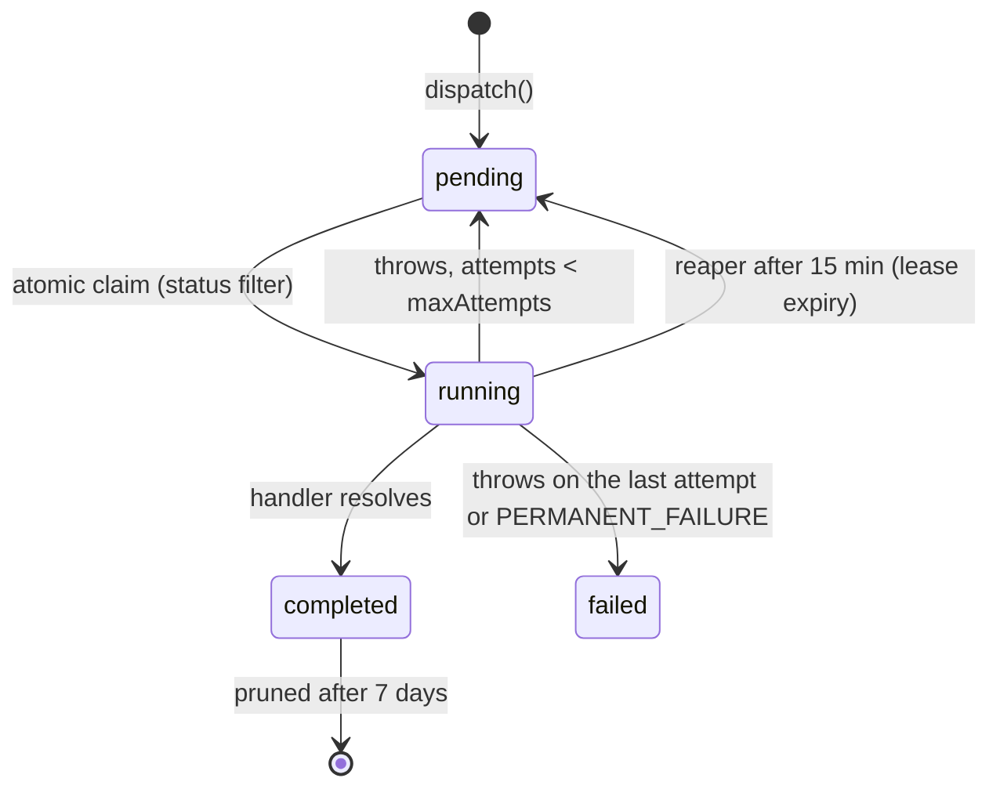

# Background Jobs & the Job Queue

Anything that must not block a request — publishing on a schedule, resizing an upload, delivering a webhook, importing rows, translating entries — becomes a row in the `svelty_jobs` table. There is **one queue**, shared by every process that talks to the same database.

## Lifecycle

- **Claim is atomic** — `UPDATE … WHERE _id = ? AND status = 'pending'`, so two workers can never run the same row.
- **Retries** — `maxAttempts` defaults to 3; the delay is exponential (`2^attempts` minutes). `PERMANENT_FAILURE` in the error message skips the retry.
- **Reaper** — a job stuck in `running` for 15 minutes (worker crash between claim and completion) is requeued, or marked `failed` once its attempts are exhausted.
- **Progress** — `progress` and `metadata` are free-form columns handlers can update while running.

## Task types

| `taskType`          | Dispatched by                                 | Cadence                   | Handler                    |
| :------------------ | :-------------------------------------------- | :------------------------ | :------------------------- |
| `publish-scheduled` | the poller                                    | every 60 s                | `jobs/scheduled-jobs.ts`   |
| `session-cleanup`   | the poller                                    | every 5 min               | `jobs/scheduled-jobs.ts`   |
| `process-media`     | upload / media pipeline                       | on demand                 | `jobs/media-jobs.ts`       |
| `webhook-delivery`  | `webhookService` fan-out                      | on demand                 | `jobs/webhook-jobs.ts`     |
| `import-data`       | Smart Importer / content packages / data sync | on demand                 | `jobs/import-jobs.ts`      |
| `bulk-translate`    | AI translation actions                        | on demand                 | `jobs/translation-jobs.ts` |
| `status-transition` | `src/services/scheduler.ts` (not the poller)  | on schedule / user action | `scheduler.ts`             |

The two poller-driven rows are maintenance sweeps. They run even when there is nothing to do and still record a completed job — **a 0–5 ms “completed” row usually means the sweep found nothing**, not that it performed work. `status-transition` rows live in the same table but are claimed and executed by the scheduler, which is why the queue poller skips that task type.

## Poller

`jobQueue.startPolling()` (default 10 s) is installed **once per process**; the bookkeeping lives on `globalThis` so a dev-server module reload reuses the same timer instead of installing another one. Ticks:

| Every  | Action                                                                          |
| :----- | :------------------------------------------------------------------------------ |
| 10 s   | `processNextBatch()` — claim and run ready jobs (hardware-adaptive concurrency) |
| 60 s   | dispatch `publish-scheduled`, reap stale `running` jobs                         |
| 5 min  | dispatch `session-cleanup`                                                      |
| 6 h    | prune `completed` rows older than 7 days                                        |
| ~100 s | sweep the temp store                                                            |

`SVELTY_BACKGROUND_MODE=child` moves every poller into a supervised worker process; `SVELTY_BACKGROUND_MODE=disabled` turns them off entirely (the UI still lets you enqueue and inspect). `DISABLE_JOBS=true` disables only the job poller.

## The `/config/queue` page

- **Stats** — total / pending / running / completed / failed, each a filter link.
- **Rows** — newest first, 10–100 per page. Click a row (or the eye button) for the task explanation, attempts, timings, tenant, last error and the raw payload.
- **Retry** — only shown for `failed` rows; resets attempts and queues immediately.
- **Delete** — removes one row, any status.
- **Clear Completed** — calls `system.jobs.cleanup(now)`, which deletes **`completed` rows only** and honours the request tenant, so pending retries and failed jobs are never lost.

## Multi-tenancy

Jobs carry a `tenantId`. Queue reads and the automatic prune run under the system scope (`withSystemScope("scheduler")`); page mutations are tenant-scoped through the request adapter. Tenant-bound adapters cannot read another tenant's job list.

## Where to look

- `src/services/background/jobs/job-queue-service.ts` — poller, claim, retries, reaper, prune.
- `src/services/background/jobs/scheduled-jobs.ts` — the two periodic sweeps.
- `src/services/scheduler.ts` — `status-transition` jobs (scheduled publish/unpublish/delete).
- `src/services/background/background-entry.ts` — supervised worker process.
- `/config/queue` — the read-only monitor with per-row detail.
