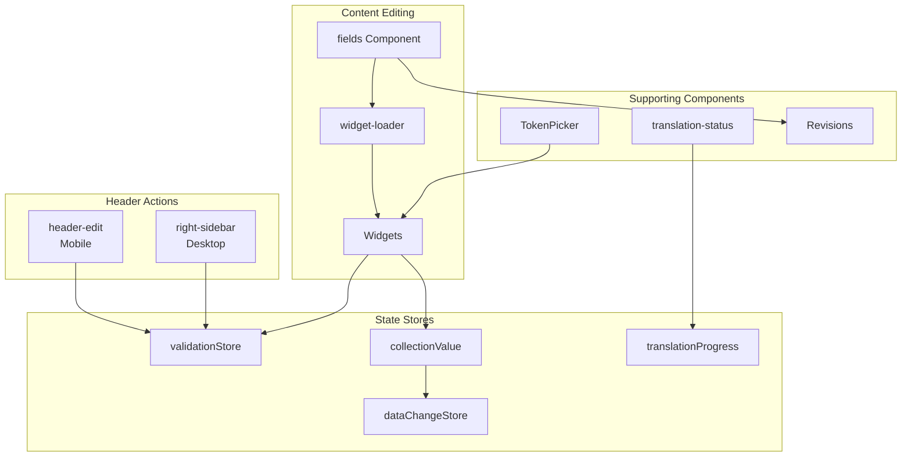

# fields Component

The `fields` component is responsible for rendering collection fields dynamically, loading appropriate widgets, handling validation, and managing revision history.

---

## Collection Entry Editing Ecosystem

The fields component is part of a larger system for editing collection entries. The following components work together:



### Component Roles

| Component              | Path                                                          | Role                                                                                                                                               |
| ---------------------- | ------------------------------------------------------------- | -------------------------------------------------------------------------------------------------------------------------------------------------- |
| **header-edit**        | `src/components/header-edit.svelte`                           | Mobile save/cancel/delete actions, validation gating                                                                                               |
| **right-sidebar**      | `src/components/right-sidebar.svelte`                         | Desktop save/status/scheduling actions                                                                                                             |
| **fields**             | `src/components/collection-display/fields.svelte`             | Dynamic field rendering, validation                                                                                                                |
| **widget-loader**      | `src/components/collection-display/widget-loader.svelte`      | Async widget loading with error handling                                                                                                           |
| **translation-status** | `src/components/collection-display/translation-status.svelte` | Translation progress per language                                                                                                                  |
| **TokenPicker**        | `src/components/token-picker.svelte`                          | Dynamic token insertion for fields (component is **unwired**: `fields.svelte` keeps the `openTokenPicker()` handler but nothing mounts the picker) |
| **Revisions**          | (within fields)                                               | Historical snapshots with revert capability                                                                                                        |

---

## 👥 Collaborative Editing (Phase 2 - Yjs Integration)

SveltyCMS implements real-time collaborative editing using **Yjs CRDTs**. This ensures that multiple users can edit the same entry simultaneously without data loss or conflicts.

### Collaborative Architecture

The collaborative system uses a **Single Source of Truth (SSoT)** model during the editing session, synchronized via a WebSocket provider (e.g., Hocuspocus).

```
flowchart TB
    subgraph Clients["Concurrent Editors"]
        C1[User A]
        C2[User B]
    end

    subgraph Sync["Synchronization Layer"]
        P[Yjs Provider<br/>WebSocket/Hocuspocus]
        YD[Y.Doc<br/>Shared Document State]
        AW[Awareness<br/>Cursors/Presence]
    end

    subgraph CMS["SveltyCMS Core"]
        F[fields Component]
        CV[collectionValue Store]
        DB[(Database)]
    end

    C1 <--> P
    C2 <--> P
    P <--> YD
    YD <--> AW
    YD --"Reconciles"--> F
    F --"Updates"--> CV
    CV --"Saves (Debounced)"--> DB
```

### Key Components of Collaboration

| Feature            | Implementation | Description                                                                                                    |
| :----------------- | :------------- | :------------------------------------------------------------------------------------------------------------- |
| **Shared State**   | `Y.Doc`        | A Conflict-free Replicated Data Type (CRDT) document that holds all entry fields.                              |
| **Presence**       | `Awareness`    | Tracks remote cursors, active users, and field-level focus highlights.                                         |
| **Sync Provider**  | `Hocuspocus`   | The recommended enterprise WebSocket provider for synchronizing Yjs docs with the server.                      |
| **Widget Binding** | `y-svelte`     | Widgets bind their inputs directly to the `Y.Doc` sub-types (e.g., `Y.Text` for inputs, `Y.Xml` for RichText). |

### Data Flow for Real-time Sync

1. **Initialization**: When an entry is opened, `fields.svelte` initializes a `Y.Doc` and connects to the provider.
2. **Local Change**: A user types in a widget. The widget updates its corresponding sub-type in the `Y.Doc`.
3. **Propagation**: Yjs automatically propagates the delta to all other connected clients and the server.
4. **Reconciliation**: `fields.svelte` watches the `Y.Doc` for changes and updates the global `collectionValue` store to maintain compatibility with non-collaborative parts of the system (like Save actions).
5. **Awareness**: Remote cursors are rendered using absolute positioning relative to the field containers, providing visual feedback of where others are working.

---

## Architecture

```
flowchart TB
    subgraph fields["fields Component"]
        direction TB
        FD[Field Definitions]
        WL[Widget Loader]
        VL[Validation Logic]
        RH[Revision History]
    end

    subgraph Widgets["Widget System"]
        TW[Text Widget]
        RTW[RichText Widget]
        MW[Media Widget]
        RW[Relation Widget]
        CW[Custom Widgets]
    end

    subgraph Stores["State Stores"]
        CV[collectionValue]
        VS[validationStore]
        TP[translationProgress]
        DC[dataChangeStore]
    end

    FD --> WL
    WL --> Widgets
    Widgets --> CV
    CV --> VL
    VL --> VS
    VS --> DC
    RH --> CV
```

---

## Features

| Feature                          | Description                                                  |
| -------------------------------- | ------------------------------------------------------------ |
| **Dynamic Widget Loading**       | Lazy-loads widgets based on field type using `widget-loader` |
| **Validation Store Integration** | Real-time field validation with `validationStore`            |
| **Translation Progress**         | Visual indicators for multilingual content completion        |
| **Revision History**             | View and revert to previous versions                         |
| **Role-Based Filtering**         | Show/hide fields based on user permissions                   |
| **Two-Way Binding**              | Sync between local and global state                          |

---

## header-edit & right-sidebar (Save Actions)

The save functionality is split between mobile and desktop views:

### header-edit (Mobile)

Visible on screens < 1024px. Provides:

- **Save Button**: Disabled when `validationStore.isValid === false` or the user lacks write access
- **Cancel/Delete**: With confirmation modals
- **Clone**: Duplicate entry functionality
- **Status toggle**: Binary publish/unpublish (PATCHes immediately, throttled to 500 ms)
- **Scheduling**: Date/time/action modal in the overflow menu; the action is not persisted (see caveats below)

```
// Save validation gating
const canSave = $derived(validationStore.isValid && dataChangeStore.hasChanges);
```

### right-sidebar (Desktop)

Visible on screens >= 1024px. Additionally provides:

- **Entry Status**: Binary publish/unpublish toggle (only in `edit`/`create` with write access)
- **Metadata Display**: Created/Updated timestamps
- **Scheduling Panel**: Date/time picker plus change/cancel controls; the selected action is not persisted

Both components integrate with `validationStore` to prevent saving invalid entries.

---

## Draft, Publish & Scheduling

### Status model

`status` is a system column (`StatusTypes`), not a schema field. The canonical values are:

| Stored value | Label       | Badge presentation    |
| ------------ | ----------- | --------------------- |
| `draft`      | Draft       | outline + pencil      |
| `publish`    | Published   | primary + thumbs-up   |
| `unpublish`  | Unpublished | warning + pause       |
| `schedule`   | Scheduled   | error + clock         |
| `archive`    | Archived    | surface + archive     |
| `clone`      | Clone       | secondary + clipboard |
| `delete`     | Delete      | surface + trash       |

Scheduling metadata:

- `_scheduled` is stored in the entry data payload as epoch milliseconds.
- `_scheduledBy` is stamped server-side from the authenticated actor; clients cannot supply it.
- `publishDate` in the demo blog schema is an ordinary user-defined DateTime field. It is **not** connected to scheduling.
- `publishedAt` is **not** automatically stamped by the status/publish path.

### Editors and permissions

- **Desktop**: right-sidebar (>= 1024 px) in `edit` / `create`, when the user has write access.
- **Mobile**: `header-edit` overflow menu (< 1024 px).
- The status toggle is binary (publish/unpublish). It PATCHes immediately, is throttled to one change per 500 ms, and is disabled while a status request is in flight.
- Save is disabled when `validationStore.isValid === false` or the user lacks write access.
- Collection mutations require `collections:write`; creating a scheduled job requires `system:settings` (administrators bypass both checks).

### Scheduling workflow

1. Open **Schedule publication…** in the right-sidebar, or the clock action in the mobile overflow menu.
2. Choose a future date and time and an action (publish / unpublish / delete). Past dates are rejected client-side.
3. The modal updates local form state only: `status` becomes `schedule` and `_scheduled` is set. Nothing is persisted until **Save**.
4. Save writes `status: "schedule"` and `_scheduled`; the server stamps `_scheduledBy`; the editor then POSTs a `status-transition` job to `/api/system-jobs` with `runAt` set to the chosen time.
5. The scheduler polls `svelty_jobs` (1 s while jobs are queued, 30 s when idle) and transitions the entry on its next poll after `runAt`. It clears `_scheduled`, runs the workflow publish gate, invalidates caches, and emits an `entry:update` event.
6. Administrators can inspect, retry, or delete jobs at `/config/queue`.

> [!WARNING]
> Scheduling is only partially wired today:
>
> - The action selected in the modal is **not persisted**. Every scheduled job targets `publish`; scheduled unpublish and delete do not work.
> - Scheduling a **new** entry in create mode does not create a job (the entry id is not available when the job request is built). The entry is saved as Scheduled but never transitions.
> - **Cancel Schedule** clears the local timestamp only. It does not delete the already-created job, which still publishes at its original time.
> - Saving again while `_scheduled` is present creates another job; jobs are not deduplicated.
> - Creating the job requires `system:settings`. With the built-in editor/developer roles the entry is saved as Scheduled but no job is enqueued.
> - A scheduled publish that lacks required fields, or whose workflow is not in a final state, fails when the job runs (3 attempts, then `failed`; visible in the queue).
> - A path field on an entry can make the scheduler update `content_nodes` instead of the collection row.
> - `_scheduled` is not in `SYSTEM_WRITABLE_FIELDS`; a collection with `strict: true` prunes it.

### Autosave / navigation guard

There is no timed autosave. On SvelteKit navigation away from `edit` / `create` with unsaved changes, the guard:

1. cancels navigation,
2. saves the current form state while **preserving the loaded status** (only a brand-new entry is saved as `draft`),
3. preserves an existing `_scheduled` timestamp and drops a schedule added only in the form,
4. shows a toast, switches to view mode, and re-issues the navigation.

There is no `beforeunload` / tab-close guard and no localStorage draft restore in this editor.

> [!NOTE]
> Autosave does not bypass the publish gate for an already-published entry. If the edited payload no longer satisfies the gate (for example, a required field was cleared), the autosave fails and navigation stays on the form with “Failed to auto-save. Please save manually.”

---

## translation-status

Displays translation completion progress for multilingual collections:

```
flowchart LR
    F[fields] --> TS[translation-status]
    TS --> |tracks| TP[translationProgress]
    TP[translationProgress]
    TS --> |displays| Languages
    Languages --> Progress[% Complete]
```

### Features {#features-2}

- **Per-Language Progress**: Shows completion % for each language
- **Field-Level Tracking**: Tracks individual translatable fields
- **Widget-Aware**: Handles complex widgets (e.g., SEO) with nested language data
- **Language Switcher**: Click to switch content language

### Progress Calculation

```
// Translation progress per language
translationProgress[language] = {
  total: new SvelteSet<string>(), // All translatable fields
  translated: new SvelteSet<string>(), // Completed translations
};

// Progress percentage
const progress = (translated.size / total.size) * 100;
```

---

## TokenPicker

A floating panel for inserting dynamic tokens into input fields:

### Features {#features-3}

- **Token Categories**: Entry, User, Site, System tokens
- **Modifier Support**: date, upper, lower, truncate, etc.
- **Live Preview**: Shows resolved token value
- **Smart Detection**: Detects existing tokens in active input
- **Draggable Window**: Repositionable UI

### Usage

Tokens are inserted with `{{ }}` syntax:

```
{
  {
    entry: title;
  }
} // Simple token
{
  {
    entry: date | date(short);
  }
} // With modifier
{
  {
    user: displayName | upper;
  }
} // Uppercase modifier
```

---

## Validation Integration

The fields component integrates with the global `validationStore` for real-time validation feedback.

### Validation Flow

```
sequenceDiagram
    participant F as fields
    participant W as Widget
    participant VS as validationStore
    participant UI as Save Button

    F->>W: Render with field config
    W->>W: User input
    W->>VS: setError(fieldName, message)
    VS->>UI: isValid = false
    Note over UI: Save disabled

    W->>W: User fixes input
    W->>VS: clearError(fieldName)
    VS->>UI: isValid = true
    Note over UI: Save enabled
```

### Required Field Validation

The component automatically validates required fields:

```
$effect(() => {
  const values = currentCollectionValue;

  filteredfields.forEach((field) => {
    if (field.required) {
      const fieldName = getFieldName(field, false);
      const value = values[fieldName];

      const isEmpty =
        value === null ||
        value === undefined ||
        (typeof value === "string" && value.trim() === "") ||
        (Array.isArray(value) && value.length === 0);

      if (isEmpty) {
        validationStore.setError(fieldName, `${field.label || fieldName} is required`);
      } else {
        validationStore.clearError(fieldName);
      }
    }
  });
});
```

### Widget-Level Validation

Individual widgets can implement their own validation using Valibot schemas:

```
// In widget input.svelte
import { validationStore } from "@stores/store.svelte";
import { parse } from "valibot";

function validateInput() {
  try {
    parse(validationSchema, currentValue);
    validationStore.clearError(fieldName);
  } catch (error) {
    const message = error.issues?.[0]?.message || "Invalid input";
    validationStore.setError(fieldName, message);
  }
}
```

---

## Widget Loading Flow

```
sequenceDiagram
    participant F as fields
    participant WL as widget-loader
    participant CL as ComponentLoader (import)
    participant W as Widget Component

    F->>WL: Render field
    WL->>CL: Execute dynamic import()
    CL-->>WL: Resolve Svelte Component
    WL->>W: Mount with props
    W->>F: bind:value updates
```

### widget-loader Error Handling

The `widget-loader` component handles loading failures gracefully:

- **Loading State**: Shows Native UI while widget loads
- **Error State**: Displays error with retry button
- **Fallback State**: Shows warning for unavailable widgets

---

## Props

```
interface fieldsProps {
  fields: FieldDefinition[];
  collection: Collection;
  entry: Entry;
  entryId: string;
  collectionValue: ValueStore;
  revisions?: Revision[];
  contentLanguage?: string;
}
```

---

## Tabs

The component uses a tabbed interface with up to 4 tabs (conditional based on settings):

### Tab 0: Edit

The primary editing interface with all field widgets.

### Tab 1: Revisions

Only visible if `collection.revision` is enabled. Shows historical snapshots with:

- Version timeline
- Compare functionality
- Revert capability

### Tab 2+: Live Preview (Editable Website plugin)

When the **[Editable Website & Live Preview](/src/plugins/editable-website/editable-website.mdx)** plugin is enabled on a collection (`plugins: ["editable-website"]` and `livePreview` configured), a **Live Preview** tab appears via the `entry_edit` injection zone.

Requires a **marketplace license** (€14.99) or active **14-day trial**.

**Features:**

- **Signed preview URL** via `POST /api/preview/authorize`
- **Bidirectional sync** — CMS edits push to iframe; preview can send `svelty:save` back to the form
- **Click-to-edit** — click `data-svelty-field` elements in the preview to focus CMS fields
- **Device preview** — desktop / tablet / mobile widths
- **Copy URL** and **open in new tab**

Works with the optional [SvelteKit Site Starter](/docs/development/site-starter.mdx) (`routes/(site)`) or any external frontend implementing the protocol.

> [!NOTE]
> For handshake security, postMessage types, and external frontend setup, see [Live Preview Architecture](/docs/reference/architecture/live-preview-architecture.mdx).

### Tab 3: API (Admin Only)

Only visible for admin users. Shows:

- **API URL** for the current entry: `/api/collection/{collectionId}/{entryId}`
- **Copy button** for the URL
- **Raw JSON view** of the entry data

---

## Plugin Extensibility

The fields component supports plugin extensions through the **`entry_edit` injection zone**, allowing plugins to add custom tabs and functionality to the entry editing interface.

### Plugin Slots

Plugins can register components in the `entry_edit` zone to:

- **Add Custom Tabs**: SEO optimization, AI content generation, preview tools
- **Inject UI Elements**: Custom actions, metadata panels, workflow controls
- **Extend Functionality**: Third-party integrations, analytics, custom validators

### Example Plugin Integration

```
// Plugin registering a custom SEO tab
import type { Plugin } from "@src/plugins/types";
import SEOTab from "./SEOTab.svelte";

export const seoPlugin: Plugin = {
  metadata: {
    id: "seo-optimizer",
    name: "SEO Optimizer",
    version: "1.0.0",
    enabled: true,
  },
  ui: {
    slots: [
      {
        zone: "entry_edit",
        slot: "tabs",
        component: SEOTab,
        order: 100,
      },
    ],
  },
};
```

### Available Slots in `entry_edit` Zone

| Slot Name          | Location                                     | Use Case                       |
| ------------------ | -------------------------------------------- | ------------------------------ |
| `tabs`             | Additional tabs after Edit/Revisions/Preview | Custom editing interfaces      |
| `header_actions`   | Header toolbar area                          | Quick actions, status controls |
| `field_extensions` | Below field groups                           | Field-level enhancements       |

> [!TIP]
> For complete plugin development guide, see [Plugin Architecture](/docs/reference/architecture/security-plugin).

---

## Best Practices

1. **Field Configuration**: Always set `db_fieldName` for consistent validation keys
2. **Required fields**: Use `required: true` for mandatory fields (handled automatically)
3. **Custom Validation**: Implement Valibot schemas in widget `index.ts` for type-specific validation
4. **Error Messages**: Provide clear, user-friendly validation messages
5. **Permissions**: Use `permissions` field config to control access per role

---

## 🧩 Visual Polymorphic Block Builder Widget {#visual-polymorphic-block-builder-widget}

The **Block Builder Widget** (`src/widgets/custom/block-builder/`) provides visual page-building capabilities directly inside SveltyCMS collection schemas. Instead of rigid, flat form fields, authors assemble modular, responsive page layouts out of polymorphic, reusable content blocks.

### 3-Pillar Widget Architecture

1. **Definition (`index.ts`)**:
   - Factory `createWidget()` conforming to the standard `GuiField` contract.
   - Strict Valibot validation schema (`blockBuilderSchema`) enforcing required block identifiers, titles, and variant data structures.
   - Built-in block preset registry:
     - `hero`: Title, subtitle, primary CTA label, CTA URL, background image URL, alignment (`left`, `center`, `right`).
     - `features`: Feature list with item titles, descriptions, and Iconify icon identifiers.
     - `cta`: Call-to-action title, description, button label, button URL, style variant (`primary`, `secondary`, `outline`).
     - `testimonials`: Quotes, author names, roles/companies, and avatar image URLs.
     - `faq`: Interactive question-and-answer pairs.
     - `rich-text`: Formatted HTML or Markdown body content.

2. **Input Component (`input.svelte`)**:
   - Interactive block inserter drawer with preset icons and human-friendly descriptions.
   - Move-up and move-down block reordering with keyboard and click accessibility.
   - Collapsible cards allowing editors to manage complex long-form pages without visual clutter.
   - In-line type-specific field editors bound directly to the active collection document state.
   - Per-block clone/duplicate and delete actions with confirmation safeguards.
   - Status badge displaying total block count and real-time schema validation feedback.

3. **Display Component (`display.svelte`)**:
   - Compact table cell preview rendering total block count badges and colored type chips for quick scannability in collection list views.

---

## Related Documentation

- [widget-loader Component](/docs/reference/components/index) - Async widget loading
- [Widget System Overview](../../development/widgets/index.mdx) - Widget architecture
- [Unified Error Handling](/docs/development/error-handling.mdx) - Error handling patterns
- [Live Preview Architecture](/docs/reference/architecture/live-preview-architecture.mdx) - Preview system
- [Validation Instant Feedback](/docs/reference/architecture/validation-instant-feedback.mdx) - Validation UX
- [Multilingual Data Loading](/docs/reference/architecture/multilingual-data-loading.mdx) - Translation handling
