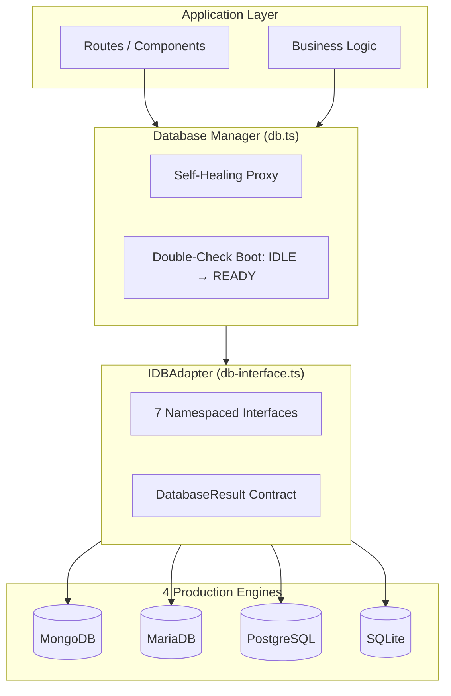

# Database Documentation Hub

Welcome to the SveltyCMS Database Engine documentation. Our architecture is built on the principle of **Strict Database Agnosticism**, allowing you to swap between NoSQL and Relational engines without changing a single line of application logic or frontend code.

## What Does "Database-Agnostic" Mean in SveltyCMS?

In traditional CMS architectures, changing databases usually requires rewriting schemas, ORM models, or migration files. SveltyCMS solves this through the **Unified `IDBAdapter` Interface**:

1. **Local & Edge (SQLite)**: Sub-millisecond queries in WAL mode with zero network latency. Ideal for local development, testing, and single-node production.
2. **Enterprise Relational (PostgreSQL & MariaDB)**: Native connection pooling, ACID transaction guarantees, and compiled prepared-statement plans for high-concurrency clustered workloads.
3. **Document Store (MongoDB)**: High-throughput document operations with type-safe query guards and automatic connection failover.
4. **Zero Code Changes**: Collections, field widgets, workflows, and search indexes behave identically across all four supported engines.

---

## 📚 Documentation Structure

### 1. Database-Agnostic Architecture

- **[Core Infrastructure](./core-infrastructure.mdx)** — `db.ts` lifecycle, self-healing proxy, topological service boot (`db-init.ts`), LocalCMS SDK
- **[Database Methods Interface](./database-methods.mdx)** — `IDBAdapter` namespaces: `auth`, `crud`, `content`, `media`, `system`, `batch`, `collection`
- **[Database Resilience](./database-resilience.mdx)** — Error handling, retry logic, circuit breaker, connection health monitoring
- **[Performance Architecture](./performance-architecture.mdx)** — `findPage` / count modes / count cache (equal on all engines), allocation-floor, schema-aware conversion, ring-buffer pools
- **[SQL Query Builder](./sql-query-builder.mdx)** — the single dialect-parameterized builder shared by SQLite, MariaDB and PostgreSQL: compiled prepared-statement list/count plans, Drizzle fallback, hybrid-schema JSON, keyset pagination

### 2. Engine Implementations

- **[SQLite Implementation](./sqlite-implementation.mdx)** ✅ **Platinum** — Default for local/edge. Sub-ms CRUD, WAL mode, zero network overhead.
- **[PostgreSQL Implementation](./postgresql-implementation.mdx)** ✅ **Production** — Enterprise scaling, native JSONB, GIN indexing, PgBouncer support.
- **[MariaDB Implementation](./mariadb-implementation.mdx)** ✅ **Production** — High-concurrency pooling via `mysql2`, shared `findPage` / count estimate path.
- **[MongoDB Implementation](./mongodb-implementation.mdx)** ✅ **Production** — NoSQL engine, safeQuery security, wire compression.

---

## 🏗️ Architecture Overview

### Shared list & count contract (all adapters)

| API                    | Default product use               | Benefit                                     |
| ---------------------- | --------------------------------- | ------------------------------------------- |
| `crud.findPage`        | Admin/API lists (`total: "none"`) | One query; `hasMore` via limit+1 — no COUNT |
| `crud.count({ mode })` | Badges / dashboards               | `exact` \| `estimate` \| `auto`             |
| Count L1 cache (30s)   | Repeated tenant counts            | ~0.024 ms hits after warm (all engines)     |

Details and measured gains: [Performance Architecture](./performance-architecture.mdx#product-layer-list--count-equal-on-all-engines) · method signatures: [Database Methods](./database-methods.mdx#-crud-namespace).

---

## 🛡️ Shared Security Principles (All Adapters)

- **4-Layer Defense-in-Depth**: Middleware → Dispatcher → Handler → Page Action
- **Tenant Isolation**: Every query scoped by `tenantId` at adapter level — architecturally impossible to bypass
- **Credential Hashing**: Website tokens and API keys are stored as SHA-256 digests only; plaintext is returned once on creation. See [`system.websiteTokens`](./database-methods.mdx#-credential-storage-website-tokens--api-keys).
- **Tenant-Scoped Bearer Lookup**: Auth passes `locals.tenantId` into credential lookups (aligned with `auth.getApiKey`) to narrow multi-tenant queries.

- **MongoDB Soft-Delete Safety**: `safeQuery()` applies `isDeleted: { $ne: true }` so legacy documents without the field remain visible to active queries.
- **SQL Soft-Delete Clamp (parity)**: `SqlAdapterCore.clampSoftDeleted` AND-s `isDeleted = false` into `findMany`/`findOne`/`count`/`exists`/`findByIds`/`streamMany`/`findPage`/`aggregate` unless the caller opts in with `includeDeleted` (or a system `bypassSafeQuery`), the table has no `isDeleted` column, or the query already pins `isDeleted` (the trash view). `findById` clamps the raw projection directly.
- **SSRF Prevention**: Cloud storage adapters validate endpoints before connection
- **NoSQL Injection Protection**: `sanitizeMongoQuery` blocks `$where`, `$function`, `$expr`
- **CSPRNG-Only Tokens**: `globalThis.crypto.getRandomValues()`, no `Math.random()` fallback
- **Fail-Closed API**: Unmapped namespaces return 403 by default

## 🔄 Shared Resilience Patterns (All Adapters)

- **Circuit Breaker**: 5 consecutive failures → 60s open → probe recovery
- **Self-Healing Reconnection**: Auto-recovery on connection loss + HMR reload
- **Exponential Backoff with Jitter**: 1s→2s→4s→8s→16s, ±500ms
- **Connection Pool Diagnostics**: `GET /api/database/pool-diagnostics` + dashboard widget — see [Database Resilience](./database-resilience.mdx)
- **Migration Safety**: `CREATE TABLE IF NOT EXISTS` — idempotent

## ⚡ 2027 Allocation-Floor Optimizations

| Optimization                               | SQLite | PostgreSQL   | MariaDB      | MongoDB          |
| ------------------------------------------ | ------ | ------------ | ------------ | ---------------- |
| Schema-aware row conversion                | ✅     | ✅           | ✅           | N/A              |
| Ring-buffer result pool (64 slots)         | ✅     | ✅           | ✅           | ✅               |
| Conditions array pool (32 slots)           | ✅     | ✅           | ✅           | N/A              |
| Fused mapQuery (no IR objects)             | ✅     | ✅           | ✅           | ✅               |
| for...in (zero Object.entries)             | ✅     | ✅           | ✅           | ✅               |
| Pre-allocated meta object                  | ✅     | ✅           | ✅           | ✅               |
| MariaDB double-parse isolated              | N/A    | ✅ Benefit   | ✅           | N/A              |
| Prepared-statement cache                   | ✅     | N/A (driver) | N/A (driver) | N/A              |
| Projection (`fields` → skip `data`)        | ✅     | ✅           | ✅           | ✅ (driver)      |
| Targeted column UPDATE (omit empty `data`) | ✅     | ✅           | ✅           | ✅ (`$set` only) |
| `createdAt` insert-only on UPDATE          | ✅     | ✅           | ✅           | ✅               |

> **SQL family**: ~5-8 fewer allocations per filtered query (self-assessed estimate — not instrumented). **MongoDB**: ~2-3 fewer (result pool + fused mapQuery). **All 4**: benefit from shared BaseAdapter optimizations plus the core widget/session/cache pipeline. The paths that promise _no_ allocation are pinned by reference-identity assertions (`tests/unit/core/relational-utils.test.ts`, `tests/unit/security/safe-query-manual.test.ts`). See [Performance Architecture](./performance-architecture.mdx#core--adapter-communication-all-4-engines).

## ⚡ 2026-10 Write-Path Optimizations (self-measured, same WSL2/Docker host)

| Optimization                                                        | Engine               | Measured gain                                                                             |
| ------------------------------------------------------------------- | -------------------- | ----------------------------------------------------------------------------------------- |
| Durability knob (`PG_SYNCHRONOUS_COMMIT`, opt-in per connection)    | PostgreSQL           | update `dbwrite` p50 **9.76 → 2.3–2.9 ms**; lane ~1.5k → 2.0–3.1k RPS (warm 8c)           |
| Durability parity (`innodb_flush_log_at_trx_commit=2`, harness DBs) | MariaDB              | update 1,269 → 1,918 RPS (+51 %); create +42 %; seed 5,686 → 7,676 docs/s                 |
| Mongo write concern knob (`MONGO_WRITE_CONCERN` / hints)            | MongoDB              | configurable replica/fsync durability (`w: 1`, `w: "majority"`, `w: 0`)                   |
| `INSERT … UNNEST` / `UPDATE … FROM UNNEST` bulk writes              | PostgreSQL           | one array per column, plan-cache-stable statements                                        |
| `UPDATE … JOIN JSON_TABLE` bulk update (10.6+)                      | MariaDB              | heterogeneous 100-row batch **68.4 → 3.6 ms (19×)**                                       |
| `skipReturning: true` fast path on all 4 adapters                   | all 4 DB adapters    | skips read-back overhead on seed and batch-write pipelines                                |
| `PATCH …?fields=_id,count,updatedAt` projection                     | PostgreSQL (all SQL) | prunes `RETURNING` — the `data` blob is never re-read/de-TOASTed                          |
| Multi-row insert coalescing                                         | PostgreSQL, MariaDB  | concurrent creates share one statement; `SVELTY_WRITE_COALESCING=0` opts out              |
| Lane-lean rate limit (local bucket + async Redis ledger)            | all                  | warm create/update srv-dur **1.86/1.49 → 0.36/0.31 ms (−79–81 %)** with Redis up (SQLite) |

Details, harness commands, and the measured-and-declined experiments: [Achievements §3.45](/docs/project/achievements-2026). The PostgreSQL commit (~2.4–2.8 ms) remains the documented write floor.

### 3. Distributed Cache Layer (Optional)

- **[Cache System Architecture](../architecture/cache-system.mdx)** — Dual-layer L1/L2 engine with stampede locking, atomic `INCRBY` versioning, and zero-tax `mGet` batching.

---

## 📈 Performance Benchmarks (SQLite, Latest)

| Operation             | Latency      | RPS               |
| --------------------- | ------------ | ----------------- |
| FIND ONE              | **0.004 ms** | 196,854           |
| UPDATE (no-returning) | **0.024 ms** | 25,516            |
| DELETE                | **0.038 ms** | 15,399            |
| Peak Throughput       | —            | **572,738 ops/s** |
| LocalCMS SDK Overhead | —            | **0.00%**         |

Full cross-database benchmarks: [Performance Benchmarks](/docs/project/benchmarks/index).

## Adapter & Cache Selection Guide

| Scale                             | Recommended DB                             | Redis L2?         | Why                                                                                                                                            |
| :-------------------------------- | :----------------------------------------- | :---------------- | :--------------------------------------------------------------------------------------------------------------------------------------------- |
| **Dev, edge, small teams**        | **SQLite** (default)                       | **No** (Optional) | In-process, zero network overhead, sub-ms CRUD. RAM L1 cache handles hot reads.                                                                |
| **Production single node**        | **PostgreSQL** or **MariaDB**              | **Optional**      | Native JSONB/JSON, relational ACID, robust pooling. Enable Redis for high-traffic spikes.                                                      |
| **High-volume NoSQL**             | **MongoDB**                                | **Recommended**   | Cuts BSON serialization overhead by ~20% and lowers p95 read latencies.                                                                        |
| **Enterprise Multi-Node Cluster** | **PostgreSQL** / **MariaDB** / **MongoDB** | **Recommended**   | Synchronizes cluster nodes via Redis Pub/Sub (`svelty:cache:invalidation`), prevents cache stampedes, and lowers p95 tail latencies by 30–35%. |

> [!NOTE]
> **Redis is Strictly Optional Across All 4 Adapters**: Without Redis, SveltyCMS automatically operates using its built-in in-memory LRU cache (`<0.001ms` hit time) with zero degraded features.

---

## 🧭 Supported Database Engine Versions & Latest Optimizations (2026–2027)

SveltyCMS targets a **lean 2-generation active window** across all four engines. The window guarantees a modern native baseline; the newest generation unlocks the fastest paths (see the caveats below). Hard floors are enforced at connection boot; older majors boot only through the migration escape hatch.

### Support tiers

| Tier                               | Engines                                                                         | Guarantee                                                                                                                               |
| :--------------------------------- | :------------------------------------------------------------------------------ | :-------------------------------------------------------------------------------------------------------------------------------------- |
| **Supported (boot-enforced)**      | PostgreSQL 18–19 · MariaDB 11.4–13.2 · MongoDB 8.0–9.0 · SQLite 3.51–3.54.1     | Tested in the adapter contract suites; boot fails below the floor.                                                                      |
| **Compatibility (migration only)** | PostgreSQL 15–17 · MariaDB 10.5.2–11.3 · MongoDB 6.0–7.x · SQLite 3.38–3.50     | Boots only with `SVELTY_ALLOW_LEGACY_DB=1`; emits a boot warning; not covered by CI; use for a one-off import, then upgrade the server. |
| **Unsupported (technical floor)**  | PostgreSQL ≤14 · MariaDB ≤10.5.1 / Oracle MySQL 8 · MongoDB ≤5.0 · SQLite ≤3.37 | Refused even with the escape hatch — the adapter uses syntax those engines reject.                                                      |

> [!IMPORTANT]
> **`SVELTY_ALLOW_LEGACY_DB=1` is a migration escape hatch, not a supported production mode.** It bypasses all four floor checks, logs a warning, and leaves you on untested code paths. Run the import, then upgrade the server before serving traffic.

### Window caveats

- **MariaDB 11.4–12.x** does not have `UPDATE ... RETURNING` (added in 13.0). Those versions use the 2-round-trip `INSERT ... RETURNING` + `skipReturning` / base-update fallback. The single-round-trip update path is guaranteed only on 13.0+.
- **PostgreSQL 18** does not have `REPACK (CONCURRENTLY)` or `WAIT FOR LSN` (added in 19). Read-Your-Writes reads on PG 18 stay pinned to the primary for `readYourWritesWindowMs`; on PG 19+ the router waits on a standby and serves the read there when synchronized.
- **MongoDB transactions** remain disabled by default (`supportsTransactions: false`). The 8.0 floor makes them available, but they are not wired into the default write path.
- **SQLite** is checked with `sqlite_version()`; FTS5 also requires the runtime's SQLite build to include `ENABLE_FTS5` (Node ≥ 24.22.1 and Bun ≥ 1.3.12 bundle it).

| Engine                                              | Minimum Supported Floor (Boot-Enforced)                | Recommended / Tested Latest      | Version-Adaptive Native Capabilities                                                                                                                                                                                                                                                                                                                                                                                                                                                                                               |
| :-------------------------------------------------- | :----------------------------------------------------- | :------------------------------- | :--------------------------------------------------------------------------------------------------------------------------------------------------------------------------------------------------------------------------------------------------------------------------------------------------------------------------------------------------------------------------------------------------------------------------------------------------------------------------------------------------------------------------------- |
| **PostgreSQL** (`postgres` ^4.1.1)                  | **18.0+** (2 majors: 18 & 19)                          | **PostgreSQL 18.7 & 19.0**       | **PG 19+**: Native online `REPACK (CONCURRENTLY, ANALYZE)` bloat reclamation, standby `WAIT FOR LSN ... WITH (TIMEOUT, NO_THROW)` Read-Your-Writes (wired into `ReplicaRouterAdapter`), `INSERT ... ON CONFLICT DO SELECT RETURNING`. **PG 18–19**: `jsonb_build_object` / `jsonb_agg` Direct-to-Wire streaming, `UNNEST` bulk writes, `jsonb_path_ops` GIN containment (`@>`), `pg_trgm` GIN media search, `NULLS NOT DISTINCT`, generic-plan prepared statement warmup.                                                          |
| **MongoDB** (`mongodb` ^7.8.0 / `mongoose` ^9.12.3) | **8.0+** (2 majors: 8.0 & 9.0)                         | **MongoDB 8.0 & 9.0**            | **MongoDB 9.0**: Native wire protocol v29 compatibility, up to 35% faster read & 30% faster update engine paths, UTC JS/aggregation evaluation, strict `$where`/`$function` ban. **MongoDB 8.0–9.0**: `$facet` single-round-trip `findManyWithCount`, `estimatedDocumentCount` fast-path, Snappy/Zstandard wire compression.                                                                                                                                                                                                       |
| **MariaDB** (`mysql2` ^3.24.6)                      | **11.4 LTS+** (2 series: 11.4 LTS & 13.x)              | **MariaDB 11.4 LTS & 13.0–13.2** | **MariaDB 13.0+**: Native single-table `UPDATE ... RETURNING *` (1 round-trip updates; 11.4 automatically uses `INSERT ... RETURNING *` + `skipReturning` or base update fallback). **11.4–13.2**: Lazy `GENERATED ALWAYS AS (...) VIRTUAL` + B-tree indexes for dynamic JSON sort fields, `UPDATE ... JOIN JSON_TABLE` heterogeneous bulk updates (19× faster), `JSON_OBJECT`/`JSON_ARRAYAGG` wire streaming. _(Note: Oracle MySQL 8 is not supported due to MariaDB-specific `RETURNING` and `CREATE INDEX IF NOT EXISTS` DDL)._ |
| **SQLite** (`node:sqlite` / `bun:sqlite`)           | **3.51.0+** (bundled in Node ≥ 24.22.1 / Bun ≥ 1.3.12) | **SQLite 3.51 – 3.54.1**         | **SQLite 3.51–3.54+**: Windows SRWL high-concurrency reader/writer locking, smart expression index `UPDATE` skip, FTS5 with `bm25()` ranking, WAL + 256 MB `mmap_size`, Direct-to-Wire `json_object`/`json_group_array` streaming, group-commit `WriteBatcher`.                                                                                                                                                                                                                                                                    |

### Competitor CMS Database Matrix Comparison

| CMS                 | PostgreSQL      | MariaDB / MySQL            | SQLite            | MongoDB           | Multi-Engine Parity Strategy                                                                                       |
| :------------------ | :-------------- | :------------------------- | :---------------- | :---------------- | :----------------------------------------------------------------------------------------------------------------- |
| **SveltyCMS**       | **18.0 – 19.0** | **MariaDB 11.4 – 13.2**    | **3.51 – 3.54.1** | **8.0 – 9.0**     | Lean 2-version window + unified `IDBAdapter`, shared `SqlAdapterCore` & Direct-to-Wire JSON streaming across all 4 |
| **Payload CMS 3.x** | 15+ (Drizzle)   | Beta                       | Experimental      | 6.0+ (Mongoose)   | Separate MongoDB vs Drizzle relational adapters                                                                    |
| **Strapi v5**       | 14+             | MySQL 8+ / MariaDB 10.6+   | 3.35+ (dev)       | ❌ Dropped in v4  | Knex.js relational-only abstraction                                                                                |
| **Directus 11**     | 13+             | MySQL 8+ / MariaDB 10.6+   | 3.35+             | ❌ Unsupported    | Knex.js relational-only abstraction                                                                                |
| **Keystone 6**      | 14+             | MySQL 8+                   | 3.35+             | ❌ Unsupported    | Prisma ORM relational-only                                                                                         |
| **Drupal 11**       | 16+             | MySQL 8.0+ / MariaDB 10.6+ | 3.45+             | ❌ Community only | PHP PDO relational layer                                                                                           |

> [!NOTE]
> **Competitor matrix methodology.** The competitor columns are based on publicly available vendor documentation as of 2026-11-21 and are provided for orientation, not as a benchmark. Verify each vendor's current support matrix before relying on it. No affiliation or endorsement is implied. SveltyCMS's own claims are self-assessments; performance claims link to dated benchmarks in [`docs/project/benchmarks/`](../../project/benchmarks/index.mdx).

---

**Last Updated**: 2026-11-21 (support tiers + migration escape hatch documented; PG 19 `WAIT FOR LSN` wired into `ReplicaRouterAdapter`; `pg_trgm` GIN indexes provisioned in `SYSTEM_SCHEMA`; MariaDB 11.4–13.2, MongoDB 8.0–9.0, SQLite 3.51–3.54.1)
**Maintained by**: SveltyCMS Team
