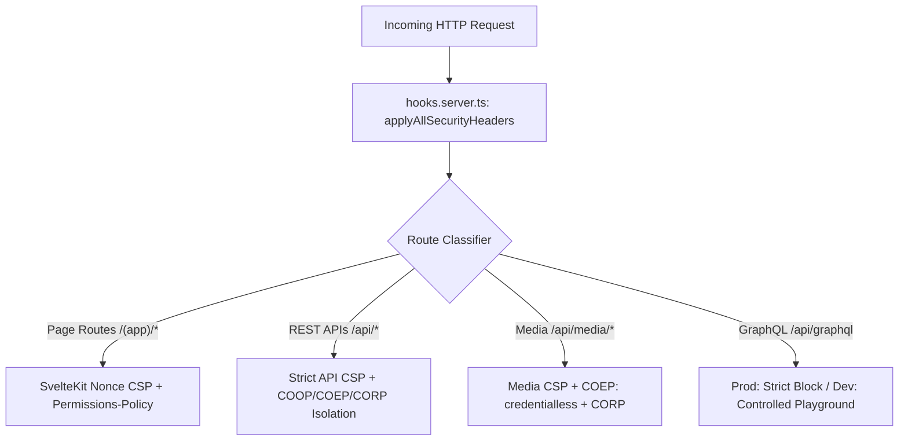

# Content Security Policy & Isolation Headers

SveltyCMS enforces a **multi-tiered, context-aware Content Security Policy (CSP)** and cross-origin isolation headers at the protocol level. Each route domain (Admin GUI, JSON REST APIs, Asset Streaming, and GraphQL Playground) receives an isolated, least-privilege security header profile.

---

## 🛡️ Architecture & Threat Model



### Key Security Objectives:

1. **Eliminate Stored & Reflected XSS**: Zero `'unsafe-inline'` or `'unsafe-eval'` in production API and Page contexts.
2. **Prevent Framing & Clickjacking**: `frame-ancestors 'none'` and `X-Frame-Options: DENY` everywhere.
3. **Cross-Origin Data Leak Isolation**: Spectre and cross-origin resource protection via `Cross-Origin-Opener-Policy: same-origin` and `Cross-Origin-Resource-Policy: same-origin`.
4. **Hardware Sandbox Lockdown**: Explicit `Permissions-Policy` disabling microphone, camera, geolocation, USB, and bluetooth access.

---

## 📋 Route-by-Route Header Profiles

### 1. REST API Endpoints (`/api/*`)

All REST API routes emit the immutable `API_CONTENT_SECURITY_POLICY` constant defined in `src/utils/security/constants.ts`:

```http
Content-Security-Policy: default-src 'self'; script-src 'self'; style-src 'self'; img-src 'self' data: blob:; font-src 'self' data:; connect-src 'self' ws: wss:; media-src 'self'; frame-src 'none'; object-src 'none'; frame-ancestors 'none'; base-uri 'self'; form-action 'self'
Cross-Origin-Opener-Policy: same-origin
Cross-Origin-Embedder-Policy: require-corp
Cross-Origin-Resource-Policy: same-origin
X-Content-Type-Options: nosniff
X-Frame-Options: DENY
```

- **Zero Script Execution**: Prohibits any foreign scripts or inline execution on raw API data responses.
- **WebSocket Support**: Explicitly whitelists `ws:` and `wss:` for real-time collaboration (Yjs CRDT server).
- **Cross-Origin Isolation**: Enforces `require-corp` to ensure cross-origin resources cannot be injected into process memory.

---

### 2. Media & Asset Streaming (`/api/media/*` & `/files/*`)

Asset serving requires relaxed embedder policies so third-party frontends can consume CMS media assets without breaking strict cross-origin isolation:

```http
Cross-Origin-Embedder-Policy: credentialless
Cross-Origin-Resource-Policy: same-origin
X-Content-Type-Options: nosniff
```

- **`credentialless`**: Allows cross-origin image embedding without passing user credentials/cookies, protecting user privacy while supporting remote CDNs and client websites.
- **MIME Sniffing Block**: `nosniff` prevents browser interpretation of polyglot uploaded files.

---

### 3. GraphQL Endpoint (`/api/graphql`)

The GraphQL route adapts its security profile based on the deployment environment:

#### Production Mode (`NODE_ENV=production`):

```http
Content-Security-Policy: default-src 'self'; script-src 'self'; style-src 'self' 'unsafe-inline'; img-src 'self' data: blob:; font-src 'self'; connect-src 'self'; frame-src 'none'; object-src 'none'; base-uri 'self'; form-action 'self'
```

- Introspection is strictly blocked via `NoSchemaIntrospectionCustomRule`.
- Interactive playgrounds are completely disabled.

#### Development / Diagnostic Mode (`ALLOW_GRAPHQL_PLAYGROUND=true`):

```http
Content-Security-Policy: default-src 'self'; script-src 'self' 'unsafe-inline' 'unsafe-eval' https://cdn.jsdelivr.net https://unpkg.com; style-src 'self' 'unsafe-inline' https://cdn.jsdelivr.net https://unpkg.com https://fonts.googleapis.com; font-src 'self' https://fonts.gstatic.com https://cdn.jsdelivr.net; img-src 'self' data: blob: https://cdn.jsdelivr.net; connect-src 'self' https://cdn.jsdelivr.net; frame-src 'none'
Cross-Origin-Embedder-Policy: unsafe-none
```

- Allows pinned CDN dependencies necessary to render the interactive GraphQL IDE.

---

### 4. Admin GUI Pages (`/(app)/*`)

Admin GUI pages are rendered by SvelteKit with a **per-request nonce CSP** configured in `vite.config.ts` (`sveltekit({ csp: { mode: "nonce", … } })`). Every inline `<script>` SvelteKit emits carries the nonce, and the shell script in `src/app.html` opts in with `nonce="%sveltekit.nonce%"`:

```http
Content-Security-Policy: default-src 'self'; script-src 'self' 'strict-dynamic' 'wasm-unsafe-eval' 'nonce-…'; style-src 'self' 'unsafe-inline'; img-src 'self' data: blob: https:; font-src 'self' data: https:; connect-src 'self' https: wss:; media-src 'self' data: blob: https:; frame-src 'self' data: blob: https:; worker-src 'self' blob:; object-src 'none'; base-uri 'self'; form-action 'self'; frame-ancestors 'none'
```

- **Cryptographic Nonces**: SvelteKit mints a fresh 128-bit nonce per SSR request (`crypto.getRandomValues()`), so a nonce from one response cannot authorise a script in another.
- **`'strict-dynamic'`**: host allowlists are ignored for script _loading_; only scripts SvelteKit minted (or scripts created by those) can execute. Injected inline handlers and DOM-injected `<script>` elements are blocked, which is what closes stored/reflected XSS without a brittle domain allowlist.
- **No `'unsafe-eval'`**: JS `eval()` stays blocked. `'wasm-unsafe-eval'` is present only because the optional LiteRT inference worker compiles WebAssembly; it does not re-enable `eval()`.
- **Styles stay inline-friendly**: `style-src 'unsafe-inline'` is deliberate — the admin kit writes `--admin-*` custom properties and the HTML shell uses a style attribute. Scripts never receive `'unsafe-inline'`; style injection is not a script-execution primitive.
- **Framing**: `frame-ancestors 'none'` duplicates `X-Frame-Options: DENY`; `object-src`, `base-uri`, and `form-action` are locked to `'self'`/`'none'`.
- **Cross-origin isolation**: page routes default to `Cross-Origin-Embedder-Policy: require-corp` and `Cross-Origin-Opener-Policy: same-origin`. The one route-scoped exception is the email preview below.
- **Verification**: `tests/unit/hooks/csp-headers.test.ts` asserts that `BASE_HEADERS` never clobbers SvelteKit's nonce policy and that API routes use the strict API policy; the built server can be checked with `curl -sD - http://127.0.0.1:4173/login -o /dev/null | grep -i content-security-policy`.

---

### 5. On-Device AI Worker (Vite bundle)

The on-device machine learning worker (LiteRT.js WebAssembly) runs inside a dedicated Web Worker, but it has **no serving route and no route-specific CSP**. Vite bundles `src/services/ai-client/ai.worker.ts` as a separate chunk, and `runtime.ts` loads it with `new URL("./ai.worker.ts", import.meta.url)`; there is no separate HTTP response that could carry a worker-specific CSP.

If a future deployment adds a worker-specific CSP, it must allow:

```http
Content-Security-Policy: worker-src 'self'; script-src 'self' 'wasm-unsafe-eval'
```

- **WASM Acceleration**: `'wasm-unsafe-eval'` permits SIMD/WASM inference compilation while still forbidding JS `eval()`.

---

### 6. Email Preview Page (`/email-previews`)

The preview renders arbitrary transactional-email HTML inside a sandboxed `srcdoc` iframe (an opaque origin). Under the page default `COEP: require-corp`, every embedded image or font without a CORP header is blocked — including the CMS logo — so the preview would not show what recipients receive.

```http
Cross-Origin-Embedder-Policy: credentialless
```

- **Scoped exception**: `applyAllSecurityHeaders()` sets `credentialless` only for `/email-previews` and `/email-previews/*`; every other page keeps `require-corp`.
- **`credentialless`**: keeps the page isolated from credentialed cross-origin reads while letting no-cors asset requests through — the same policy the media routes use.
- **Logo allowlist**: `/SveltyCMS.png` is the only static asset the pipeline marks `Cross-Origin-Resource-Policy: cross-origin` (`CROSS_ORIGIN_STATIC_ASSETS` in `src/hooks/handle-security-headers.ts`), because templates embed it and static assets skip the normal header pass. Never widen this to a path prefix.

---

## 🔒 Permissions-Policy Hardening

SveltyCMS emits a restrictive `Permissions-Policy` header on all HTTP responses:

```http
Permissions-Policy: geolocation=(), microphone=(), camera=(), display-capture=(), clipboard-read=(), clipboard-write=(self), web-share=(self), payment=(), usb=(), bluetooth=(), accelerometer=(), gyroscope=(), magnetometer=()
```

| Directive              | Policy                 | Purpose                                                                           |
| :--------------------- | :--------------------- | :-------------------------------------------------------------------------------- |
| `camera`, `microphone` | `()` (Disabled)        | Blocks unauthorized recording devices.                                            |
| `geolocation`          | `()` (Disabled)        | Prevents browser location profiling.                                              |
| `clipboard-write`      | `(self)` (Same-origin) | Allows copy-to-clipboard actions (e.g. API keys, slugs) only from the CMS origin. |
| `clipboard-read`       | `()` (Disabled)        | Blocks programmatic clipboard inspection.                                         |
| `usb`, `bluetooth`     | `()` (Disabled)        | Protects host hardware ports against malicious web-serial attacks.                |

---

## 🧪 Automated Test Verification

CSP and header enforcement are continuously tested across the test suite:

- `tests/unit/hooks/defense-in-depth.test.ts` — Validates header presence on all HTTP response codes (200, 401, 403, 404, 500).
- `tests/unit/hooks/csp-headers.test.ts` — Pins the API/GraphQL policy shape and asserts SvelteKit's nonce CSP survives `applyAllSecurityHeaders`/`applySecurityHeaders` on page routes.
- `tests/unit/hooks/handle-turbo-get-lane.test.ts` — Asserts security header parity in Turbo Cache hits.
- `tests/unit/api/graphql-security.test.ts` — Asserts playground CSP gating in production vs development.
